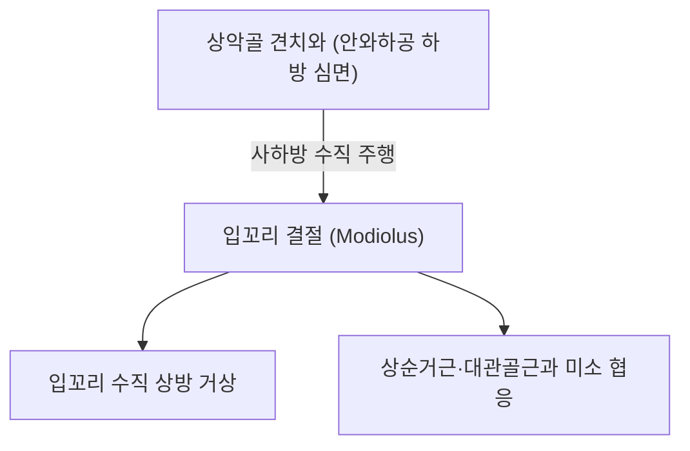

# 🫁 [[구각거근]] (Levator Anguli Oris)

> **핵심 요약 (Key Summary)**:
> [[구각거근]](Levator anguli oris, 입꼬리올림근)은 상악골 견치와(Canine fossa)에서 기시하여 입꼬리 결절(구각 Modiolus)에 정지하는 심층 안면 표정근이다.
> [[안면신경]](CN VII)의 협부 및 관자가지의 지배를 받으며, **입꼬리를 수직 상방으로 견인하여 송곳니를 드러내고 입체적인 미소와 표정 깊이**를 형성한다.
> 임상적으로는 [[안면신경마비]](구안와사), 구각 처짐, 비대칭 미소, 안와하신경(V2) 포착 증후군 감별의 핵심 근육이며, 한의 치료에서는 거료·사백혈 침구 및 심부 매선이 주된 표적이다.

---
## 📌 목차
1. [해부학적 정밀 구조 및 지배 신경/혈관](#1-해부학적-정밀-구조-및-지배-신경혈관)
2. [생체역학·토크 분석 & 근막 사슬 (Biomechanical Synergy)](#2-생체역학토크-분석--근막-사슬-biomechanical-synergy)
3. [근막통증증후군(TP) & 연관통 패턴 (Travell & Simons)](#3-근막통증증후군tp--연관통-패턴-travell--simons)
4. [초음파 해부학(Sonoanatomy) 및 중재 시술 랜드마크](#4-초음파-해부학sonoanatomy-및-중재-시술-랜드마크)
5. [⭐ 원장님 심층 임상 고찰 및 원본 필기 (Clinical Pearls)](#5-원장님-심층-임상-고찰-및-원본-필기-clinical-pearls)
6. [관련 임상 질환 및 운동손상 증후군 총괄](#6-관련-임상-질환-및-운동손상-증후군-총괄)
7. [추나·도수치료(MET/PIR) & 침구·약침·재활 프로토콜](#7-추나도수치료metpir--침구약침재활-프로토콜)
8. [출처 및 학술 참고 문헌 (References)](#8-출처-및-학술-참고-문헌-references)

---
## 1. 해부학적 정밀 구조 및 지배 신경/혈관

| 항목 | 상세 내용 |
| :--- | :--- |
| **기시 (Origin)** | 상악골(Maxilla) 전면의 **견치와(Canine fossa)** — 안와하공(Infraorbital foramen) 바로 하방 |
| **정지 (Insertion)** | 입꼬리 결절(구각 Modiolus) — 상순거근, 대관골근, [[구륜근]], [[구각하제근]] 섬유와 융합 |
| **신경 지배** | [[안면신경]](Facial nerve, **CN VII**)의 협부 가지(Buccal branches) 및 관자가지(Zygomatic branches) |
| **혈관 공급** | 안면동맥(Facial artery)의 상순가지 및 악동맥의 안와하동맥(Infraorbital artery) |
| **해부학적 층 (Layer)** | 안면 표정근 중 **심층(Deep layer)**에 위치하며, 천층의 상순거근(Levator labii superioris)과 소관골근에 의해 덮여 있음 |

### 🔬 해부학 도해 및 단면도

구각거근은 안와하공 바로 아래의 깊은 골면에서 출발하여 사하방으로 내려와 모디올루스에 합류한다. 이 근육의 표층으로는 안와하신경(Infraorbital nerve, V2) 분지들과 안면동맥이 지나가므로, 해부학적 층(layer) 구분이 매우 중요하다.

---
## 2. 생체역학·토크 분석 & 근막 사슬 (Biomechanical Synergy)

* **입꼬리 수직 거상 (Angle Elevation)**:
  * 대관골근이 입꼬리를 상외측(사선)으로 당기는 반면, 구각거근은 **입꼬리를 보다 수직 상방으로 들어올려** 송곳니(Canine tooth)를 노출시키는 독특한 벡터를 형성한다.
* **비순구(팔자주름) 심부 지지대**:
  * 비순구 하부의 깊은 층에서 볼 조직이 처지지 않도록 받쳐주는 심부 서스펜션 역할을 담당한다.
* **모디올루스(Modiolus)의 수직 안정화**:
  * 하방으로 당기는 [[구각하제근]](Depressor anguli oris)과 직접적인 수직 길항 관계를 형성하여 입꼬리의 상하 위치 평형을 조절한다.

---
## 3. 근막통증증후군(TP) & 연관통 패턴 (Travell & Simons)

* **발통점 위치**: 안와하공 직하방 견치와 깊은 곳에 잠재성 또는 활동성 TrP가 형성된다.
* **연관통 양상**:
  * 뺨 중앙부 및 상악 전치부·견치부(앞니 및 송곳니) 부근의 뻐근한 가성 치통.
  * 비익(콧망울) 외측 및 상순의 이상감각과 둔통.
  * 만성적인 얼굴 피로감 및 웃을 때 입꼬리 떨림.

---
## 4. 초음파 해부학(Sonoanatomy) 및 중재 시술 랜드마크

* **초음파 스캔 프로토콜**:
  * 안와하연과 구각 사이의 중간 지점에 고주파 선형 프로브를 위치.
  * 상악골 피질골 바로 위에 위치한 저에코의 구각거근과 그 표층을 덮는 상순거근을 층별로 구별(Wu 2022).
* **안전 마진 및 시술 랜드마크**:
  * **안와하공 및 안와하신경(V2)**: 기시부 상방에 위치하므로, 자침 시 상악 신경통 유발을 방지하기 위해 안와하공 직상방을 찌르지 않도록 하방 1cm 안전 마진 확보.
  * **안면정맥 및 안면동맥**: 구각거근 표층을 비스듬히 가로지르므로 도플러로 혈관 위치를 확인.

---
## 5. ⭐ 원장님 심층 임상 고찰 및 원본 필기 (Clinical Pearls)

> 원장님의 임상 필기와 독창적인 임상 노하우를 바탕으로 한 핵심 지침이다.

1. **상순거근 표층과 구각거근 심층의 층 분리 감각**: 안면 침구 시 2~3mm의 천자 깊이에서는 상순거근만 자극된다. 구각거근을 타깃할 때는 상악골 견치와 골면에 닿는 느낌(Touch the bone)으로 자입해야 정확한 심부 자극이 이루어진다.
2. **구안와사 회복기 '입꼬리 처짐'의 숨은 열쇠**: 환자가 대관골근 운동(미소)은 가능한데 평상시 입꼬리가 처져 침이 고이는 경우, 심층의 구각거근 장력 부전이 원인인 경우가 많다. 거료혈 직자 심부 전침이 특효이다.
3. **안와하신경통과의 감별**: 뺨과 윗입술이 찌릿하다고 호소할 때, 삼차신경 V2 신경통 외에도 견치와 부위 구각거근의 근막 단축 및 유착에 의한 포착성 통증을 반드시 감별해야 한다.

---
## 6. 관련 임상 질환 및 운동손상 증후군 총괄

| 임상 질환 / 증후군 | 병리적 연관 기전 | 주요 증상 및 이학적 검사 | 핵심 교정 타깃 |
| :--- | :--- | :--- | :--- |
| [[안면신경마비]] (구안와사) | 안면신경 협부가지 손상에 따른 거근 마비 | 환측 구각 하수, 송곳니 노출 불능 | 사백·거료 심부 전침 및 매선 |
| 안면 비대칭 및 구각 하수 | 구각거근 약화 및 구각하제근 과긴장 | 무표정 시 입꼬리 비대칭 처짐 | 구각거근 강화 및 하제근 이완 |
| 안와하 신경 포착증 | 견치와 부위 근막 유착 및 신경 압박 | 뺨 및 상순의 이상감각, 저림 | 견치와 도침 미세 감압술 |
| 보톡스 후 상순 처짐 합병증 | 저작근/광대 보톡스 확산으로 인한 마비 | 윗입술 무거움, 발음 불명확(Wu 2022) | 온열 요법, 침구 신경재생 자극 |

---
## 7. 추나·도수치료(MET/PIR) & 침구·약침·재활 프로토콜

* **한의학 경혈 매핑**:
  * 사백(ST2): 안와하공 하방, 구각거근 기시부 상단 접근.
  * 거료(ST3): 견치와 부위 구각거근 근복 심부 취혈.
  * [[지창(地倉)|지창(ST4)]]: 구각 결절 정지부 표적.
  * [[합곡(LI4)|합곡(LI4)]]: 안면부 전반의 기혈 순환 촉진.
* **침구 및 수기 프로토콜**:
  * 거료(ST3) 심부 직자(상악골 골막 근접 10~15mm) 후 미세 저주파 전침 자극(1~2Hz).
  * 구강 내 지두 압박법: 장갑을 착용한 엄지를 뺨 안쪽에 넣고 검지로 견치와 부위를 집어 구각거근을 상방으로 부드럽게 신장.
* **양방 치료 및 의뢰 기준 (Red Flags)**:
  * **급성 발병 안면 편측 마비 + 이마 주름 소실 없음**: 중추성 뇌졸중(뇌경색/뇌출혈) 감별을 위해 즉시 **신경과 뇌 MRI/CT 의뢰**.
  * **상악동 부위 극심한 박동통 및 발열, 농성 비루**: 급성 상악동염 또는 치성 상악동염 감별을 위한 이비인후과/치과 의뢰.
  * **상악골 부위 종괴 촉지 및 감각 이상 지속**: 악안면 종양 감별을 위한 CT/생검 의뢰.

---
## 8. 출처 및 학술 참고 문헌 (References)

1. Dao, D. P. D., Fakoya, A. O., & Le, P. H. (2024). Anatomy, Head and Neck: Levator Anguli Oris Muscle. *StatPearls*. [PMID: 31613468](https://pubmed.ncbi.nlm.nih.gov/31613468/)

2. Wu, W. T., Chang, K. V., & Mezian, K. (2022). Ultrasound imaging of atrophic levator labii superioris and levator anguli oris after aesthetic facial botulinum toxin injection. *Med Ultrason*, 24(4), 493-495. [PMID: 36546444](https://pubmed.ncbi.nlm.nih.gov/36546444/)

3. Standring, S. (2020). *Gray's Anatomy: The Anatomical Basis of Clinical Practice* (42nd ed.). Elsevier, p. 531.

4. Travell, J. G., & Simons, D. G. (1999). *Myofascial Pain and Dysfunction: The Trigger Point Manual*, Vol. 1 (2nd ed.). Williams & Wilkins.
