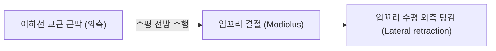

# 🫁 [[구각견근]] (Risorius)

> **핵심 요약 (Key Summary)**:
> [[구각견근]](Risorius, 입꼬리당김근 또는 소근)은 이하선근막(Parotid fascia) 및 [[교근]] 근막에서 기시하여 입꼬리 결절(구각 Modiolus)에 정지하는 표층 안면 표정근이다.
> [[안면신경]](CN VII)의 협부 및 하악연 가지의 지배를 받으며, **입꼬리를 수평 외측으로 당겨 긴장된 미소, 냉소(Smirk) 또는 입술을 가로로 넓히는 표정**을 만든다.
> 인체에서 해부학적 변이(결손율 20~40%)가 매우 큰 근육이며, [[교근]] 축소술(보톡스/침구) 시 약액 확산 또는 손상으로 인한 비대칭 미소 합병증과 [[안면신경마비]]의 감별 표적이다.

---
## 📌 목차
1. [해부학적 정밀 구조 및 지배 신경/혈관](#1-해부학적-정밀-구조-및-지배-신경혈관)
2. [생체역학·토크 분석 & 근막 사슬 (Biomechanical Synergy)](#2-생체역학토크-분석--근막-사슬-biomechanical-synergy)
3. [근막통증증후군(TP) & 연관통 패턴 (Travell & Simons)](#3-근막통증증후군tp--연관통-패턴-travell--simons)
4. [초음파 해부학(Sonoanatomy) 및 중재 시술 랜드마크](#4-초음파-해부학sonoanatomy-및-중재-시술-랜드마크)
5. [⭐ 원장님 심층 임상 고찰 및 원본 필기 (Clinical Pearls)](#5-원장님-심층-임상-고찰-및-원본-필기-clinical-pearls)
6. [관련 임상 질환 및 운동손상 증후군 총괄](#6-관련-임상-질환-및-운동손상-증후군-총괄)
7. [추나·도수치료(MET/PIR) & 침구·약침·재활 프로토콜](#7-추나도수치료metpir--침구약침재활-프로토콜)
8. [출처 및 학술 참고 문헌 (References)](#8-출처-및-학술-참고-문헌-references)

---
## 1. 해부학적 정밀 구조 및 지배 신경/혈관

| 항목 | 상세 내용 |
| :--- | :--- |
| **기시 (Origin)** | 이하선근막(Parotid fascia), [[교근]](Masseter) 천층 근막, 광경근(Platysma) 상부 섬유 |
| **정지 (Insertion)** | 입꼬리 피부 및 점막, 모디올루스(구각 Modiolus) |
| **신경 지배** | [[안면신경]](Facial nerve, **CN VII**) 협부 가지(Buccal branches) 및 하악연 가지(Marginal mandibular branch) |
| **혈관 공급** | 안면동맥(Facial artery)의 상순가지 및 횡안면동맥(Transverse facial artery) |
| **해부학적 변이** | 매우 가변적인 근육으로, 편측 또는 양측 결손율이 인구의 약 20~40%에 이름(Germann 2023, Bae 2014) |

### 🔬 해부학 도해 및 단면도

구각견근은 교근의 표면을 수평으로 가로질러 입꼬리로 향하는 얇은 근섬유 띠이다. 피하지방층 직하방 SMAS층에 위치하며, 하부로는 교근 전연과 볼지방체(Buccal fat pad), 안면동맥이 지나간다.

---
## 2. 생체역학·토크 분석 & 근막 사슬 (Biomechanical Synergy)

* **수평 외측 당김 (Horizontal Lateral Retraction)**:
  * 대관골근이 위뒤쪽으로 당기는 것과 달리, 구각견근은 **순수한 수평 외측 벡터**로 입꼬리를 당겨 입의 가로 폭을 넓힌다.
* **표정 역학 (Grinning & Smirking)**:
  * 눈의 협응이 없는 억지 미소, 쓴웃음(Sardonic grin), 경계하거나 긴장된 표정 시 주로 활성화된다.
* **근막 사슬 연계**:
  * 후방으로는 경부의 광경근(Platysma) 및 이하선 부위 근막과 연결되어 뺨과 목의 표층 장력을 입꼬리로 전달한다.

---
## 3. 근막통증증후군(TP) & 연관통 패턴 (Travell & Simons)

* **발통점 위치**: 교근 전연과 입꼬리 사이 뺨 중앙부 피하 근복에 위치.
* **연관통 양상**:
  * 뺨 외측 및 입꼬리 부위의 가벼운 둔통과 입술 외측의 뻐근함.
  * 입을 크게 벌리거나 하품할 때 뺨이 팽팽하게 당기는 느낌 유발.

---
## 4. 초음파 해부학(Sonoanatomy) 및 중재 시술 랜드마크

* **초음파 스캔 프로토콜**:
  * 교근 전연과 구각 사이를 가로지르는 횡단면 스캔을 시행.
  * 진피 하방 1~2mm 깊이의 천층 저에코 근섬유 띠를 확인(Bae 2014).
* **안전 마진 및 중재 시술 랜드마크**:
  * **교근 전연과의 경계**: 교근 심부 치료 시 구각견근이 덮고 있는 구역을 인지하여 불필요한 표층 신경 마비 예방.
  * **안면동맥(Facial artery)**: 구각견근 심층 바로 아래에서 하악골 하연을 넘어 상행하므로 도플러로 맥박 확인 필수.

---
## 5. ⭐ 원장님 심층 임상 고찰 및 원본 필기 (Clinical Pearls)

> 원장님의 임상 필기와 풍부한 임상 노하우를 바탕으로 한 핵심 지침이다.

1. **사각턱 교근 치료 후 '비대칭 미소' 호소 환자의 주범**: 교근 축소를 위해 하악각 부위에 보톡스를 주입하거나 도침/심부 전침을 시술할 때, 자침점이 교근 전연을 벗어나 전방으로 침범하면 구각견근이 마비되어 웃을 때 입꼬리가 옆으로 벌어지지 않는 비대칭이 발생한다(Bae 2014). 시술 안전선(Safety line)을 반드시 교근 전연 후방으로 설정해야 한다.
2. **구안와사 환자의 수평 개구 대칭성 평가**: 환자에게 이를 드러내며 "이-" 발성을 시켰을 때 구각이 외측으로 벌어지는 정도를 통해 협부/하악연 신경가지의 회복도를 정밀 판정할 수 있다.
3. **가변성 인지**: 환자마다 구각견근의 발달 정도가 천차만별이며 선천적으로 결손된 경우도 많으므로, 좌우 미소 비대칭이 오랜 기간 지속되었다면 근육 결손 변이를 감별해야 한다.

---
## 6. 관련 임상 질환 및 운동손상 증후군 총괄

| 임상 질환 / 증후군 | 병리적 연관 기전 | 주요 증상 및 이학적 검사 | 핵심 교정 타깃 |
| :--- | :--- | :--- | :--- |
| [[안면신경마비]] (구안와사) | 안면신경 협부가치 손상 | "이-" 발성 시 입꼬리 외측 당김 불능 | 지창·협거 침구 및 전침 치료 |
| 의원성 비대칭 미소 | 교근 축소 시술 후 구각견근 마비 | 한쪽 입꼬리만 벌어지는 미소 왜곡 | 마비 측 온열 요법 및 신경 회복 |
| 파상풍 (Tetanus) 의 소경련 | 파상풍 독소에 의한 안면근 지속 수축 | 경련성 쓴웃음(Risus sardonicus) | 즉시 응급 감염 치료 의뢰 |
| 안면 비대칭 보조개 변이 | 구각견근 및 대관골근 부착 이상 | 웃을 때 뺨 부위의 비정상적 함몰 | 근막 유착 평가 및 교정 |

---
## 7. 추나·도수치료(MET/PIR) & 침구·약침·재활 프로토콜

* **한의학 경혈 매핑**:
  * [[지창(地倉)|지창(ST4)]]: 구각견근의 정지부(모디올루스).
  * 대영(ST5): 교근 전연, 구각견근 하부 안면동맥 박동부.
  * 협거(ST6): 구각견근 기시부 후방 근막 연결점.
* **침구 및 수기 프로토콜**:
  * 지창에서 대영 방향으로 피하 수평 사자(천자, 깊이 2~3mm).
  * 뺨 근막 이완술: 입술 외측에서 귀 앞쪽 방향으로 손가락을 밀착하여 수평 장력을 부드럽게 이완.
* **양방 치료 및 의뢰 기준 (Red Flags)**:
  * **전신성 근육 강직 및 개구 불능(Trismus) 동반**: 파상풍(Tetanus) 의심 시 즉시 응급실 이송 및 항독소/면역글로불린 투여 의뢰.
  * **이하선 부위 무통성 고정성 종괴**: 안면신경을 침범하는 이하선 악성 종양 감별을 위해 이비인후과/두경부외과 의뢰.

---
## 8. 출처 및 학술 참고 문헌 (References)

1. Germann, A. M., & Al Khalili, Y. (2023). Anatomy, Head and Neck, Risorius Muscle. *StatPearls*. [PMID: 31082043](https://pubmed.ncbi.nlm.nih.gov/31082043/)

2. Bae, J. H., Choi, D. Y., & Lee, J. G. (2014). The risorius muscle: anatomic considerations with reference to botulinum neurotoxin injection for masseteric hypertrophy. *Dermatol Surg*, 40(12), 1334-1339. [PMID: 25393348](https://pubmed.ncbi.nlm.nih.gov/25393348/)

3. Standring, S. (2020). *Gray's Anatomy: The Anatomical Basis of Clinical Practice* (42nd ed.). Elsevier, p. 532.

4. Travell, J. G., & Simons, D. G. (1999). *Myofascial Pain and Dysfunction: The Trigger Point Manual*, Vol. 1 (2nd ed.). Williams & Wilkins.
