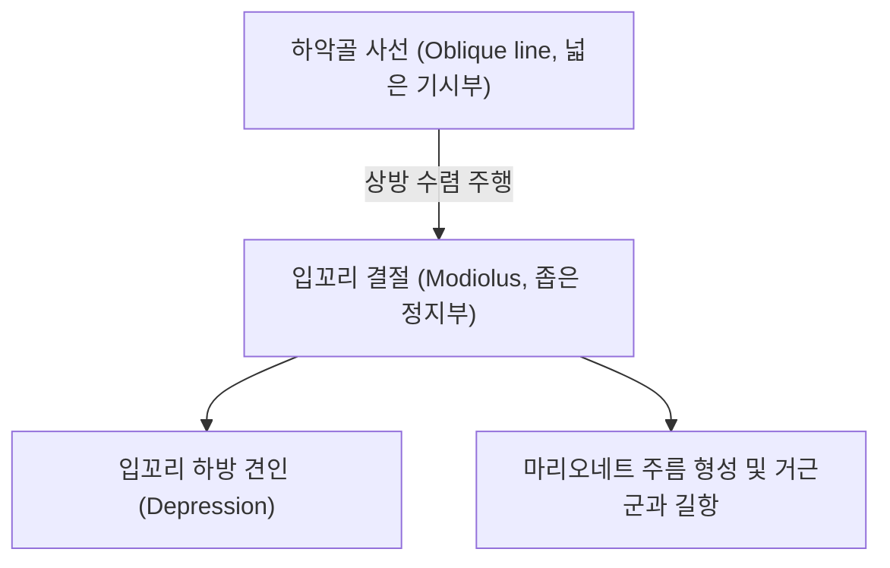

# 🫁 [[구각하제근]] (Depressor Anguli Oris)

> **핵심 요약 (Key Summary)**:
> [[구각하제근]](Depressor anguli oris, 입꼬리내림근)은 하악골 사선(Oblique line)에서 기시하여 입꼬리 결절(구각 Modiolus)에 정지하는 삼각형 형태의 표층 안면 표정근이다.
> [[안면신경]](CN VII)의 하악연 가지(Marginal mandibular branch) 및 협부 가지의 지배를 받으며, **입꼬리를 하외측으로 당겨 슬픔, 실망, 불만의 표정을 만들고 마리오네트 라인(Marionette line)**을 형성한다.
> 임상적으로는 노화성 구각 하수, 꼭두각시 주름, [[안면신경마비]](구안와사) 및 신경 재생 후 연합운동(Synkinesis)의 핵심 병변근이며, 한의 치료에서는 지창·대영 하방 침구, 매선 리프팅 및 도침 감압술의 주요 표적이다.

---
## 📌 목차
1. [해부학적 정밀 구조 및 지배 신경/혈관](#1-해부학적-정밀-구조-및-지배-신경혈관)
2. [생체역학·토크 분석 & 근막 사슬 (Biomechanical Synergy)](#2-생체역학토크-분석--근막-사슬-biomechanical-synergy)
3. [근막통증증후군(TP) & 연관통 패턴 (Travell & Simons)](#3-근막통증증후군tp--연관통-패턴-travell--simons)
4. [초음파 해부학(Sonoanatomy) 및 중재 시술 랜드마크](#4-초음파-해부학sonoanatomy-및-중재-시술-랜드마크)
5. [⭐ 원장님 심층 임상 고찰 및 원본 필기 (Clinical Pearls)](#5-원장님-심층-임상-고찰-및-원본-필기-clinical-pearls)
6. [관련 임상 질환 및 운동손상 증후군 총괄](#6-관련-임상-질환-및-운동손상-증후군-총괄)
7. [추나·도수치료(MET/PIR) & 침구·약침·재활 프로토콜](#7-추나도수치료metpir--침구약침재활-프로토콜)
8. [출처 및 학술 참고 문헌 (References)](#8-출처-및-학술-참고-문헌-references)

---
## 1. 해부학적 정밀 구조 및 지배 신경/혈관

| 항목 | 상세 내용 |
| :--- | :--- |
| **기시 (Origin)** | 하악골(Mandible) 전면의 **사선(Oblique line)** — 전방으로는 하악결합 부근, 후방으로는 이공(Mental foramen) 하방 하악골 하연 |
| **정지 (Insertion)** | 입꼬리 결절(구각 Modiolus) — [[구륜근]], 대관골근, [[구각거근]] 섬유와 교차 결합 |
| **신경 지배** | [[안면신경]](Facial nerve, **CN VII**)의 **하악연 가지(Marginal mandibular branch)** 및 협부 가지 |
| **혈관 공급** | 안면동맥(Facial artery)의 하순가지 및 이신경동맥(Mental artery) |
| **형태적 특징** | 기시부가 넓고 정지부로 가면서 좁아지는 역삼각형 모양으로, 광경근(Platysma) 전방 섬유와 연속 |

### 🔬 해부학 도해 및 단면도

구각하제근은 턱선(하악골 하연)에서 모디올루스로 수직·사선으로 올라가는 표층 삼각형 근육이다. 심층으로는 하순하제근(Depressor labii inferioris)과 이신경(Mental nerve)이 위치한다.

---
## 2. 생체역학·토크 분석 & 근막 사슬 (Biomechanical Synergy)

* **입꼬리 하방 및 외측 견인 (Angle Depression)**:
  * 입꼬리를 강하게 아래로 끌어내려 "입술 삐죽거리기", 슬픔, 회의적인 표정을 완성한다.
* **거근군과의 수직 평형 (Antagonistic Synergy)**:
  * 대관골근 및 [[구각거근]]이 위로 당기는 힘과 구각하제근이 아래로 당기는 힘이 상호 균형을 이루어 평상시 중립적인 수평 구각선을 유지한다.
* **노화와 마리오네트 라인 (Marionette Fold)**:
  * 구각하제근의 과긴장 및 단축, 주변 피하지방 하수는 입꼬리에서 턱선으로 이어지는 깊은 세로 주름(마리오네트 주름)을 초래한다.
* **광경근(Platysma)과의 근막 연쇄**:
  * 구각하제근은 하방으로 광경근과 직접 결합하여 경부의 긴장을 턱과 입술로 전달하는 표층전방선(Superficial Front Line)의 종말 분지 역할을 한다(Brodsky 2026).

---
## 3. 근막통증증후군(TP) & 연관통 패턴 (Travell & Simons)

* **발통점 위치**: 하악골 사선 직상방 근복 중앙부에 형성된다.
* **연관통 양상**:
  * 하악골 전방부 및 턱 끝(Chin) 부위로 뻐근하게 조이는 통증.
  * 하순(아랫입술) 외측의 둔한 압통 및 음식 섭취 시 턱 피로감.

---
## 4. 초음파 해부학(Sonoanatomy) 및 중재 시술 랜드마크

* **초음파 스캔 프로토콜**:
  * 구각에서 하악골 하연을 잇는 수직선상에 선형 프로브를 위치.
  * 표층의 구각하제근과 심층의 하순하제근 및 이공(Mental foramen)의 음향 음영을 확인.
* **안전 마진 및 시술 랜드마크**:
  * **안면신경 하악연가지**: 하악골 하연을 따라 주행하므로 하악골 경계부 시술 시 신경 손상(구순 비대칭) 회피.
  * **안면동맥 및 정맥**: 구각하제근 외측연을 바짝 스쳐 지나가므로 도플러 확인 필수.

---
## 5. ⭐ 원장님 심층 임상 고찰 및 원본 필기 (Clinical Pearls)

> 원장님의 임상 필기와 독창적인 임상 노하우를 바탕으로 한 핵심 지침이다.

1. **마리오네트 주름 리프팅의 핵심 비밀**: 많은 임상의들이 입꼬리 처짐 치료 시 광대(관골근)만 당겨 올리려고 한다. 하지만 아래에서 밧줄처럼 붙잡고 있는 **구각하제근의 과긴장을 먼저 이완시키지 않으면 거상 효과가 오래가지 못한다**. 구각하제근 기시부 도침 및 이완 침 치료가 선행되어야 한다.
2. **구안와사 후유증 시 '반대편' 구각하제근의 보상적 단축**: 안면마비 환자에서 건측(정상 측) 구각하제근이 보상적으로 과활성화되어 마비 측보다 건측 입꼬리가 아래로 끌려내려가 얼굴 전체가 심하게 비틀려 보일 수 있다. 건측 하제근의 긴장 완화가 전체 대칭 회복의 핵심이다.
3. **이신경(Mental nerve) 손상 주의**: 구각하제근 심층에 위치한 이공 부위를 강하게 직자하면 아랫입술 감각 저하(저림)가 발생할 수 있으므로, 하악골 사선을 따라 피하 사자하는 것이 안전하다.

---
## 6. 관련 임상 질환 및 운동손상 증후군 총괄

| 임상 질환 / 증후군 | 병리적 연관 기전 | 주요 증상 및 이학적 검사 | 핵심 교정 타깃 |
| :--- | :--- | :--- | :--- |
| 노화성 구각 하수 및 마리오네트선 | 구각하제근 과긴장 단축 및 거근군 약화 | 우울한 인상, 입꼬리 깊은 주름 | 구각하제근 이완 도침 및 매선 |
| [[안면신경마비]] (구안와사) | 하악연가지 마비로 인한 하제 기능 소실 | 아랫입술 비대칭, 음식물 잔류 | 하악연 전침 및 구각 교정 |
| 표정근 연합운동 (Synkinesis) | 신경 재생 이상으로 미소 시 하제근 동시 수축 | 웃을 때 입꼬리가 올라가지 못하고 경련 | 구각하제근 이전술 또는 도침 박리(Sakuma 2026) |
| 무턱 증후군 및 턱끝 자갈 주름 | 구각하제근과 이근의 만성 과긴장 | 턱 끝 표면 귤껍질 모양 주름 | 하제근-이근 복합 이완 침구 |

---
## 7. 추나·도수치료(MET/PIR) & 침구·약침·재활 프로토콜

* **한의학 경혈 매핑**:
  * [[지창(地倉)|지창(ST4)]]: 구각하제근 정지부.
  * 대영(ST5): 하악골 하연, 기시부 외측 경계.
  * 협거(ST6): 저작근과 안면 하부 근막 연결점.
* **침구 및 수기 프로토콜**:
  * 하악골 사선 부착부 도침 미세 절개 및 이완술.
  * 입꼬리 상방 견인 수기(PIR): 입꼬리를 검지로 가볍게 위로 들어 올린 상태에서 환자에게 입꼬리를 아래로 내리는 약한 등척성 저항(5초) 후 호기 시 상방으로 신장.
* **양방 치료 및 의뢰 기준 (Red Flags)**:
  * **아랫입술 및 턱 부위 편측 무감각 (Numb Chin Syndrome)**: 하악골 전이암(유방암, 폐암, 림프종 등)의 위험 신호이므로 즉시 **종양내과/구강악안면외과 정밀 CT/MRI 의뢰**.
  * **하악골 부위 발열, 동통 및 누공성 배농**: 하악골 골수염(Osteomyelitis) 감별을 위한 항생제 및 외과적 치료 의뢰.

---
## 8. 출처 및 학술 참고 문헌 (References)

1. Sakuma, H., Matoba, E., & Fujii, T. (2026). Dynamic augmentation of lip levator function via depressor anguli oris transfer for post-facial paralysis synkinesis. *JPRAS Open*, 49, 10-18. [PMID: 42099755](https://pubmed.ncbi.nlm.nih.gov/42099755/)

2. Standring, S. (2020). *Gray's Anatomy: The Anatomical Basis of Clinical Practice* (42nd ed.). Elsevier, p. 532.

3. Travell, J. G., & Simons, D. G. (1999). *Myofascial Pain and Dysfunction: The Trigger Point Manual*, Vol. 1 (2nd ed.). Williams & Wilkins.
