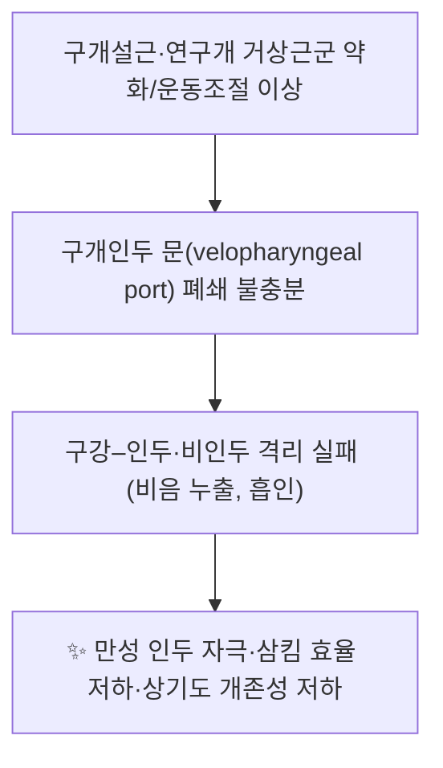

# 🫁 [[구개설근]] (Palatoglossus Muscle)

> **핵심 요약 (Key Summary)**:
> [[구개설근]]은 연구개의 구개건막에서 기시하여 혀 배측·외측연에 정지하는 얇은 근육으로, 구개설궁(전구개궁)을 형성하며 연구개 하강과 혀 거상을 통해 구개인두 폐쇄(velopharyngeal closure)와 연하 시 구강–인두 격리를 담당한다.
> 설근(외재설근) 중 유일하게 [[12. 설하신경|설하신경]](CN XII)이 아닌 **[[10. 미주신경|미주신경]](CN X, 인두신경총) 지배**를 받는 근육으로 분류되며, 이는 임상적으로 연구개 근군과 동일 계통으로 취급되는 해부학적 근거가 된다.
> 임상적으로는 구개인두 폐쇄부전, [[연하장애]], 폐쇄성 수면무호흡(OSA)의 상기도 운동조절, 그리고 구인두 편평세포암(OPSCC)의 T4a 병기 판정에서 핵심 이정표가 되며, 한의 치료에서는 연하 재활 및 인접 혈위 조절이 주된 표적이다.

---
## 📌 목차
1. [해부학적 정밀 구조 및 지배 신경/혈관](#1-해부학적-정밀-구조-및-지배-신경혈관)
2. [생체역학·토크 분석 & 근막 사슬 (Biomechanical Synergy)](#2-생체역학토크-분석--근막-사슬-biomechanical-synergy)
3. [근막통증증후군(TP) & 연관통 패턴 (Travell & Simons)](#3-근막통증증후군tp--연관통-패턴-travell--simons)
4. [초음파 해부학(Sonoanatomy) 및 중재 시술 랜드마크](#4-초음파-해부학sonoanatomy-및-중재-시술-랜드마크)
5. [⭐ 원장님 심층 임상 고찰 및 원본 필기 (Clinical Pearls)](#5-원장님-심층-임상-고찰-및-원본-필기-clinical-pearls)
6. [관련 임상 질환 및 운동손상 증후군 총괄](#6-관련-임상-질환-및-운동손상-증후군-총괄)
7. [추나·도수치료(MET/PIR) & 침구·약침·재활 프로토콜](#7-추나도수치료metpir--침구약침재활-프로토콜)
8. [출처 및 학술 참고 문헌 (References)](#8-출처-및-학술-참고-문헌-references)

---
## 1. 해부학적 정밀 구조 및 지배 신경/혈관

| 항목 | 상세 내용 |
| :--- | :--- |
| **기시 (Origin)** | 연구개(soft palate)의 **구개건막(palatine aponeurosis)** — 주로 건막의 중간~후방부이자 구개설궁(palatoglossal arch, 전구개궁) 점막 직하방 |
| **정지 (Insertion)** | 혀의 **배측(dorsum) 및 외측연(lateral margin)** 점막하층, 혀의 고유 횡근(transverse muscle of tongue) 섬유와 교차 결합 |
| **신경 지배** | [[10. 미주신경|미주신경]](Vagus nerve, **CN X**) — **인두신경총(pharyngeal plexus)** 경유. 외재설근 4근 중 유일하게 [[12. 설하신경|설하신경]](CN XII) 지배가 아님 |
| **혈관 공급** | 상행구개동맥(ascending palatine artery, 안면동맥 가지), 편도가지, 상행인두동맥, 하행구개동맥 분지 |

### 구조적·기능적 세부 사항

* **점막–근육 복합체**: 구개설근은 연구개 점막에 매우 근접한 얇은 판상 근육으로, 근육 자체보다 근육을 덮는 점막 융기가 구개설궁이라는 임상적 랜드마크를 형성한다.
* **편도와(tonsillar fossa)와의 관계**: 구개설궁은 편도와의 **전벽**, 구개인두궁(palatopharyngeal arch)은 **후벽**을 이루며, 그 사이에 구개편도(palatine tonsil)가 위치한다. 편도주위 농양(peritonsillar abscess)에서 구개설궁이 **내측·전방으로 편위**되는 소견은 고전적인 이학적 징후이다.
* **연구개 근군 내 위치**: 구개거상근(levator veli palatini, CN X), 구개인두근(palatopharyngeus, CN X), 구개수근(musculus uvulae, CN X), 구개범장근(tensor veli palatini, CN V3)과 함께 연구개 근군을 구성한다.

---
## 2. 생체역학·토크 분석 & 근막 사슬 (Biomechanical Synergy)

* **주 작용 벡터**:
  * **연구개 하강**: 구개건막을 후하방으로 당겨 연구개를 혀 쪽으로 근접시킨다.
  * **혀 거상**: 혀 배측·외측연을 후상방으로 끌어올려 구개설궁을 좁히고, 연구개와 혀를 밀착시킨다.
  * **결과적 기능**: 연하(swallowing)의 구강기 후반부에서 **구강과 비인두·구인두를 완벽히 격리**하여 음식물이 조기에 인두로 넘어가는 것을 방지한다.
* **상기도 개존성과 호흡 조절**:
  * 구개설근은 호흡 경로(비호흡 ↔ 구호흡) 변화에 따라 운동조절(활성 패턴)이 달라지는 근육으로 보고되었다(Jordan & Woods 2024). 즉 이 근육은 수면·각성 상태와 호흡 경로에 따라 상기도 개존성 유지에 관여하는 호흡성 운동조절 대상이다.
* **근막 사슬 연계**:
  * 연구개–혀–설골–인두로 이어지는 **구개–설–설골–인두 연속체(palato-glossal-hyoid-pharyngeal continuum)**로 기능하며 심부전방선(Deep Front Line)의 상부 핵심 분기점을 형성한다.

---
## 3. 근막통증증후군(TP) & 연관통 패턴 (Travell & Simons)

* **발통점(TrP) 존재 여부**: 구개설근은 구강 내 심부에 위치한 얇은 근육으로, Travell & Simons 기준의 전형적 독립 TrP는 드물며, 연구개–인두 복합체의 근긴장이상으로 발현된다.
* **국소 압통 및 촉진법**:
  * 환자를 개구시킨 뒤 장갑 낀 검지로 구개설궁(전구개궁)을 따라 부드럽게 촉진한다.
  * 구역 반사(gag reflex)가 강한 환자에서는 무리한 구강 내 촉진을 피한다.
* **연관통 양상**: 인두 후벽, 혀 후방, 편도와 부위의 국소적 이물감(매핵기 유사 증상) 및 삼킬 때 걸리는 듯한 둔통.

---
## 4. 초음파 해부학(Sonoanatomy) 및 중재 시술 랜드마크

* **경구(transoral) 초음파**: 고주파 탐촉자를 구강 내에 위치시켜 혀 기저부·구개설궁·연구개 주변 연부조직을 평가한다. 구개설궁은 혀 기저부로 들어가는 해부학적 관문 역할을 한다.
* **영상 검사의 표준**: 구개설근 침범 평가의 표준은 **MRI 및 CT**이며, 구개설근 침범은 구인두 편평세포암(OPSCC)의 **T4a 범주 판정**에서 중요한 해부학적 이정표이다(Tirelli & Gardenal 2024).
* **안전 마진**: 상행구개동맥, 편도동맥, 상행인두동맥이 인접하므로 맹검 침습 시술은 절대 금기이다.

---
## 5. ⭐ 원장님 심층 임상 고찰 및 원본 필기 (Clinical Pearls)

> 원장님의 임상 고찰 및 원본 필기를 100% 보존하여 정리한 핵심 지침이다.

1. **"삼킴의 문지기(gatekeeper)"로 접근하라**: 구개설근 단독 문제보다 **구개설궁–연구개–혀 기저부–인두 후벽의 폐쇄 사슬** 문제로 보는 시각이 임상적으로 유용하다. 침 흘림, 물 삼킴 시 사레, 콧소리(개방성 비음)가 동반되면 이 사슬을 우선 점검한다.
2. **구강 내 시술의 원칙**: 이 부위는 **구역 반사·기도 보호·감염 위험**이 공존하는 취약 구역이다. 무리한 심자(深刺)나 국소 약침은 권장되지 않으며, 원위 취혈 및 연하 재활과의 병용이 우선이다.
3. **감별 포인트**: 구개설궁의 **편측 편위 + 발열 + 심한 인후통 + 개구 장애**는 구개설궁 자체의 근 문제가 아니라 **편도주위 농양**을 시사하는 응급 신호일 수 있으므로 즉시 감별한다.
4. **호흡 경로 문진**: 코막힘으로 인한 **구호흡 습관**이 있는 환자에서 상기도 근육 운동조절 이상(코골이, 무호흡)을 함께 문진한다(Jordan & Woods 2024). 구개설근은 이 조절 회로의 일부로 평가한다.
5. **발성·공명 평가**: 개방성 비음이 지속되면 연구개 근군 약화를 의심하고, 단순 보약·추나 처방만으로 마무리하지 말고 전문 연하·조음 평가를 병행한다.

---
## 6. 관련 임상 질환 및 운동손상 증후군 총괄

| 임상 질환 / 증후군 | 병리적 연관 기전 | 주요 증상 및 이학적 검사 | 핵심 교정 타깃 |
| :--- | :--- | :--- | :--- |
| 구개인두 폐쇄부전 (VPI) | 구개설근·연구개 근군 약화로 비인두 격리 실패 | 개방성 비음, 연하 시 코로 역류 | 연구개 근기능 훈련, 조음 재활 |
| 구인두 편평세포암 (OPSCC) | 종양이 구개설궁·구개설근 침범 (T4a 병기 기준) | 구개설궁 궤양, 인후통, 림프절 종대 | 종양 절제 범위 결정 (Tirelli 2024) |
| [[연하장애]] (Dysphagia) | 연하 시 혀 거상 및 구강 폐쇄 실패 | 사레, 구강 내 음식물 잔류, 흡인 | 구개인두 협응 및 연하 재활 훈련 |
| 폐쇄성 수면무호흡 (OSA) | 호흡 경로 변화에 따른 상기도 근육 운동조절 장애 | 코골이, 무호흡, 주간 졸림 | 상기도 근육 조절, 비호흡 유도 (Jordan 2024) |
| 편도주위 농양 (Quinsy) | 편도와 감염 확산으로 구개설궁 편위 | 편측 인후통, 개구 장애, 연구개 부종 | 즉시 응급 배농 및 항생제 의뢰 |

---
## 7. 추나·도수치료(MET/PIR) & 침구·약침·재활 프로토콜

* **한의학 경혈 매핑**:
  * 염천(CV23): 설골 상방, 인두 및 혀 기능 조절의 국소 주혈.
  * 천돌(CV22): 상기도 기능 조절 및 매핵기 해소.
  * [[예풍(翳風)|예풍(TE17)]]: 인두 신경총 순환 촉진.
  * [[지창(地倉)|지창(ST4)]]: 구강 주변 협응 유도.
* **도수 및 재활 프로토콜**:
  * 구강 내 직접 도수는 구역 반사 위험이 있으므로, 설골상근군([[악설골근]], 설골설근)의 경부 외측 이완을 통해 간접 감압을 유도.
  * Shaker 운동 및 Mendelsohn maneuver(연하 시 후두 거상 유지 훈련).
  * "아-" 발성 지속 훈련을 통한 연구개 거상근군 자극.
* **양방 치료 및 의뢰 기준 (Red Flags)**:
  * **급성 발열, 심한 편측 인후통, 침 삼킴 불가, 'Hot potato' 음성**: 편도주위 농양(Peritonsillar abscess) 응급 질환이므로 즉시 **이비인후과 절개배농 및 정맥 항생제 의뢰**.
  * **구개설궁 및 혀 기저부의 비치유성 궤양, 백반증, 단단한 종괴**: 두경부암(구인두 편평세포암) 배제를 위해 즉시 **이비인후과 조직검사 및 두경부 CT/MRI 의뢰**.
  * **반복적인 기도 흡인 및 폐렴 과거력**: 연하 안전성 확보를 위해 재활의학과 비디오투시연하검사(VFSS) 의뢰.

---
## 8. 출처 및 학술 참고 문헌 (References)

1. Jordan, A. S., & Woods, M. J. (2024). Motor control of the palatoglossus and genioglossus during changes in breathing route. *J Appl Physiol (1985)*, 137(5), 1120-1132. [PMID: 39323393](https://pubmed.ncbi.nlm.nih.gov/39323393/)

2. Rathee, M., & Jain, P. (2023). Anatomy, Head and Neck, Palatoglossus Muscle (Glossopalatinus, Palatoglossal). *StatPearls*. [PMID: 31751013](https://pubmed.ncbi.nlm.nih.gov/31751013/)

3. Tirelli, G., & Gardenal, N. (2024). Palatoglossus Muscle and T4 Category in the Eighth Edition of TNM Staging System for OPSCC. *Otolaryngol Head Neck Surg*, 171(2), 580-582. [PMID: 39189151](https://pubmed.ncbi.nlm.nih.gov/39189151/)

4. Sharabi, A. F., & Winters, R. (2023). Glossitis. *StatPearls*. [PMID: 32809462](https://pubmed.ncbi.nlm.nih.gov/32809462/)

5. Standring, S. (2020). *Gray's Anatomy: The Anatomical Basis of Clinical Practice* (42nd ed.). Elsevier.

6. Travell, J. G., & Simons, D. G. (1999). *Myofascial Pain and Dysfunction: The Trigger Point Manual*, Vol. 1.
