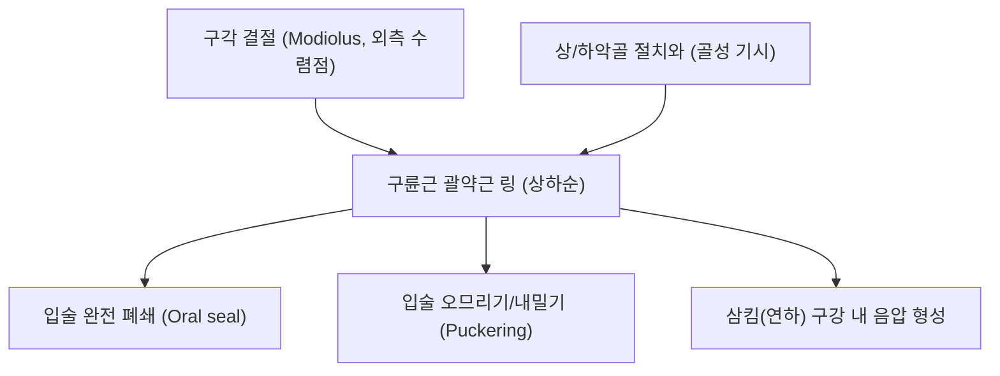

# 🫁 [[구륜근]] (Orbicularis Oris)

> **핵심 요약 (Key Summary)**:
> [[구륜근]](Orbicularis Oris, 입둘레근)은 상악골/하악골 및 구각 결절(구각 Modiolus)에서 기시하여 입술 전체의 피부와 점막을 고리 형태로 감싸는 복합 괄약근성 안면 표정근이다.
> [[안면신경]](CN VII)의 협부 및 하악연 가지의 지배를 받으며, **입술 폐쇄(Oral seal), 입술 내밀기/오므리기 및 정확한 조음(양순음 발성)과 삼킴(연하) 압력 형성**을 주도한다.
> 임상적으로는 [[안면신경마비]](구안와사), 음식물 흘림(Oral incompetence), [[연하장애]], 뇌졸중 후유증의 핵심 병변근이며, 한의 치료에서는 지창·인중·승장혈 침구, 매선 및 입술 폐쇄 재활 훈련이 주된 표적이다.

---
## 📌 목차
1. [해부학적 정밀 구조 및 지배 신경/혈관](#1-해부학적-정밀-구조-및-지배-신경혈관)
2. [생체역학·토크 분석 & 근막 사슬 (Biomechanical Synergy)](#2-생체역학토크-분석--근막-사슬-biomechanical-synergy)
3. [근막통증증후군(TP) & 연관통 패턴 (Travell & Simons)](#3-근막통증증후군tp--연관통-패턴-travell--simons)
4. [초음파 해부학(Sonoanatomy) 및 중재 시술 랜드마크](#4-초음파-해부학sonoanatomy-및-중재-시술-랜드마크)
5. [⭐ 원장님 심층 임상 고찰 및 원본 필기 (Clinical Pearls)](#5-원장님-심층-임상-고찰-및-원본-필기-clinical-pearls)
6. [관련 임상 질환 및 운동손상 증후군 총괄](#6-관련-임상-질환-및-운동손상-증후군-총괄)
7. [추나·도수치료(MET/PIR) & 침구·약침·재활 프로토콜](#7-추나도수치료metpir--침구약침재활-프로토콜)
8. [출처 및 학술 참고 문헌 (References)](#8-출처-및-학술-참고-문헌-references)

---
## 1. 해부학적 정밀 구조 및 지배 신경/혈관

| 항목 | 상세 내용 |
| :--- | :--- |
| **기시 (Origin)** | • 상악골 전면 절치와(Incisive fossa) 및 비중격(Septum of nose) • 하악골 전면 절치와 및 구각 결절(구각 Modiolus) |
| **정지 (Insertion)** | 상하순의 피부, 구순 점막 및 정중선에서 반대측 구륜근 섬유와 교차 융합 |
| **신경 지배** | [[안면신경]](Facial nerve, **CN VII**) 협부 가지(Buccal branches) 및 하악연 가지(Marginal mandibular branch) |
| **혈관 공급** | 안면동맥의 상순동맥(Superior labial artery) 및 하순동맥(Inferior labial artery) |
| **조직학적 구조** | 단순한 고리형 괄약근이 아니며, **내인성 섬유(Intrinsic fibers)**와 뺨·턱 표정근이 유입되는 **외인성 섬유(Extrinsic fibers)**의 4중 층상 복합체(Rogers 2009) |

### 🔬 해부학 도해 및 단면도

구륜근은 입술 주변을 둥글게 감싸며 모든 표정근(관골근, 구각거근, 구각하제근, 협근 등)의 힘을 한곳으로 모아주는 입술의 조리개 밸브이다. 상하순동맥은 구륜근의 점막측 심면(구순 점막 직하방 3~6mm 깊이)을 따라 수평 주행한다.

---
## 2. 생체역학·토크 분석 & 근막 사슬 (Biomechanical Synergy)

* **입술 폐쇄 및 구강 내 압력 형성 (Oral Seal & Competence)**:
  * 음식물이나 침이 밖으로 새지 않도록 상하순을 단단히 밀봉하여 삼킴(연하) 시 인두로 볼루스(음식물 덩어리)를 밀어 넣는 강력한 구강 내 음압을 생성한다.
* **입술 오므리기 및 내밀기 (Puckering & Protrusion)**:
  * 휘파람 불기, 빨대 사용, 촛불 끄기 등 정밀한 구순 직경 조절을 수행한다.
* **자음 조음 및 발성 명료도 (Articulation)**:
  * 양순음(ㅁ, ㅂ, ㅍ / m, b, p) 발음 시 상하순을 강하게 밀착시켰다가 파열시키는 정밀한 음성 제어 메커니즘을 담당한다.

---
## 3. 근막통증증후군(TP) & 연관통 패턴 (Travell & Simons)

* **발통점 위치**: 상순 및 하순의 결절 부위 또는 구각 모디올루스 연결부에 형성된다.
* **연관통 양상**:
  * 입술 주변 피부 및 잇몸으로 찌르는 듯한 국소 압통과 얼얼함.
  * 말을 많이 하거나 악기(금관/목관악기) 연주 시 입술 주변의 경련성 피로 및 마비감.

---
## 4. 초음파 해부학(Sonoanatomy) 및 중재 시술 랜드마크

* **초음파 스캔 프로토콜**:
  * 입술 홍순 경계(Vermilion border)에 고주파 선형 프로브를 수직 거치.
  * 표피 직하방의 얇은 피하지방, 그 아래의 저에코 구륜근층, 그리고 점막하층을 확인.
* **안전 마진 및 시술 랜드마크**:
  * **상/하순동맥(Labial arteries)**: 구륜근과 구순 점막 사이(깊이 3~6mm)에 위치하며 강한 박동성을 보인다. 필러, 매선, 약침 시술 시 점막측 깊은 층을 피하고 피하 천층을 타깃하여 동맥 색전 및 혈종을 예방해야 한다.

---
## 5. ⭐ 원장님 심층 임상 고찰 및 원본 필기 (Clinical Pearls)

> 원장님의 임상 필기와 독창적인 임상 노하우를 100% 보존한 핵심 지침이다.

### 1) 구안와사(Bell's Palsy)와 음식물 흘림 (원장님 팁)
* 안면신경마비 시 구륜근 마비로 입술을 꽉 다물지 못해 물을 마실 때 마비 측 입꼬리로 물이 주르륵 새고, 식사 시 볼과 잇몸 사이에 음식물이 끼는 증상이 호발한다.
* 치료 시 지창·협거·인중 혈위 매선 및 구강 내 근막 자극을 통해 입술 조임력(Lip-closing force)을 회복시키는 것이 환자의 일상생활 삶의 질 개선에 가장 시급하다.

### 2) 중풍 후유증, 파킨슨병 및 연하장애 (원장님 팁 100% 보존)
* 뇌성마비, 중풍, 파킨슨병 환자에서 구륜근 긴장도 저하는 삼킴 압력 붕괴로 이어져 침 흘림(Drooling) 및 흡인성 폐렴 위험을 급격히 증가시킨다.
* 승장·인중 혈위 전침 자극 및 입술 저항 운동(Lip closure training, 단추 당기기 운동)을 병행 지도하여 구강기 연하 압력을 보존해야 한다.

---
## 6. 관련 임상 질환 및 운동손상 증후군 총괄

| 임상 질환 / 증후군 | 병리적 연관 기전 | 주요 증상 및 이학적 검사 | 핵심 교정 타깃 |
| :--- | :--- | :--- | :--- |
| [[안면신경마비]] (구안와사) | 안면신경 협부/하악연가지 손상 | 입술 폐쇄 불능, 물·음식물 흘림 | 지창·인중·승장 전침 및 매선 |
| [[연하장애]] (Dysphagia) | 구륜근 괄약근 긴장도 저하로 구강 폐쇄 실패 | 구강기 삼킴 곤란, 침 흘림, 흡인 | 승장·인중 전침, 입술 저항 운동 |
| 뇌졸중 후유 구음장애 | 구륜근 운동실조에 따른 양순음 조음 장애 | 발음 불명확(ㅁ, ㅂ, ㅍ 왜곡) | 조음 재활 훈련 및 안면 침구 |
| 구순구개열 수술 후 반흔 | 구륜근 섬유의 선천적 결손 및 수술 반흔 | 윗입술 비대칭, 구륜근 연속성 소실 | 반흔 유착 완화 도침 및 재활 |

---
## 7. 추나·도수치료(MET/PIR) & 침구·약침·재활 프로토콜

* **한의학 경혈 매핑**:
  * [[지창(地倉)|지창(ST4)]]: 구각 모디올루스 부위 구륜근 외측 정지점.
  * 인중(GV26): 상순 중앙부 구륜근 상부 취혈.
  * 승장(CV24): 하순 중앙부 구륜근 하부 취혈.
  * 거료(ST3), 화료(LI19): 상순 외측 근섬유 조절.
* **침구 및 수기 프로토콜**:
  * 지창에서 입술 중앙을 향해 피하 수평 자침(깊이 3~5mm 천자).
  * 인중-승장 저주파 전침(2Hz, 부드러운 오므리기 유도).
  * 구순 저항 운동(Lip closure exercise): 설압자나 멸균 거즈를 입술 사이에 물고 빠지지 않도록 버티는 등척성 저항 훈련.
* **양방 치료 및 의뢰 기준 (Red Flags)**:
  * **급성 편측 입술 마비 + 구음 장애 + 편측 상하지 위약/저림**: 급성 뇌경색/뇌출혈(Stroke)의 핵심 징후이므로 즉시 119 구급대를 통한 **응급실 뇌졸중 센터 의뢰**.
  * **만성 침 흘림 및 연하 곤란 환자에서 고열, 호흡곤란, 화농성 객담 동반**: 흡인성 폐렴(Aspiration pneumonia) 의심 시 즉시 호흡기내과 정밀 흉부 X-ray/CT 및 항생제 치료 의뢰.

---
## 8. 출처 및 학술 참고 문헌 (References)

1. Anatomy, Head and Neck, Orbicularis Oris Muscle. *StatPearls*. 2023. [PMID: 31424753](https://pubmed.ncbi.nlm.nih.gov/31424753/)

2. Rogers, C. R., Mooney, M. P., Smith, T. D., et al. (2009). Comparative microanatomy of the orbicularis oris muscle between chimpanzees and humans: evolutionary divergence of lip function. *J Anat*, 214(1), 36-44. [PMID: 19166471](https://pubmed.ncbi.nlm.nih.gov/19166471/)

3. Standring, S. (2020). *Gray's Anatomy: The Anatomical Basis of Clinical Practice* (42nd ed.). Elsevier, p. 532.

4. Travell, J. G., & Simons, D. G. (1999). *Myofascial Pain and Dysfunction: The Trigger Point Manual*, Vol. 1 (2nd ed.). Williams & Wilkins.
