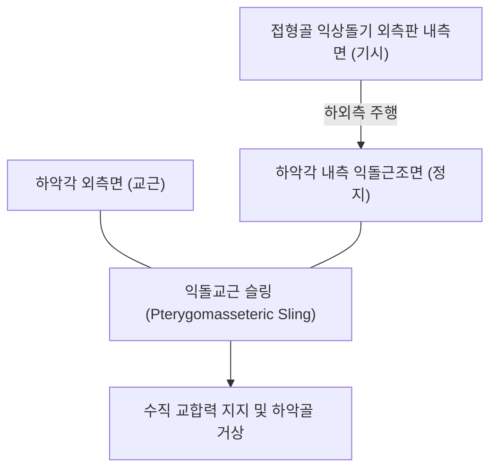
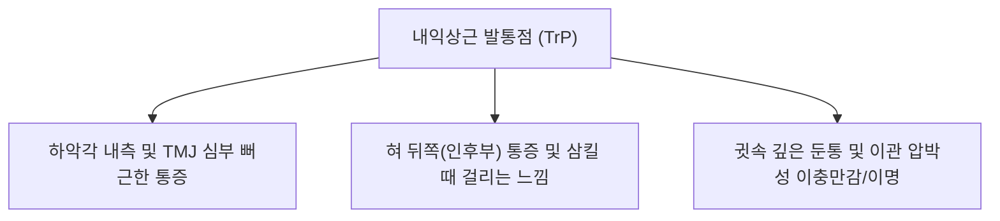

# 🫁 [[내익상근]] (Medial Pterygoid)

> **핵심 요약 (Key Summary)**:
> [[내익상근]](Medial Pterygoid, 안쪽날개근)은 접형골 익상돌기 외측판 내측면 및 상악결절에서 기시하여 하악각 내측면 익돌근조면에 정지하는 심부 저작 근육이다.
> [[5. 삼차신경|삼차신경]](CN V3) 하악신경 내익상근가지의 지배를 받으며, **하악골 거상(강력한 폐구), 전방 돌출 및 반대측 측방 맷돌질(Grinding) 운동**을 주도한다.
> 하악각 외측의 [[교근]]과 함께 **익돌교근 슬링(Pterygomasseteric sling)**을 이루어 하악골을 받치며, [[턱관절 통증|턱관절 장애(TMD)]], 개구 장애(Trismus), 이관(Eustachian tube) 압박성 귀 먹먹함의 핵심 병변근이다.

---
## 📌 목차
1. [해부학적 정밀 구조 및 지배 신경/혈관](#1-해부학적-정밀-구조-및-지배-신경혈관)
2. [생체역학·토크 분석 & 근막 사슬 (Biomechanical Synergy)](#2-생체역학토크-분석--근막-사슬-biomechanical-synergy)
3. [근막통증증후군(TP) & 연관통 패턴 (Travell & Simons)](#3-근막통증증후군tp--연관통-패턴-travell--simons)
4. [초음파 해부학(Sonoanatomy) 및 중재 시술 랜드마크](#4-초음파-해부학sonoanatomy-및-중재-시술-랜드마크)
5. [⭐ 원장님 심층 임상 고찰 및 원본 필기 (Clinical Pearls)](#5-원장님-심층-임상-고찰-및-원본-필기-clinical-pearls)
6. [관련 임상 질환 및 운동손상 증후군 총괄](#6-관련-임상-질환-및-운동손상-증후군-총괄)
7. [추나·도수치료(MET/PIR) & 침구·약침·재활 프로토콜](#7-추나도수치료metpir--침구약침재활-프로토콜)
8. [출처 및 학술 참고 문헌 (References)](#8-출처-및-학술-참고-문헌-references)

---
## 1. 해부학적 정밀 구조 및 지배 신경/혈관

| 항목 | 상세 내용 |
| :--- | :--- |
| **기시 (Origin)** | • **심두 (Deep head)**: 접형골(Sphenoid bone) 익상돌기 외측판의 내측면 및 구개골 추체돌기 • **천두 (Superficial head)**: 상악골(Maxilla) 상악결절(Maxillary tuberosity) 및 구개골 추체돌기 외측면 |
| **정지 (Insertion)** | 하악각(Angle of mandible) 내측면의 **익돌근조면(Pterygoid tuberosity)** 및 하악지 하내측면 |
| **신경 지배** | [[5. 삼차신경|삼차신경]](Trigeminal nerve, **CN V3**) 하악신경 주간 분지인 내익상근신경(Nerve to medial pterygoid) |
| **혈관 공급** | 악동맥(Maxillary artery)의 익상가지(Pterygoid branches) 및 안면동맥 분지 |
| **해부학적 관계** | 내익상근 외측면과 하악지 내측면 사이 공간을 **익돌하악간극(Pterygomandibular space)**이라 하며, 하치조신경·설신경·악동맥이 통과 |

### 🔬 해부학 도해 및 단면도

내익상근은 두개골 바닥(접형골)에서 하악각 안쪽으로 비스듬히 내려오는 두꺼운 사각형 근육이다. 하악각 바깥쪽에 붙는 [[교근]]과 완벽한 U자형 슬링(Sling)을 형성한다.

---
## 2. 생체역학·토크 분석 & 근막 사슬 (Biomechanical Synergy)

* **하악골 강력 폐구 (Jaw Closure)**:
  * 교근, 측두근과 함께 턱을 상내측으로 끌어올려 치아를 맞물리게 한다.
* **하악골 전방 돌출 (Protraction / Protrusion)**:
  * 양측 내익상근과 외익상근이 동시 수축하면 아래턱이 앞으로 전진한다.
* **편측 수축 시 반대측 측방 편위 (Contralateral Grinding)**:
  * 편측 내익상근이 수축하면 하악각이 내측으로 당겨지면서 턱 끝이 **반대측으로 회전 이동**하여 음식물을 갈아 부수는 맷돌질(Grinding)을 수행한다(Chen 2017).
* **수평 턱 운동의 동적 안정자 (Horizontal Jaw Stabiliser)**:
  * 저작 시 하악골의 불필요한 측방 동요를 억제하고 턱관절 내 과두의 중심위를 유지한다.

---
## 3. 근막통증증후군(TP) & 연관통 패턴 (Travell & Simons)

* **발통점 위치**: 하악각 안쪽 익돌근조면 부착부 또는 하악지 내측면 근복.
* **연관통 양상**:
  * **하악각 심부 및 턱관절 연관통**: 아래턱 안쪽 깊숙한 곳에서 시작되어 귀 앞쪽으로 퍼지는 모호하고 깊은 둔통.
  * **인후 및 연하통**: 침이나 음식물을 삼킬 때 목구멍 뒤쪽이 아프거나 이물감이 드는 가성 인후통.
  * **귀 먹먹함(Eustachian tube dysfunction)**: 귓속이 꽉 막힌 느낌이나 비특이성 이명 동반.

---
## 4. 초음파 해부학(Sonoanatomy) 및 중재 시술 랜드마크

* **초음파 스캔 프로토콜**:
  * 하악골 하연 아래에서 상방으로 탐촉자를 틸팅하여 하악지 내측면을 스캔.
  * 고에코의 하악골 피질 내측에 밀착된 저에코의 내익상근 근복 관찰(Spilz 2026).
* **안전 마진 및 시술 랜드마크**:
  * **익돌하악간극의 설신경 및 하치조신경**: 하악지 내측 심부 깊숙이 자침 시 설신경 손상(혀 감각 저하) 위험이 있으므로, 하악각 골막에 바짝 붙여 시술해야 함.
  * **악동맥(Maxillary artery)**: 상악 부위 심층 주행을 확인하여 혈종 예방.

---
## 5. ⭐ 원장님 심층 임상 고찰 및 원본 필기 (Clinical Pearls)

> 원장님의 임상 필기와 독창적인 임상 노하우를 100% 보존한 핵심 지침이다.

### 1) 턱관절 개구 장애(Trismus)와 편측 편위 (원장님 팁)
* 입을 벌릴 때 턱이 한쪽으로 지그재그(Z-pattern)로 틀어지거나 입이 벌어지지 않는 개구 장애의 주원인은 **내익상근의 편측 연축 및 [[외익상근]]과의 협응 파탄**이다.
* 진단 및 치료: 치과용 글러브를 착용하고 구강 내로 검지를 넣어 하악 대구치 후내측(하악각 안쪽)을 직접 촉진하여 극심한 압통을 확인하고, 구강 내 허혈성 압박 이완 및 협거혈 하방 심부 도침으로 익돌근조면 유착을 박리한다.

### 2) 이관(Eustachian Tube) 기능 이상과 귀 먹먹함 (원장님 팁 100% 보존)
* 내익상근신경 분지가 구개범장근(Tensor veli palatini) 및 고막긴장근(Tensor tympani)과 동일한 삼차신경 V3 줄기를 공유하므로, 내익상근 과긴장 시 **귀 먹먹함(이충만감), 원인 불명의 이명, 연하 시 귀 통증**이 동반 호발한다. 이관 개폐 부전을 호소하는 환자에서 저작근 치료를 반드시 병행해야 한다.

---
## 6. 관련 임상 질환 및 운동손상 증후군 총괄

| 임상 질환 / 증후군 | 병리적 연관 기전 | 주요 증상 및 이학적 검사 | 핵심 교정 타깃 |
| :--- | :--- | :--- | :--- |
| [[턱관절 통증|턱관절 장애(TMD)]] | 내익상근 연축 및 하악과두 내측 견인 | 편측 개구 편위, 관절잡음, 저작통 | 하악각 내측 도침 및 구강 내 추나 |
| 개구 장애 (Trismus) | 익상근 강직 및 익돌교근 슬링 구축 | 최대 개구량 30mm 미만 제한 | 내익상근 심부 박리 및 온열 요법 |
| 이관 개구장애 / 이충만감 | 삼차신경 연계 구개범장근 기능부전 | 귀 먹먹함, 침 삼킬 때 귓속 통증 | 내익상근 이완 및 악관절 감압 |
| 비특이성 인후 심부통 | 내익상근 TrP에 의한 인두 방사통 | 인후염 없는 만성 삼킴 통증/이물감 | 하악각 내측 TrP 허혈성 압박 |

---
## 7. 추나·도수치료(MET/PIR) & 침구·약침·재활 프로토콜

* **한의학 경혈 매핑**:
  * 협거(ST6) 하방 직하: 하악각 하연을 감아 올라가는 내익상근 부착부 접근.
  * 하관(ST7): 익상돌기 방향 심부 취혈.
  * [[예풍(翳風)|예풍(TE17)]]: 이관 및 두개저 순환 촉진.
* **침구 및 수기 프로토콜**:
  * 하악각 하연 익돌근조면 도침 박리술: 하악각 골막에 팁을 접촉하여 내측 부착부를 가볍게 박리.
  * 구강 내 악관절 추나(Intraoral TMJ release): 검지로 하악각 내측을 내익상근 주행을 따라 상하로 가볍게 밀어주며 환자에게 심호흡 유도.
* **양방 치료 및 의뢰 기준 (Red Flags)**:
  * **치과 국소마취(하치조신경 전달마취) 후 급성 개구 불능 및 하악 종창**: 익돌하악간극 혈종(Hematoma) 또는 심부 감염 의심 시 즉시 구강악안면외과 의뢰.
  * **연하 곤란, 고열, 편측 인후 종창 및 기도 압박 증상**: 인두주위 농양(Parapharyngeal abscess) 응급 질환이므로 즉시 이비인후과 조영 CT 및 응급 배농 의뢰.
  * **급성 턱관절 외상 후 개구 불능**: 하악골 골절 배제를 위한 안면골 X-ray/CT 의뢰.

---
## 8. 출처 및 학술 참고 문헌 (References)

1. Anatomy, Head and Neck, Medial Pterygoid Muscle. *StatPearls*. 2023. [PMID: 31536196](https://pubmed.ncbi.nlm.nih.gov/31536196/)

2. Chen, H., et al. (2017). The medial pterygoid muscle: a stabiliser of horizontal jaw movement. [PMID: 28664577](https://pubmed.ncbi.nlm.nih.gov/28664577/)

3. Spilz, A., Schwahn, C., & Krey, K. F. (2026). Craniofacial morphology and its association with masseter and medial pterygoid muscle thickness among adults from a population-based sample. *Clin Oral Investig*, 30(2), 112-120. [PMID: 42640338](https://pubmed.ncbi.nlm.nih.gov/42640338/)

4. Standring, S. (2020). *Gray's Anatomy: The Anatomical Basis of Clinical Practice* (42nd ed.). Elsevier, p. 550.

5. Travell, J. G., & Simons, D. G. (1999). *Myofascial Pain and Dysfunction: The Trigger Point Manual*, Vol. 1 (2nd ed.). Williams & Wilkins.
