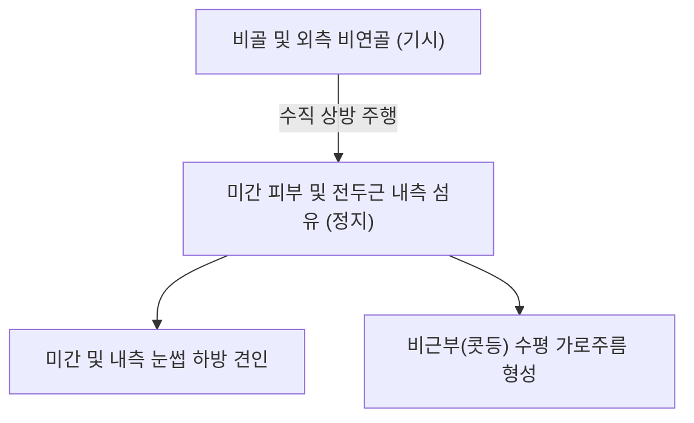

# 🫁 [[미간근]] (Procerus)

> **핵심 요약 (Key Summary)**:
> [[미간근]](Procerus, 눈살근)은 비골(Nasal bone) 및 외측 비연골 표면에서 기시하여 미간(Glabella) 피부 및 [[전두근]] 하부 섬유에 정지하는 피하 안면 표정근이다.
> [[안면신경]](CN VII)의 협부 및 관자가지의 지배를 받으며, **내측 눈썹과 미간 피부를 아래로 당겨 콧등(비근부)에 뚜렷한 가로 주름(Horizontal nasal wrinkles)**을 형성한다.
> 추미근(Corrugator), 안륜근과 함께 **미간 주름 복합체(Glabellar complex)**를 이루어 눈부심, 분노, 집중 표정을 지으며, 긴장성 전두통, 안정피로(눈 피로)의 핵심 병변근이자 인당(EX-HN3)·찬죽혈 침구의 주된 표적이다.

---
## 📌 목차
1. [해부학적 정밀 구조 및 지배 신경/혈관](#1-해부학적-정밀-구조-및-지배-신경혈관)
2. [생체역학·토크 분석 & 근막 사슬 (Biomechanical Synergy)](#2-생체역학토크-분석--근막-사슬-biomechanical-synergy)
3. [근막통증증후군(TP) & 연관통 패턴 (Travell & Simons)](#3-근막통증증후군tp--연관통-패턴-travell--simons)
4. [초음파 해부학(Sonoanatomy) 및 중재 시술 랜드마크](#4-초음파-해부학sonoanatomy-및-중재-시술-랜드마크)
5. [⭐ 원장님 심층 임상 고찰 및 원본 필기 (Clinical Pearls)](#5-원장님-심층-임상-고찰-및-원본-필기-clinical-pearls)
6. [관련 임상 질환 및 운동손상 증후군 총괄](#6-관련-임상-질환-및-운동손상-증후군-총괄)
7. [추나·도수치료(MET/PIR) & 침구·약침·재활 프로토콜](#7-추나도수치료metpir--침구약침재활-프로토콜)
8. [출처 및 학술 참고 문헌 (References)](#8-출처-및-학술-참고-문헌-references)

---
## 1. 해부학적 정밀 구조 및 지배 신경/혈관

| 항목 | 상세 내용 |
| :--- | :--- |
| **기시 (Origin)** | 비골(Nasal bone) 하부 표면을 덮는 골막 및 외측 비연골(Upper lateral nasal cartilage) 상부 근막 |
| **정지 (Insertion)** | 미간(Glabella) 중심부 피부 및 [[전두근]](Frontalis) 내측 하부 근섬유와 교차 결합 |
| **신경 지배** | [[안면신경]](Facial nerve, **CN VII**)의 측두가지(Temporal branches) 및 협부/관자가지(Buccal/Zygomatic branches) |
| **혈관 공급** | 안면동맥의 각동맥(Angular artery) 분지 및 안구동맥의 활차상/안와상동맥(Supratrochlear & Supraorbital arteries) |
| **복합체 구조** | 추미근(Corrugator supercilii), 강미간근(Depressor supercilii), 안륜근(Orbicularis oculi)과 함께 **미간 주름 복합체(Glabellar wrinkle complex)** 형성 |

### 🔬 해부학 도해 및 단면도

미간근은 콧등(비근부)에서 이마 정중선 방향으로 수직 주행하는 작은 피라미드형 근육이다. 피부 바로 밑 천층에 위치하며, 하방의 비골 골막과 상방의 미간 진피를 연결한다.

---
## 2. 생체역학·토크 분석 & 근막 사슬 (Biomechanical Synergy)

* **미간 피부 하방 견인 (Glabellar Depression)**:
  * 미간 피부를 코 방향으로 끌어내려 강한 햇빛이나 눈부심으로부터 안구를 보호하는 해부학적 차양 역할을 수행한다.
* **콧등 가로 주름 형성 (Horizontal Nasal Creases)**:
  * 추미근이 눈썹을 모아 세로 주름(11자 주름)을 만드는 것과 대조적으로, 미간근은 **콧등 상부에 가로 주름**을 깊게 형성한다.
* **전두근과의 상하 대립 장력**:
  * 이마를 들어 올리는 [[전두근]]과 반대로 미간을 내리는 미간근이 균형을 유지하며, 미간근 과긴장 시 눈썹 내측이 처져 험상궂거나 피로한 인상을 초래한다.
* **표층후방선(Superficial Back Line) 두개부 연계**:
  * 모상건막-후두근-경추 기립근으로 이어지는 후방 근막선 장력이 미간근 부위에서 안면부 표층과 만난다.

---
## 3. 근막통증증후군(TP) & 연관통 패턴 (Travell & Simons)

* **발통점 위치**: 비골과 전두골이 만나는 비근부(Nasion) 직상방 미간근 중심부에 형성된다.
* **연관통 양상**:
  * 비근부(콧등 뿌리) 및 미간 중심의 묵직하고 쪼이는 듯한 압박통.
  * 양측 안구 심부로 퍼지는 안정피로(눈의 피로, 눈이 침침함) 및 전두부 긴장성 두통 유발.
  * 스마트폰, 모니터를 오래 응시할 때 눈살을 찌푸리는 습관으로 인해 유발 및 악화.

---
## 4. 초음파 해부학(Sonoanatomy) 및 중재 시술 랜드마크

* **초음파 스캔 프로토콜**:
  * 비근부에서 미간 중심을 따라 종축(수직) 스캔 거치.
  * 비골 피질골 바로 위의 저에코성 미간근 두께(통상 1.5~2.5mm) 및 피하 진피와의 경계 확인(Cho 2019).
* **안전 마진 및 시술 랜드마크**:
  * **각동맥(Angular artery) 및 활차상동맥**: 미간근 외측연을 따라 주행하므로, 필러나 침습적 시술 시 도플러 혈류를 확인하여 망막동맥 색전증(실명) 등의 치명적 합병증을 원천 차단.
  * **침술 안전 깊이**: 뼈(비골/전두골)가 바로 밑을 받치고 있으므로 맹검 심자 시 골막 통증에 유의하며 2~3mm 피하 사자 권장.

---
## 5. ⭐ 원장님 심층 임상 고찰 및 원본 필기 (Clinical Pearls)

> 원장님의 임상 필기와 독창적인 임상 노하우를 바탕으로 한 핵심 지침이다.

1. **'인당혈(EX-HN3)' 직하자극의 치료적 실체**: 한의학에서 불면, 두통, 비염의 명혈인 인당혈의 해부학적 해부 실체는 바로 미간근이다. 인당혈 자침 시 단순히 피부만 찌르지 말고, 비근부에서 상방으로 미간근의 수직 주행을 따라 피하 사자(Thread needle)하면 만성적인 미간 긴장과 전두부 두통이 즉각적으로 완화된다.
2. **미간 가로주름과 수면 중 찡그림 습관**: 아침에 일어났을 때 콧등 가로주름이 심하고 두통을 호소하는 환자는 수면 중 스트레스나 이갈이와 동반된 미간근 연축이 흔하다. 미간근 침 치료와 함께 측두근-교근 이완을 병행해야 한다.
3. **상안검하수 오인 주의**: 미간근과 추미근이 과도하게 단축되면 눈썹 내측이 아래로 끌려내려와 눈꺼풀이 처진 것처럼 보일 수 있다. 안검하수 수술 전 미간근 긴장도를 먼저 평가하고 이완시켜야 한다.

---
## 6. 관련 임상 질환 및 운동손상 증후군 총괄

| 임상 질환 / 증후군 | 병리적 연관 기전 | 주요 증상 및 이학적 검사 | 핵심 교정 타깃 |
| :--- | :--- | :--- | :--- |
| 긴장성 전두통 / 미간통 | 미간근 만성 과긴장 및 TrP 형성 | 비근부 뻐근함, 이마 앞쪽 조임통 | 인당·찬죽 도침 및 침구 |
| 안정피로 (Asthenopia) | 근거리 작업 시 미간근 지속 수축 | 눈 피로, 시야 흐림, 눈 찡그림 | 미간근 이완 및 온열 마사지 |
| 콧등 노화성 가로주름 | 미간근 단축 및 진피 탄력 저하 | 콧등의 깊은 횡주름, 험상궂은 인상 | 미간근 매선 및 PIR 스트레칭 |
| 미간 주름 복합체 연합경련 | 안면신경 과흥분 및 안검경련 연계 | 불수의적 미간 찌푸림, 눈 깜빡임 | 인당·양백 전침 치료 |

---
## 7. 추나·도수치료(MET/PIR) & 침구·약침·재활 프로토콜

* **한의학 경혈 매핑**:
  * 인당(EX-HN3): 양 눈썹 사이 중심, 미간근 정중앙 취혈.
  * 찬죽(BL2): 눈썹 안쪽 끝, 추미근 및 미간근 외측 경계.
  * 어요(EX-HN4), [[양백(陽白)|양백(GB14)]]: 전두근 연계 취혈.
  * [[풍지(GB20)|풍지(GB20)]], [[합곡(LI4)|합곡(LI4)]]: 원위부 두면부 기혈 순환 촉진.
* **침구 및 수기 프로토콜**:
  * 비근부(산근)에서 인당 방향으로 피하 수평 사자(침장 15~20mm 삽입).
  * 미간근 근막 이완술: 양 엄지로 비근부를 고정하고 검지로 미간 피부를 이마 쪽으로 밀어 올리며 10초간 신장 유지.
* **양방 치료 및 의뢰 기준 (Red Flags)**:
  * **외상 후 미간/콧등 부위 골 마찰음, 비출혈, 외비 변형**: 비골 골절(Nasal bone fracture) 의심 시 즉시 이비인후과/성형외과 안면골 CT 의뢰.
  * **미간 부위 필러 시술 후 급격한 안구 통증, 시력 저하, 피부 창백/괴사**: 각동맥 색전증에 의한 망막동맥 폐쇄 응급 상황이므로 즉시 대학병원 안과/응급실 이송 및 히알루로니다아제 투여 의뢰.
  * **미간 발적, 열감 및 안검 부종 급속 진행**: 안와 격막전 봉와직염(Preseptal cellulitis) 감별을 위한 감염내과/안과 의뢰.

---
## 8. 출처 및 학술 참고 문헌 (References)

1. Brown, T. M., Drake, T. M., & Krishnamurthy, K. (2023). Anatomy, Head and Neck, Procerus Muscle. *StatPearls*. [PMID: 30521184](https://pubmed.ncbi.nlm.nih.gov/30521184/)

2. Cho, Y., Lee, H. J., & Lee, K. W. (2019). Ultrasonographic and Three-Dimensional Analyses at the Glabella and Radix of the Nose for Botulinum Neurotoxin Injection Procedures into the Procerus Muscle. *Toxins (Basel)*, 11(10), 560. [PMID: 31554222](https://pubmed.ncbi.nlm.nih.gov/31554222/)

3. Standring, S. (2020). *Gray's Anatomy: The Anatomical Basis of Clinical Practice* (42nd ed.). Elsevier, p. 530.

4. Travell, J. G., & Simons, D. G. (1999). *Myofascial Pain and Dysfunction: The Trigger Point Manual*, Vol. 1 (2nd ed.). Williams & Wilkins.
