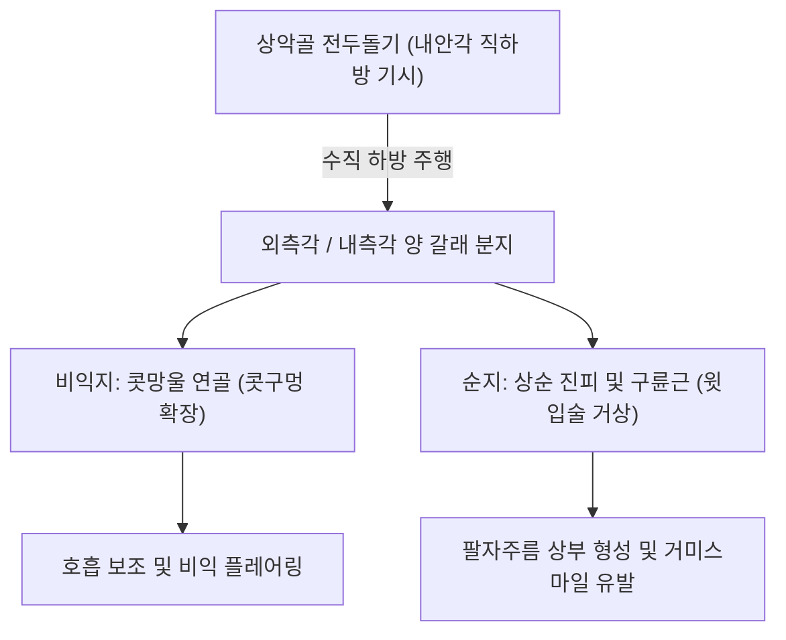

# 🫁 [[상순비익거근]] (Levator Labii Superioris Alaeque Nasi)

> **핵심 요약 (Key Summary)**:
> [[상순비익거근]](Levator labii superioris alaeque nasi, LLSAN)은 상악골 전두돌기에서 기시하여 외측 비익(콧망울) 연골 및 상순에 정지하는 세장한 표층 안면 표정근이다.
> [[안면신경]](CN VII)의 협부 및 관자가지의 지배를 받으며, **비익을 거상하여 콧구멍을 확장(Dilatation of nares)시키고 윗입술을 끌어올려 분노, 경멸(Snarling) 및 비순구 상부**를 형성한다.
> 임상적으로는 잇몸 노출 미소(Gummy smile), 비익 연축, [[안면신경마비]](구안와사) 비대칭의 핵심 병변근이며, 한의 치료에서는 영향(LI20)·사백혈 주변 침구 및 비순구 매선이 주된 표적이다.

---
## 📌 목차
1. [해부학적 정밀 구조 및 지배 신경/혈관](#1-해부학적-정밀-구조-및-지배-신경혈관)
2. [생체역학·토크 분석 & 근막 사슬 (Biomechanical Synergy)](#2-생체역학토크-분석--근막-사슬-biomechanical-synergy)
3. [근막통증증후군(TP) & 연관통 패턴 (Travell & Simons)](#3-근막통증증후군tp--연관통-패턴-travell--simons)
4. [초음파 해부학(Sonoanatomy) 및 중재 시술 랜드마크](#4-초음파-해부학sonoanatomy-및-중재-시술-랜드마크)
5. [⭐ 원장님 심층 임상 고찰 및 원본 필기 (Clinical Pearls)](#5-원장님-심층-임상-고찰-및-원본-필기-clinical-pearls)
6. [관련 임상 질환 및 운동손상 증후군 총괄](#6-관련-임상-질환-및-운동손상-증후군-총괄)
7. [추나·도수치료(MET/PIR) & 침구·약침·재활 프로토콜](#7-추나도수치료metpir--침구약침재활-프로토콜)
8. [출처 및 학술 참고 문헌 (References)](#8-출처-및-학술-참고-문헌-references)

---
## 1. 해부학적 정밀 구조 및 지배 신경/혈관

| 항목 | 상세 내용 |
| :--- | :--- |
| **기시 (Origin)** | 상악골 전두돌기(Frontal process of maxilla)의 상부 외측면 (내안각 부근) |
| **정지 (Insertion)** | 하방으로 주행하며 두 갈래로 분지: • **외측각(비익지)**: 대비익연골(Greater alar cartilage) 및 콧망울 외측 피부 • **내측각(순지)**: 상순(윗입술) 외측 진피 및 [[구륜근]] 섬유와 융합 |
| **신경 지배** | [[안면신경]](Facial nerve, **CN VII**)의 관자가지(Zygomatic branches) 및 협부 가지(Buccal branches) |
| **혈관 공급** | 안면동맥의 각동맥(Angular artery) 및 안와하동맥(Infraorbital artery) |
| **해부학적 특이성** | 인체 골격근 중 이름이 가장 긴 근육(Longest named muscle)으로 알려져 있음 |

### 🔬 해부학 도해 및 단면도

상순비익거근은 코 외측 경계를 따라 수직으로 길게 뻗어 내려오는 얇은 근육 띠이다. 안쪽으로는 비골과 외측 비연골을 감싸고, 외측으로는 상순거근과 인접한다.

---
## 2. 생체역학·토크 분석 & 근막 사슬 (Biomechanical Synergy)

* **비익 거상 및 콧구멍 개대 (Naris Dilation)**:
  * 외측각 수축 시 콧망울을 외상방으로 당겨 비강 입구를 열어주며, 깊은 흡기나 운동 시 비강 기도 저항을 감소시킨다.
* **상순 중앙부 거상 (Upper Lip Elevation)**:
  * 내측각 수축 시 윗입술 중앙부를 위로 끌어올려 상악 전치를 과도하게 노출(Gummy smile)시키거나 역겨움, 으르렁거리는 표정(Snarling)을 완성한다(Tan 2024).
* **비순구(팔자주름) 최상부 앵커**:
  * 비익 외측 기저부에서 깊은 함몰 주름을 형성하는 시작점 역할을 한다.

---
## 3. 근막통증증후군(TP) & 연관통 패턴 (Travell & Simons)

* **발통점 위치**: 내안각 하방 1cm, 코 외측 경계부 근복에 형성된다.
* **연관통 양상**:
  * 콧망울 주변 및 상악 치경부의 욱신거리는 둔통.
  * 코 주변의 불쾌한 조임감 및 가려움, 비익 주위의 경련성 떨림(비근부 연축).

---
## 4. 초음파 해부학(Sonoanatomy) 및 중재 시술 랜드마크

* **초음파 스캔 프로토콜**:
  * 비익 외측에서 내안각을 잇는 선을 따라 선형 탐촉자를 거치.
  * 비골 및 상악골 피질 바로 위에서 피하지방층 아래로 주행하는 저에코의 LLSAN 띠 확인(Niamtu 2024).
* **안전 마진 및 시술 랜드마크**:
  * **각동맥(Angular artery)**: LLSAN의 외측 또는 심층을 따라 내안각으로 상행하므로 도플러로 박동을 확인하고 혈관 천자 회피.

---
## 5. ⭐ 원장님 심층 임상 고찰 및 원본 필기 (Clinical Pearls)

> 원장님의 임상 필기와 독창적인 임상 노하우를 바탕으로 한 핵심 지침이다.

1. **거미 스마일(Gummy Smile) 침구 교정의 핵심 표적**: 웃을 때 잇몸이 과도하게 노출되어 스트레스를 받는 환자는 대관골근보다 상순비익거근(LLSAN)의 과긴장이 주원인이다. 영향혈(LI20) 직상방 5mm 지점에서 LLSAN 근복을 향해 사자 자침하여 전침 자극을 주면 상순의 과도한 거상이 즉각적으로 완화된다.
2. **비염 환자의 코 찡그림과 팔자주름 조기 노출**: 알레르기 비염이나 비폐색으로 습관적으로 코를 벌렁거리거나 찡그리는 환자는 LLSAN이 조기에 단축 비후되어 20~30대에도 깊은 팔자주름 상부 함몰이 발생한다. 비염 치료와 함께 LLSAN 근막 이완을 병행해야 한다.
3. **각동맥 손상 방지**: 내안각 부위는 안구로 가는 안동맥 분지와 안면동맥이 만나는 혈관 위험구역이므로, 심자(深刺)를 금하고 피하 2~3mm 천자로 부드럽게 시술해야 한다.

---
## 6. 관련 임상 질환 및 운동손상 증후군 총괄

| 임상 질환 / 증후군 | 병리적 연관 기전 | 주요 증상 및 이학적 검사 | 핵심 교정 타깃 |
| :--- | :--- | :--- | :--- |
| 잇몸 노출 미소 (Gummy smile) | LLSAN 과도한 수축 및 상순 거상 | 미소 시 상악 잇몸 3mm 이상 노출 | 영향혈 상방 LLSAN 이완 침구 |
| [[안면신경마비]] (구안와사) | 안면신경 협부가지 마비 | 환측 비익 확장 불능, 비순구 편평화 | 영향·사백 전침 및 매선 |
| 비익 연축 및 틱 장애 | 삼차-안면신경 반사 과흥분 | 콧망울의 불수의적 실룩거림 | LLSAN 기시부 침구 및 이완 |
| 팔자주름 상부 함몰 | LLSAN 단축 및 피부 진피 유착 | 코 옆 깊은 삼각 함몰선 형성 | 비순구 박리 도침 및 매선 리프팅 |

---
## 7. 추나·도수치료(MET/PIR) & 침구·약침·재활 프로토콜

* **한의학 경혈 매핑**:
  * 영향(LI20): 비익 외측 하단, LLSAN 외측각 정지점.
  * 사백(ST2): LLSAN 외측 상순거근과의 경계 취혈.
  * 정명(BL1): 기시부 내안각 부근 신경순환 촉진.
* **침구 및 수기 프로토콜**:
  * 영향(LI20)에서 비근부를 향해 상방으로 10~15mm 피하 사자.
  * 콧망울 이완 수기: 양 검지로 비익 외측을 가볍게 누르며 하방으로 쓸어내려 상순 긴장을 완화.
* **양방 치료 및 의뢰 기준 (Red Flags)**:
  * **코 주변 부종, 발열, 안구돌출 및 시력 이상**: 안면 중심부 감염의 해면정맥동 혈전증(Cavernous sinus thrombosis) 의심 시 즉시 대학병원 감염내과/신경과 응급 이송.
  * **외상 후 코피 지속 및 비골 변형**: 비골 골절 배제를 위한 이비인후과 안면골 X-ray/CT 의뢰.

---
## 8. 출처 및 학술 참고 문헌 (References)

1. Niamtu, J., & Lee, K. (2024). Accessing the Levator Labii Superioris Alaeque Nasi (LLSAN) Muscle for the Treatment of Infraorbital Dimples-A Case Report. *J Clin Med*, 13(14), 4127. [PMID: 41277724](https://pubmed.ncbi.nlm.nih.gov/41277724/)

2. Tan, C. Y., & Al-Niaimi, F. (2024). Levator Labii Superioris Alaeque Nasi Targeted Botulinum Toxin Injection for Treatment of Perinasal Facial Discomfort and Snarling. *Dermatol Surg*, 50(7), 680-682. [PMID: 39012106](https://pubmed.ncbi.nlm.nih.gov/39012106/)

3. Standring, S. (2020). *Gray's Anatomy: The Anatomical Basis of Clinical Practice* (42nd ed.). Elsevier, p. 531.

4. Travell, J. G., & Simons, D. G. (1999). *Myofascial Pain and Dysfunction: The Trigger Point Manual*, Vol. 1 (2nd ed.). Williams & Wilkins.
