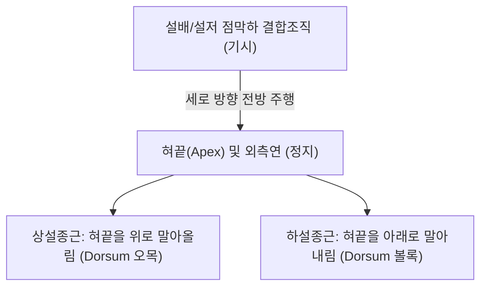

# 🫁 [[설종근]] (Longitudinal Muscles of Tongue)

> **핵심 요약 (Key Summary)**:
> [[설종근]](Longitudinalis linguae, 혀세로근)은 혀 내부에 위치하는 대표적인 **내재설근(Intrinsic tongue muscles)**으로, 상설종근(Superior longitudinal)과 하설종근(Inferior longitudinal)으로 구성된다.
> [[12. 설하신경|설하신경]](CN XII)의 운동 지배를 받으며, **혀의 길이를 단축시키고 혀끝(Apex)을 상방 또는 하방으로 굴곡(말아올림/내림)**시켜 구강기 음식물 덩어리(볼루스)를 숟가락 형태로 안착시키는 핵심 역할을 수행한다.
> 임상적으로는 설첨음(ㄹ, ㄷ, ㄴ) 조음장애, [[연하장애]](구강기 볼루스 형성 부전), [[12. 설하신경|설하신경]] 마비 및 신경퇴행성 질환(ALS 등)의 설 섬유속 연축 표적이다.

---
## 📌 목차
1. [해부학적 정밀 구조 및 지배 신경/혈관](#1-해부학적-정밀-구조-및-지배-신경혈관)
2. [생체역학·토크 분석 & 근막 사슬 (Biomechanical Synergy)](#2-생체역학토크-분석--근막-사슬-biomechanical-synergy)
3. [근막통증증후군(TP) & 연관통 패턴 (Travell & Simons)](#3-근막통증증후군tp--연관통-패턴-travell--simons)
4. [초음파 해부학(Sonoanatomy) 및 중재 시술 랜드마크](#4-초음파-해부학sonoanatomy-및-중재-시술-랜드마크)
5. [⭐ 원장님 심층 임상 고찰 및 원본 필기 (Clinical Pearls)](#5-원장님-심층-임상-고찰-및-원본-필기-clinical-pearls)
6. [관련 임상 질환 및 운동손상 증후군 총괄](#6-관련-임상-질환-및-운동손상-증후군-총괄)
7. [추나·도수치료(MET/PIR) & 침구·약침·재활 프로토콜](#7-추나도수치료metpir--침구약침재활-프로토콜)
8. [출처 및 학술 참고 문헌 (References)](#8-출처-및-학술-참고-문헌-references)

---
## 1. 해부학적 정밀 구조 및 지배 신경/혈관

| 항목 | 상세 내용 |
| :--- | :--- |
| **분류 및 구성** | 골성 기시·정지가 없는 순수 **내재설근(Intrinsic tongue muscles)** • **상설종근 (Superior longitudinal)**: 설배(혀등) 점막 바로 직하방에 얇은 판상으로 위치 • **하설종근 (Inferior longitudinal)**: 혀 하면의 이설근과 설골설근 사이에 위치 |
| **기시 및 주행** | • **상설종근**: 설골 상방 정중설중격(Median septum) 및 설배 점막하 결합조직에서 기시하여 전방으로 주행 • **하설종근**: 설근부(혀뿌리)에서 기시하여 혀끝 방향으로 주행 |
| **정지 (Insertion)** | 혀끝(Apex) 점막 및 외측연(Lateral margin) 점막하층 |
| **신경 지배** | [[12. 설하신경|설하신경]](Hypoglossal nerve, **CN XII**) 단독 운동 지배 |
| **혈관 공급** | 설동맥(Lingual artery)의 심설동맥(Deep lingual artery) 분지 |

### 🔬 해부학 도해 및 단면도

설종근은 혀의 등 쪽(상설종근)과 바닥 쪽(하설종근)을 세로로 가로지르며, 그 사이에 혀수직근(Verticalis)과 혀가로근(Transversus)이 교차하는 정교한 3차원 근육 그물망을 형성한다(Wrench 2024).

---
## 2. 생체역학·토크 분석 & 근막 사슬 (Biomechanical Synergy)

* **근성 정수압체(Muscular Hydrostat)의 종축 변형**:
  * 혀는 체적(Volume)이 일정하게 보존되는 유체 기관이므로, 설종근이 수축하여 혀 길이가 짧아지면 반작용으로 혀의 폭과 두께가 즉각적으로 증가한다.
* **혀끝 정밀 조작 (Apex Curling & Articulation)**:
  * **상설종근 수축**: 혀등을 오목한 숟가락 모양으로 만들어 음식물을 감싸고, 혀끝을 경구개에 밀착시켜 치조음/탄설음(ㄹ, t, d, n, l)을 발음한다.
  * **하설종근 수축**: 혀끝을 아래로 구부려 하악 절치 뒤로 밀착시키며 연구개음 및 특정 모음 구성을 보조한다.
* **심부전방선(Deep Front Line)의 최상단 종말 분지**:
  * 혀의 내재근은 횡격막-심낭-경부 심부 굴근을 거쳐 올라온 심부전방선의 기능적 종착점으로 전신 긴장도와 호흡 리듬에 직결된다.

---
## 3. 근막통증증후군(TP) & 연관통 패턴 (Travell & Simons)

* **발통점 위치**: 혀의 전방 1/3 외측연 또는 혀끝 심부 결절 부위.
* **연관통 양상**:
  * 혀 자체의 얼얼한 작열통(Burning mouth sensation) 및 둔한 통증.
  * 구강저 및 하악 치은 부위로 퍼지는 피로감과 연하 시 혀 무거움 호소.

---
## 4. 초음파 해부학(Sonoanatomy) 및 중재 시술 랜드마크

* **초음파 스캔 프로토콜**:
  * 턱밑(악하부)에서 설배를 향해 고주파 선형 또는 볼록형 탐촉자를 거치.
  * 혀 중앙의 고에코 정중중격 양측으로 천층의 상설종근과 심층의 하설종근 분리 관찰(Kao 2014).
* **안전 마진**: 심설동맥이 하설종근 내측을 주행하므로 침습 시술 시 도플러 혈류 확인 필수.

---
## 5. ⭐ 원장님 심층 임상 고찰 및 원본 필기 (Clinical Pearls)

> 원장님의 임상 필기와 독창적인 임상 노하우를 바탕으로 한 핵심 지침이다.

1. **외재근(이설근)만 보지 말고 내재근(설종근)의 숟가락 오므리기를 평가하라**: 구안와사나 중풍 후유증 환자가 "침이나 국물이 혀 옆으로 줄줄 샌다"고 호소할 때, 혀를 밖으로 내미는 외재근 운동만 검사하면 이상이 없어 보일 수 있다. 혀끝을 위로 말아 숟가락 형태로 오목하게 만드는 상설종근 기능을 반드시 확인해야 한다.
2. **조음장애 환자의 'ㄹ, ㄴ' 발음 피로**: 말을 많이 할 때 혀끝이 굳어 발음이 새는 환자는 설종근의 근피로가 원인이다. 턱밑 염천혈 자침 및 혀끝 스트레칭이 효과적이다.
3. **루게릭병(ALS) 의심 신호**: 혀 표면이 부글거리듯 불수의적으로 꿈틀거리는 섬유속성 연축(Fasciculation)과 혀 위축이 양측 설종근에서 관찰되면 중추성 신경퇴행 질환을 즉시 의심해야 한다.

---
## 6. 관련 임상 질환 및 운동손상 증후군 총괄

| 임상 질환 / 증후군 | 병리적 연관 기전 | 주요 증상 및 이학적 검사 | 핵심 교정 타깃 |
| :--- | :--- | :--- | :--- |
| 구강기 [[연하장애]] | 설종근 기능 저하로 볼루스 오므리기 실패 | 구강 내 음식물 잔류, 침 흘림 | 염천혈 침구 및 혀끝 오므리기 재활 |
| 설첨 조음장애 (Dysarthria) | 상/하설종근 마비로 치조음 형성 불능 | 'ㄹ, ㄷ, ㄴ' 발음 왜곡, 조음 피로 | 설하신경 자극 및 설근 협응 훈련 |
| [[설하신경 마비]] | CN XII 손상으로 인한 편측 설종근 위축 | 혀 편위, 환측 혀 주름 및 볼륨 감소 | 풍지·염천 전침 및 신경 재생 한약 |
| 설통증 (Burning Mouth Syndrome) | 설 점막하 신경염 및 설종근 만성 긴장 | 혀끝이 화끈거리고 얼얼한 작열감 | 심열(心熱) 강하 한약 및 설하 자락 |

---
## 7. 추나·도수치료(MET/PIR) & 침구·약침·재활 프로토콜

* **한의학 경혈 매핑**:
  * 염천(CV23): 혀뿌리 및 설하신경 본간 순환 주혈.
  * 금진·옥액(EX-HN12, 13): 혀 밑 정맥 울혈 해소 및 신경 반사 자극.
  * [[풍지(GB20)|풍지(GB20)]]: 연수 설하신경핵 부위 순환 개선.
* **설근 재활 및 운동 프로토콜**:
  * 혀끝 말아올리기 운동: 입을 벌리고 혀끝을 입천장 뒤쪽(경구개 후방)으로 닿게 말아올려 5초간 유지.
  * 숟가락 누르기 저항 운동: 멸균 설압자를 혀끝에 대고 혀끝으로 위로 밀어 올리는 등척성 저항 훈련.
* **양방 치료 및 의뢰 기준 (Red Flags)**:
  * **혀의 안정 시 지속적인 미세 연축(Fasciculation) + 전신 근력 저하**: 근위축성 측삭경화증(ALS/루게릭병) 감별을 위해 즉시 **신경과 근전도(EMG) 및 정밀 검사의뢰**.
  * **급성 발병의 혀 마비 + 안면마비 + 연하곤란**: 연수 부위 뇌간 경색(Wallenberg syndrome) 의심 시 즉시 응급실 뇌 MRI 의뢰.

---
## 8. 출처 및 학술 참고 문헌 (References)

1. Kao, P. C., Benson, C., & Stone, M. (2014). Segmentation of tongue muscles from super-resolution magnetic resonance images. *IEEE Trans Med Imaging*, 33(8), 1616-1624. [PMID: 25487963](https://pubmed.ncbi.nlm.nih.gov/25487963/)

2. Wrench, A. A. (2024). The Compartmental Tongue. [PMID: 38959159](https://pubmed.ncbi.nlm.nih.gov/38959159/)

3. Standring, S. (2020). *Gray's Anatomy: The Anatomical Basis of Clinical Practice* (42nd ed.). Elsevier, pp. 586-587.

4. Travell, J. G., & Simons, D. G. (1999). *Myofascial Pain and Dysfunction: The Trigger Point Manual*, Vol. 1 (2nd ed.). Williams & Wilkins.
