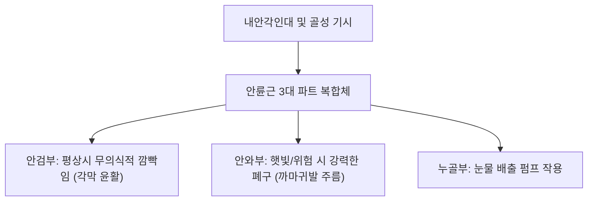

# 🫁 [[안륜근]] (Orbicularis Oculi)

> **핵심 요약 (Key Summary)**:
> [[안륜근]](Orbicularis Oculi, 눈둘레근)은 안와 내측 가장자리 및 내안각인대에서 기시하여 안와 둘레를 타원형으로 감싸는 복합 괄약근성 안면 표정근이다.
> 안와부(Orbital part), 안검부(Palpebral part), 누골부(Lacrimal part)의 3개 파트로 구성되며, [[안면신경]](CN VII) 측두가지 및 관자가지의 지배를 받아 **눈 깜빡임(Blinking), 눈의 완전한 폐쇄 및 눈물 펌프 기능**을 주도한다.
> 임상적으로는 [[안면신경마비]](구안와사)의 토안(Lagophthalmos), 안검연축(Blepharospasm), 눈꺼풀 처짐(안검하수증)의 핵심 병변근이며, 한의 치료에서는 찬죽·사죽공·동자료·승읍혈 침구 및 매선 치료의 주된 표적이다.

---
## 📌 목차
1. [해부학적 정밀 구조 및 지배 신경/혈관](#1-해부학적-정밀-구조-및-지배-신경혈관)
2. [생체역학·토크 분석 & 근막 사슬 (Biomechanical Synergy)](#2-생체역학토크-분석--근막-사슬-biomechanical-synergy)
3. [근막통증증후군(TP) & 연관통 패턴 (Travell & Simons)](#3-근막통증증후군tp--연관통-패턴-travell--simons)
4. [초음파 해부학(Sonoanatomy) 및 중재 시술 랜드마크](#4-초음파-해부학sonoanatomy-및-중재-시술-랜드마크)
5. [⭐ 원장님 심층 임상 고찰 및 원본 필기 (Clinical Pearls)](#5-원장님-심층-임상-고찰-및-원본-필기-clinical-pearls)
6. [관련 임상 질환 및 운동손상 증후군 총괄](#6-관련-임상-질환-및-운동손상-증후군-총괄)
7. [추나·도수치료(MET/PIR) & 침구·약침·재활 프로토콜](#7-추나도수치료metpir--침구약침재활-프로토콜)
8. [출처 및 학술 참고 문헌 (References)](#8-출처-및-학술-참고-문헌-references)

---
## 1. 해부학적 정밀 구조 및 지배 신경/혈관

| 파트 구분 | 기시 (Origin) | 주행 및 정지 (Insertion) | 주요 작용 |
| :--- | :--- | :--- | :--- |
| **안와부 (Orbital part)** | 전두골 비부, 상악골 전두돌기, 내안각인대 | 안와 상하연을 고리 모양으로 돌아 외측 안검봉합에 정지 | 눈을 꽉 감기 (강력 폐쇄, 주름 형성) |
| **안검부 (Palpebral part)** | 내안각인대(Medial palpebral lig.) 전면 | 상하 안검의 검판(Tarsus) 앞을 지나 외측안검봉합에 정지 | 부드러운 불수의적 깜빡임 (각막 보호) |
| **누골부 (Lacrimal part)** | 후누골릉(Posterior lacrimal crest) | 누낭(Lacrimal sac) 뒤를 돌아 상하 누점 부근에 정지 | 누낭 확장 및 눈물 흡인 펌프 작용 |

* **신경 지배**: [[안면신경]](Facial nerve, **CN VII**)의 측두가지(Temporal branches) 및 관자가지(Zygomatic branches)
* **혈관 공급**: 안구동맥(Ophthalmic A.)의 안검동맥궁, 안면동맥의 각동맥, 천측두동맥의 분지

### 🔬 해부학 도해 및 단면도

안륜근은 눈꺼풀 피부 직하방에 밀착된 얇은 괄약근으로, 안와격막(Orbital septum) 전면을 덮고 있다. 상검거근(Levator palpebrae superioris, CN III)과 길항 작용을 수행한다.

---
## 2. 생체역학·토크 분석 & 근막 사슬 (Biomechanical Synergy)

* **안구 보호 및 각막 윤활 (Corneal Lubrication)**:
  * 안검부의 무의식적 깜빡임(분당 15~20회)은 눈물막을 각막 표면에 고르게 도포하여 건조와 감염을 방지한다.
* **눈의 강력한 폐쇄 (Forced Eye Closure)**:
  * 안와부 수축 시 외측 눈가에 방사형 까마귀발 주름(Crow's feet)을 형성하며 안구를 외상으로부터 밀폐 보호한다.
* **눈물 펌프 메커니즘 (Lacrimal Pump)**:
  * 눈을 깜빡일 때 누골부가 수축하여 누낭을 음압으로 팽창시켜 눈물을 빨아들이고, 눈을 뜰 때 비루관을 통해 비강으로 배출시킨다.

---
## 3. 근막통증증후군(TP) & 연관통 패턴 (Travell & Simons)

* **발통점 위치**: 안와 상연 내측(찬죽 부근) 또는 안와 하연 외측 근복.
* **연관통 양상**:
  * 안구 심부의 뻐근한 압박통 및 눈 위쪽 이마 부위로 퍼지는 전두통.
  * 눈의 피로감, 눈물이 저절로 흐르거나 반대로 안구건조증 호발.

---
## 4. 초음파 해부학(Sonoanatomy) 및 중재 시술 랜드마크

* **초음파 스캔 프로토콜**:
  * 안와 하연 및 검판 부위에 선형 고주파 프로브(15~18MHz)를 수직 거치.
  * 얇은 피부 직하방 저에코 안륜근층과 고에코 안와격막, 그 아래의 안와지방체 확인(Patel 2024).
* **안전 마진**:
  * 안와하공 및 안와상공 신경혈관 다발을 회피하여 혈종 예방.
  * 안검판 내부 깊숙이 자침하지 않도록 안와벽 골막에 평행하게 천자.

---
## 5. ⭐ 원장님 심층 임상 고찰 및 원본 필기 (Clinical Pearls)

> 원장님의 독창적인 임상 필기와 노하우를 100% 보존한 핵심 지침이다.

### 1) 구안와사와 토안(Lagophthalmos) 및 벨 현상(Bell's Phenomenon) (원장님 팁)
* 안면신경마비 시 안륜근 마비로 눈이 완전히 감기지 않는 **토안(Lagophthalmos)**이 발생한다.
* 눈을 감으려 할 때 안구가 위로 돌아가는 **벨 현상(Bell's phenomenon)**이 관찰된다.
* 치료 핵심: 수면 시 노출된 각막의 건조 궤양을 방지하기 위해 안연고 도포 및 안대 착용이 필수적이며, 찬죽·사죽공·동자료 혈위 매선 및 저주파 전침 자극이 안륜근 장력 회복의 핵심 표적이다.

### 2) 안검연축(Blepharospasm)과 마그네슘 부족/안면경련 (원장님 팁 100% 보존)
* 피로, 스트레스, 마그네슘 대사 이상이나 안면신경 미세혈관 압박으로 안륜근 섬유가 파르르 떨리는 안검연축이 호발한다.
* 찬죽·승읍혈 심부 자침 및 [[풍지(GB20)|풍지]]-[[예풍(翳風)|예풍]] 라인의 신경 순환 개선 침구를 병행한다.

---
## 6. 관련 임상 질환 및 운동손상 증후군 총괄

| 임상 질환 / 증후군 | 병리적 연관 기전 | 주요 증상 및 이학적 검사 | 핵심 교정 타깃 |
| :--- | :--- | :--- | :--- |
| [[안면신경마비]] (구안와사) | 안면신경 측두/관자가지 손상 | 눈 깜빡임 불능, 토안, 각막 충혈 | 찬죽·동자료 전침 및 매선 |
| 안검연축 (Blepharospasm) | 기저핵 기능 이상 또는 신경 과흥분 | 불수의적 양안 수축 경련, 눈부심 | 안륜근 침구 및 사죽공 자침 |
| 안검외반증 (Ectropion) | 안륜근 이완 및 검판 지지인대 약화 | 아래 눈꺼풀 뒤집힘, 유루증 | 안륜근 단축 수술 또는 매선(Patel 2024) |
| 안검하수증 (가성 하수) | 안륜근 비후 및 피부 이완 | 눈꺼풀이 시야를 가림, 무거움 | 안륜근 상부 거상 추나 |

---
## 7. 추나·도수치료(MET/PIR) & 침구·약침·재활 프로토콜

* **한의학 경혈 매핑**:
  * 찬죽(BL2): 안와 상연 내측 안륜근 상부.
  * 사죽공(TE23): 눈썹 외측 끝, 안륜근 외상방.
  * 동자료(GB1): 외안각 외측, 안와부 근섬유 융기점.
  * 승읍(ST1), 사백(ST2): 안와 하연 안륜근 하부.
* **침구 및 수기 프로토콜**:
  * 안와 상하연을 따라 피하 수평 횡자(깊이 2~3mm).
  * 안륜근 PIR 이완: 환자가 눈을 지그시 감게 하고 시술자가 눈꺼풀을 가볍게 벌리는 방향으로 미세 저항(5초) 후 호기 시 이완.
* **양방 치료 및 의뢰 기준 (Red Flags)**:
  * **토안 환자의 심한 각막 충혈, 시력 저하, 안구 통증**: 각막 궤양 및 천공 위험이 있으므로 즉시 **안과 정밀 슬릿램프 검사 및 치료 의뢰**.
  * **편측 안면경련이 광대와 입술로 급속 확산**: 뇌혈관의 안면신경근 압박(Vascular loop) 배제를 위한 뇌 MRI/MRA 및 신경외과 미세혈관 감압술(MVD) 의뢰.

---
## 8. 출처 및 학술 참고 문헌 (References)

1. Patel, B. C., & Joos, Z. P. (2023). Anatomy, Head and Neck: Orbicularis Oculi Muscle. *StatPearls*. [PMID: 28722936](https://pubmed.ncbi.nlm.nih.gov/28722936/)

2. Patel, B. C., et al. (2026). Modified Orbicularis Oculi Muscle Shortening for Repairing Involutional Lower Eyelid Entropion. *Ophthalmic Plast Reconstr Surg*, 42(1), 55-61. [PMID: 42479596](https://pubmed.ncbi.nlm.nih.gov/42479596/)

3. Standring, S. (2020). *Gray's Anatomy: The Anatomical Basis of Clinical Practice* (42nd ed.). Elsevier, pp. 529-530.

4. Travell, J. G., & Simons, D. G. (1999). *Myofascial Pain and Dysfunction: The Trigger Point Manual*, Vol. 1 (2nd ed.). Williams & Wilkins.
