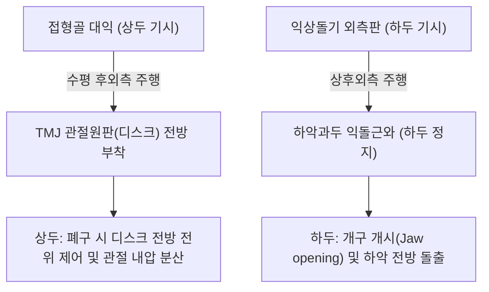
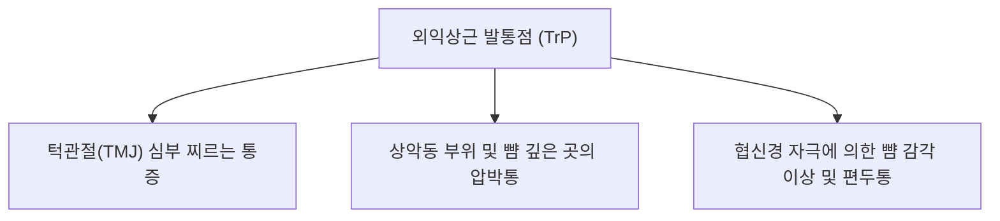

# 🫁 [[외익상근]] (Lateral Pterygoid)

> **핵심 요약 (Key Summary)**:
> [[외익상근]](Lateral Pterygoid, 가쪽날개근)은 접형골 대익 및 익상돌기 외측판 외측면에서 기시하여 하악골 과두 경부 및 턱관절(TMJ) 관절원판(디스크)에 정지하는 심부 저작 근육이다.
> 상두(Superior head)와 하두(Inferior head)의 독립된 기능 단위를 가지며, [[5. 삼차신경|삼차신경]](CN V3) 하악신경 외익상근가지의 지배를 받는다.
> 저작근 중 유일하게 **입을 벌리는 개구(Depression)를 개시하고 하악골 전방 돌출 및 TMJ 디스크 동적 정렬**을 조절하며, [[턱관절 통증|턱관절 장애(TMD)]] 디스크 전방 전위(ADD)와 관절음(Click)의 절대적 핵심 병변근이다.

---
## 📌 목차
1. [해부학적 정밀 구조 및 지배 신경/혈관](#1-해부학적-정밀-구조-및-지배-신경혈관)
2. [생체역학·토크 분석 & 근막 사슬 (Biomechanical Synergy)](#2-생체역학토크-분석--근막-사슬-biomechanical-synergy)
3. [근막통증증후군(TP) & 연관통 패턴 (Travell & Simons)](#3-근막통증증후군tp--연관통-패턴-travell--simons)
4. [초음파 해부학(Sonoanatomy) 및 중재 시술 랜드마크](#4-초음파-해부학sonoanatomy-및-중재-시술-랜드마크)
5. [⭐ 원장님 심층 임상 고찰 및 원본 필기 (Clinical Pearls)](#5-원장님-심층-임상-고찰-및-원본-필기-clinical-pearls)
6. [관련 임상 질환 및 운동손상 증후군 총괄](#6-관련-임상-질환-및-운동손상-증후군-총괄)
7. [추나·도수치료(MET/PIR) & 침구·약침·재활 프로토콜](#7-추나도수치료metpir--침구약침재활-프로토콜)
8. [출처 및 학술 참고 문헌 (References)](#8-출처-및-학술-참고-문헌-references)

---
## 1. 해부학적 정밀 구조 및 지배 신경/혈관

| 두부 구분 | 기시 (Origin) | 정지 (Insertion) | 핵심 생체역학 |
| :--- | :--- | :--- | :--- |
| **상두 (Superior head)** | 접형골 대익(Greater wing)의 측두하면 및 측두하릉 | TMJ 관절낭(Capsule), **관절원판(Articular disc)** 전내측연 및 과두 경부 상부 | 치아를 꽉 물 때(폐구 시) 디스크를 전방에서 지지 및 안정화 |
| **하두 (Inferior head)** | 접형골 익상돌기 외측판(Lateral pterygoid plate)의 외측면 | 하악과두 경부 전면의 **익돌근와(Pterygoid fovea)** | 하악골을 전하방으로 당겨 **입을 벌림(개구 개시)** |

* **신경 지배**: [[5. 삼차신경|삼차신경]](Trigeminal nerve, **CN V3**)의 전지 분지인 외익상근신경(Nerve to lateral pterygoid)
* **혈관 공급**: 악동맥(Maxillary artery)의 익상가지
* **신경혈관 통과 관계**: 상두와 하두 사이 틈새로 협신경(Buccal nerve)과 악동맥이 가로질러 주행

### 🔬 해부학 도해 및 단면도

외익상근은 측두하와(Infratemporal fossa)의 가장 깊은 곳에서 수평 사선으로 뻗어 하악과두와 관절원판을 직접 조절하는 턱관절의 사령탑이다.

---
## 2. 생체역학·토크 분석 & 근막 사슬 (Biomechanical Synergy)

* **상두와 하두의 상반된 협응 (Reciprocal Synergy)**:
  * **입을 벌릴 때 (개구)**: 하두가 강력 수축하여 하악과두를 관절융기(Articular eminence) 아래로 전하방 활주시킨다. 이때 상두는 이완된다.
  * **입을 다물 때 (폐구)**: 하두는 이완하고, 상두가 조절된 편심성 수축을 하여 후퇴하는 과두에 맞추어 디스크가 뒤로 딸려 들어가는 속도를 제어한다.
* **편측 수축 시 반대측 회전**:
  * 한쪽 외익상근 하두만 수축하면 턱 끝이 반대측으로 회전 편위된다.
* **근막 사슬 연계 (Deep Front Line)**:
  * 외익상근은 두개저-경추 심부 근막-후두하근막과 기능적 긴장 연쇄를 이루어 경추 부정렬 시 턱관절 동기 장애를 유발한다.

---
## 3. 근막통증증후군(TP) & 연관통 패턴 (Travell & Simons)

* **발통점 위치**: 관골궁 하연 하관혈 심층 및 상악 대구치 후방 점막 뒤쪽.
* **연관통 양상**:
  * 턱관절(TMJ) 바로 앞 심부의 격렬한 통증 및 저작 시 악화.
  * 상악골 부위로 퍼지는 둔통 및 관자놀이 편두통 유발.
  * 귀 안쪽의 통증 및 침 삼킬 때 턱관절 부위 뻐근함.

---
## 4. 초음파 해부학(Sonoanatomy) 및 중재 시술 랜드마크

* **초음파 스캔 프로토콜**:
  * 관골궁과 하악절흔(Mandibular notch) 사이에 선형 프로브를 수평 거치.
  * 하악절흔 깊은 곳에서 악동맥의 박동성 도플러 혈류와 그 심층의 외익상근 하두 근섬유 확인.
* **안전 마진**:
  * **악동맥 및 익상정맥총(Pterygoid venous plexus)**: 혈종 위험이 매우 높으므로 맹검 심자 시 아스피레이션 확인 필수.

---
## 5. ⭐ 원장님 심층 임상 고찰 및 원본 필기 (Clinical Pearls)

> 원장님의 독창적인 임상 필기와 노하우를 100% 보존한 핵심 지침이다.

### 1) 턱관절 디스크 전방 전위(ADD)와 '딱' 소리(Click) (원장님 팁)
* 스트레스성 이갈이나 부정교합으로 **상두가 만성 단축·연축되면 관절원판(디스크)을 전방으로 영구 견인**하여 디스크 전방 전위(Anterior Disc Displacement, ADD)를 유발한다.
* 입을 벌릴 때 하악과두가 전방으로 밀려난 디스크의 후방 턱을 넘어가면서 턱관절에서 '딱' 소리(Clicking)가 나거나 지그재그(S자형) 개구가 일어나는 절대적 주범이다.
* 치료 핵심: 하관혈(ST7) 전하방 심부 도침 자극 및 구강 내(상악 제2대구치 후외측 전정) 외익상근 직접 지두 이완술이 최고의 표적이다.

### 2) 삼차신경 자극과 비특이성 이개통·편두통 (원장님 팁 100% 보존)
* 외익상근 상두와 하두 두 갈래 사이로 협신경(Buccal nerve)이 통과하므로, 근육 경직 시 뺨의 감각 이상, 턱관절 심부 통증 및 측두부 편두통이 연쇄 호발한다.

---
## 6. 관련 임상 질환 및 운동손상 증후군 총괄

| 임상 질환 / 증후군 | 병리적 연관 기전 | 주요 증상 및 이학적 검사 | 핵심 교정 타깃 |
| :--- | :--- | :--- | :--- |
| [[턱관절 통증|턱관절 장애(TMD)]] 디스크 전위 | 상두 만성 연축으로 디스크 전방 탈구 | 개구 시 관절음(Click), 개구 편위(Wang 2026) | 하관혈 도침 및 외익상근 구강내 이완 |
| 급성 폐구 장애 (Closed Lock) | 디스크 비정복성 전방 전위 | 개구량 20~25mm 제한, 심한 관절통 | 외익상근 긴급 감압 및 TMJ 도수교정 |
| 턱관절 개구 탈구 (Open Lock) | 하두 과도한 전방 견인으로 과두 걸림 | 입이 다물어지지 않음, 하악 전방 돌출 | 하두 이완 및 턱관절 정복술 |
| 저작성 편두통 | 협신경 포착 및 측두하와 근막 긴장 | 관자놀이 및 귀 앞쪽의 박동성 통증 | 외익상근 TrP 불활성화 |

---
## 7. 추나·도수치료(MET/PIR) & 침구·약침·재활 프로토콜

* **한의학 경혈 매핑**:
  * 하관(ST7): 관골궁 하연, 외익상근 심부 직접 도달점.
  * 청궁(SI19), 이문(TE21): 턱관절 후방 관절낭 및 하악과두 배후 조절.
  * [[지창(地倉)|지창(ST4)]], 협거: 저작 협응 조절.
* **침구 및 수기 프로토콜**:
  * 하관혈 심부 사자(깊이 25~35mm)를 통한 외익상근 자침 및 전기자극.
  * 구강 내 외익상근 이완술: 장갑 착용 후 검지를 상악 협측 전정 가장 깊은 곳(제2대구치 뒤쪽)으로 넣어 상외측으로 부드럽게 지두 압박.
* **양방 치료 및 의뢰 기준 (Red Flags)**:
  * **입이 갑자기 닫히지 않는 급성 하악 탈구 (Open Lock)**: 악안면외과/응급실 넬라톤 수기 정복술(Nelaton maneuver) 의뢰.
  * **개구량 15mm 이하의 비가역적 개구 불능**: 관절원판 완전 유착(Adhesion) 또는 감염성 관절염 감별을 위한 턱관절 MRI 의뢰.

---
## 8. 출처 및 학술 참고 문헌 (References)

1. Barghouth G, Aizenbud D. Anatomy, Head and Neck, Lateral Pterygoid Muscle. *StatPearls*. 2023. [PMID: 31747206](https://pubmed.ncbi.nlm.nih.gov/31747206/)

2. Wang, Y., Zhang, X., & Liu, M. (2026). Correlation between abnormal jaw movement dominated by the lateral pterygoid muscle and symptoms of temporomandibular joint disorder: a retrospective analysis. *Hua Xi Kou Qiang Yi Xue Za Zhi*, 44(1), 88-95. [PMID: 42576764](https://pubmed.ncbi.nlm.nih.gov/42576764/)

3. Standring, S. (2020). *Gray's Anatomy: The Anatomical Basis of Clinical Practice* (42nd ed.). Elsevier, pp. 549-550.

4. Okeson, J. P. (2019). *Management of Temporomandibular Disorders and Occlusion* (8th ed.). Elsevier, pp. 161-175.

5. Travell, J. G., & Simons, D. G. (1999). *Myofascial Pain and Dysfunction: The Trigger Point Manual*, Vol. 1 (2nd ed.). Williams & Wilkins.
