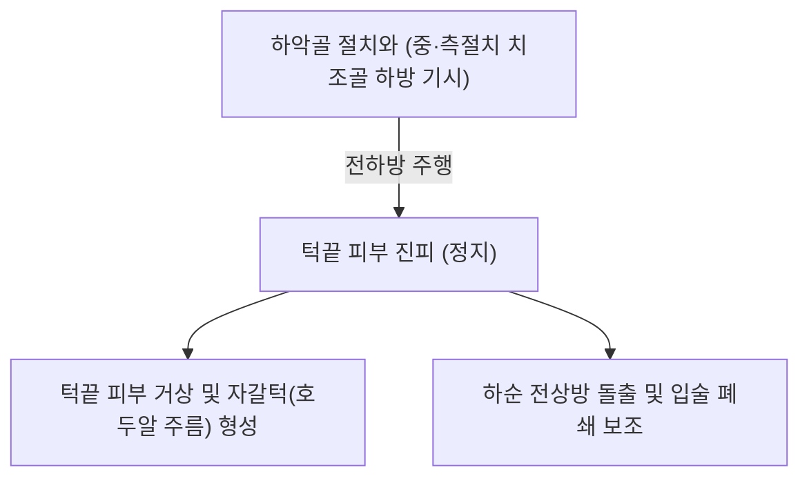

# 🫁 [[이근]] (Mentalis)

> **핵심 요약 (Key Summary)**:
> [[이근]](Mentalis, 턱끝근)은 하악골 절치와(Incisive fossa)에서 기시하여 턱끝(Chin)의 피부 진피에 정지하는 원추형의 안면 표정근이다.
> [[안면신경]](CN VII)의 하악연 가지(Marginal mandibular branch) 지배를 받으며, **턱끝 피부를 위로 끌어올려 주름(자갈턱, Peau d'orange)을 형성하고 아랫입술을 전상방으로 돌출(삐죽거리기)**시킨다.
> 임상적으로는 무턱(소하악증) 환자의 보상적 과긴장, 입술 폐쇄부전(Incompetent lips), 꼭두각시 주름 연계 및 턱끝 비대칭의 핵심 병변근이며, 한의 치료에서는 승장혈 하방 침구 및 매선 치료가 주된 표적이다.

---
## 📌 목차
1. [해부학적 정밀 구조 및 지배 신경/혈관](#1-해부학적-정밀-구조-및-지배-신경혈관)
2. [생체역학·토크 분석 & 근막 사슬 (Biomechanical Synergy)](#2-생체역학토크-분석--근막-사슬-biomechanical-synergy)
3. [근막통증증후군(TP) & 연관통 패턴 (Travell & Simons)](#3-근막통증증후군tp--연관통-패턴-travell--simons)
4. [초음파 해부학(Sonoanatomy) 및 중재 시술 랜드마크](#4-초음파-해부학sonoanatomy-및-중재-시술-랜드마크)
5. [⭐ 원장님 심층 임상 고찰 및 원본 필기 (Clinical Pearls)](#5-원장님-심층-임상-고찰-및-원본-필기-clinical-pearls)
6. [관련 임상 질환 및 운동손상 증후군 총괄](#6-관련-임상-질환-및-운동손상-증후군-총괄)
7. [추나·도수치료(MET/PIR) & 침구·약침·재활 프로토콜](#7-추나도수치료metpir--침구약침재활-프로토콜)
8. [출처 및 학술 참고 문헌 (References)](#8-출처-및-학술-참고-문헌-references)

---
## 1. 해부학적 정밀 구조 및 지배 신경/혈관

| 항목 | 상세 내용 |
| :--- | :--- |
| **기시 (Origin)** | 하악골(Mandible) 전면 절치와(Incisive fossa) — 하악 중절치 및 측절치 치조골 바로 하방 골면 |
| **정지 (Insertion)** | 턱끝 결절(Mental protuberance)의 피부 및 피하 진피 조직 |
| **신경 지배** | [[안면신경]](Facial nerve, **CN VII**)의 **하악연 가지(Marginal mandibular branch)** |
| **혈관 공급** | 안면동맥의 하순동맥(Inferior labial artery) 및 악동맥의 이신경동맥(Mental artery) |
| **형태적 특징** | 좌우 두 개의 근육 다발이 중앙에서 역V자 형태로 만나며, 정지부 섬유가 진피 속으로 깊게 파고드는 구조 |

### 🔬 해부학 도해 및 단면도

이근은 턱끝의 중심부를 두껍게 형성하는 수직 근육이다. 피부 바로 밑에서 치조골 골막으로 직행하며, 심층 외측으로는 이공(Mental foramen)과 이신경이 인접한다.

---
## 2. 생체역학·토크 분석 & 근막 사슬 (Biomechanical Synergy)

* **턱끝 피부 거상 및 압박 (Chin Elevation)**:
  * 피부를 뼈 방향으로 강하게 조여 올려 턱 끝에 귤껍질 또는 호두알 모양의 딤플(자갈 주름)을 만든다.
* **아랫입술 전상방 돌출 (Lower Lip Pouting)**:
  * [[구륜근]] 하부를 위로 밀어 올려 아랫입술을 밖으로 삐죽 내밀거나(의심, 삐짐의 표정), 구순 폐쇄력이 부족할 때 입술을 억지로 다물게 한다.
* **하악 표층 근막 연계**:
  * 구각하제근 및 광경근과 턱끝 결절 부위에서 근막적으로 연결되어 하악-경부 전방 긴장도를 공유한다.

---
## 3. 근막통증증후군(TP) & 연관통 패턴 (Travell & Simons)

* **발통점 위치**: 턱끝 결절 정중선 양측 이근 근복 중심.
* **연관통 양상**:
  * 턱끝 중심부의 뻐근하고 얼얼한 압박통.
  * 하악 전치부(아래 앞니)의 둔한 가성 치통 및 턱 끝 피부의 이상 긴장감.

---
## 4. 초음파 해부학(Sonoanatomy) 및 중재 시술 랜드마크

* **초음파 스캔 프로토콜**:
  * 턱끝 정중부에 탐촉자를 종축 또는 횡축으로 거치.
  * 하악골 피질골 바로 위에서 두 개의 돔(Dome) 형태로 융기된 저에코 이근 근복 확인(Silva 2024).
* **안전 마진**:
  * 이근 외측 1.5~2cm 지점의 제1·2소구치 치근단 하방에 이공(Mental foramen)이 위치하므로, 정중선 부위를 타깃하여 이신경 손상(아랫입술 무감각) 회피.

---
## 5. ⭐ 원장님 심층 임상 고찰 및 원본 필기 (Clinical Pearls)

> 원장님의 임상 필기와 독창적인 임상 노하우를 바탕으로 한 핵심 지침이다.

1. **무턱(Micrognathia) 및 돌출입 환자의 '자갈턱' 호소**: 하악이 후퇴되어 있거나 상악이 돌출된 환자는 입을 편안히 다물지 못한다. 가만히 있을 때도 입술을 닫기 위해 이근을 비정상적으로 과수축시키므로 턱 끝에 심한 호두알 주름이 잡힌다. 이근에 직자 침 치료 및 승장혈 자극을 통해 긴장을 풀어주어야 안면 윤곽이 부드러워진다.
2. **구안와사 회복기 비대칭 턱 주름**: 하악연 신경마비 회복 시 이근의 편측 수축 불균형으로 턱끝이 한쪽으로 치우쳐 보일 수 있으므로, 환측 이근 자극과 건측 이근 이완을 병행한다.
3. **구강 내 자침 테크닉**: 피부를 통한 자침 외에도 하순 구강 전정을 통해 이근 기시부 골막으로 진입하는 구강 내 자침법이 근막 이완에 매우 강력하다(Silva 2024).

---
## 6. 관련 임상 질환 및 운동손상 증후군 총괄

| 임상 질환 / 증후군 | 병리적 연관 기전 | 주요 증상 및 이학적 검사 | 핵심 교정 타깃 |
| :--- | :--- | :--- | :--- |
| 자갈턱 (Peau d'orange chin) | 이근의 만성 과긴장 및 진피 유착 | 턱 끝 표면의 울퉁불퉁한 요철 주름 | 이근 피하 도침 및 매선 삽입 |
| 구순 폐쇄부전 (Lip incompetence) | 무턱/돌출입으로 인한 보상적 이근 연축 | 입 다물 때 턱 끝 힘 들어감, 입 벌어짐 | 이근 이완 및 구순 폐쇄 재활 |
| [[안면신경마비]] (구안와사) | 하악연가지 마비로 인한 이근 무력 | 턱끝 수축 불능, 아랫입술 비대칭 | 승장·하악연 전침 치료 |
| 턱끝 비대칭 (Chin deviation) | 좌우 이근의 불균형적 수축 | 말하거나 웃을 때 턱끝 피부 편위 | 비대칭 교정 침구 및 MET |

---
## 7. 추나·도수치료(MET/PIR) & 침구·약침·재활 프로토콜

* **한의학 경혈 매핑**:
  * 승장(CV24): 하순 하방 정중와, 이근 상부 경계.
  * 하악 정중부 아시혈: 턱끝 융기부 정중선 좌우 이근 근복.
  * [[지창(地倉)|지창(ST4)]]: 구륜근 및 모디올루스 협응 취혈.
* **침구 및 수기 프로토콜**:
  * 승장혈 하방 1cm 지점에서 턱끝 골막을 향해 45도 하방 사자(깊이 10~15mm).
  * 턱끝 PIR 스트레칭: 양 엄지로 턱끝 피부를 하방으로 지그시 당긴 상태에서 환자에게 아랫입술을 올리는 약한 저항(5초) 후 호기 시 하방 견인.
* **양방 치료 및 의뢰 기준 (Red Flags)**:
  * **턱끝 및 아랫입술의 편측 감각 저하(Numb Chin Syndrome)**: 유방암, 전립선암 등의 하악골 전이암 징후이므로 즉시 **종양내과 및 악안면 3D CT/MRI 의뢰**.
  * **턱끝 부위 무통성 골 융기 및 치아 동요**: 하악골 법랑모세포종(Ameloblastoma) 등 치성 종양 감별을 위한 치과 방사선 의뢰.

---
## 8. 출처 및 학술 참고 문헌 (References)

1. Silva, P., & Santos, M. (2024). A Novel Intraoral Technique for Botulinum Toxin Type A Application in the Mentalis Muscle. *J Craniofac Surg*, 35(3), e245-e248. [PMID: 42037878](https://pubmed.ncbi.nlm.nih.gov/42037878/)

2. Standring, S. (2020). *Gray's Anatomy: The Anatomical Basis of Clinical Practice* (42nd ed.). Elsevier, p. 532.

3. Travell, J. G., & Simons, D. G. (1999). *Myofascial Pain and Dysfunction: The Trigger Point Manual*, Vol. 1 (2nd ed.). Williams & Wilkins.
