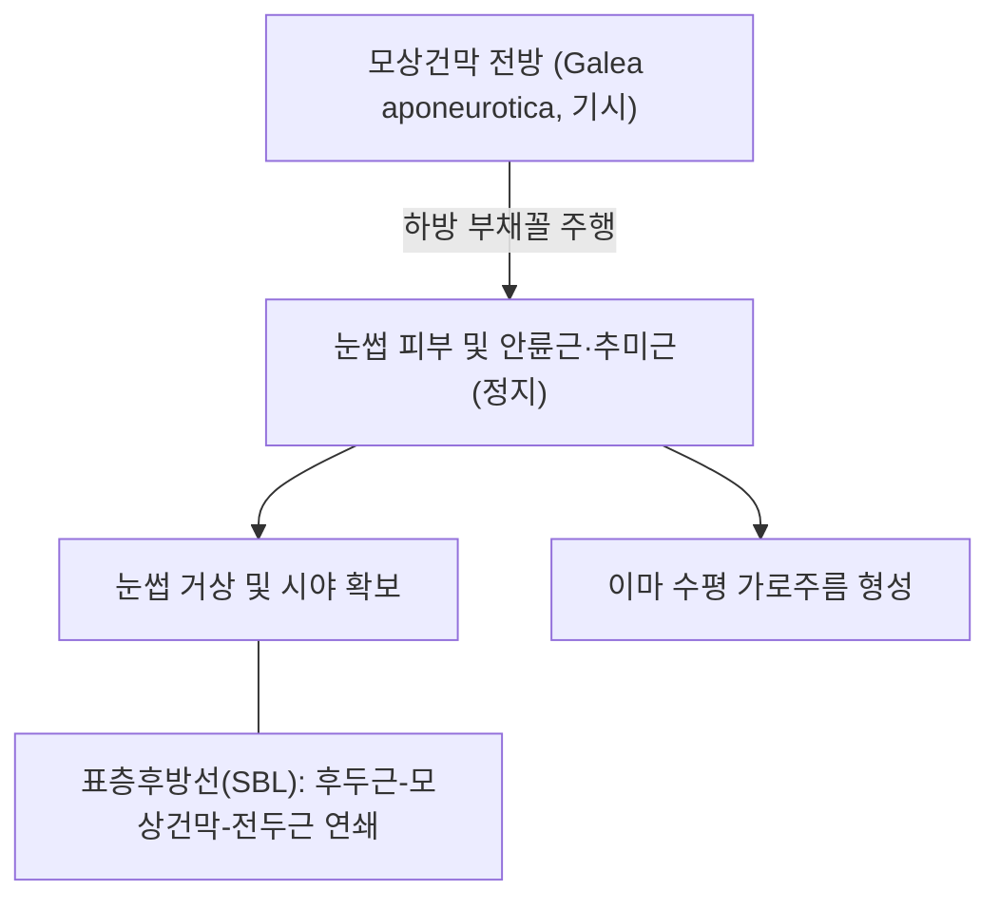

# 🫁 [[전두근]] (Frontalis)

> **핵심 요약 (Key Summary)**:
> [[전두근]](Frontalis, 이마근)은 두개골 상부의 모상건막(Galea aponeurotica) 전방부에서 기시하여 눈썹 피부, [[안륜근]] 및 미간근 섬유에 정지하는 넓은 판상 안면 표정근이다.
> 후두근(Occipitalis)과 함께 **후두전두근(Occipitofrontalis)** 복합체를 형성하며, [[안면신경]](CN VII) 측두가지(Temporal branches)의 지배를 받는다.
> **눈썹을 위로 들어 올리고(거상), 이마에 수평 가로 주름을 형성하여 놀람·경탄·주시의 표정**을 만들며, **중추성 뇌졸중(이마 주름 보존)과 말초성 구안와사(이마 주름 소실)를 가르는 절대적 임상 감별 지표**이다.

---
## 📌 목차
1. [해부학적 정밀 구조 및 지배 신경/혈관](#1-해부학적-정밀-구조-및-지배-신경혈관)
2. [생체역학·토크 분석 & 근막 사슬 (Biomechanical Synergy)](#2-생체역학토크-분석--근막-사슬-biomechanical-synergy)
3. [근막통증증후군(TP) & 연관통 패턴 (Travell & Simons)](#3-근막통증증후군tp--연관통-패턴-travell--simons)
4. [초음파 해부학(Sonoanatomy) 및 중재 시술 랜드마크](#4-초음파-해부학sonoanatomy-및-중재-시술-랜드마크)
5. [⭐ 원장님 심층 임상 고찰 및 원본 필기 (Clinical Pearls)](#5-원장님-심층-임상-고찰-및-원본-필기-clinical-pearls)
6. [관련 임상 질환 및 운동손상 증후군 총괄](#6-관련-임상-질환-및-운동손상-증후군-총괄)
7. [추나·도수치료(MET/PIR) & 침구·약침·재활 프로토콜](#7-추나도수치료metpir--침구약침재활-프로토콜)
8. [출처 및 학술 참고 문헌 (References)](#8-출처-및-학술-참고-문헌-references)

---
## 1. 해부학적 정밀 구조 및 지배 신경/혈관

| 항목 | 상세 내용 |
| :--- | :--- |
| **기시 (Origin)** | 모상건막(Galea aponeurotica) 전방 가장자리 — 관상봉합(Coronal suture) 전방 두피 근막 |
| **정지 (Insertion)** | 눈썹 부위 피하 진피 조직, [[안륜근]], [[추미근]], [[미간근]] 근섬유와 교차 융합 |
| **신경 지배** | [[안면신경]](Facial nerve, **CN VII**)의 **측두가지(Temporal branches)** |
| **중추 신경로 특징** | **대뇌피질의 양측성 운동 지배(Bilateral cortical representation)**를 받는 유일한 안면 표정근 영역 |
| **혈관 공급** | 안구동맥의 안와상동맥(Supraorbital artery), 활차상동맥(Supratrochlear artery) 및 천측두동맥 이마분지 |

### 🔬 해부학 도해 및 단면도

전두근은 이마 전체를 덮고 있으며 뼈에 직접 부착하지 않고 모상건막과 눈썹 피부를 잇는 부유성 근육판이다.

---
## 2. 생체역학·토크 분석 & 근막 사슬 (Biomechanical Synergy)

* **눈썹 거상 및 시야 확장 (Eyebrow Elevation)**:
  * 눈썹을 이마 쪽으로 끌어올려 상안검을 간접 거상시키고 상방 시야를 넓힌다.
* **이마 수평 주름 형성 (Forehead Wrinkles)**:
  * 놀람, 의문, 공포 시 이마 전면에 다중 수평 주름을 형성한다.
* **표층후방선(Superficial Back Line) 연쇄**:
  * 후두하근군 → [[후두근]] → 모상건막 → 전두근으로 이어지는 두경부 근막선 상에서 후두부 단축 시 이마를 거쳐 안구와 전두부로 장력이 전파된다.

---
## 3. 근막통증증후군(TP) & 연관통 패턴 (Travell & Simons)

* **발통점 위치**: 눈썹 상방 2~3cm 지점의 전두근 내측 및 외측 근복.
* **연관통 양상**:
  * 이마 전면의 묵직하고 띠를 두른 듯한 압박성 전두통.
  * 안구 심부 통증 및 눈 주위 뻐근함 유발.

---
## 4. 초음파 해부학(Sonoanatomy) 및 중재 시술 랜드마크

* **초음파 스캔 프로토콜**:
  * 이마 중앙부에 선형 고주파 탐촉자를 수직 거치.
  * 전두골 피질 위의 골막, 그 위의 저에코 전두근층, 피하지방 및 피부층을 확인(Kim 2024).
* **안전 마진**:
  * 안와상신경 및 혈관 다발이 안와상절흔에서 나와 전두근 심층을 관통하여 표층으로 올라오므로 안와상연 직상방 심자 주의.

---
## 5. ⭐ 원장님 심층 임상 고찰 및 원본 필기 (Clinical Pearls)

> 원장님의 독창적인 임상 필기와 노하우를 100% 보존한 핵심 지침이다.

### 1) 중추성 안면마비(뇌졸중) vs 말초성 안면마비(구안와사) 감별 절대 지표 (원장님 팁)
* **전두근은 양측 대뇌피질의 이중 지배(Bilateral cortical innervation)**를 받는다.
* 따라서 뇌경색/뇌출혈 같은 **중추성 마비 시에는 반대측 대뇌피질이 보상하여 이마 주름(전두근 거상)이 정상 보존**된다.
* 반면 안면신경 핵 또는 본간이 손상된 **말초성 구안와사(Bell's palsy) 시에는 환측 이마 주름이 완전히 소실**되어 눈썹을 위로 전혀 올리지 못한다. 이는 임상에서 중추성/말초성을 가르는 1순위 베드사이드 테스트이다.

### 2) 긴장성 전두통과 눈썹 보톡스 부작용 (원장님 팁 100% 보존)
* 안검하수(눈꺼풀 처짐)가 있는 환자는 눈을 뜨기 위해 전두근을 보상적으로 과도하게 사용하여 만성 긴장성 전두통을 호소한다.
* 이때 미용 목적으로 이마에 보톡스를 과도하게 주입하여 전두근이 마비되면 보상 기전이 차단되어 **눈을 제대로 뜨지 못하는 심각한 안검하수 및 눈 무거움**이 발생한다. 양백(GB14)-두유 매선 및 침구 치료로 전두근 긴장도를 정상화해야 한다.

---
## 6. 관련 임상 질환 및 운동손상 증후군 총괄

| 임상 질환 / 증후군 | 병리적 연관 기전 | 주요 증상 및 이학적 검사 | 핵심 교정 타깃 |
| :--- | :--- | :--- | :--- |
| [[안면신경마비]] (구안와사) | 말초 안면신경 측두가지 마비 | 환측 이마 주름 소실, 눈썹 거상 불능 | 양백·두유·찬죽 전침 및 매선 |
| 중추성 뇌졸중 (Stroke) | 대뇌피질 상위운동신경원 손상 | **이마 주름 보존**, 구각 편위/구음장애 | 즉시 응급실 뇌 MRI 의뢰 |
| 긴장성 두통 (Tension Headache) | 전두근 및 모상건막 만성 연축 | 띠로 조이는 듯한 이마 통증, 안통 | 양백혈 도침 및 모상건막 이완 |
| 가성 안검하수 | 상안검 이완증에 따른 보상적 전두근 과사용 | 만성 이마 가로주름, 눈 피로 | 전두근-안검 협응 재활 |

---
## 7. 추나·도수치료(MET/PIR) & 침구·약침·재활 프로토콜

* **한의학 경혈 매핑**:
  * [[양백(陽白)|양백(GB14)]]: 눈썹 중앙 상방 1촌, 전두근 중심 취혈.
  * [[두유(頭維)|두유(ST8)]]: 이마 모서리 발제 부위, 모상건막 전외측 연결점.
  * 찬죽(BL2), 어요(EX-HN4): 전두근 하연 취혈.
* **침구 및 수기 프로토콜**:
  * 전두골 골막을 따라 이마 전체를 피하 수평 횡자(침장 15~20mm).
  * 모상건막 두피 추나: 양 손가락을 갈고리 모양으로 모아 두개골 정수리에서 전두근 방향으로 모상건막을 전후좌우로 이동시키며 근막 유착 박리.
* **양방 치료 및 의뢰 기준 (Red Flags)**:
  * **이마 주름은 멀쩡한데 편측 입꼬리 마비 + 구음장애 + 편마비 동반**: 급성 뇌경색/뇌출혈 신호이므로 즉시 **119를 통한 응급실 뇌졸중 센터 의뢰**.
  * **50세 이상에서 편측 이마/관자놀이의 극심한 박동통, 시력 저하, 압통 비후된 측두동맥**: 거대세포동맥염(Temporal arteritis) 의심 시 실명 예방을 위해 즉시 류마티스내과/안과 응급 스테로이드 투여 의뢰.

---
## 8. 출처 및 학술 참고 문헌 (References)

1. Kim, H., & Lee, W. (2024). Understanding Perceived Forehead Changes Post-Endoscopic Brow Lift: The Impact of Frontalis Muscle Contraction. *Aesthetic Plast Surg*, 48(2), 215-223. [PMID: 42012844](https://pubmed.ncbi.nlm.nih.gov/42012844/)

2. Standring, S. (2020). *Gray's Anatomy: The Anatomical Basis of Clinical Practice* (42nd ed.). Elsevier, pp. 528-529.

3. Travell, J. G., & Simons, D. G. (1999). *Myofascial Pain and Dysfunction: The Trigger Point Manual*, Vol. 1 (2nd ed.). Williams & Wilkins.
