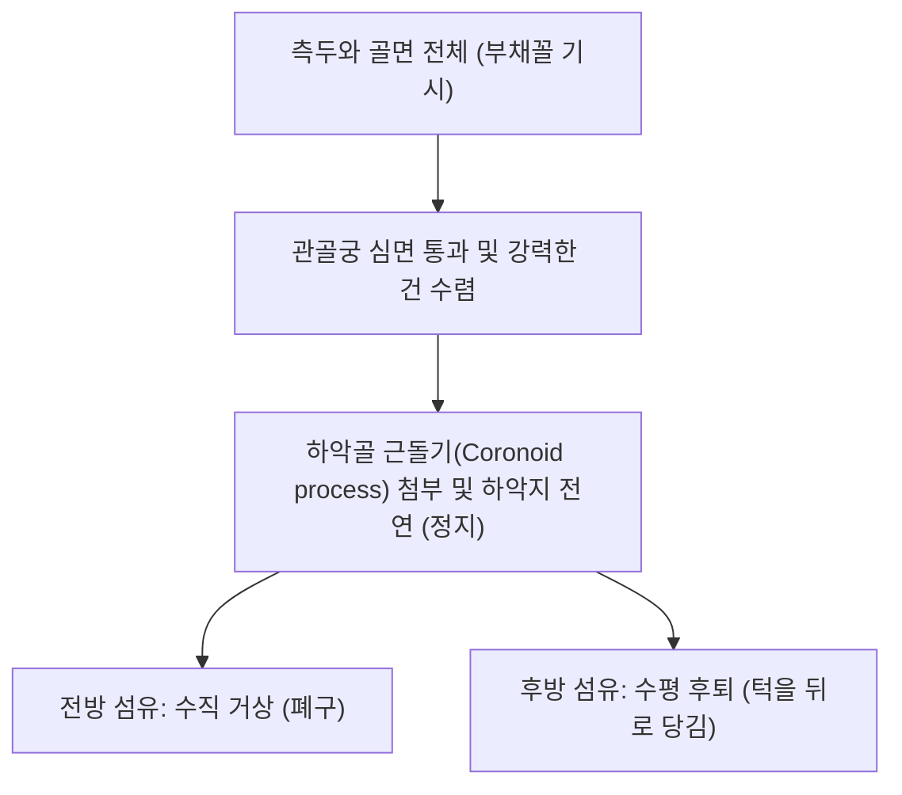
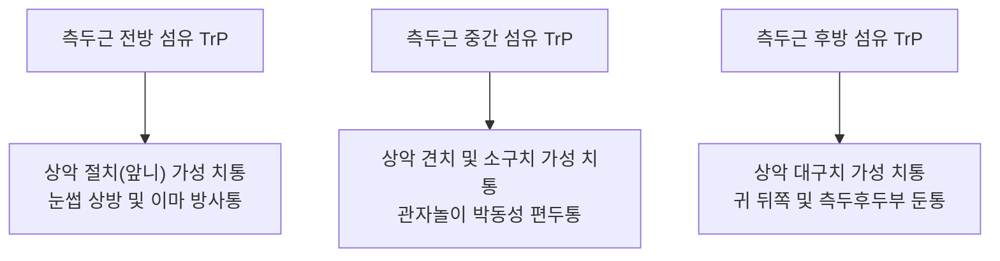

# 🫁 [[측두근]] (Temporalis)

> **핵심 요약 (Key Summary)**:
> [[측두근]](Temporalis, 관자근)은 측두와(Temporal fossa) 바닥 전체 및 측두근막에서 기시하여 하악골 근돌기(Coronoid process) 및 하악지 전연에 정지하는 부채꼴 모양의 거대 저작 근육이다.
> [[5. 삼차신경|삼차신경]](CN V3) 하악신경 심측두신경(Deep temporal nerves)의 지배를 받으며, **하악골 거상(폐구), 하악골 후퇴(Retraction) 및 턱관절(TMJ)의 시상면 안정성**을 담당한다.
> 임상적으로는 [[턱관절 통증|턱관절 장애(TMD)]], 만성 긴장성 편두통, 오훼돌기 건염 및 가성 상악 치통의 핵심 병변근이며, 한의 치료에서는 [[태양(EX-HN5)|태양]]·두유·솔곡혈 침구 및 근돌기 도침 박리술이 주된 표적이다.

---
## 📌 목차
1. [해부학적 정밀 구조 및 지배 신경/혈관](#1-해부학적-정밀-구조-및-지배-신경혈관)
2. [생체역학·토크 분석 & 근막 사슬 (Biomechanical Synergy)](#2-생체역학토크-분석--근막-사슬-biomechanical-synergy)
3. [근막통증증후군(TP) & 연관통 패턴 (Travell & Simons)](#3-근막통증증후군tp--연관통-패턴-travell--simons)
4. [초음파 해부학(Sonoanatomy) 및 중재 시술 랜드마크](#4-초음파-해부학sonoanatomy-및-중재-시술-랜드마크)
5. [⭐ 원장님 심층 임상 고찰 및 원본 필기 (Clinical Pearls)](#5-원장님-심층-임상-고찰-및-원본-필기-clinical-pearls)
6. [관련 임상 질환 및 운동손상 증후군 총괄](#6-관련-임상-질환-및-운동손상-증후군-총괄)
7. [추나·도수치료(MET/PIR) & 침구·약침·재활 프로토콜](#7-추나도수치료metpir--침구약침재활-프로토콜)
8. [출처 및 학술 참고 문헌 (References)](#8-출처-및-학술-참고-문헌-references)

---
## 1. 해부학적 정밀 구조 및 지배 신경/혈관

| 항목 | 상세 내용 |
| :--- | :--- |
| **기시 (Origin)** | 하측두선(Inferior temporal line) 하방의 **측두와(Temporal fossa) 골면 전체** 및 측두근막(Temporal fascia) 내측면 |
| **정지 (Insertion)** | 하악골 **근돌기(Coronoid process)**의 내·외측면 및 첨부, 하악지(Mandibular ramus) 전연을 따라 제3대구치 부근까지 하행 |
| **신경 지배** | [[5. 삼차신경|삼차신경]](Trigeminal nerve, **CN V3**) 전지 분지인 **심측두신경(Deep temporal nerves, 전·후지)** |
| **혈관 공급** | 악동맥의 심측두동맥(Deep temporal arteries) 및 외경동맥의 중측두동맥 |
| **근섬유 방향 분화** | 전방(수직 주행), 중간(사선 주행), 후방(수평 주행) 섬유로 나뉘어 관골궁 심면을 통과 |

### 🔬 해부학 도해 및 단면도

측두근은 관자놀이 전체를 넓게 채운 뒤 강력한 건(Tendon) 다발로 수렴하여 관골궁 안쪽 좁은 틈을 지나 하악골 근돌기에 부착한다.

---
## 2. 생체역학·토크 분석 & 근막 사슬 (Biomechanical Synergy)

* **하악골 강력 폐구 (Mandibular Elevation)**:
  * 전방 수직 섬유가 수축하여 치아를 맞물리게 하는 빠른 저작 폐구 속도를 제공한다.
* **하악골 후퇴 및 위치 유지 (Mandibular Retraction)**:
  * 후방 수평 섬유가 수축하여 앞으로 나간 아래턱을 뒤로 당겨 턱관절와(Glenoid fossa) 내 과두 위치를 복귀시킨다.
* **측방 연삭 운동 협응**:
  * 동측 측두근과 반대측 [[내익상근]]이 교차 수축하여 턱의 좌우 수평 맷돌질을 제어한다.
* **측두근막-모상건막 근막 연결**:
  * 측두근막은 상방으로 모상건막 및 두피 근막과 연결되어 두경부 표층 긴장을 관자놀이로 전달한다.

---
## 3. 근막통증증후군(TP) & 연관통 패턴 (Travell & Simons)

* **발통점 위치**: 관자놀이 전방, 중앙, 후방 근복에 다발성 TrP 형성.
* **연관통 양상**:
  * **가성 치통(False Toothache)**: 치과적으로 아무 이상이 없는데도 위쪽 앞니, 송곳니, 어금니가 욱신거리는 연관 치통의 가장 흔한 원인.
  * **관자놀이 편두통**: 관자놀이를 띠로 조이거나 쿵쾅거리는 긴장성 두통 유발.

---
## 4. 초음파 해부학(Sonoanatomy) 및 중재 시술 랜드마크

* **초음파 스캔 프로토콜**:
  * 관자놀이 부위에 선형 프로브를 수직 또는 수평 거치.
  * 고에코의 측두골 피질 바로 위에서 두터운 저에코 측두근 실질과 그 위를 덮는 2중 측두근막 확인(Spilz 2026).
* **안전 마진**:
  * 천측두동맥(Superficial temporal artery)과 이개측두신경이 측두근 표면을 수직 주행하므로 도플러로 혈류를 확인하고 혈관 천자 회피.

---
## 5. ⭐ 원장님 심층 임상 고찰 및 원본 필기 (Clinical Pearls)

> 원장님의 독창적인 임상 필기와 노하우를 100% 보존한 핵심 지침이다.

### 1) 긴장성 편두통과 상악 치통 방사 (원장님 팁)
* 스트레스나 장시간 컴퓨터 작업 시 이를 꽉 무는 습관(Clenching)으로 측두근 전·중부에 발통점(TrP)이 생기면 **관자놀이가 조이는 듯한 편두통 및 위쪽 어금니·앞니가 욱신거리는 치통 방사**가 호발한다.
* 치과에서 충치가 없다고 하는데도 치통을 호소하는 환자는 측두근을 1순위로 촉진해야 한다. [[태양(EX-HN5)|태양]]혈-현로혈 심부 침구 자극이 특효이다.

### 2) 오훼돌기(Coronoid Process) 건염과 개구통 (원장님 팁 100% 보존)
* 입을 크게 벌릴 때 관골궁 아래에서 하악골 근돌기(오훼돌기) 부착부가 관골궁과 마찰되거나 건막 유착으로 심각한 개구통이 발생한다.
* 관골궁 하연 하관혈 전상방에서 입을 벌린 상태로 근돌기 첨부를 촉진하여 도침으로 건 부착부 유착을 박리(Coronoid tenotomy 효과)하면 개구 제한이 즉각 풀린다.

---
## 6. 관련 임상 질환 및 운동손상 증후군 총괄

| 임상 질환 / 증후군 | 병리적 연관 기전 | 주요 증상 및 이학적 검사 | 핵심 교정 타깃 |
| :--- | :--- | :--- | :--- |
| 긴장성 편두통 (Tension Headache) | 측두근 만성 과긴장 및 TrP 활성화 | 관자놀이 조임통, 턱 피로감 | 태양·솔곡 도침 및 침구 |
| 가성 상악 치통 (Referred Odontalgia) | 측두근 발통점에 의한 치아 방사통 | 상악 전치/소구치/대구치 치통 | 측두근 TrP 허혈성 압박 |
| 근돌기(오훼돌기) 충돌 증후군 | 근돌기 비후 및 측두근 건막 구축 | 입 벌릴 때 관골궁 하부 극심한 통증 | 근돌기 부착부 도침 박리술 |
| [[이갈이]] 및 악물기 증후군 | 측두근 후방 섬유 과활성화 | 기상 시 관자놀이 뻐근함, 치아 마모 | 측두근 이완 및 스플린트 연계 |

---
## 7. 추나·도수치료(MET/PIR) & 침구·약침·재활 프로토콜

* **한의학 경혈 매핑**:
  * [[태양(EX-HN5)|태양]]: 눈썹 외측과 외안각 사이 함요처, 전방 섬유 주혈.
  * 솔곡(GB8): 이첨 직상 1.5촌, 측두근 중간·후방 섬유 취혈.
  * [[두유(頭維)|두유(ST8)]]: 전외측 근막 연결점.
* **침구 및 수기 프로토콜**:
  * 측두근 전체를 부채꼴 방향으로 피하 사자(깊이 10~15mm) 후 저주파 전침 자극.
  * 측두근 PIR 스트레칭: 시술자가 하악골을 아래로 부드럽게 견인하여 개구를 유도한 상태에서 환자에게 입을 살짝 다무는 등척성 저항(5초) 후 호기 시 완전 개구 신장.
* **양방 치료 및 의뢰 기준 (Red Flags)**:
  * **50세 이상에서 편측 관자놀이의 심한 박동통 + 씹을 때 턱 통증(Jaw claudication) + 시력 저하**: 측두동맥염(Giant cell arteritis) 응급 신호이므로 즉시 **류마티스내과 혈액검사(ESR/CRP) 및 고용량 스테로이드 의뢰**.
  * **외상 후 관자놀이 뇌출혈 의심(의식 소실, 두통 악화)**: 중경막동맥 파열에 의한 경막외출혈(EDH) 배제를 위해 즉시 뇌 CT 의뢰.

---
## 8. 출처 및 학술 참고 문헌 (References)

1. Standring, S. (2020). *Gray's Anatomy: The Anatomical Basis of Clinical Practice* (42nd ed.). Elsevier, pp. 547-548.

2. Okeson, J. P. (2019). *Management of Temporomandibular Disorders and Occlusion* (8th ed.). Elsevier, pp. 145-160.

3. Travell, J. G., & Simons, D. G. (1999). *Myofascial Pain and Dysfunction: The Trigger Point Manual*, Vol. 1 (2nd ed.). Williams & Wilkins.
