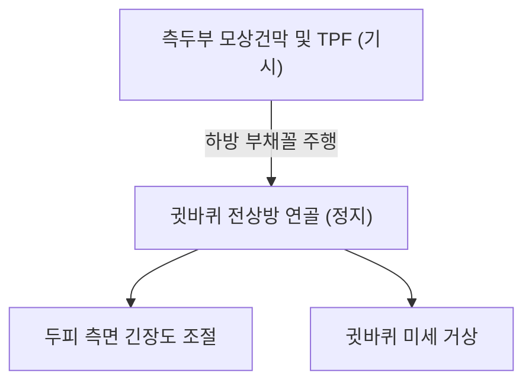

# 🫁 [[측두정근]] (Temporoparietalis)

> **핵심 요약 (Key Summary)**:
> [[측두정근]](Temporoparietalis, 관자마루근)은 귀 윗부분 측두부 모상건막(Galea aponeurotica)에서 기시하여 이개(Auricle) 연골 및 이개상근에 정지하는 얇은 표층 두피 근육이다.
> [[안면신경]](CN VII) 측두가지(Temporal branches)의 지배를 받으며, **두피를 긴장시키고 귓바퀴를 미세하게 상방으로 거상**시키는 역할을 수행한다.
> 본 근육이 위치하는 **측두두정근막(Temporoparietal fascia, TPF)**은 두경부 재건 성형술(TPF flap)의 핵심 랜드마크이며, 임상적으로는 만성 두피 압박통, 관자놀이 조임성 두통 및 솔곡(GB8)·각손혈 침구의 주된 표적이다.

---
## 📌 목차
1. [해부학적 정밀 구조 및 지배 신경/혈관](#1-해부학적-정밀-구조-및-지배-신경혈관)
2. [생체역학·토크 분석 & 근막 사슬 (Biomechanical Synergy)](#2-생체역학토크-분석--근막-사슬-biomechanical-synergy)
3. [근막통증증후군(TP) & 연관통 패턴 (Travell & Simons)](#3-근막통증증후군tp--연관통-패턴-travell--simons)
4. [초음파 해부학(Sonoanatomy) 및 중재 시술 랜드마크](#4-초음파-해부학sonoanatomy-및-중재-시술-랜드마크)
5. [⭐ 원장님 심층 임상 고찰 및 원본 필기 (Clinical Pearls)](#5-원장님-심층-임상-고찰-및-원본-필기-clinical-pearls)
6. [관련 임상 질환 및 운동손상 증후군 총괄](#6-관련-임상-질환-및-운동손상-증후군-총괄)
7. [추나·도수치료(MET/PIR) & 침구·약침·재활 프로토콜](#7-추나도수치료metpir--침구약침재활-프로토콜)
8. [출처 및 학술 참고 문헌 (References)](#8-출처-및-학술-참고-문헌-references)

---
## 1. 해부학적 정밀 구조 및 지배 신경/혈관

| 항목 | 상세 내용 |
| :--- | :--- |
| **기시 (Origin)** | 귀 윗부분의 모상건막(Galea aponeurotica) 측두부 및 측두두정근막(TPF) |
| **정지 (Insertion)** | 귓바퀴(Auricle)의 전상방 연골 및 이개상근(Superior auricular muscle) 섬유 |
| **신경 지배** | [[안면신경]](Facial nerve, **CN VII**)의 **측두가지(Temporal branches)** |
| **혈관 공급** | 외경동맥의 천측두동맥(Superficial temporal artery, STA) 분지 |
| **수술 해부학적 중요성** | 두경부 재건 수술에서 혈관경이 풍부한 **측두두정근막 피판(TPF flap)**의 근골격 성분(StatPearls 2023) |

### 🔬 해부학 도해 및 단면도

측두정근은 측두근막(심층) 위에 놓인 표층 근막계(SMAS)의 연속선상에 위치하며, 천측두동맥과 이개측두신경이 이 근육의 층을 관통하여 상행한다.

---
## 2. 생체역학·토크 분석 & 근막 사슬 (Biomechanical Synergy)

* **두피 측면 장력 제어**:
  * 모상건막을 외측에서 단단히 지지하여 이마와 후두부 사이의 두피 장력 균형을 유지한다.
* **이개 거상 보조**:
  * 동물의 경우 소리를 향해 귀를 세우는 핵심 근육이나, 인간에게는 흔적 기관(Vestigial structure)으로 남아 표정 및 두피 긴장 조절에 주로 관여한다.
* **나선선(Spiral Line) 두개부 연계**:
  * 두개 측두부를 감싸며 판상근 및 흉쇄유돌근과 연결되어 두개골의 비틀림 장력을 흡수한다.

---
## 3. 근막통증증후군(TP) & 연관통 패턴 (Travell & Simons)

* **발통점 위치**: 귀 윗부분(솔곡혈 부근) 측두정근 피하 섬유.
* **연관통 양상**:
  * 귀 바로 위 관자놀이에서 정수리 외측으로 퍼지는 얕은 찌릿함.
  * 빗질을 하거나 모자를 쓸 때 두피가 따갑거나 아픈 두피 이질통(Allodynia) 유발.

---
## 4. 초음파 해부학(Sonoanatomy) 및 중재 시술 랜드마크

* **초음파 스캔 프로토콜**:
  * 이첨 직상 1~2cm 지점에 선형 고주파 프로브 거치.
  * 피부 직하방 고에코의 측두두정근막(TPF)과 그 내부의 얇은 측두정근 섬유, 하부의 무에코성 느슨한 유착 조직층 확인.
* **안전 마진**:
  * 천측두동맥(STA)의 두정분지가 바로 인접하여 주행하므로 도플러로 박동을 확인하고 혈종 예방.

---
## 5. ⭐ 원장님 심층 임상 고찰 및 원본 필기 (Clinical Pearls)

> 원장님의 임상 필기와 독창적인 임상 노하우를 바탕으로 한 핵심 지침이다.

1. **'두피가 찌릿하고 당긴다'는 이상감각의 숨은 표적**: 환자가 관자놀이 윗부분과 귀 주변 두피가 조여서 머리카락만 건드려도 아프다고 할 때, 심층의 [[측두근]]만 치료하면 호전이 더디다. 표층에 위치한 측두정근 및 측두두정근막(TPF)을 솔곡(GB8)·각손(TE20) 혈위에서 피하 횡자로 얇게 자침하여 이완시키면 두피 조임증이 즉각 해소된다.
2. **이마-귀-후두부 긴장 연쇄 고리**: 전두근과 후두근을 측면에서 이어주는 다리 역할을 하므로, 만성 긴장성 두통 환자에서 측두정근을 함께 풀어주어야 헬멧을 쓴 것 같은 전체 두피 긴장이 완전히 풀린다.

---
## 6. 관련 임상 질환 및 운동손상 증후군 총괄

| 임상 질환 / 증후군 | 병리적 연관 기전 | 주요 증상 및 이학적 검사 | 핵심 교정 타깃 |
| :--- | :--- | :--- | :--- |
| 두피 신경통 / 이질통 | 측두두정근막 내 미세 감각신경 자극 | 머리카락 당길 때 통증, 두피 화끈거림 | 솔곡·각손 침구 및 두피 추나 |
| 만성 측두부 긴장통 | 측두정근 및 모상건막 만성 단축 | 귀 윗부분 묵직한 압박통, 턱 피로감 | 측두정근 피하 횡자 |
| TPF 피판 수술 후 반흔 | 안면거상술 및 귀 재건 수술 후 구축 | 귀 주변 당김, 국소 흉터 통증 | 도침 미세 유착 박리 |

---
## 7. 추나·도수치료(MET/PIR) & 침구·약침·재활 프로토콜

* **한의학 경혈 매핑**:
  * 솔곡(GB8): 이첨 직상 1.5촌, 측두정근 중심 취혈.
  * 각손(TE20): 귓바퀴를 앞으로 접었을 때 이첨이 닿는 발제부.
  * 천충(GB9): 솔곡 후방 0.5촌, 후두부 연계점.
* **침구 및 수기 프로토콜**:
  * 솔곡(GB8)에서 전방 또는 후방으로 두피 골막을 따라 피하 수평 횡자(깊이 2~3mm 천자).
  * 귓바퀴 상방 두피 이완술: 양 손바닥으로 귀 윗부분 두피를 위로 밀어 올리며 부드럽게 원형 마사지.
* **양방 치료 및 의뢰 기준 (Red Flags)**:
  * **외상 후 관자놀이 상부의 급격한 박동성 종괴 형성**: 천측두동맥 가성동맥류(Pseudoaneurysm) 의심 시 즉시 혈관외과 초음파 및 결찰술 의뢰.

---
## 8. 출처 및 학술 참고 문헌 (References)

1. Standring, S. (2020). *Gray's Anatomy: The Anatomical Basis of Clinical Practice* (42nd ed.). Elsevier, p. 529.

2. Travell, J. G., & Simons, D. G. (1999). *Myofascial Pain and Dysfunction: The Trigger Point Manual*, Vol. 1 (2nd ed.). Williams & Wilkins.
