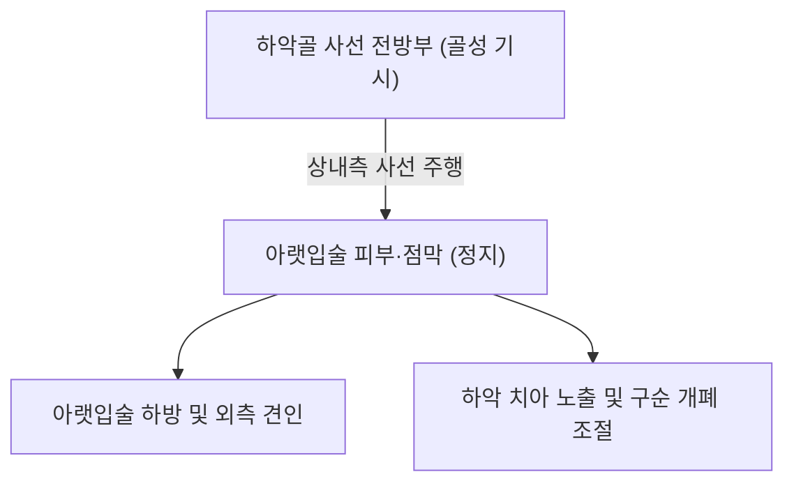

# 🫁 [[하순하제근]] (Depressor Labii Inferioris)

> **핵심 요약 (Key Summary)**:
> [[하순하제근]](Depressor labii inferioris, 아래입술내림근)은 하악골 사선 전방부에서 기시하여 아랫입술(Lower lip)의 피부 및 점막에 정지하는 사각형 형태의 심층 안면 표정근이다.
> [[안면신경]](CN VII)의 **하악연 가지(Marginal mandibular branch)** 및 경부가지의 지배를 받으며, **아랫입술을 아래 및 가쪽(하외측)으로 당겨 하악 절치를 노출시키고 슬픔·회의·아이러니의 표정**을 짓는다.
> 임상적으로는 [[안면신경마비]](구안와사) 회복기 및 안면 재건술 후 **말할 때 아랫입술 비대칭**의 핵심 결정 근육이며, 한의 치료에서는 대영·승장 외측 침구 및 매선 치료가 주된 표적이다.

---
## 📌 목차
1. [해부학적 정밀 구조 및 지배 신경/혈관](#1-해부학적-정밀-구조-및-지배-신경혈관)
2. [생체역학·토크 분석 & 근막 사슬 (Biomechanical Synergy)](#2-생체역학토크-분석--근막-사슬-biomechanical-synergy)
3. [근막통증증후군(TP) & 연관통 패턴 (Travell & Simons)](#3-근막통증증후군tp--연관통-패턴-travell--simons)
4. [초음파 해부학(Sonoanatomy) 및 중재 시술 랜드마크](#4-초음파-해부학sonoanatomy-및-중재-시술-랜드마크)
5. [⭐ 원장님 심층 임상 고찰 및 원본 필기 (Clinical Pearls)](#5-원장님-심층-임상-고찰-및-원본-필기-clinical-pearls)
6. [관련 임상 질환 및 운동손상 증후군 총괄](#6-관련-임상-질환-및-운동손상-증후군-총괄)
7. [추나·도수치료(MET/PIR) & 침구·약침·재활 프로토콜](#7-추나도수치료metpir--침구약침재활-프로토콜)
8. [출처 및 학술 참고 문헌 (References)](#8-출처-및-학술-참고-문헌-references)

---
## 1. 해부학적 정밀 구조 및 지배 신경/혈관

| 항목 | 상세 내용 |
| :--- | :--- |
| **기시 (Origin)** | 하악골 전면의 **사선(Oblique line)** — 하악결합과 이공(Mental foramen) 사이의 골면 (구각하제근 심층 전방) |
| **정지 (Insertion)** | 하순(아랫입술)의 피부 및 구순 점막하층, [[구륜근]] 하부 섬유와 교차 결합 |
| **신경 지배** | [[안면신경]](Facial nerve, **CN VII**)의 **하악연 가지(Marginal mandibular branch)** 및 협부/경부가지(이중 신경 지배 관찰, Roostaeian 2024) |
| **혈관 공급** | 안면동맥의 하순동맥(Inferior labial artery) 및 이신경동맥(Mental artery) |
| **층상 구조** | 천층의 [[구각하제근]](Depressor anguli oris)에 의해 외측 절반이 덮여 있는 사각형 판상 근육 |

### 🔬 해부학 도해 및 단면도

하순하제근은 턱선에서 아랫입술 중앙부로 비스듬히 상내측 주행하는 얇은 근육이다. 내측으로는 이근(Mentalis)과 경계를 이루고, 외측으로는 구각하제근과 겹쳐진다.

---
## 2. 생체역학·토크 분석 & 근막 사슬 (Biomechanical Synergy)

* **아랫입술 하외측 견인 (Lower Lip Eversion & Depression)**:
  * 아랫입술을 아래로 끌어내리면서 살짝 뒤집어 하악 치아와 치경부를 드러낸다.
* **구륜근 및 이근과의 길항 작용**:
  * 아랫입술을 닫고 올리는 [[구륜근]] 및 [[이근]]과 직접적인 길항 작용을 수행하여 구순의 정밀한 발음과 음식물 섭취 통로를 개방한다.
* **표층전방선(Superficial Front Line) 연계**:
  * 광경근의 상부 내측 섬유와 해부학적으로 긴밀히 결합하여 하악골 전면의 장력을 형성한다.

---
## 3. 근막통증증후군(TP) & 연관통 패턴 (Travell & Simons)

* **발통점 위치**: 승장혈 외측 1.5cm, 하악골 하연 상방 1cm 지점.
* **연관통 양상**:
  * 아랫입술 전체 및 턱 전방부의 조이는 듯한 둔통.
  * 하악 전치부 잇몸의 욱신거림 및 말할 때 아랫입술 떨림.

---
## 4. 초음파 해부학(Sonoanatomy) 및 중재 시술 랜드마크

* **초음파 스캔 프로토콜**:
  * 구각하제근 전방 하순 아래에 선형 프로브를 비스듬히 거치.
  * 구각하제근 심층 내측에서 하악골 피질에 인접하여 주행하는 저에코의 하순하제근 확인.
* **안전 마진**:
  * 기시부 바로 외측 뒤쪽에 **이공(Mental foramen)과 이신경**이 위치하므로, 이공 부위 압박을 피하고 하순 점막 쪽으로 천자.

---
## 5. ⭐ 원장님 심층 임상 고찰 및 원본 필기 (Clinical Pearls)

> 원장님의 임상 필기와 독창적인 임상 노하우를 바탕으로 한 핵심 지침이다.

1. **"말할 때 아랫입술이 삐뚤어져요"의 진범**: 안면마비 환자가 웃을 때는 대칭인데, 말을 하거나 입을 벌릴 때 아랫입술이 정상 측으로 심하게 끌려내려가며 비틀리는 경우가 많다. 이는 마비 측 하순하제근이 작동하지 않고 **건측(정상 측) 하순하제근만 강하게 아래로 당기기 때문**이다(Roostaeian 2024). 치료 시 건측 하순하제근의 과긴장을 침구로 이완시키고 마비 측 하순하제근에 전침을 걸어야 말할 때의 대칭이 잡힌다.
2. **구각하제근과의 층별 감별**: 입꼬리를 내리는 구각하제근은 표층이고, 입술 자체를 내리는 하순하제근은 보다 내측 심층이다. 자침 시 승장혈 외측 1~1.5cm에서 깊이 5~8mm로 자입해야 정확히 하순하제근에 도달한다.

---
## 6. 관련 임상 질환 및 운동손상 증후군 총괄

| 임상 질환 / 증후군 | 병리적 연관 기전 | 주요 증상 및 이학적 검사 | 핵심 교정 타깃 |
| :--- | :--- | :--- | :--- |
| [[안면신경마비]] (구안와사) 비대칭 | 하악연가지 마비로 하순 하강 불능 | 발화 시 아랫입술 건측 편위, 치아 노출 비대칭 | 승장 외측 전침 및 건측 이완 |
| 안면 재건 후 대칭 부전 | 유리근피판술 후 하순 운동 불일치 | 웃거나 말할 때 입술 왜곡(Snyder 2024) | 하순하제근 절제 또는 침구 조절 |
| 아랫입술 연합운동 (Synkinesis) | 신경 재생 시 눈 깜빡일 때 하순 당김 | 눈 감을 때 아랫입술이 아래로 씰룩거림 | 하순하제근 도침 미세 박리 |

---
## 7. 추나·도수치료(MET/PIR) & 침구·약침·재활 프로토콜

* **한의학 경혈 매핑**:
  * 승장(CV24) 외측 1촌: 하순하제근 상부 정지점.
  * 대영(ST5) 전방 1촌: 하순하제근 기시부 골막 취혈.
  * [[지창(地倉)|지창(ST4)]]: 구각부 협응점.
* **침구 및 수기 프로토콜**:
  * 하순 하방에서 하악골 사선을 향해 45도 각도로 사자(깊이 5~8mm).
  * 아랫입술 PIR 스트레칭: 검지로 아랫입술을 위로 살짝 말아 올린 상태에서 환자에게 아랫입술을 아래로 내리는 약한 저항(5초) 후 호기 시 상방 신장.
* **양방 치료 및 의뢰 기준 (Red Flags)**:
  * **아랫입술 점막의 치유되지 않는 단단한 궤양/백반**: 하순 구순암(Squamous cell carcinoma) 배제를 위한 구강악안면외과 조직검사 의뢰.
  * **이신경 손상에 따른 아랫입술 영구 무감각**: 하악골 외상 또는 임플란트 신경 손상 시 신경과/치과 정밀 의뢰.

---
## 8. 출처 및 학술 참고 문헌 (References)

1. Snyder, L. C., & Borschel, G. H. (2024). Long-term outcomes of dissection of the depressor labii inferioris muscle to enhance symmetry after free functional gracilis muscle transfer in patients with facial paralysis. *Plast Reconstr Surg*, 154(1), 145-152. [PMID: 41297504](https://pubmed.ncbi.nlm.nih.gov/41297504/)

2. Roostaeian, J., & Unger, J. G. (2024). Dual Innervation of the Depressor Labii Inferioris and Implications for Deep Plane Facelift and Structural Neck Contouring: Insights from In Vivo Stimulation of the Facial Nerve Branches. *Aesthet Surg J*, 44(8), 810-819. [PMID: 40876005](https://pubmed.ncbi.nlm.nih.gov/40876005/)

3. Standring, S. (2020). *Gray's Anatomy: The Anatomical Basis of Clinical Practice* (42nd ed.). Elsevier, p. 532.

4. Travell, J. G., & Simons, D. G. (1999). *Myofascial Pain and Dysfunction: The Trigger Point Manual*, Vol. 1 (2nd ed.). Williams & Wilkins.
