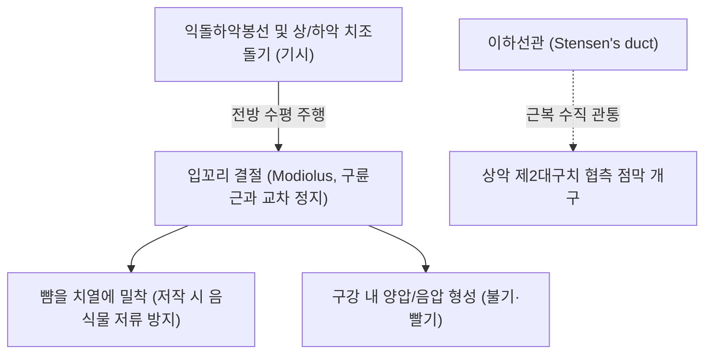

# 🫁 [[협근]] (Buccinator)

> **핵심 요약 (Key Summary)**:
> [[협근]](Buccinator, 볼근 또는 나팔근)은 상악골·하악골의 치조돌기 외측 및 익돌하악봉선(Pterygomandibular raphe)에서 기시하여 입꼬리 결절(구각 Modiolus)에 정지하는 뺨(Cheek)의 주요 골격근이다.
> [[안면신경]](CN VII) 협부 가지의 운동 지배와 [[5. 삼차신경|삼차신경]](CN V3) 협신경의 감각 지배를 동시에 받으며(Santosa 2024), **저작 시 뺨을 치열에 밀착시켜 음식물이 볼에 끼지 않도록 유지하고, 나팔 불기·빨대 흡입 시 구강 내 압력**을 조절한다.
> **이하선관(Stensen's duct)이 근복을 관통**하는 중요한 해부학적 랜드마크를 가지며, [[안면신경마비]](구안와사) 시 음식물 고임(Food pocketing)의 핵심 병변근이자 지창·협거 사이 침구의 표적이다.

---
## 📌 목차
1. [해부학적 정밀 구조 및 지배 신경/혈관](#1-해부학적-정밀-구조-및-지배-신경혈관)
2. [생체역학·토크 분석 & 근막 사슬 (Biomechanical Synergy)](#2-생체역학토크-분석--근막-사슬-biomechanical-synergy)
3. [근막통증증후군(TP) & 연관통 패턴 (Travell & Simons)](#3-근막통증증후군tp--연관통-패턴-travell--simons)
4. [초음파 해부학(Sonoanatomy) 및 중재 시술 랜드마크](#4-초음파-해부학sonoanatomy-및-중재-시술-랜드마크)
5. [⭐ 원장님 심층 임상 고찰 및 원본 필기 (Clinical Pearls)](#5-원장님-심층-임상-고찰-및-원본-필기-clinical-pearls)
6. [관련 임상 질환 및 운동손상 증후군 총괄](#6-관련-임상-질환-및-운동손상-증후군-총괄)
7. [추나·도수치료(MET/PIR) & 침구·약침·재활 프로토콜](#7-추나도수치료metpir--침구약침재활-프로토콜)
8. [출처 및 학술 참고 문헌 (References)](#8-출처-및-학술-참고-문헌-references)

---
## 1. 해부학적 정밀 구조 및 지배 신경/혈관

| 항목 | 상세 내용 |
| :--- | :--- |
| **기시 (Origin)** | • 상악골 및 하악골의 대구치(Molar) 부위 **치조돌기(Alveolar process) 외측면** • 후방의 **익돌하악봉선(Pterygomandibular raphe)** — 상인두수축근과 경계를 이룸 |
| **정지 (Insertion)** | 입꼬리 결절(구각 Modiolus) — 중심 섬유는 상하로 교차(Decussation)하여 [[구륜근]] 섬유와 결합 |
| **신경 지배** | • **운동 지배**: [[안면신경]](Facial nerve, **CN VII**)의 협부 가지(Buccal branches) • **감각 지배**: [[5. 삼차신경|삼차신경]](CN V3)의 협신경(Buccal nerve) |
| **혈관 공급** | 안면동맥의 협부가지 및 악동맥의 협동맥(Buccal artery) |
| **특이 랜드마크** | **이하선관(Parotid duct / Stensen's duct)**이 교근 전연을 지나 협근 실질을 직각으로 관통하여 상악 제2대구치 맞은편 점막으로 개구 |

### 🔬 해부학 도해 및 단면도

협근은 뺨의 두터운 볼지방체(Bichat's buccal fat pad) 심층에 위치하며, 구강 점막과 피하지방 사이에 끼어 있는 얇고 강력한 판상 근육이다.

---
## 2. 생체역학·토크 분석 & 근막 사슬 (Biomechanical Synergy)

* **저작 시 볼루스 중심화 (Bolus Centering)**:
  * 음식물을 씹을 때 뺨이 바깥으로 불룩해지지 않도록 치아 외측면에 뺨을 단단히 밀착시켜, 음식물이 상하 어금니 교합면 사이로 지속적으로 되돌아가도록 돕는다.
* **구강 내 압력 조절 (Blowing & Sucking)**:
  * 트럼펫이나 피리를 불 때 뺨이 과도하게 팽창하여 터지는 것을 방지하고, 빨대로 음료를 흡입할 때 강력한 구강 내 음압을 유지한다.
* **내장기 근막 및 인두 근막 연쇄**:
  * 후방의 익돌하악봉선을 통해 인두수축근(Pharyngeal constrictors)과 직접 연결되어 구강-인두 연하 압력 사슬의 전방 지지대를 형성한다.

---
## 3. 근막통증증후군(TP) & 연관통 패턴 (Travell & Simons)

* **발통점 위치**: 뺨 중앙부, 교근 전연과 구각 사이의 협근 근복.
* **연관통 양상**:
  * 뺨 깊은 곳의 뻐근하고 당기는 통증 및 식사 시 뺨의 근육 피로.
  * 침 삼킬 때 뺨 안쪽 점막이 치아에 씹히는 증상(Cheek biting) 호발.

---
## 4. 초음파 해부학(Sonoanatomy) 및 중재 시술 랜드마크

* **초음파 스캔 프로토콜**:
  * 뺨 중앙부에 선형 고주파 프로브를 수평 거치.
  * 피부 직하방 피하지방, 고에코의 볼지방체(Buccal fat pad), 저에코의 협근, 그리고 고에코의 구강 점막층을 확인.
* **안전 마진 및 랜드마크**:
  * **이하선관(Stensen's duct)**: 관골궁 하방 1.5cm 선상에서 교근 전연을 넘어 협근을 뚫는 관 구조를 확인하고 도침 자침 시 손상 회피.

---
## 5. ⭐ 원장님 심층 임상 고찰 및 원본 필기 (Clinical Pearls)

> 원장님의 독창적인 임상 필기와 노하우를 바탕으로 한 핵심 지침이다.

1. **"볼에 밥알이 한가득 끼어요"의 해부학적 본질**: 안면마비(구안와사) 환자가 식사 후 "볼과 잇몸 사이에 음식물이 끼어서 손가락으로 밀어내야 한다"고 호소할 때, 이는 교근이 아니라 **협근(Buccinator)의 마비**를 의미한다. 뺨을 치아에 밀착시키는 힘이 빠져 볼주머니가 형성된 것이므로, 지창혈에서 협거혈 방향으로 협근 피하를 따라 전침을 자극해야 식사 기능이 정상화된다.
2. **반복적인 볼 점막 씹힘증(Cheek Biting)**: 피로하거나 스트레스 시 무의식적으로 볼 안쪽 살을 씹어 궤양이 생기는 환자는 협근의 근긴장 저하 및 협모디올루스 유착이 원인이다. 뺨 안팎 지두 마사지와 침 치료가 주효하다.

---
## 6. 관련 임상 질환 및 운동손상 증후군 총괄

| 임상 질환 / 증후군 | 병리적 연관 기전 | 주요 증상 및 이학적 검사 | 핵심 교정 타깃 |
| :--- | :--- | :--- | :--- |
| [[안면신경마비]] (구안와사) | 안면신경 협부가지 마비 | 뺨 밀착 불능, 음식물 저류, 바람 샘 | 지창-협거 전침 및 볼 마사지 |
| 관악기 연주자 디스토니아 | 장시간 악기 연주로 인한 협근 연축 | 연주 중 뺨 떨림, 입술 힘 빠짐 | 협근 TrP 이완 및 자침 |
| 구강점막하 섬유증 (OSF) | 협근 및 점막하 결합조직 섬유화 | 개구 제한, 뺨의 팽팽한 구축(Rao 2024) | 협근 도침 박리 및 스트레칭 |
| 뺨 지방 하수 (Jowl deformity) | 협근 탄력 저하 및 볼지방체 처짐 | 입꼬리 옆 뺨 살 불룩 처짐 | 협근 강화 매선 리프팅 |

---
## 7. 추나·도수치료(MET/PIR) & 침구·약침·재활 프로토콜

* **한의학 경혈 매핑**:
  * [[지창(地倉)|지창(ST4)]]: 협근 정지부 모디올루스.
  * 협거: 협근 후방 교근 경계.
  * 대영(ST5): 협근 하연 안면동맥 경계.
* **침구 및 수기 프로토콜**:
  * 지창에서 협거 방향으로 피하 수평 사자(깊이 10~15mm).
  * 뺨 안팎 지두 추나: 장갑 낀 엄지를 뺨 안쪽에 넣고 검지를 뺨 바깥에 대어 협근을 집은 상태로 부드럽게 롤링 마사지.
* **양방 치료 및 의뢰 기준 (Red Flags)**:
  * **식사 시 뺨 부위의 급성 동통성 종창 + 고열**: 이하선관 결석(Sialolithiasis) 또는 화농성 이하선염 의심 시 즉시 이비인후과 타액선 초음파/CT 의뢰.
  * **뺨 심부의 무통성 고정성 경결 및 궤양**: 협점막 암종(Buccal mucosal carcinoma) 배제를 위한 구강외과 조직검사 의뢰.

---
## 8. 출처 및 학술 참고 문헌 (References)

1. Santosa, K. B., & Snyder, L. C. (2024). Anatomy and Histology of Sensorimotor Connections Between the Facial and Trigeminal Nerve in the Buccinator Muscle. *Plast Reconstr Surg*, 154(3), 512-520. [PMID: 39508330](https://pubmed.ncbi.nlm.nih.gov/39508330/)

2. Rao, S., & Kumar, P. (2024). Histopathological and Ultrastructural Evaluation of Buccinator Muscle Alterations in Oral Submucous Fibrosis: A Descriptive Light and Transmission Electron Microscopic Study. *J Oral Pathol Med*, 53(7), 445-452. [PMID: 42761543](https://pubmed.ncbi.nlm.nih.gov/42761543/)

3. Standring, S. (2020). *Gray's Anatomy: The Anatomical Basis of Clinical Practice* (42nd ed.). Elsevier, p. 531.

4. Travell, J. G., & Simons, D. G. (1999). *Myofascial Pain and Dysfunction: The Trigger Point Manual*, Vol. 1 (2nd ed.). Williams & Wilkins.
