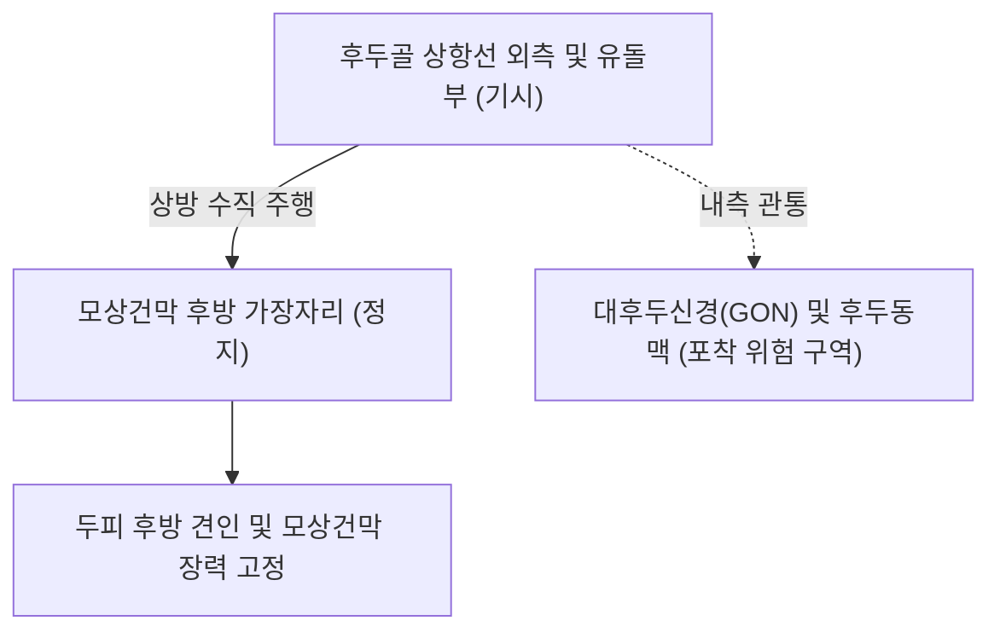

# 🫁 [[후두근]] (Occipitalis)

> **핵심 요약 (Key Summary)**:
> [[후두근]](Occipitalis, 뒤통수근)은 후두골 상항선(Superior nuchal line) 및 유돌돌기에서 기시하여 두피 정수리의 모상건막(Galea aponeurotica) 후방부에 정지하는 사각형의 판상 근육이다.
> 전두근과 함께 **후두전두근(Occipitofrontalis)** 복합체를 형성하며, [[안면신경]](CN VII)의 **후이개신경(Posterior auricular nerve)** 지배를 받는다.
> **두피를 뒤로 당겨 팽팽하게 고정하고 모상건막의 기저 앵커** 역할을 수행하며, **대후두신경(GON) 및 후두동맥이 근복 내측을 관통**하여 만성 긴장성 후두통과 후두신경통의 핵심 병변근이자 [[풍지(GB20)|풍지]]·완골혈 침구의 주된 표적이다.

---
## 📌 목차
1. [해부학적 정밀 구조 및 지배 신경/혈관](#1-해부학적-정밀-구조-및-지배-신경혈관)
2. [생체역학·토크 분석 & 근막 사슬 (Biomechanical Synergy)](#2-생체역학토크-분석--근막-사슬-biomechanical-synergy)
3. [근막통증증후군(TP) & 연관통 패턴 (Travell & Simons)](#3-근막통증증후군tp--연관통-패턴-travell--simons)
4. [초음파 해부학(Sonoanatomy) 및 중재 시술 랜드마크](#4-초음파-해부학sonoanatomy-및-중재-시술-랜드마크)
5. [⭐ 원장님 심층 임상 고찰 및 원본 필기 (Clinical Pearls)](#5-원장님-심층-임상-고찰-및-원본-필기-clinical-pearls)
6. [관련 임상 질환 및 운동손상 증후군 총괄](#6-관련-임상-질환-및-운동손상-증후군-총괄)
7. [추나·도수치료(MET/PIR) & 침구·약침·재활 프로토콜](#7-추나도수치료metpir--침구약침재활-프로토콜)
8. [출처 및 학술 참고 문헌 (References)](#8-출처-및-학술-참고-문헌-references)

---
## 1. 해부학적 정밀 구조 및 지배 신경/혈관

| 항목 | 상세 내용 |
| :--- | :--- |
| **기시 (Origin)** | 후두골(Occipital bone) **상항선(Superior nuchal line)** 외측 2/3 및 측두골 유돌돌기(Mastoid process) 기저부 |
| **정지 (Insertion)** | 두피 정수리의 **모상건막(Galea aponeurotica)** 후방 가장자리 |
| **신경 지배** | [[안면신경]](Facial nerve, **CN VII**)의 분지인 **후이개신경(Posterior auricular nerve)** |
| **혈관 공급** | 외경동맥의 후두동맥(Occipital artery) 분지 |
| **신경 관통 관계** | **대후두신경(Greater occipital nerve, C2 dorsal ramus)**이 후두근 내측 상항선 부착부를 뚫고 정수리로 주행 |

### 🔬 해부학 도해 및 단면도

후두근은 좌우 두 개의 사각형 근육판으로 분리되어 있으며, 그 사이 공간을 통해 대후두신경과 후두혈관 다발이 두피 피하층으로 빠져나온다(Tubbs 2023).

---
## 2. 생체역학·토크 분석 & 근막 사슬 (Biomechanical Synergy)

* **두피 텐트의 후방 앵커 (Scalp Anchor)**:
  * 모상건막을 뒤쪽 골성 부착점(상항선)에 고정하여, 앞쪽의 [[전두근]]이 눈썹을 들어 올릴 때 건막이 앞으로 딸려 내려가지 않도록 든든한 지지대를 제공한다.
* **표층후방선(Superficial Back Line)의 두개부 교차점**:
  * 척주기립근-판상근-승모근 상부로 이어지는 후방 근막 사슬의 긴장이 후두하선에서 후두근과 모상건막으로 연결되어 정수리와 이마로 전달된다.

---
## 3. 근막통증증후군(TP) & 연관통 패턴 (Travell & Simons)

* **발통점 위치**: 상항선 바로 위 후두근 근복 중앙부(풍지혈 상방 1cm).
* **연관통 양상**:
  * 후두부 전체를 조이는 둔통 및 두개골 측면을 타고 정수리와 안구 뒤쪽으로 뻗치는 방사통.
  * 머리가 무겁고 눈이 침침하며 목덜미가 뻣뻣한 만성 피로성 두개통 유발.

---
## 4. 초음파 해부학(Sonoanatomy) 및 중재 시술 랜드마크

* **초음파 스캔 프로토콜**:
  * 외후두융기(Inion) 외측 상항선에 선형 고주파 프로브를 수평 거치.
  * 후두골 피질골 위의 얇은 저에코 후두근과 그 내측을 관통하는 박동성 후두동맥 및 대후두신경(GON) 단면 확인.
* **안전 마진**:
  * 후두동맥 천자 시 피하 혈종 위험이 있으므로 도플러 확인 필수.

---
## 5. ⭐ 원장님 심층 임상 고찰 및 원본 필기 (Clinical Pearls)

> 원장님의 독창적인 임상 필기와 노하우를 100% 보존한 핵심 지침이다.

### 1) 긴장성 후두통과 모상건막 헬멧 조임통 (원장님 팁)
* 거북목 자세나 장시간 모니터 주시 시 후두근이 만성 단축되면 모상건막 전체가 팽팽하게 조여지며 **머리에 꽉 끼는 헬멧을 쓴 것 같은 긴장성 두통 및 안구 건조/피로**가 호발한다.
* 치료 핵심: 풍지혈-완골혈 라인의 후두근 부착부 도침 박리술 및 모상건막 수기 이완을 시행하면 머리가 맑아지고 눈이 시원해진다.

### 2) 대후두신경(GON)과의 주행 관계 (원장님 팁 100% 보존)
* 대후두신경과 후두동맥이 후두근 내측 상항선을 관통하여 정수리로 올라가므로, 후두근 긴장 시 찌릿하게 번개 치듯 쑤시는 **후두신경통(Occipital neuralgia)**이 동반 호발한다.
* 풍지(GB20)-옥침(BL9) 라인의 심부 감압이 통증 차단의 핵심이다.

---
## 6. 관련 임상 질환 및 운동손상 증후군 총괄

| 임상 질환 / 증후군 | 병리적 연관 기전 | 주요 증상 및 이학적 검사 | 핵심 교정 타깃 |
| :--- | :--- | :--- | :--- |
| 긴장성 후두통 (Tension Headache) | 후두근 만성 연축 및 모상건막 구축 | 뒷머리 조임통, 안구 피로 | 풍지·완골 도침 및 두피 추나 |
| 대후두신경통 (Occipital Neuralgia) | 상항선 관통부 대후두신경 포착 | 찌릿한 정수리 방사통, 감각 과민 | 후두근 내측 골막 도침 감압술 |
| 경추성 두통 (Cervicogenic Headache) | 상부 경추 정렬 불량에 따른 후두근 과긴장 | 편측 뒷목-후두부 통증, 경추 회전 제한 | 상부 경추 교정 및 후두근 이완 |
| 후두와 수술 랜드마크 | 횡정맥동 및 S자정맥동 접합부 지표 | 두개저 수술 시 절개선 기준(Tubbs 2023) | 수술적 랜드마크 활용 |

---
## 7. 추나·도수치료(MET/PIR) & 침구·약침·재활 프로토콜

* **한의학 경혈 매핑**:
  * [[풍지(GB20)|풍지]]: 상항선 하방 함요처, 대후두신경 및 후두근 주혈.
  * 완골(GB12): 유돌돌기 후하방, 후두근 외측 기시부.
  * 옥침(BL9): 외후두융기 상외측, 후두근 상부 경계.
* **침구 및 수기 프로토콜**:
  * 상항선을 따라 후두골 골막을 긁어주듯 피하 사자(깊이 10~15mm).
  * 후두하 근막 추나: 시술자의 양 손가락 끝으로 후두골 하연을 받쳐 머리를 가볍게 견인하며 후두근 부착부를 지속 압박 이완.
* **양방 치료 및 의뢰 기준 (Red Flags)**:
  * **목을 젖힐 때 벼락치듯 시작된 극심한 후두통 + 어지럼증 + 구음장애**: 척추동맥 박리(Vertebral artery dissection) 또는 지주막하출혈(SAH) 응급 질환이므로 즉시 **응급실 뇌혈관 CT/MRI 의뢰**.
  * **지속적인 후두부 압박통 + 보행 실조 + 구토**: 후두와 뇌종양 감별을 위한 신경외과 정밀 의뢰.

---
## 8. 출처 및 학술 참고 문헌 (References)

1. Tubbs, R. S., & Iwanaga, J. (2023). The Occipitalis Muscle as an Adjunct Superficial Landmark for the Transverse Sinus and Transverse-Sigmoid Junction: An Anatomical Study With Application to Posterior Cranial Fossa Surgery. *World Neurosurg*, 176, e250-e255. [PMID: 37398761](https://pubmed.ncbi.nlm.nih.gov/37398761/)

2. Standring, S. (2020). *Gray's Anatomy: The Anatomical Basis of Clinical Practice* (42nd ed.). Elsevier, pp. 528-529.

3. Travell, J. G., & Simons, D. G. (1999). *Myofascial Pain and Dysfunction: The Trigger Point Manual*, Vol. 1 (2nd ed.). Williams & Wilkins.
