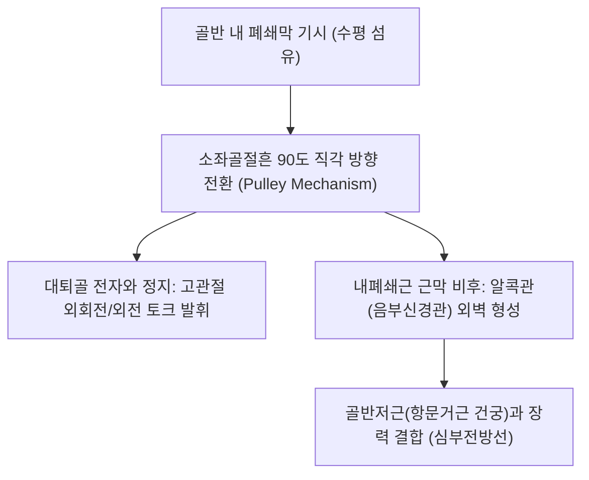

# 🫁 [[내폐쇄근]] (Obturator Internus)

> **핵심 요약 (Key Summary)**:
> [[내폐쇄근]](Obturator Internus)은 골반강 내면의 폐쇄막 및 치골·좌골지에서 기시하여 소좌골절흔(Lesser sciatic notch)을 도르래 삼아 90도 직각으로 꺾여 [[대퇴골]] 대전자 [[전자와]](Trochanteric fossa)에 정지하는 고관절 심부 외회전근이다.
> [[내폐쇄근신경]](L5, S1, S2)의 지배를 받으며, 고관절 신전 시 외회전, 90도 굴곡 시 외전 및 [[골반저근]] 지지와 음부신경관(알콕관, Alcock's canal)의 외벽 형성을 주동한다.
> 임상적으로는 심부 둔부 증후군(Deep Gluteal Syndrome), [[가성 좌골신경통]], 만성 골반통증 증후군(CPPS)의 핵심 원인근이며, 한의 치료에서는 [[환도]]혈 심부 침구 및 삼두관절근(Triceps coxae) 침도 치료의 표적이다.

---
## 📌 목차
1. [해부학적 정밀 구조 및 지배 신경/혈관](#1-해부학적-정밀-구조-및-지배-신경혈관)
2. [생체역학·토크 분석 & 근막 사슬 (Biomechanical Synergy)](#2-생체역학토크-분석--근막-사슬-biomechanical-synergy)
3. [근막통증증후군(TP) & 연관통 패턴 (Travell & Simons)](#3-근막통증증후군tp--연관통-패턴-travell--simons)
4. [초음파 해부학(Sonoanatomy) 및 중재 시술 랜드마크](#4-초음파-해부학sonoanatomy-및-중재-시술-랜드마크)
5. [⭐ 원장님 심층 임상 고찰 및 원본 필기 (Clinical Pearls)](#5-원장님-심층-임상-고찰-및-원본-필기-clinical-pearls)
6. [관련 임상 질환 및 운동손상 증후군 총괄](#6-관련-임상-질환-및-운동손상-증후군-총괄)
7. [추나·도수치료(MET/PIR) & 침구·약침·재활 프로토콜](#7-추나도수치료metpir--침구약침재활-프로토콜)
8. [출처 및 학술 참고 문헌 (References)](#8-출처-및-학술-참고-문헌-references)

---
## 1. 해부학적 정밀 구조 및 지배 신경/혈관

| 항목 | 상세 내용 |
| :--- | :--- |
| **기시 (Origin)** | • 골반강 내면의 폐쇄막(Obturator membrane) 내측면 전체 • 폐쇄공을 둘러싼 [[치골]]하지 및 [[좌골]]지의 골반 내면 골막 |
| **정지 (Insertion)** | • 소좌골절흔(Lesser sciatic notch)을 지나 90° 후외측으로 방향 전환 • 상·하쌍자근의 지지를 받으며 [[대퇴골]](Femur) 대전자 내측 [[전자와]](Trochanteric fossa)에 공통건으로 정지 |
| **신경 지배** | [[내폐쇄근신경]](Nerve to obturator internus, **L5, S1, S2**) — [[상쌍자근]]과 공통 신경 지배 |
| **혈관 공급** | 내음부동맥(Internal pudendal artery), 하둔동맥(Inferior gluteal artery), 폐쇄동맥 분지 |
| **복합체 형성** | 상쌍자근(위), 하쌍자근(아래)과 함께 **삼두관절근(Triceps coxae)** 복합체를 형성 |

### 🔬 해부학 도해 및 단면도

골반강 내부에서 광범위하게 기시한 내폐쇄근의 부채꼴 근섬유는 소좌골절흔(Lesser sciatic notch)의 활차형 연골면을 도르래 삼아 직각(90도)으로 방향을 틀어 둔부로 빠져나온다. 소좌골절흔과 힘줄 사이에는 마찰을 줄이기 위한 내폐쇄근 점액낭(Obturator internus bursa)이 존재하며, 힘줄이 골반 밖으로 나오자마자 위아래에서 상쌍자근과 하쌍자근이 샌드위치처럼 감싸 대퇴골 대전자 전자와에 정지한다.

---
## 2. 생체역학·토크 분석 & 근막 사슬 (Biomechanical Synergy)

* **90도 직각 도르래 기전 (Pulley Mechanism)**: 골반강 안쪽에서 전후축으로 달리다가 소좌골절흔에서 90도 꺾여 횡축(외회전)으로 전환되는 독특한 생체역학적 지렛대이다. 관절 위치에 따라 신전 시 강력한 외회전근, 90도 굴곡 시 고관절 외전근으로 기능 전환이 일어난다.
* **알콕관(Alcock's Canal) 외벽 형성**: 내폐쇄근의 골반 내 근막이 두꺼워져 음부신경관을 형성하므로, 내폐쇄근의 만성 연축은 [[음부신경]](Pudendal nerve)을 기계적으로 포착하여 회음부 방사통을 유발한다.
* **근막 사슬 연계 (Anatomy Trains)**: 근막경선 해부학의 심부전방선(Deep Front Line) 핵심 앵커로 [[골반저근]](항문거근 건궁)과 직접 장력을 교환하며 골반환의 후방 안정성을 통제한다.

---
## 3. 근막통증증후군(TP) & 연관통 패턴 (Travell & Simons)

* **발통점(TrP) 위치**: 소좌골절흔 직상방 및 외측, [[좌골신경]] 심부의 삼두관절근 건복 복합체 부위.
* **연관통 양상**:
  * 둔부 중앙 및 하부의 깊은 뻐근함과 지속적인 둔통.
  * [[좌골신경]]에 직접적인 유착 및 기계적 압박을 가하여 대퇴 후면, 슬와부, 종아리 후외측으로 방사통 유발 (심부 둔부 증후군).
  * [[음부신경]] 포착 시 회음부, 항문 주위, 생식기 부위의 화끈거림, 찌릿함, 배뇨통 모사.
* **악화 인자**: 딱딱한 의자에 장시간 착석, 계단 오르기, 고관절 굴곡 및 내회전 시 건 마찰로 통증 급증.

---
## 4. 초음파 해부학(Sonoanatomy) 및 중재 시술 랜드마크

* **초음파 스캔 프로토콜**:
  * 환자를 복와위 또는 건측 측와위로 취한 후, [[대퇴골]] 대전자와 [[좌골결절]] 사이에 트랜스듀서를 횡단 배치.
  * 표층의 [[대둔근]] 아래로 주행하는 [[좌골신경]](고에코 타원형)을 동정하고, 그 바로 심부에 위치한 상쌍자근-내폐쇄근 힘줄-하쌍자근의 샌드위치 층판 확인.
  * 소좌골절흔 레벨에서 내폐쇄근 힘줄이 뼈 모서리를 감싸며 주행하는 고에코 구조물 식별.
* **시술 안전 마진**: 좌골신경이 내폐쇄근 힘줄의 표면을 교차하여 내려가므로, 침이나 약침 바늘이 신경을 관통하지 않도록 실시간 가이드 하에 신경 외측 또는 내측 안전 마진을 확보해야 한다.

---
## 5. ⭐ 원장님 심층 임상 고찰 및 원본 필기 (Clinical Pearls)

* **이상근 증후군과 내폐쇄근의 감별 (원장님 필기 100% 보존)**:
  * 둔부 통증과 좌골신경통 환자에서 이상근만 만지는 것은 치료 실패의 주요 원인이다.
  * 실제 임상에서 좌골신경 포착의 40% 이상은 이상근 하방의 삼두관절근(내폐쇄근·쌍자근 복합체)에서 발생한다.
  * 내폐쇄근은 소좌골절흔에서 90도로 꺾이기 때문에 마찰력이 극대화되는 부위이며, 결절성 섬유화가 빈발한다.
* **만성 골반통증 증후군(CPPS)과 알콕관의 상관성**:
  * 비뇨기과나 산부인과적 이상이 없는데도 회음부나 고관절 깊은 곳의 묵직한 통증을 호소하는 남녀 환자의 경우, 내폐쇄근 근막 연축으로 인한 [[음부신경]] 포착증을 반드시 감별해야 한다.
* **침구 및 침도 치료 노하우**:
  * [[환도]]혈에서 대전자와 좌골결절을 잇는 선의 외측 1/3 지점에서 직자하여 약 60~75mm 심부로 진입, 대퇴골 대전자 전자와 골막에 닿을 때 득기감을 유도한다.
  * 좌골결절 내측을 깊게 압박하며 고관절을 수동 내회전시킬 때 서혜부와 둔부 심부로 전기가 통하듯 통증이 재현되면 내폐쇄근 단독 병변으로 확진할 수 있다.

---
## 6. 관련 임상 질환 및 운동손상 증후군 총괄

| 임상 질환 / 증후군 | 병리적 연관 기전 | 주요 증상 및 이학적 검사 | 핵심 교정 타깃 |
| :--- | :--- | :--- | :--- |
| **심부 둔부 증후군(DGS)** | 삼두관절근 복합체 비후로 인한 좌골신경 압박 | 둔부 심부 압통, 보행 시 하지 방사통, Freiberg 검사 양성 | 내폐쇄근 침도 박리 및 신장 |
| **만성 골반통증 증후군(CPPS)** | 알콕관 외벽 비후로 음부신경 자극 | 회음부 둔통, 배뇨통, 착석 시 심화 | 내폐쇄근 근막 이완, 골반저 추나 |
| **내폐쇄근 건 점액낭염** | 소좌골절흔 도르래 부위 과도한 마찰 | 대전자 전자와 심부 압통, 고관절 내회전 제한 | 소좌골절흔 심부 약침 치료 |
| **골반 불안정성** | 고관절 외회전근 불균형 및 골반저 이완 | 보행 시 골반 동요, 천장관절 기능부전 | 삼두관절근 협응 재활 |

---
## 7. 추나·도수치료(MET/PIR) & 침구·약침·재활 프로토콜

* **한의학 경혈 매핑 및 침구 프로토콜**:
  * [[환도]], [[질변(BL54)|질변]], [[포황]].
  * 환자를 측와위(이환측 위)로 하고 0.35×75mm 장침을 사용하여 환도혈에서 대퇴골 전자와 방향으로 60~75mm 심부 자침.
  * 소좌골절흔 부위 침도 치료 시 건-골 부착부의 비후된 섬유대를 종축으로 박리.
* **근에너지기법 (MET/PIR)**:
  * 환자 복와위, 슬관절 90도 굴곡 상태에서 시술자가 하퇴를 잡고 고관절 최대 내회전 유도.
  * 환자에게 외회전 방향으로 등척성 수축(20% 힘, 7초 유지) 후 호흡과 함께 심부 이완 및 내회전 가동범위 증진.
* **재활 운동**:
  * 클램쉘(Clamshell) 운동을 통한 심부 외회전근의 고립 강화 및 고관절 중심화(Centration) 회복.

---
## 8. 출처 및 학술 참고 문헌 (References)

1. **Standring, S.** (2020). *Gray's Anatomy* (42nd ed.). Elsevier.
   - `[연구 요약]`: 내폐쇄근의 90도 도르래 주행 해부학 및 알콕관(음부신경관) 외벽 형성 구조 규명.

2. **Yoon, Y. H., et al. (2025)**. Beyond Nerve Entrapment: A Narrative Review of Muscle-Tendon Pathologies in Deep Gluteal Syndrome. *Diagnostics (Basel)*, 15(17), 2531. [PMID: 41095750](https://pubmed.ncbi.nlm.nih.gov/41095750/)
   - `[연구 요약]`: 심부 둔부 공간의 삼두관절근(내폐쇄근·상하쌍자근) 복합체 병변과 좌골신경 포착의 최신 임상 지침.
