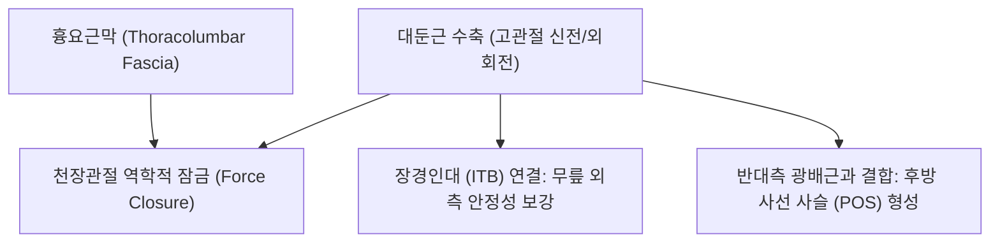

# 🫁 [[대둔근]] (Gluteus Maximus)

> **핵심 요약 (Key Summary)**:
> [[대둔근]](Gluteus Maximus)은 인체에서 단일 근육 중 가장 크고 강한 근육으로, [[장골]] 후둔선, [[천골]]·미골 후면 및 천결절인대, 흉요근막에서 기시하여 [[장경인대]] 및 [[대퇴골]] 둔근조면에 정지한다.
> [[하둔신경]](Inferior gluteal nerve, L5-S2)의 지배를 받으며, **고관절 신전(강력한 추진력), 외회전 및 [[천장관절]]의 역학적 잠금(Force Closure)**을 주동한다.
> 임상적으로는 둔근 기억상실증(Dead Butt Syndrome), 대퇴골 전방 활주 증후군, [[천장관절 증후군]], 요통의 핵심 기저 원인근이며, 한의 치료에서는 [[환도]]혈 및 [[질변(BL54)|질변]]혈 심부 침구와 후방 사선 슬링(POS) 교정 추나의 핵심 타깃이다.

---
## 📌 목차
1. [해부학적 정밀 구조 및 지배 신경/혈관](#1-해부학적-정밀-구조-및-지배-신경혈관)
2. [생체역학·토크 분석 & 근막 사슬 (Biomechanical Synergy)](#2-생체역학토크-분석--근막-사슬-biomechanical-synergy)
3. [근막통증증후군(TP) & 연관통 패턴 (Travell & Simons)](#3-근막통증증후군tp--연관통-패턴-travell--simons)
4. [초음파 해부학(Sonoanatomy) 및 중재 시술 랜드마크](#4-초음파-해부학sonoanatomy-및-중재-시술-랜드마크)
5. [⭐ 원장님 심층 임상 고찰 및 원본 필기 (Clinical Pearls)](#5-원장님-심층-임상-고찰-및-원본-필기-clinical-pearls)
6. [관련 임상 질환 및 운동손상 증후군 총괄](#6-관련-임상-질환-및-운동손상-증후군-총괄)
7. [추나·도수치료(MET/PIR) & 침구·약침·재활 프로토콜](#7-추나도수치료metpir--침구약침재활-프로토콜)
8. [출처 및 학술 참고 문헌 (References)](#8-출처-및-학술-참고-문헌-references)

---
## 1. 해부학적 정밀 구조 및 지배 신경/혈관

| 항목 | 상세 내용 |
| :--- | :--- |
| **기시 (Origin)** | • [[장골]]의 후둔선(Posterior gluteal line) 후방 골면 • [[천골]](Sacrum) 및 미골(Coccyx)의 후외측면 • 흉요근막(Thoracolumbar fascia) 및 천결절인대(Sacrotuberous ligament) |
| **정지 (Insertion)** | • **표층/상부 섬유(3/4)**: 대퇴 근막을 보강하는 [[장경인대]](Iliotibial tract)에 합류 • **심층/하부 섬유(1/4)**: [[대퇴골]](Femur) 후외측면의 둔근조면(Gluteal tuberosity) |
| **신경 지배** | [[하둔신경]](Inferior gluteal nerve, **L5, S1, S2**) — 대좌골공 이상근하공을 통해 진입 |
| **혈관 공급** | 상둔동맥(Superior gluteal a.) 및 하둔동맥(Inferior gluteal a.) |
| **점액낭 구조** | 전자간 점액낭(Trochanteric bursa), 좌골 점액낭(Ischial bursa), 둔근대퇴 점액낭(Gluteofemoral bursa) |

### 🔬 해부학 도해 및 단면도

대둔근은 골반 후면 전체를 사선 방향으로 덮고 있는 거대한 층판 구조물이다. 심부의 중둔근 후부, 이상근, 삼두관절근 및 좌골신경 위를 두껍게 덮어 완충 작용을 하며, 상부 근섬유는 장경인대로 이어져 무릎 외측까지 장력을 전달하고, 하부 근섬유는 대퇴골 간부 둔근조면에 직접 결합하여 직립 자세를 유지하는 기둥 역할을 수행한다.

---
## 2. 생체역학·토크 분석 & 근막 사슬 (Biomechanical Synergy)

* **보행 및 달리기 시 추진력의 핵심**: 평지 보행보다는 계단 오르기, 의자에서 일어서기, 달리기, 도약 시 체간이 앞으로 쏠리는 굴곡 모멘트를 상쇄하고 강력한 전방 추진력을 발생시킨다.
* **천장관절 압박력(Force Closure) 제공**: 천결절인대와 흉요근막에 부착되어 수축 시 천장관절 관절면을 강하게 압박·결속하여 골반환의 전단력 파단을 방지한다.
* **근막 사슬 연계 (Anatomy Trains)**: 반대측 광배근과 흉요근막을 통해 연결되는 **후방 사선 슬링(Posterior Oblique Sling, POS)**의 핵심 앵커이며, 표재후방선(Superficial Back Line)을 통해 척추기립근 및 햄스트링과 협응한다.

---
## 3. 근막통증증후군(TP) & 연관통 패턴 (Travell & Simons)

* **발통점(TrP) 분류 및 연관통 영역**:
  * **TrP 1 (천장관절 인접부)**: 천장관절 및 미골 주변의 뻐근한 통증, 앉아 있을 때 엉덩이 바닥이 배기는 통증 유발.
  * **TrP 2 (좌골결절 상외측)**: 둔부 하부 및 둔주름 부위의 둔통, 대퇴 후면 상부로 가벼운 연관통 방사.
  * **TrP 3 (둔부 최하외측)**: 미골 및 항문 주위의 연관통, 배변 시 둔부 압박감 유발.
* **증상 특징**:
  * 의자에 앉을 때 엉덩이가 닿는 부위가 쑤셔 자주 자세를 바꾸게 됨.
  * 오르막길이나 계단을 오를 때 둔부 후면에 쥐가 나는 듯한 통증 발생.

---
## 4. 초음파 해부학(Sonoanatomy) 및 중재 시술 랜드마크

* **초음파 스캔 프로토콜**:
  * 환자 복와위 상태에서 천골 후외측연부터 대전자 방향으로 사선 주행 관찰.
  * 가장 표층에 두껍고 뚜렷한 근섬유 다발(Hyperechoic striations)을 가진 대둔근 층판 동정.
  * 심부로 프로브를 압박하며 대둔근 하방의 [[중둔근]] 후연, [[이상근]], 그리고 고에코 굵은 타원형의 [[좌골신경]] 층간 경계 확인.
* **자침 안전 마진**:
  * 대둔근 단독 치료 시에는 30~50mm 심도로 안전하게 접근 가능.
  * 좌골신경은 대둔근 심부의 지방층 사이를 주행하므로 침도가 이상근하공 레벨로 깊이 들어갈 때 방사통 유발에 각별히 주의해야 한다.

---
## 5. ⭐ 원장님 심층 임상 고찰 및 원본 필기 (Clinical Pearls)

* **둔근 기억상실증(Gluteal Amnesia / Dead Butt Syndrome)과 협동근 우세 (원장님 필기 100% 보존)**:
  * 장시간 좌식 생활로 인해 대둔근이 상호억제(Reciprocal Inhibition)되어 신경학적으로 활성도가 급감한다.
  * 고관절 신전 시 대둔근이 먼저 발화해야 함에도 햄스트링(Hamstring)과 요추 기립근이 먼저 발화하는 '협동근 우세(Synergistic Dominance)'가 고착된다.
* **대퇴골두 전방 활주 증후군(Femoral Anterior Glide Syndrome)**:
  * 대둔근 약화 상태에서 햄스트링이 고관절 신전을 주동하면, 대퇴골두를 뒤에서 잡아당기지 못하고 앞쪽으로 밀어내게 된다.
  * 이로 인해 고관절 전방 관절순 및 장요근건에 충돌이 발생하여 서혜부 통증이 유발된다.
* **천장관절 안정화와 요통의 치료 열쇠**:
  * 만성 요통 환자에서 척추 자체만 치료해서 낫지 않는 경우, 대둔근의 힘줄 결속력(Force Closure)이 무너져 천장관절이 미세 전위된 경우가 대부분이다.
  * [[환도]]혈과 [[질변(BL54)|질변]]혈 심부 자침을 통해 대둔근의 근긴장도를 정상화하고 신경 전달을 회복시키는 것이 치료의 첫걸음이다.

---
## 6. 관련 임상 질환 및 운동손상 증후군 총괄

| 임상 질환 / 증후군 | 병리적 연관 기전 | 주요 증상 및 이학적 검사 | 핵심 교정 타깃 |
| :--- | :--- | :--- | :--- |
| **둔근 기억상실증** | 지속적 좌식으로 인한 대둔근 발화 억제 | 계단 승강 시 요통, 고관절 신전 패턴 검사 비정상 | 둔근 인지 활성화(Glute bridge) |
| **[[천장관절 증후군]]** | 대둔근의 천장관절 압박 잠금(Force closure) 부전 | 원-핑거 테스트 양성, 보행 시 천골통 | 대둔근 강화 및 골반 천장 추나 |
| **햄스트링 재발성 파열** | 대둔근 무력에 따른 햄스트링 과부하 | 달리기 시 대퇴 후면 급성 통증 | 대둔근-햄스트링 발화 순서 재교육 |
| **대퇴골두 전방 충돌** | 대둔근 약화로 인한 대퇴골두 전방 활주 | 고관절 신전/보행 시 서혜부 찝힘 | 대둔근 원심성 강화, 관절낭 이완 |

---
## 7. 추나·도수치료(MET/PIR) & 침구·약침·재활 프로토콜

* **한의학 경혈 매핑 및 침구 프로토콜**:
  * [[환도]], [[질변(BL54)|질변]], [[포황]].
  * 0.35×60~75mm 호침을 사용하여 대둔근의 주요 긴장대 및 근막 유착 부위에 자침 후 저주파(2~4Hz) 전침 적용.
* **추나 골반 교정 & MET**:
  * 장골 후하방 변위(PI) 교정 추나를 통해 대둔근 기시부의 비틀림 해소.
  * 환자 복와위, 고관절 신전 저항 운동을 통한 대둔근 등척성 수축-이완 기법.
* **3단계 둔근 재활 프로토콜**:
  1. **1단계 (신경 인지)**: 엎드려 엉덩이 조이기(Prone Glute Squeeze) — 햄스트링 개입 차단.
  2. **2단계 (고립 강화)**: 글루트 브릿지(Glute Bridge), 버드독(Bird-Dog).
  3. **3단계 (기능 통합)**: 힙 힌지(Hip Hinge), 케틀벨 데드리프트, 계단 스텝업.

---
## 8. 출처 및 학술 참고 문헌 (References)

1. **Lieberman, D. E., et al. (2006)**. The human gluteus maximus and its role in running. *J Exp Biol*, 209(11), 2143-2155. [PMID: 16709916](https://pubmed.ncbi.nlm.nih.gov/16709916/)
   - `[연구 요약]`: 인류 직립 보행 및 달리기 시 몸통의 전방 쏠림을 제어하는 대둔근의 결정적 진화생체역학 규명.

2. **Koga, H., et al. (2025)**. Evaluation of Trendelenburg and Duchenne signs by experimentally induced gluteal muscle paralysis. *J Orthop Res*, 43(2), 345-353. [PMID: 42501605](https://pubmed.ncbi.nlm.nih.gov/42501605/)
   - `[연구 요약]`: 둔부 근육군의 마비 실험을 통해 골반 수평 유지와 보행 시 둔근 안정화 기전을 검증한 연구.
