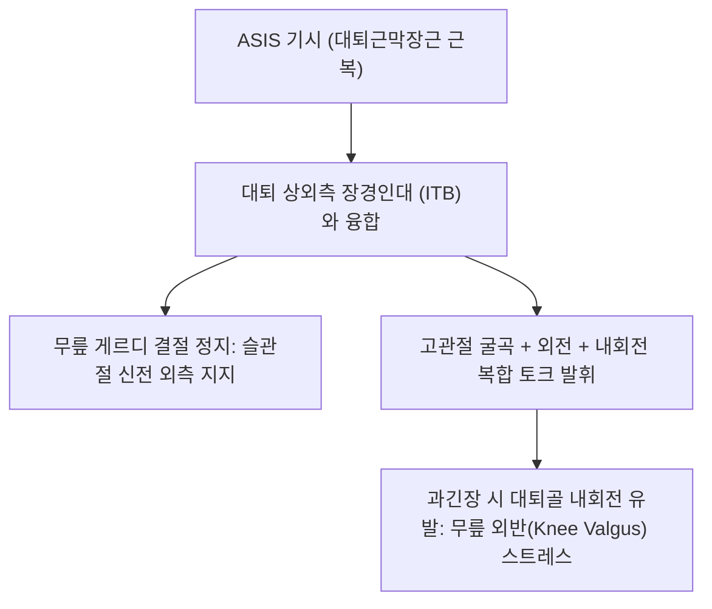

# 🫁 [[대퇴근막장근]] (Tensor Fasciae Latae)

> **핵심 요약 (Key Summary)**:
> [[대퇴근막장근]](Tensor Fasciae Latae, TFL)은 상전장골극(ASIS) 및 [[장골]]능 전방 외측순에서 기시하여 대퇴 상외측에서 [[장경인대]](Iliotibial tract)로 이행한 뒤 경골 외측 과의 게르디 결절(Gerdy's tubercle)에 정지하는 방추형 근육이다.
> [[상둔신경]](Superior gluteal nerve, L4-S1)의 지배를 받으며, **고관절 굴곡, 외전, 내회전 및 슬관절 외측 지지**를 주동한다.
> 임상적으로는 [[장경인대 증후군]](ITBS), 슬개대퇴통증증후군(PFPS), 대전자 점액낭염, 보행 시 무릎 외측 마찰통의 핵심 발원근이며, 한의 치료에서는 [[풍시(GB31)|풍시]]혈 및 거료(GB29) 침구, 외측선 근막 추나의 핵심 타깃이다.

---
## 📌 목차
1. [해부학적 정밀 구조 및 지배 신경/혈관](#1-해부학적-정밀-구조-및-지배-신경혈관)
2. [생체역학·토크 분석 & 근막 사슬 (Biomechanical Synergy)](#2-생체역학토크-분석--근막-사슬-biomechanical-synergy)
3. [근막통증증후군(TP) & 연관통 패턴 (Travell & Simons)](#3-근막통증증후군tp--연관통-패턴-travell--simons)
4. [초음파 해부학(Sonoanatomy) 및 중재 시술 랜드마크](#4-초음파-해부학sonoanatomy-및-중재-시술-랜드마크)
5. [⭐ 원장님 심층 임상 고찰 및 원본 필기 (Clinical Pearls)](#5-원장님-심층-임상-고찰-및-원본-필기-clinical-pearls)
6. [관련 임상 질환 및 운동손상 증후군 총괄](#6-관련-임상-질환-및-운동손상-증후군-총괄)
7. [추나·도수치료(MET/PIR) & 침구·약침·재활 프로토콜](#7-추나도수치료metpir--침구약침재활-프로토콜)
8. [출처 및 학술 참고 문헌 (References)](#8-출처-및-학술-참고-문헌-references)

---
## 1. 해부학적 정밀 구조 및 지배 신경/혈관

| 항목 | 상세 내용 |
| :--- | :--- |
| **기시 (Origin)** | • [[장골]]의 상전장골극(Anterior Superior Iliac Spine, ASIS) 외측순 • 장골능(Iliac crest) 전외측순의 앞쪽 5cm 구역 골막 |
| **정지 (Insertion)** | • 대퇴 근위부 1/3 지점에서 [[장경인대]](Iliotibial tract)의 전외측층으로 합류 • 장경인대를 통해 경골(Tibia) 외측과의 게르디 결절(Gerdy's tubercle)에 최종 정지 |
| **신경 지배** | [[상둔신경]](Superior gluteal nerve, **L4, L5, S1**) — [[중둔근]], [[소둔근]]과 공통 신경 지배 |
| **혈관 공급** | 외측대퇴회선동맥의 상행지(Ascending branch of lateral circumflex femoral a.), 상둔동맥 |
| **근막 결합** | 대퇴근막(Fascia lata)의 두 층판 사이에 포장되어 주행하며 장경인대로 장력 전달 |

### 🔬 해부학 도해 및 단면도

대퇴근막장근은 ASIS 바로 외측 아래에서 시작하여 대퇴 외측을 따라 약 15cm 정도의 짧고 두꺼운 근복(Muscle belly)을 형성한 뒤, 대전자 높이에서 대퇴근막의 특수 비후 구조인 장경인대와 단단하게 융합된다. 전방으로는 봉공근과 인접하고 후방으로는 중둔근 전방 섬유와 밀착되어 있으며, 대퇴골 대전자 상부를 덮으며 하퇴 외측까지 강력한 장력 띠를 형성한다.

---
## 2. 생체역학·토크 분석 & 근막 사슬 (Biomechanical Synergy)

* **보행 단각 지지기 골반 관상면 안정성**: 반대측 다리가 지면에서 떨어질 때 중둔근과 협동하여 지지측 골반이 아래로 처지는 것을 방어한다.
* **슬관절 신전 시 외측 텐션 제공**: 무릎이 0~30도 굴곡 상태에서는 신전을 보조하고, 30도 이상 굴곡되면 굴곡을 보조하는 지렛대 전환(Roll-over) 특성을 갖는다.
* **근막 사슬 연계 (Anatomy Trains)**: 근막경선 해부학의 **외측선(Lateral Line)** 및 **나선선(Spiral Line)**의 핵심 기둥으로 발목 비골근군에서 시작하여 장경인대, 골반 외측, 복사근으로 이어지는 신체 외측 안정화 사슬을 통제한다.

---
## 3. 근막통증증후군(TP) & 연관통 패턴 (Travell & Simons)

* **발통점(TrP) 위치**: ASIS 직하방 2~3cm 지점, 대퇴근막장근의 도톰한 근복 중앙부.
* **연관통 양상**:
  * 고관절 외측 대전자 주변 및 대퇴 외측면을 따라 무릎 외측까지 방사되는 깊은 쑤심.
  * 환자가 아픈 쪽으로 누워 잘 때(측와위) 대전자 부위가 짓눌려 통증으로 잠을 깨게 됨.
  * 빠른 보행, 달리기, 경사로 하강 시 대퇴 외측 및 무릎 외측면의 날카로운 통증 발생.
* **유발 및 악화 요인**: 장시간 둔부 굴곡 자세(운전, 의자 좌식), 고르지 못한 지면에서의 달리기, 대둔근 약화에 따른 보상성 과긴장.

---
## 4. 초음파 해부학(Sonoanatomy) 및 중재 시술 랜드마크

* **초음파 스캔 프로토콜**:
  * ASIS 직하방에 트랜스듀서를 횡단 배치하여 표층의 피부 및 피하지방층 아래에 위치한 타원형의 TFL 근복 동정.
  * TFL 내측의 봉공근(Sartorius) 및 심부의 대퇴직근(Rectus femoris) 반회건과의 층간 경계면 확인.
  * 원위부로 스캔을 이동하며 TFL 근섬유가 점차 납작해지고 고에코 섬유선인 장경인대 층판으로 흡수되는 이행부(Myotendinous junction) 관찰.
* **자침 안전 마진**:
  * TFL 근복은 대퇴신경 및 대퇴동정맥이 주행하는 대퇴삼각보다 외측에 위치하므로 혈관 손상 위험은 낮으나, 외측대퇴피신경(Lateral femoral cutaneous nerve)이 ASIS 내측 및 하방을 지나므로 과도한 내측 자침 시 저림 유발에 주의해야 한다.

---
## 5. ⭐ 원장님 심층 임상 고찰 및 원본 필기 (Clinical Pearls)

* **장경인대 증후군(ITBS) 치료의 진짜 열쇠 (원장님 필기 100% 보존)**:
  * 마라토너나 사이클 선수들이 무릎 바깥쪽이 아프다고 호소할 때, 무릎 외측상과만 치료하면 백전백패한다.
  * 장경인대 자체는 늘어나지 않는 질긴 결합조직이며, 장경인대를 팽팽하게 잡아당겨 무릎 뼈와 마찰시키는 '모터'는 바로 골반의 대퇴근막장근(TFL)이다.
  * 따라서 무릎 외측 통증 환자는 반드시 ASIS 아래의 TFL 근복을 촉진하여 압통을 해소해야 무릎 통증이 완치된다.
* **대둔근·중둔근 약화와 TFL의 과보상 고리**:
  * 보행 시 고관절을 외전하고 골반을 받치는 주동근은 중둔근인데, 현대인의 중둔근 후부 섬유가 약화되면 TFL이 이를 보상하려 과활성화된다.
  * TFL은 고관절을 '내회전'시키는 토크를 함께 발생시키므로, TFL 과보상이 지속되면 대퇴골이 안쪽으로 돌아가며 무릎이 안으로 무너지는 '동적 외반(Dynamic knee valgus)'이 발생하고 결국 슬개대퇴관절 연골 마모로 이어진다.
* **이학적 검사 및 감별 노하우**:
  * 오버 검사(Ober's test) 시 하지가 수평선 아래로 자연스럽게 떨어지지 않고 공중에 떠 있으면 TFL/ITB 단축 확진.
  * 노블 압박 검사(Noble compression test)를 통해 대퇴골 외측상과 30도 굴곡 시 마찰성 압통 유무 재확인.
  * [[풍시(GB31)|풍시]]혈과 거료(GB29)혈에 침구 치료 후 TFL의 근긴장도가 즉각 떨어지는 것을 촉진으로 확인해야 한다.

---
## 6. 관련 임상 질환 및 운동손상 증후군 총괄

| 임상 질환 / 증후군 | 병리적 연관 기전 | 주요 증상 및 이학적 검사 | 핵심 교정 타깃 |
| :--- | :--- | :--- | :--- |
| **[[장경인대 증후군]](ITBS)** | TFL 긴장으로 대퇴골 외측상과 마찰 | 무릎 외측 통증, Noble 검사 양성 | TFL 이완 및 장경인대 롤링 |
| **대전자 통증 증후군(GTPS)** | TFL-ITB가 대전자 점액낭을 지속 압박 | 대전자 압통, 측와위 수면 통증 | TFL 심부 약침, 점액낭 감압 |
| **슬개대퇴통증증후군(PFPS)** | TFL 과긴장에 따른 대퇴골 내회전/외반 | 계단 하강 시 슬개골 주변 통증 | TFL 이완 + 중둔근/대둔근 강화 |
| **골반 전방경사 증후군** | TFL 및 장요근 단축에 따른 골반 전경 | 요추 전만 증가, 둔부 돌출 보행 | TFL 스트레칭, 복근/둔근 강화 |

---
## 7. 추나·도수치료(MET/PIR) & 침구·약침·재활 프로토콜

* **한의학 경혈 매핑 및 침구 프로토콜**:
  * [[풍시(GB31)|풍시]], 거료(GB29), 환도.
  * ASIS 외하방 2~3cm 지점의 TFL 발통점에 0.30×40~50mm 침으로 직자하여 국소 연축 반응(LTR) 유도.
  * 풍시혈 부위 장경인대 긴장대에 사자하여 근막 장력 분산.
* **근에너지기법 (MET/PIR)**:
  * 환자 측와위(이환측 위), 하측 고관절 90도 굴곡하여 요추 안정화.
  * 시술자가 이환측 다리를 잡고 고관절 신전 + 내전 + 외회전 방향으로 신장.
  * 환자에게 외전 방향으로 20%의 등척성 저항(7초)을 유도한 뒤 호흡과 함께 하방으로 부드럽게 신장.
* **재활 및 폼롤러 이완**:
  * 폼롤러를 장경인대 중간보다는 골반 바로 아래 TFL 근복에 위치시키고 자가 근막 이완(SMR) 시행.

---
## 8. 출처 및 학술 참고 문헌 (References)

1. **Fairclough, J., et al. (2006)**. The functional anatomy of the iliotibial band during flexion and extension of the knee: implications for understanding iliotibial band syndrome. *J Anat*, 208(3), 309-316. [PMID: 16533314](https://pubmed.ncbi.nlm.nih.gov/16533314/)
   - `[연구 요약]`: TFL과 장경인대의 해부학적 융합 구조 및 무릎 굴신 시 대퇴골 외측상과 마찰 기전의 정밀 규명.

2. **Dierks, T. A., et al. (2025)**. Influence of Hip Abductor Strength on Running Biomechanics in Healthy Populations: A Scoping Review. *Sports Med*, 55(1), 112-125. [PMID: 41874888](https://pubmed.ncbi.nlm.nih.gov/41874888/)
   - `[연구 요약]`: 고관절 외전근군과 TFL의 협응 부전이 달리기 생체역학 및 무릎 외반 변형에 미치는 영향 분석.
