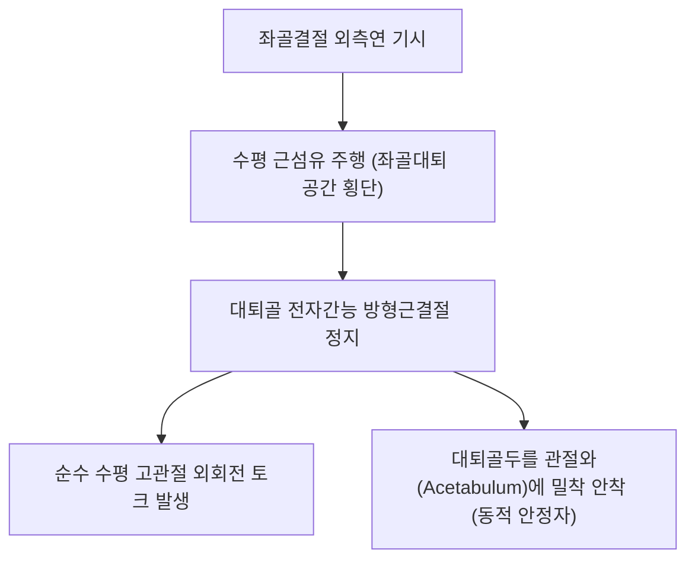

# 🫁 [[대퇴방형근]] (Quadratus Femoris)

> **핵심 요약 (Key Summary)**:
> [[대퇴방형근]](Quadratus Femoris)은 [[좌골]]의 [[좌골결절]] 외측연에서 기시하여 수평 주행한 뒤 [[대퇴골]] 전자간능의 방형근결절(Quadrate tubercle)에 정지하는 편평한 사각형의 심부 외회전근이다.
> [[대퇴방형근신경]](Nerve to quadratus femoris, L4-S1)의 지배를 받으며, **고관절 외회전(순수 수평 토크), 내전 보조 및 대퇴골두의 관절와 중심화(Centration)**를 주동한다.
> 임상적으로는 [[좌골대퇴충돌증후군]](Ischiofemoral Impingement, IFI), 심부 둔부 증후군(DGS), 고관절 후방 충돌성 서혜부-둔부 통증의 핵심 병변근이며, 한의 치료에서는 [[환도]]혈 외하방 심부 침구 및 좌골-소전자 간격 감압 추나의 표적이다.

---
## 📌 목차
1. [해부학적 정밀 구조 및 지배 신경/혈관](#1-해부학적-정밀-구조-및-지배-신경혈관)
2. [생체역학·토크 분석 & 근막 사슬 (Biomechanical Synergy)](#2-생체역학토크-분석--근막-사슬-biomechanical-synergy)
3. [근막통증증후군(TP) & 연관통 패턴 (Travell & Simons)](#3-근막통증증후군tp--연관통-패턴-travell--simons)
4. [초음파 해부학(Sonoanatomy) 및 중재 시술 랜드마크](#4-초음파-해부학sonoanatomy-및-중재-시술-랜드마크)
5. [⭐ 원장님 심층 임상 고찰 및 원본 필기 (Clinical Pearls)](#5-원장님-심층-임상-고찰-및-원본-필기-clinical-pearls)
6. [관련 임상 질환 및 운동손상 증후군 총괄](#6-관련-임상-질환-및-운동손상-증후군-총괄)
7. [추나·도수치료(MET/PIR) & 침구·약침·재활 프로토콜](#7-추나도수치료metpir--침구약침재활-프로토콜)
8. [출처 및 학술 참고 문헌 (References)](#8-출처-및-학술-참고-문헌-references)

---
## 1. 해부학적 정밀 구조 및 지배 신경/혈관

| 항목 | 상세 내용 |
| :--- | :--- |
| **기시 (Origin)** | [[좌골]](Ischium)의 [[좌골결절]](Ischial tuberosity) 외측연 (폐쇄공 하부 외측 골면) |
| **정지 (Insertion)** | [[대퇴골]](Femur) 후면 전자간능(Intertrochanteric crest)의 방형근결절(Quadrate tubercle) 및 대퇴골 간부 상부 후면 |
| **신경 지배** | [[대퇴방형근신경]](Nerve to quadratus femoris, **L4, L5, S1**) — 하쌍자근 및 고관절 후하방 관절낭과 공통 분지 |
| **혈관 공급** | 내측대퇴회선동맥(Medial circumflex femoral a.), 하둔동맥 분지 |
| **해부학적 층위** | 이상근 및 삼두관절근의 바로 하방에 위치하며, 대내전근 상연의 바로 상방에 인접 |

### 🔬 해부학 도해 및 단면도

대퇴방형근은 둔부 심층 최하단에 위치하는 두껍고 단단한 사각형 근육이다. 좌골결절과 대퇴골 소전자(Lesser trochanter) 사이의 좁은 공간(좌골대퇴 공간, Ischiofemoral space)을 가로지르며, 바로 뒤쪽 표면을 거대한 [[좌골신경]](Sciatic nerve) 줄기가 수직으로 타고 내려가므로 기계적 마찰과 압박이 쉽게 발생하는 해부학적 교차로를 형성한다.

---
## 2. 생체역학·토크 분석 & 근막 사슬 (Biomechanical Synergy)

* **순수 고관절 외회전 모멘트**: 기시와 정지가 거의 동일한 수평선상에 배열되어 있어 굴곡이나 신전 각도의 영향을 적게 받으며 가장 안정적인 외회전 토크를 제공한다.
* **관절와 중심화(Dynamic Centration)**: 보행 시 대퇴골두를 관절와 후방에서 단단히 결속하여 고관절의 전방 아탈구 전단력을 방어한다.
* **근막 사슬 연계 (Anatomy Trains)**: 심부전방선(Deep Front Line)의 후하방 기저부로서 대내전근(Adductor magnus)의 후방 섬유와 결합하여 고관절 내전 및 안정성 사슬을 완성한다.

---
## 3. 근막통증증후군(TP) & 연관통 패턴 (Travell & Simons)

* **발통점(TrP) 위치**: 좌골결절과 대퇴골 대전자-소전자 사이 중간 지점의 두터운 근복 중앙부.
* **연관통 양상**:
  * 좌골결절 부위 및 둔부 하부, 둔주름 깊은 곳의 묵직하고 쥐어짜는 듯한 통증.
  * 대퇴 후면 상부 및 슬와부로 방사되며, 보행 시 다리를 뒤로 뻗을 때(고관절 신전 및 내회전) 통증 급증.
  * [[좌골신경]]이 대퇴방형근 표면을 지나므로 근비후나 부종 발생 시 신경 포착성 하지 방사통 동반.
* **악화 인자**: 딱딱한 의자에 앉아 체중이 좌골결절에 실릴 때, 보행 시 보폭을 크게 하여 걸을 때.

---
## 4. 초음파 해부학(Sonoanatomy) 및 중재 시술 랜드마크

* **초음파 스캔 프로토콜**:
  * 환자 복와위 상태에서 좌골결절과 대퇴골 소전자를 연결하는 가상의 선에 트랜스듀서를 횡단 배치.
  * 표층의 두꺼운 [[대둔근]] 아래로 주행하는 [[좌골신경]]의 고에코 타원형 단면 동정.
  * 좌골신경 바로 아래에서 좌골결절 외측연과 대퇴골 후면을 수평으로 잇는 두터운 직사각형 근육층(대퇴방형근) 확인.
  * 좌골대퇴 공간(Ischiofemoral space)의 너비 및 근육 내 부종·고신호 강도 여부 관찰.
* **자침 안전 마진**:
  * 좌골신경이 대퇴방형근의 바로 표면을 지나가므로, 자침 시 좌골신경 주행로를 피해 약간 내측(좌골결절 쪽) 또는 외측(대퇴골 쪽) 골막을 향해 사선으로 접근해야 한다.

---
## 5. ⭐ 원장님 심층 임상 고찰 및 원본 필기 (Clinical Pearls)

* **좌골대퇴 충돌증후군(Ischiofemoral Impingement, IFI)의 진단 팁 (원장님 필기 100% 보존)**:
  * 엉덩이 깊은 곳과 허벅지 뒤쪽 통증으로 디스크나 이상근 증후군 치료를 받아도 호전되지 않는 환자 중 상당수가 IFI이다.
  * 좌골결절과 대퇴골 소전자 사이 간격이 선천적 혹은 후천적(골반 부정렬, 대퇴골 과도한 후념)으로 좁아져(정상 > 20mm, IFI 환자 < 15mm) 대퇴방형근이 찝히는 질환이다.
  * 보행 시 이환측 다리가 뒤로 빠지는 입각기 후기(Terminal Stance)에 엉덩이 깊은 곳에서 찝히는 통증이 재현된다.
* **이학적 유발 검사 (IFI Test)**:
  * 앙와위에서 고관절을 신전시킨 상태로 내전 및 외회전/내회전을 유도할 때 좌골결절 외측에서 통증이 유발되면 강력히 의심한다.
* **침구 및 약침 시술 노하우**:
  * [[환도]]혈에서 약 2~3cm 하방, 좌골결절과 대전자의 중간 함요처에서 0.35×75mm 침을 사용하여 50~70mm 직자 진입.
  * 대퇴방형근 건부착부의 섬유성 유착을 침도로 미세 절개하고, 고황약침이나 신바로약침 1.0~1.5cc를 좌골대퇴 공간 심부에 주입하여 신경 염증과 부종을 가라앉힌다.

---
## 6. 관련 임상 질환 및 운동손상 증후군 총괄

| 임상 질환 / 증후군 | 병리적 연관 기전 | 주요 증상 및 이학적 검사 | 핵심 교정 타깃 |
| :--- | :--- | :--- | :--- |
| **[[좌골대퇴충돌증후군]](IFI)** | 좌골결절-소전자 공간 협소로 대퇴방형근 압박 | 보행 신전 시 둔부 찝힘, IFI 유발 검사 양성 | 좌골대퇴 공간 감압, 대퇴방형근 이완 |
| **심부 둔부 증후군(DGS)** | 대퇴방형근 비후/부종에 의한 좌골신경 마찰 | 좌골결절 외측 압통, 하지 후면 방사통 | 대퇴방형근 심부 약침, 신경 수력박리 |
| **좌골 점액낭염** | 대퇴방형근 기시부 마찰 및 좌골 압박 | 착석 시 좌골결절 심한 통증 | 좌골결절부 침도 및 소염 약침 |
| **고관절 후방 불안정성** | 대퇴방형근 약화로 인한 대퇴골두 중심화 부전 | 고관절 굴곡/내회전 시 불안정감 | 대퇴방형근 등척성 강화 재활 |

---
## 7. 추나·도수치료(MET/PIR) & 침구·약침·재활 프로토콜

* **한의학 경혈 매핑 및 침구 프로토콜**:
  * [[환도]] 하방 반응점, [[질변(BL54)|질변]], 승부(BL36).
  * 0.35×75mm 장침으로 좌골신경 주행로를 피해 좌골결절 외측면 골막을 향해 50~65mm 심부 자침.
* **추나 골반 교정 & MET**:
  * 골반의 아웃플레어(Out-flare) 변위를 교정하여 좌골대퇴 간격을 구조적으로 확보.
  * 환자 복와위, 슬관절 90도 굴곡 상태에서 고관절 완전 내회전 유도 후 외회전 방향 등척성 저항(7초 유지) 후 PIR 신장.
* **보행 수정 및 생활 티칭**:
  * IFI 환자는 보폭을 너무 크게 하여 다리를 뒤로 과신전시키는 보행을 피하고, 보폭을 줄여 걷도록 지도.

---
## 8. 출처 및 학술 참고 문헌 (References)

1. **Torriani, M. (2025)**. Ischiofemoral Impingement Syndrome in 2024: Updated Concepts and Imaging Methods. *Magn Reson Imaging Clin N Am*, 33(1), 63-73. [PMID: 39515961](https://pubmed.ncbi.nlm.nih.gov/39515961/)
   - `[연구 요약]`: 대퇴방형근의 부종 및 지방 변성을 동반하는 좌골대퇴 충돌증후군(IFI)의 최신 병태생리 및 영상 진단 지침.

2. **Yoon, Y. H., et al. (2025)**. Beyond Nerve Entrapment: A Narrative Review of Muscle-Tendon Pathologies in Deep Gluteal Syndrome. *Diagnostics (Basel)*, 15(17), 2531. [PMID: 41095750](https://pubmed.ncbi.nlm.nih.gov/41095750/)
   - `[연구 요약]`: 심부 둔부 공간 내 대퇴방형근 및 심부 외회전근군 건병증과 좌골신경 유착 메커니즘 총괄 분석.
