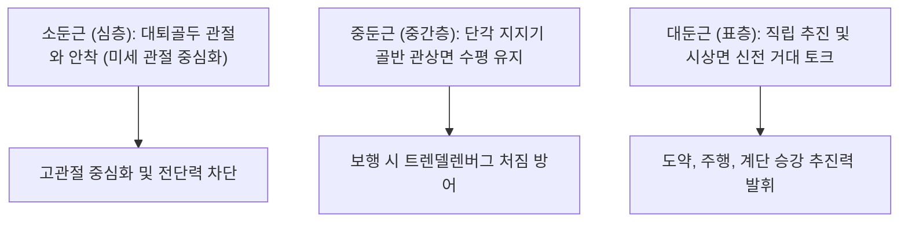

# 🫁 [[둔근]] (Gluteal Muscles Complex)

> **핵심 요약 (Key Summary)**:
> [[둔근]](Gluteal Muscles)은 골반 후외측을 감싸며 직립 보행의 핵심 동력을 제공하는 3대 근육군으로, 표층의 [[대둔근]](Gluteus maximus), 중간층의 [[중둔근]](Gluteus medius), 심층의 [[소둔근]](Gluteus minimus)으로 구성된다.
> 각각 [[하둔신경]](대둔근)과 [[상둔신경]](중·소둔근)의 지배를 받으며, **고관절 신전(추진력), 외전(골반 수평 유지), 내·외회전 및 [[천장관절]]의 역학적 안정화**를 총괄한다.
> 임상적으로는 둔근 기억상실증(Dead Butt Syndrome), [[트렌델렌부르크 징후|트렌델렌버그 보행(징후)]], [[가성 좌골신경통]], 슬개대퇴통증증후군의 핵심 발원 복합체이며, 한의 치료에서는 [[환도]]혈, 거료(GB29)혈, [[질변(BL54)|질변]]혈 심부 침구 및 요골반 복합체 추나의 표적이다.

---
## 📌 목차
1. [해부학적 정밀 구조 및 지배 신경/혈관](#1-해부학적-정밀-구조-및-지배-신경혈관)
2. [생체역학·토크 분석 & 근막 사슬 (Biomechanical Synergy)](#2-생체역학토크-분석--근막-사슬-biomechanical-synergy)
3. [근막통증증후군(TP) & 연관통 패턴 (Travell & Simons)](#3-근막통증증후군tp--연관통-패턴-travell--simons)
4. [초음파 해부학(Sonoanatomy) 및 중재 시술 랜드마크](#4-초음파-해부학sonoanatomy-및-중재-시술-랜드마크)
5. [⭐ 원장님 심층 임상 고찰 및 원본 필기 (Clinical Pearls)](#5-원장님-심층-임상-고찰-및-원본-필기-clinical-pearls)
6. [관련 임상 질환 및 운동손상 증후군 총괄](#6-관련-임상-질환-및-운동손상-증후군-총괄)
7. [추나·도수치료(MET/PIR) & 침구·약침·재활 프로토콜](#7-추나도수치료metpir--침구약침재활-프로토콜)
8. [출처 및 학술 참고 문헌 (References)](#8-출처-및-학술-참고-문헌-references)

---
## 1. 해부학적 정밀 구조 및 지배 신경/혈관

| 근육명 | 기시 (Origin) | 정지 (Insertion) | 신경 지배 | 혈관 공급 | 주요 작용 |
| :--- | :--- | :--- | :--- | :--- | :--- |
| **[[대둔근]]** | [[장골]] 후둔선 후방, [[천골]]·미골 후면, 천결절인대, 흉요근막 | [[장경인대]](상부 3/4), [[대퇴골]] 둔근조면(하부 1/4) | [[하둔신경]](L5-S2) | 상둔·하둔동맥 | 고관절 강력 신전, 외회전, 천장관절 압박 |
| **[[중둔근]]** | 장골 외측면 (전둔선과 후둔선 사이 골면) | 대퇴골 대전자(Greater trochanter) 외측면 사선능 | [[상둔신경]](L4-S1) | 상둔동맥 심지 | 고관절 외전(골반 수평 유지), 전방 내회전, 후방 외회전 |
| **[[소둔근]]** | 장골 외측면 (전둔선과 하둔선 사이 골면) | 대퇴골 대전자 전연 및 고관절 상외측 관절낭 | [[상둔신경]](L4-S1) | 상둔동맥 심지 | 고관절 외전, 강력한 내회전, 대퇴골두 관절와 안착 |

### 🔬 해부학 도해 및 단면도

둔근 복합체는 골반 장골익 후외측면에 3겹의 정교한 층판(Layered Structure)을 형성한다.
* **표층(Superficial)**: 거대한 대둔근이 후방 전체를 덮어 하지 추진력을 형성하고 좌골신경 통로를 쿠션처럼 감싼다.
* **중간층(Middle)**: 부채꼴 모양의 중둔근이 장골능 전체에서 대퇴골 대전자로 모여들며 보행 시 골반이 반대측으로 무너지는 것을 지탱하는 외측 기둥을 만든다.
* **심층(Deep)**: 가장 깊은 곳의 소둔근이 관절낭에 밀착하여 고관절 회전 중심을 정밀하게 제어한다.

---
## 2. 생체역학·토크 분석 & 근막 사슬 (Biomechanical Synergy)

* **보행 주기에서의 3단계 협동 기전**:
  1. **초기 접지기(Initial Contact)**: 대둔근이 편심성 수축으로 체간의 전방 쏠림을 제동.
  2. **단각 지지기(Mid-Stance)**: 중둔근과 소둔근이 강력한 외전 토크를 발휘하여 반대측 골반이 아래로 떨어지는 트렌델렌버그 현상 차단.
  3. **말기 입각기(Terminal Stance)**: 대둔근이 동심성 수축으로 골반을 밀어내며 강력한 전방 추진력 생성.
* **근막 사슬 연계 (Anatomy Trains)**:
  * 대둔근: 후방 사선 슬링(POS) 및 표재후방선(SBL).
  * 중둔근·소둔근: 외측선(Lateral Line).

---
## 3. 근막통증증후군(TP) & 연관통 패턴 (Travell & Simons)

* **대둔근 TrP**: 천장관절, 둔부 하부, 꼬리뼈 주변 통증(앉을 때 엉덩이가 배겨 똑바로 앉지 못함).
* **중둔근 TrP**: 장골능 후부, 천장관절, 둔부 외측 통증(측와위 수면 시 짓눌려 통증 발생, 보행 시 골반 외측 통증).
* **소둔근 TrP (위대한 모방자, The Great Mimicker)**:
  * 둔부 후외측에서 시작하여 대퇴 외측, 하퇴 외측, 발목 및 발등까지 방사되는 신경근병증 모사 통증.
  * L5 또는 S1 디스크(추간판 탈출증)와 거의 구별할 수 없는 가성 좌골신경통 유발.

---
## 4. 초음파 해부학(Sonoanatomy) 및 중재 시술 랜드마크

* **둔부 3층 초음파 랜드마크**:
  * 장골익 외측에 트랜스듀서를 관상면(Coronal plane)으로 거치하면, 표층부터 대둔근 → 중둔근 → 소둔근 → 장골 뼈 음영(Hyperechoic bony cortex)의 3개 근육층이 선명하게 구획된다.
  * 중둔근과 소둔근 사이의 근막면(Intermuscular plane)을 따라 주행하는 상둔동맥 심지와 상둔신경 분지를 도플러로 식별.
* **시술 안전 마진**: 대전자 상부에서 접근 시 좌골신경 주행로와 안전 거리를 확보할 수 있으나, 심부 자침 시 상둔신경 분지를 자극하지 않도록 층간 공간을 정밀 타깃해야 한다.

---
## 5. ⭐ 원장님 심층 임상 고찰 및 원본 필기 (Clinical Pearls)

* **둔근 기억상실증(Gluteal Amnesia / Dead Butt Syndrome)의 본질 (원장님 필기 100% 보존)**:
  * 오랜 시간 앉아 있는 현대인의 뇌는 둔근을 쓰는 법을 잊어버린다.
  * 걸을 때나 계단을 오를 때 엉덩이 근육 대신 허리 기립근과 허벅지 앞뒤 근육만 혹사당한다.
  * 그 결과 만성 요통, 무릎 관절염, 족저근막염 환자의 90% 이상에서 둔근 약화가 관찰된다.
  * 둔근을 깨우지 않고 허리나 무릎만 치료하는 것은 밑 빠진 독에 물 붓기이다.
* **보행 평가(Gait Analysis)를 통한 둔근 진단**:
  * 환자가 진료실로 걸어 들어올 때 엉덩이가 좌우로 뒤뚱거리는지([[트렌델렌부르크 징후|트렌델렌버그 보행]], 중둔근 약화), 상체가 뒤로 젖혀지며 걷는지(대둔근 약화 보상), 발끝이 팔자로 벌어지는지(이상근/외회전근 과긴장)를 즉각 파악해야 한다.
* **3대 둔근 촉진 및 자침 가이드**:
  * 대둔근: [[환도]]혈, [[질변(BL54)|질변]]혈 심부 자침 (천장관절 및 대전자 방향).
  * 중둔근: 거료(GB29) 상외측 장골능 라인 사자.
  * 소둔근: 거료(GB29) 심부 장골익 뼈 바닥까지 0.35×75mm 장침 직자하여 섬유화 박리.

---
## 6. 관련 임상 질환 및 운동손상 증후군 총괄

| 임상 질환 / 증후군 | 병리적 연관 기전 | 주요 증상 및 이학적 검사 | 핵심 교정 타깃 |
| :--- | :--- | :--- | :--- |
| **둔근 기억상실증** | 지속적 좌식으로 인한 둔근 발화 억제 | 계단 승강 시 무릎/요통, 둔부 무력 | 둔근 인지 활성화(Glute bridge) |
| **[[트렌델렌부르크 징후|트렌델렌버그 보행]]** | 중둔근 부전으로 반대측 골반 처짐 | 뒤뚱거리는 보행, 한 발 서기 불능 | 중둔근 강화 및 골반 수평 추나 |
| **[[가성 좌골신경통]]** | 소둔근/이상근 발통점 연관통 | 다리 저림, 하지 외측 방사통 | 소둔근 침도 및 이상근 이완 |
| **무릎 외측 충돌 및 PFPS** | 둔근 약화로 대퇴골 내회전/외반 | 스쿼트 시 무릎 모임(Knee valgus) | 둔근 외회전/외전근 강화 재활 |

---
## 7. 추나·도수치료(MET/PIR) & 침구·약침·재활 프로토콜

* **한의학 경혈 매핑 및 침구 프로토콜**:
  * [[환도]], 거료(GB29), [[질변(BL54)|질변]], [[포황]], [[풍시(GB31)|풍시]].
  * 둔부 주요 경혈에 0.35×75mm 장침으로 심부 자입 후 저주파(2Hz) 전침을 걸어 둔근 전체의 근수축 유발.
* **골반 추나 교정**:
  * 장골의 전·후방 회전 변위를 교정하여 둔근 기시부의 생체역학적 장력 회복.
* **둔근 활성화 3단계 재활**:
  * **1단계(인지)**: 엎드려 엉덩이 조이기(Prone glute squeeze).
  * **2단계(고립)**: 클램쉘(Clamshell), 사이드 라잉 레그 레이즈.
  * **3단계(통합)**: 힙 힌지(Hip hinge), 스쿼트, 런지.

---
## 8. 출처 및 학술 참고 문헌 (References)

1. **Koga, H., et al. (2025)**. Evaluation of Trendelenburg and Duchenne signs by experimentally induced gluteal muscle paralysis. *J Orthop Res*, 43(2), 345-353. [PMID: 42501605](https://pubmed.ncbi.nlm.nih.gov/42501605/)
   - `[연구 요약]`: 둔부 근육군의 마비 실험을 통해 골반 수평 유지와 보행 시 둔근 안정화 기전을 검증한 연구.

2. **Dierks, T. A., et al. (2025)**. Influence of Hip Abductor Strength on Running Biomechanics in Healthy Populations: A Scoping Review. *Sports Med*, 55(1), 112-125. [PMID: 41874888](https://pubmed.ncbi.nlm.nih.gov/41874888/)
   - `[연구 요약]`: 고관절 외전근군과 둔근 복합체의 근력 수준이 달리기 생체역학 및 하지 정렬에 미치는 영향 분석.
