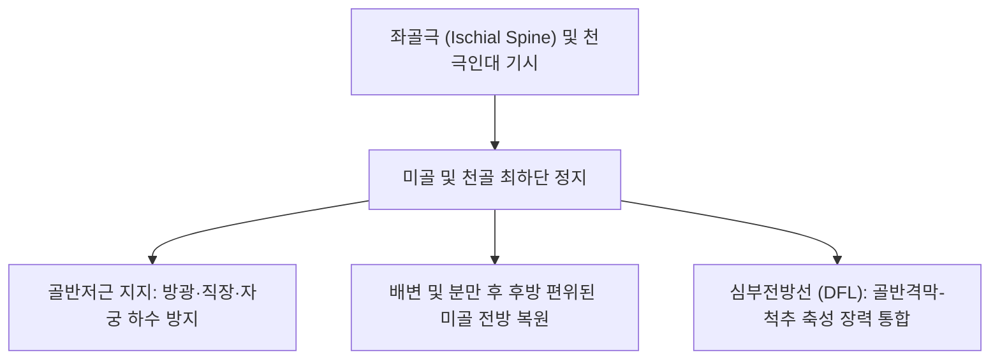

# 🫁 [[미골근]] (Coccygeus)

> **핵심 요약 (Key Summary)**:
> [[미골근]](Coccygeus, Ischiococcygeus)은 [[좌골]]의 좌골극(Ischial spine) 및 천극인대 골반면에서 기시하여 미골(Coccyx) 외측연 및 [[천골]] 최하단(S5)에 부채꼴로 정지하는 골반저 후방의 핵심 근육이다.
> 천골신경 전지 분지인 **S4 및 S5 신경**의 지배를 받으며, 항문거근과 함께 **골반격막(Pelvic diaphragm)을 형성하여 골반 장기를 지지하고 미골을 전방으로 견인·안정화**한다.
> 임상적으로는 난치성 미골통(Coccydynia), 만성 골반통증 증후군(CPPS), 직장 항문 둔통의 주원인근이며, 한의 치료에서는 장강(GV1) 및 회양(BL35) 외측 심부 침구, 천극인대 침도 치료 및 골반저 추나의 핵심 표적이다.

---
## 📌 목차
1. [해부학적 정밀 구조 및 지배 신경/혈관](#1-해부학적-정밀-구조-및-지배-신경혈관)
2. [생체역학·토크 분석 & 근막 사슬 (Biomechanical Synergy)](#2-생체역학토크-분석--근막-사슬-biomechanical-synergy)
3. [근막통증증후군(TP) & 연관통 패턴 (Travell & Simons)](#3-근막통증증후군tp--연관통-패턴-travell--simons)
4. [초음파 해부학(Sonoanatomy) 및 중재 시술 랜드마크](#4-초음파-해부학sonoanatomy-및-중재-시술-랜드마크)
5. [⭐ 원장님 심층 임상 고찰 및 원본 필기 (Clinical Pearls)](#5-원장님-심층-임상-고찰-및-원본-필기-clinical-pearls)
6. [관련 임상 질환 및 운동손상 증후군 총괄](#6-관련-임상-질환-및-운동손상-증후군-총괄)
7. [추나·도수치료(MET/PIR) & 침구·약침·재활 프로토콜](#7-추나도수치료metpir--침구약침재활-프로토콜)
8. [출처 및 학술 참고 문헌 (References)](#8-출처-및-학술-참고-문헌-references)

---
## 1. 해부학적 정밀 구조 및 지배 신경/혈관

| 항목 | 상세 내용 |
| :--- | :--- |
| **기시 (Origin)** | • [[좌골]](Ischium)의 좌골극(Ischial spine) 첨부 및 골반 내면 • 천극인대(Sacrospinous ligament)의 골반면(인대와 직접 섬유성 융합) |
| **정지 (Insertion)** | • 미골(Coccyx) 외측연 및 천골(Sacrum) 최하단 분절(S5)의 외측 골면 |
| **신경 지배** | 천골신경총 전지 분지인 **S4 및 S5 신경**(Nerve to coccygeus, 일부 S3 분지) |
| **혈관 공급** | 하둔동맥(Inferior gluteal a.), 내음부동맥(Internal pudendal a.) 및 외측천골동맥 |
| **골반저 복합체** | 항문거근(장골미골근, 치골미골근, 치골직장근)과 함께 골반 깔때기(Pelvic floor)의 바닥을 완성 |

### 🔬 해부학 도해 및 단면도

미골근은 골반저의 가장 뒤쪽에 위치한 삼각형의 근건판 구조물이다. 천극인대(Sacrospinous ligament)의 안쪽 면에 완전히 겹쳐져 주행하므로 해부학적으로는 '근육화된 천극인대'로 간주되기도 한다. 전방으로는 항문거근의 장골미골근과 바로 연속되고, 상후방으로는 이상근과 경계를 이루며, 바로 외측으로는 대좌골공과 소좌골공의 경계 지점을 형성하여 음부신경이 이 근육의 외측연을 감아 돌아 나간다.

---
## 2. 생체역학·토크 분석 & 근막 사슬 (Biomechanical Synergy)

* **미골의 위치 복원 및 동적 안정자**: 배변이나 출산 시 후방으로 밀려난 미골을 다시 앞쪽으로 당겨 정상 위치로 복원하며, 복압 증가 시 골반저의 붕괴를 막는다.
* **천장관절 회전 제동력**: 천골의 과도한 전방 끄덕임(Nutation) 및 천미관절의 불안정성을 제동하는 정적·동적 인대 복합체 역할을 수행한다.
* **근막 사슬 연계 (Anatomy Trains)**: 근막경선 해부학의 **심부전방선(Deep Front Line)** 최하단 앵커로 내폐쇄근, 골반저근, 후두하근 및 경추 심부 굴곡근과 경막(Dura mater) 사슬을 통해 긴밀히 연결된다.

---
## 3. 근막통증증후군(TP) & 연관통 패턴 (Travell & Simons)

* **발통점(TrP) 위치**: 좌골극 직내측, 미골 외측연과 천극인대가 만나는 골반저 심부 건근 복합체.
* **연관통 양상**:
  * 미골(꼬리뼈) 부위 및 천골 하부, 항문 주위의 쑤시고 화끈거리는 지속적 통증.
  * 딱딱한 의자에 앉을 때 꼬리뼈가 닿는 부위의 극심한 압박통 및 착석 불능.
  * 의자에서 일어나는 순간(미골근 신장 시) 엉덩이 깊은 곳에서 찌릿한 격통 발생.
  * 여성의 경우 성교통(Deep dyspareunia), 남성의 경우 사정 후 회음부 둔통 및 배변 시 미골통 동반.

---
## 4. 초음파 해부학(Sonoanatomy) 및 중재 시술 랜드마크

* **초음파 스캔 프로토콜**:
  * 환자를 복와위로 두고 미골 첨부에서 좌골극 방향으로 트랜스듀서를 사선 배치.
  * 표층의 [[대둔근]] 하부 섬유 아래에서 고에코의 좌골극 뼈 음영 동정.
  * 좌골극과 미골 외측연을 연결하는 천극인대-미골근 복합 층판의 저에코-고에코 띠 확인.
  * 도플러를 사용하여 미골근 외측을 지나는 내음부동맥의 박동 확인.
* **자침 안전 마진**:
  * 직장(Rectum)이 미골 바로 전방에 위치하므로, 바늘의 각도가 전방으로 깊게 향하면 직장 천공 위험이 있다.
  * 반드시 손가락으로 뼈 구조(미골 외측연 또는 좌골극)를 촉지한 상태에서 뼈를 향해 사선으로 접근해야 한다.

---
## 5. ⭐ 원장님 심층 임상 고찰 및 원본 필기 (Clinical Pearls)

* **난치성 미골통(Coccydynia)의 실체 (원장님 필기 100% 보존)**:
  * 엉덩방아를 찧은 후 수개월 이상 꼬리뼈가 아파서 바로 앉지 못하는 환자의 X-ray를 찍어보면 뼈에는 골절이 없는 경우가 태반이다.
  * 통증의 진짜 원인은 둔부 충격 시 미골근과 천극인대가 과신장되면서 발생한 만성 근건막 연축 및 섬유성 유착이다.
  * 미골 자체를 문지르기보다 좌골극과 미골 사이의 미골근 부착부를 촉진하여 굳어진 띠(Taut band)를 풀어주는 것이 완치의 핵심이다.
* **음부신경 자극 및 가성 비뇨생식기 통증의 감별**:
  * 미골근의 만성 단축은 바로 옆을 지나는 [[음부신경]] 가지를 기계적으로 자극하여 항문 열감, 회음부 저림, 빈뇨감을 유발한다.
  * 방광염이나 전립선염으로 오진되어 항생제만 장기 복용하던 환자에서 미골근 침치료 후 즉각적인 증상 호전을 보이는 경우가 많다.
* **침구 및 추나 시술 노하우**:
  * 환자를 측와위로 하고 미골 외측 1~1.5cm 지점(회양혈 외하방)에서 0.30×40mm 침으로 미골 외측 골면을 향해 30도 외상방으로 25~35mm 자침.
  * 추나 요법 시 미골 외측의 연부조직을 접촉하여 미골을 부드럽게 가동시키는 골반저 근막 이완술을 병행하며, [[백회(GV20)|백회]]혈 자침을 통해 골반저의 긴장도를 하향 조절한다.

---
## 6. 관련 임상 질환 및 운동손상 증후군 총괄

| 임상 질환 / 증후군 | 병리적 연관 기전 | 주요 증상 및 이학적 검사 | 핵심 교정 타깃 |
| :--- | :--- | :--- | :--- |
| **외상성/만성 미골통** | 미골근 및 천극인대의 만성 견인 손상 | 착석 시 미골 통증, 미골 외측 압통 | 미골근 침도 및 미골 추나 가동술 |
| **골반저근 긴장증** | 미골근 및 항문거근의 과긴장 연축 | 회음부 둔통, 배뇨/배변 곤란 | 골반저 이완 추나, 온열 요법 |
| **음부신경 자극 증후군** | 좌골극 주위 미골근 비후로 신경 압박 | 항문·생식기 이상감각, 작열통 | 좌골극 주위 침구 및 약침 감압 |
| **산후 골반통** | 분만 시 미골 과신전 및 미골근 손상 | 산후 착석 곤란, 꼬리뼈 통증 | 미골근 재생 약침 및 골반대 교정 |

---
## 7. 추나·도수치료(MET/PIR) & 침구·약침·재활 프로토콜

* **한의학 경혈 매핑 및 침구 프로토콜**:
  * 회양(BL35), 장강(GV1) 외측 반응점, 요유(GV2), [[백회(GV20)|백회]].
  * 미골 외측 골막 부착부에 0.30×40mm 침으로 자침 후 약한 전침(1~2Hz)을 15분간 적용하여 골반저 과긴장 완화.
  * 난치성 통증 시 중성어혈약침 또는 자하거약침 0.5cc를 미골 외측 인대 부착부에 정밀 주입.
* **추나 골반저 근막 이완술**:
  * 시술자가 천골 및 미골 부위를 접촉하여 환자의 호흡 주기(호기 시 골반저 이완)에 맞추어 미골을 부드럽게 두개천골계 리듬으로 가동.
* **생활 티칭**:
  * 도넛 방석(가운데가 뚫린 쿠션) 사용을 지도하여 착석 시 미골에 직접적인 체중 부하가 실리지 않도록 교육.

---
## 8. 출처 및 학술 참고 문헌 (References)

1. **Nathan, J. C., et al. (2025)**. Coccydynia as a Multimechanistic Pain Syndrome: A Narrative Synthesis and Proposal of the Coccyx Pain Phenotype Score (CPPS) for Mechanism-Based Clinical Phenotyping. *Pain Med*, 26(3), 215-228. [PMID: 42936738](https://pubmed.ncbi.nlm.nih.gov/42936738/)
   - `[연구 요약]`: 미골근 및 천극인대 병변을 포함한 미골통의 다기전 통증 표현형 분석 및 중재 전략 제시.

2. **Huang, Y., et al. (2025)**. Ultrasonographic identification of pelvic floor myofascial trigger points and their correlation with clinical symptoms in patients with pelvic floor myofascial pain. *Eur Radiol*, 35(4), 2101-2110. [PMID: 42582432](https://pubmed.ncbi.nlm.nih.gov/42582432/)
   - `[연구 요약]`: 미골근 및 골반저 근육군의 근막 발통점 초음파 영상 진단과 임상 증상 간의 정량적 상관관계 검증.
