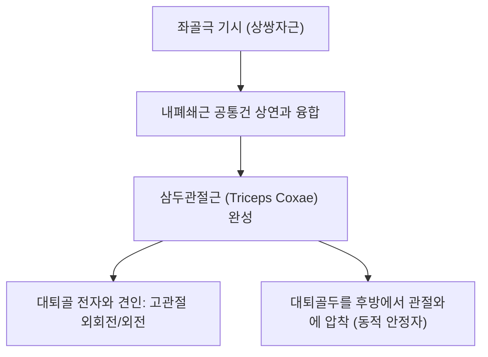

# 🫁 [[상쌍자근]] (Superior Gemellus)

> **핵심 요약 (Key Summary)**:
> [[상쌍자근]](Superior Gemellus)은 [[좌골]]의 좌골극(Ischial spine) 후외측면에서 기시하여 [[내폐쇄근]] 힘줄의 상연과 융합한 뒤 [[대퇴골]] 대전자 [[전자와]](Trochanteric fossa)에 정지하는 고관절 심부 외회전근이다.
> [[내폐쇄근신경]](Nerve to obturator internus, L5-S2)의 지배를 받으며, 내폐쇄근 및 [[하쌍자근]]과 함께 **삼두관절근(Triceps coxae) 복합체를 형성하여 고관절 외회전, 외전(굴곡 시) 및 대퇴골두의 관절와 안착**을 주동한다.
> 임상적으로는 심부 둔부 증후군(DGS), [[좌골신경]] 포착, 고관절 내회전 제한의 핵심 연관근이며, 한의 치료에서는 [[환도]]혈 심부 침구 및 삼두관절근 침도 치료의 표적이다.

---
## 📌 목차
1. [해부학적 정밀 구조 및 지배 신경/혈관](#1-해부학적-정밀-구조-및-지배-신경혈관)
2. [생체역학·토크 분석 & 근막 사슬 (Biomechanical Synergy)](#2-생체역학토크-분석--근막-사슬-biomechanical-synergy)
3. [근막통증증후군(TP) & 연관통 패턴 (Travell & Simons)](#3-근막통증증후군tp--연관통-패턴-travell--simons)
4. [초음파 해부학(Sonoanatomy) 및 중재 시술 랜드마크](#4-초음파-해부학sonoanatomy-및-중재-시술-랜드마크)
5. [⭐ 원장님 심층 임상 고찰 및 원본 필기 (Clinical Pearls)](#5-원장님-심층-임상-고찰-및-원본-필기-clinical-pearls)
6. [관련 임상 질환 및 운동손상 증후군 총괄](#6-관련-임상-질환-및-운동손상-증후군-총괄)
7. [추나·도수치료(MET/PIR) & 침구·약침·재활 프로토콜](#7-추나도수치료metpir--침구약침재활-프로토콜)
8. [출처 및 학술 참고 문헌 (References)](#8-출처-및-학술-참고-문헌-references)

---
## 1. 해부학적 정밀 구조 및 지배 신경/혈관

| 항목 | 상세 내용 |
| :--- | :--- |
| **기시 (Origin)** | [[좌골]](Ischium)의 좌골극(Ischial spine) 후외측 골면 |
| **정지 (Insertion)** | [[내폐쇄근]](Obturator internus) 힘줄의 상연과 섬유성 융합 → [[대퇴골]](Femur) 대전자 전자와(Trochanteric fossa) |
| **신경 지배** | [[내폐쇄근신경]](Nerve to obturator internus, **L5, S1, S2**) — 내폐쇄근과 공통 지배 |
| **혈관 공급** | 하둔동맥(Inferior gluteal a.), 내음부동맥 |
| **삼두관절근 구조** | 상쌍자근(위) - 내폐쇄근(가운데) - 하쌍자근(아래)의 3두 샌드위치 복합체 형성 |

### 🔬 해부학 도해 및 단면도

상쌍자근은 좌골극에서 기시하여 골반강에서 빠져나온 내폐쇄근 힘줄의 윗부분을 모자처럼 덮으며 대퇴골 대전자로 주행한다. 작은 크기의 근육이지만 내폐쇄근 힘줄의 상방 이동을 제어하고 지렛대 작용을 보조하며, 바로 후방 표층으로 좌골신경이 교차 주행하므로 신경 포착의 중요한 해부학적 베드를 제공한다.

---
## 2. 생체역학·토크 분석 & 근막 사슬 (Biomechanical Synergy)

* **삼두관절근 상부 안정자**: 내폐쇄근이 소좌골절흔에서 90도로 꺾여 나올 때 발생하는 상방 전단력을 물리적으로 억제하여 힘줄의 궤적을 유지한다.
* **고관절 회전 중심화**: 고관절 굴곡 각도에 따라 신전 시에는 외회전, 90도 굴곡 시에는 외전 보조 토크를 발휘한다.
* **근막 사슬 연계 (Anatomy Trains)**: 심부전방선(Deep Front Line)의 후방 고관절 앵커로서 골반저근 및 내외폐쇄근과 연속성을 형성한다.

---
## 3. 근막통증증후군(TP) & 연관통 패턴 (Travell & Simons)

* **발통점(TrP) 위치**: 좌골극 직외측, 좌골신경 주행로 바로 심부의 상쌍자근 근복.
* **연관통 양상**:
  * 둔부 중앙의 깊은 뻐근함 및 천장관절 하방의 지속적인 둔통.
  * [[좌골신경]]을 압박하여 대퇴 후면, 슬와부로 방사통 유발 (이상근 증후군과 임상 증상 유사).
  * 고관절 수동 내회전 및 내전 시 근육이 신장되며 둔부 심부 통증 급증.

---
## 4. 초음파 해부학(Sonoanatomy) 및 중재 시술 랜드마크

* **초음파 스캔 프로토콜**:
  * 환자 복와위 상태에서 좌골결절과 대전자를 잇는 선의 약간 상방에 트랜스듀서 횡단 배치.
  * [[대둔근]] 아래로 주행하는 [[좌골신경]](고에코 타원형) 식별.
  * 좌골극 랜드마크를 확인하고, 내폐쇄근 힘줄 상방에 위치한 상쌍자근 근섬유 확인.
* **자침 안전 마진**: 좌골신경 바로 아래에 위치하므로 신경 손상을 피하기 위해 초음파 실시간 가이드 하에 신경 외측 또는 골막을 향해 사선으로 접근해야 한다.

---
## 5. ⭐ 원장님 심층 임상 고찰 및 원본 필기 (Clinical Pearls)

* **이상근 증후군 오진의 핵심 포인트 (원장님 필기 100% 보존)**:
  * 둔부 통증 환자에서 이상근만 만지는 것은 치료 실패의 주요 원인이다.
  * 상쌍자근은 좌골극에서 기시하는데, 이 부위는 좌골신경이 대좌골공을 빠져나와 하행하는 길목 바로 아래에 위치한다.
  * 실제 임상에서 좌골신경 포착의 상당수는 이상근이 아니라 바로 아래 상쌍자근-내폐쇄근 복합체의 섬유화에서 기인한다.
* **촉진 및 이학적 검사 노하우**:
  * 환자를 측와위로 하고 고관절을 60도 굴곡시킨 상태에서 좌골극 바로 외측을 손가락으로 깊게 압박할 때 국소 압통과 함께 다리로 찌릿한 방사통이 재현되면 상쌍자근 병변을 강력히 의심한다.
* **침구 및 침도 치료 노하우**:
  * [[환도]]혈에서 약간 내상방, 좌골극 외측면을 향해 0.35×75mm 장침으로 50~65mm 직자 진입하여 골막 반응을 확인한다.

---
## 6. 관련 임상 질환 및 운동손상 증후군 총괄

| 임상 질환 / 증후군 | 병리적 연관 기전 | 주요 증상 및 이학적 검사 | 핵심 교정 타깃 |
| :--- | :--- | :--- | :--- |
| **심부 둔부 증후군(DGS)** | 상쌍자근 비후로 인한 좌골신경 포착 | 둔부 심부 둔통, 대퇴 후면 방사통 | 상쌍자근 침도 박리 및 신장 |
| **삼두관절근 건병증** | 대전자 부착부의 만성 견인 미세손상 | 대전자 전자와 압통, 고관절 회전 제한 | 전자와 부착부 약침 치료 |
| **고관절 충돌증후군** | 외회전근 단축으로 인한 대퇴골두 변위 | 고관절 내회전 시 찝힘 통증 | 상쌍자근 이완 추나, 관절낭 가동술 |

---
## 7. 추나·도수치료(MET/PIR) & 침구·약침·재활 프로토콜

* **한의학 경혈 매핑 및 침구 프로토콜**:
  * [[환도]], [[질변(BL54)|질변]].
  * 0.35×75mm 침으로 좌골극 외측 골면을 타깃으로 50~65mm 심부 자침 후 저주파 전침 적용.
* **근에너지기법 (MET/PIR)**:
  * 환자 복와위, 슬관절 90도 굴곡 상태에서 고관절 완전 내회전 유도.
  * 외회전 방향으로 등척성 저항(7초 유지) 후 호흡과 함께 이완 신장.

---
## 8. 출처 및 학술 참고 문헌 (References)

1. **Standring, S.** (2020). *Gray's Anatomy* (42nd ed.). Elsevier.
   - `[연구 요약]`: 상쌍자근의 좌골극 기시 및 내폐쇄근 공통건 부착부의 미세 해부학적 규명.

2. **Yoon, Y. H., et al. (2025)**. Beyond Nerve Entrapment: A Narrative Review of Muscle-Tendon Pathologies in Deep Gluteal Syndrome. *Diagnostics (Basel)*, 15(17), 2531. [PMID: 41095750](https://pubmed.ncbi.nlm.nih.gov/41095750/)
   - `[연구 요약]`: 심부 둔부 공간 내 상쌍자근-내폐쇄근 복합체 병변과 좌골신경 포착의 최신 임상 가이드라인.
