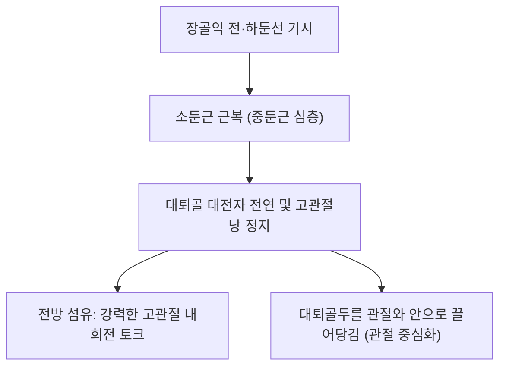

# 🫁 [[소둔근]] (Gluteus Minimus)

> **핵심 요약 (Key Summary)**:
> [[소둔근]](Gluteus Minimus)은 둔부 3대 근육 중 최심층에 위치하며, [[장골]] 외측면의 전둔선과 하둔선 사이에서 기시하여 [[대퇴골]] 대전자 전연 및 고관절낭에 정지하는 부채꼴 모양의 근육이다.
> [[상둔신경]](Superior gluteal nerve, L4-S1)의 지배를 받으며, **고관절 외전, 강력한 내회전 및 대퇴골두의 관절와 중심화(Centration)**를 주동한다.
> 임상적으로는 추간판 탈출증을 완벽히 모사하는 **'위대한 모방자(The Great Mimicker)'**이자 [[가성 좌골신경통]](Pseudo-sciatica)의 제1원인근이며, 한의 치료에서는 거료(GB29)혈 심부 장골익 골막 직자 침구 및 심부 침도 치료의 핵심 표적이다.

---
## 📌 목차
1. [해부학적 정밀 구조 및 지배 신경/혈관](#1-해부학적-정밀-구조-및-지배-신경혈관)
2. [생체역학·토크 분석 & 근막 사슬 (Biomechanical Synergy)](#2-생체역학토크-분석--근막-사슬-biomechanical-synergy)
3. [근막통증증후군(TP) & 연관통 패턴 (Travell & Simons)](#3-근막통증증후군tp--연관통-패턴-travell--simons)
4. [초음파 해부학(Sonoanatomy) 및 중재 시술 랜드마크](#4-초음파-해부학sonoanatomy-및-중재-시술-랜드마크)
5. [⭐ 원장님 심층 임상 고찰 및 원본 필기 (Clinical Pearls)](#5-원장님-심층-임상-고찰-및-원본-필기-clinical-pearls)
6. [관련 임상 질환 및 운동손상 증후군 총괄](#6-관련-임상-질환-및-운동손상-증후군-총괄)
7. [추나·도수치료(MET/PIR) & 침구·약침·재활 프로토콜](#7-추나도수치료metpir--침구약침재활-프로토콜)
8. [출처 및 학술 참고 문헌 (References)](#8-출처-및-학술-참고-문헌-references)

---
## 1. 해부학적 정밀 구조 및 지배 신경/혈관

| 항목 | 상세 내용 |
| :--- | :--- |
| **기시 (Origin)** | [[장골]](Ilium) 외측 골면 (전둔선과 하둔선 사이 골면) 및 대좌골절흔 상연 |
| **정지 (Insertion)** | [[대퇴골]](Femur) 대전자(Greater trochanter) 전연 및 고관절 상외측 관절낭(Capsule) |
| **신경 지배** | [[상둔신경]](Superior gluteal nerve, **L4, L5, S1**) — [[중둔근]]과 소둔근 사이 근막면 주행 |
| **혈관 공급** | 상둔동맥 심지(Deep branch of superior gluteal artery) |
| **해부학적 층위** | 중둔근의 바로 심층에 완전히 덮여 위치하며, 고관절낭의 천루프(Roof)를 형성 |

### 🔬 해부학 도해 및 단면도

소둔근은 중둔근의 깊은 곳에서 장골익 외측면에 부채꼴로 넓게 밀착되어 있다. 전방 섬유와 후방 섬유로 뚜렷하게 나뉘며, 전방 섬유는 수평 주행하여 대퇴골 대전자 전연에 정지하면서 강력한 내회전력을 발휘하고, 후방 섬유는 비스듬히 외전력을 보조한다. 건부착부는 고관절낭 상외측 섬유와 긴밀히 융합되어 있어 어깨의 극상근처럼 고관절의 회전근개(Rotator cuff of the hip) 역할을 수행한다.

---
## 2. 생체역학·토크 분석 & 근막 사슬 (Biomechanical Synergy)

* **고관절의 동적 중심화(Dynamic Centration)**: 보행 시 대퇴골두를 관절와(Acetabulum) 안으로 강하게 끌어당겨 관절 내 유격을 방지하고 관절순(Labrum)에 가해지는 전단 응력을 완충한다.
* **보행 단각 지지기 안정성**: 중둔근과 함께 체중을 지지하는 다리의 고관절을 외전시켜 골반의 수평 균형을 유지한다.
* **근막 사슬 연계 (Anatomy Trains)**: **외측선(Lateral Line)** 및 심부전방선(Deep Front Line)의 고관절 제동 복합체로 기능한다.

---
## 3. 근막통증증후군(TP) & 연관통 패턴 (Travell & Simons)

* **전방부 발통점(Anterior TrP)**:
  * 둔부 하외측, 대퇴 전외측 및 외측, 무릎 외측, 비골 외측을 따라 발목과 발등 외측까지 연관통 방사.
  * 요추 4~5번(L4, L5) 신경근병증과 증상이 완벽히 일치하여 족하수(Foot drop) 모사 가능.
* **후방부 발통점(Posterior TrP)**:
  * 둔부 하부 대부분, 대퇴 후면(햄스트링 라인), 슬와부, 종아리 후외측 및 아킬레스건 부위까지 방사통 투사.
  * 천골 1번(S1) 좌골신경통(Sciatica)과 동일한 주행로를 형성하여 '위대한 모방자(The Great Mimicker)'로 명명됨.
* **임상적 특징**: 의자에서 일어날 때 통증이 극심하며, 파행(절뚝거림)이 나타나고 보행 시 체중 부하가 불가능해짐.

---
## 4. 초음파 해부학(Sonoanatomy) 및 중재 시술 랜드마크

* **초음파 스캔 프로토콜**:
  * 장골능과 대전자 사이의 둔부 외측면에 트랜스듀서를 관상면 배치.
  * 표층의 피하지방 → 중둔근 층판 → 저에코 근막 경계면 → 소둔근 층판 → 고에코 장골 뼈 음영 순으로 확인.
  * 중둔근과 소둔근 사이 층판을 주행하는 상둔동맥 및 상둔신경 분지 동정.
* **자침 안전 마진**:
  * 소둔근은 심층에 위치하므로 반드시 장골 골막(Bony cortex)을 확인하고 뼈에 닿는 깊이까지 정확히 자입해야 한다.
  * 신경 혈관이 지나가는 중둔근-소둔근 사이 면을 지나 장골익 골막 부착부에 침끝이 안착되도록 깊이를 조절한다.

---
## 5. ⭐ 원장님 심층 임상 고찰 및 원본 필기 (Clinical Pearls)

* **위대한 모방자(The Great Mimicker)의 진단 감별법 (원장님 필기 100% 보존)**:
  * 요추 MRI 상 경미한 디스크 팽륜만 있는데도 환자는 발목과 발등까지 찌릿찌릿 저려 걷지 못하겠다고 호소하는 경우 십중팔구 소둔근 병변이다.
  * 신경근병증과 감별하는 결정적 이학적 검사:
    1. **하지직거상(SLR) 검사**: 디스크 환자는 30~60도에서 방사통이 극심하나, 소둔근 발통점 환자는 SLR 검사 시 음성(정상)이거나 둔부 뒤쪽만 뻐근함.
    2. **촉진 압통 검사**: 거료(GB29)혈 부위를 손가락으로 깊게 찔러 넣었을 때 환자의 평소 다리 저림 증상이 100% 똑같이 재현됨(Sign of jump).
* **고관절 충돌 및 관절순 파열과의 연관성**:
  * 소둔근 건부착부는 고관절낭과 결합되어 있어, 소둔근이 만성 단축되면 대퇴골두가 전상방으로 당겨져 비구순 충돌을 유발한다.
* **침구 및 침도 치료 노하우**:
  * 거료(GB29)혈에서 대전자 상방 2~3cm 지점의 함요처를 향해 0.35×75mm 장침으로 수직 직자 진입.
  * 장골익 골막에 침끝이 '탁' 닿을 때까지 약 50~70mm 자입한 뒤 골막을 긁어주듯 섬유화된 발통대를 자극하면 다리 아래로 짜릿한 득기감이 방사되며 즉각적인 이완 효과를 얻는다.

---
## 6. 관련 임상 질환 및 운동손상 증후군 총괄

| 임상 질환 / 증후군 | 병리적 연관 기전 | 주요 증상 및 이학적 검사 | 핵심 교정 타깃 |
| :--- | :--- | :--- | :--- |
| **[[가성 좌골신경통]]** | 소둔근 후방 발통점 연관통 | SLR 음성, 다리 외측/후면 저림, 거료혈 압통 | 소둔근 골막 심부 침구 및 박리 |
| **고관절 회전근개 파열** | 대전자 전연 건부착부 마모 및 견인 파열 | 고관절 외측 통증, 외전 약화, 외전 시 통증 | 소둔근 건 부착부 약침 재생 치료 |
| **대전자 통증 증후군** | 소둔근 건염 및 전자간 점액낭염 병발 | 측와위 수면 통증, 계단 승강 통증 | 소둔근 이완 및 점액낭 소염 약침 |
| **트렌델렌버그 보행** | 소둔근-중둔근 복합 약화로 골반 처짐 | 편측 지지 시 반대측 골반 하강 | 소둔근 등척성 외전 강화 재활 |

---
## 7. 추나·도수치료(MET/PIR) & 침구·약침·재활 프로토콜

* **한의학 경혈 매핑 및 침구 프로토콜**:
  * 거료(GB29), [[환도]], [[풍시(GB31)|풍시]].
  * 0.35×75mm 장침을 사용하여 장골익 골막까지 깊게 직자 진입 후 저주파(2Hz) 전침 20분 적용.
  * 소둔근 건-골 부착부 섬유화가 극심한 경우 침도를 이용하여 장골면 유착을 수평 박리.
* **근에너지기법 (MET/PIR)**:
  * 환자 측와위(이환측 위), 고관절 신전 및 외회전 유도(소둔근 최대 신장).
  * 환자에게 내회전 및 외전 방향으로 등척성 저항(20% 힘, 7초 유지) 유도 후 호흡과 함께 이완.
* **재활 운동**:
  * 사이드 라잉 힙 어브덕션(Side-lying hip abduction with internal rotation)을 통한 소둔근 전방 섬유 선택적 강화.

---
## 8. 출처 및 학술 참고 문헌 (References)

1. **Beck, M., et al. (2000)**. The anatomy and function of the gluteus minimus muscle. *J Bone Joint Surg Br*, 82(3), 358-363. [PMID: 10813169](https://pubmed.ncbi.nlm.nih.gov/10813169/)
   - `[연구 요약]`: 사체 해부를 통해 소둔근의 전방/후방 분절 구조 및 고관절 안정화 회전근개 기능을 규명한 고전적 연구.

2. **Yoon, Y. H., et al. (2025)**. Beyond Nerve Entrapment: A Narrative Review of Muscle-Tendon Pathologies in Deep Gluteal Syndrome. *Diagnostics (Basel)*, 15(17), 2531. [PMID: 41095750](https://pubmed.ncbi.nlm.nih.gov/41095750/)
   - `[연구 요약]`: 심부 둔부 공간 내 소둔근 및 심부 건병증과 가성 좌골신경통의 감별 진단 및 임상 지침.
