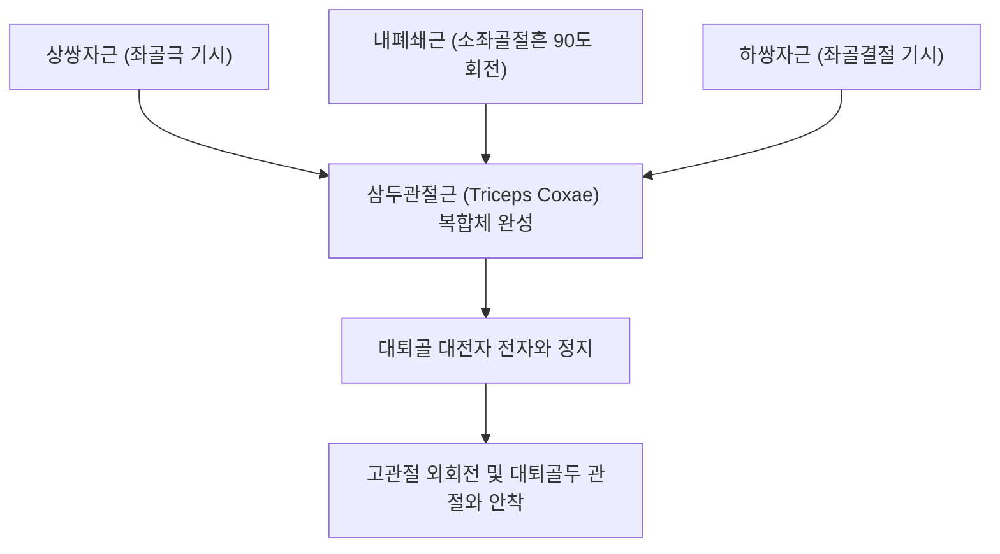

# 🫁 [[쌍자근]] (Gemelli Muscles Complex)

> **핵심 요약 (Key Summary)**:
> [[쌍자근]](Gemelli Muscles)은 [[상쌍자근]](Superior gemellus)과 [[하쌍자근]](Inferior gemellus)으로 구성된 한 쌍의 작은 근육으로, 각각 [[좌골]]극과 [[좌골결절]]에서 기시하여 [[내폐쇄근]] 힘줄을 위아래에서 샌드위치처럼 감싸며 [[대퇴골]] 대전자 [[전자와]](Trochanteric fossa)에 정지한다.
> 상쌍자근은 [[내폐쇄근신경]](L5-S2), 하쌍자근은 [[대퇴방형근신경]](L4-S1)의 **서로 다른 이중 신경 지배**를 받으며, 내폐쇄근과 함께 **삼두관절근(Triceps coxae) 복합체를 이루어 고관절 외회전 및 대퇴골두의 동적 안정성**을 주동한다.
> 임상적으로는 심부 둔부 증후군(DGS), [[가성 좌골신경통]], 고관절 심부 충돌통의 핵심 기여근이며, 한의 치료에서는 [[환도]]혈 심부 침구 및 삼두관절근 침도 치료의 표적이다.

---
## 📌 목차
1. [해부학적 정밀 구조 및 지배 신경/혈관](#1-해부학적-정밀-구조-및-지배-신경혈관)
2. [생체역학·토크 분석 & 근막 사슬 (Biomechanical Synergy)](#2-생체역학토크-분석--근막-사슬-biomechanical-synergy)
3. [근막통증증후군(TP) & 연관통 패턴 (Travell & Simons)](#3-근막통증증후군tp--연관통-패턴-travell--simons)
4. [초음파 해부학(Sonoanatomy) 및 중재 시술 랜드마크](#4-초음파-해부학sonoanatomy-및-중재-시술-랜드마크)
5. [⭐ 원장님 심층 임상 고찰 및 원본 필기 (Clinical Pearls)](#5-원장님-심층-임상-고찰-및-원본-필기-clinical-pearls)
6. [관련 임상 질환 및 운동손상 증후군 총괄](#6-관련-임상-질환-및-운동손상-증후군-총괄)
7. [추나·도수치료(MET/PIR) & 침구·약침·재활 프로토콜](#7-추나도수치료metpir--침구약침재활-프로토콜)
8. [출처 및 학술 참고 문헌 (References)](#8-출처-및-학술-참고-문헌-references)

---
## 1. 해부학적 정밀 구조 및 지배 신경/혈관

| 근육 구분 | 기시 (Origin) | 정지 (Insertion) | 신경 지배 | 혈관 공급 |
| :--- | :--- | :--- | :--- | :--- |
| **[[상쌍자근]]** | [[좌골]]극(Ischial spine) 후외측면 | 내폐쇄근 힘줄 상연 융합 → 대전자 전자와 | [[내폐쇄근신경]](**L5, S1, S2**) | 하둔동맥, 내음부동맥 |
| **[[하쌍자근]]** | [[좌골결절]](Ischial tuberosity) 상부 외측연 | 내폐쇄근 힘줄 하연 융합 → 대전자 전자와 | [[대퇴방형근신경]](**L4, L5, S1**) | 하둔동맥, 내측대퇴회선동맥 |

### 🔬 해부학 도해 및 단면도

쌍자근은 소좌골절흔을 도르래 삼아 골반 밖으로 빠져나오는 내폐쇄근의 굵은 중심 힘줄을 위(상쌍자근)와 아래(하쌍자근)에서 마치 핫도그 빵처럼 단단히 감싸고 있다. 세 근육이 합쳐져 비구 뒤쪽을 지나 대퇴골 대전자 전자와에 하나의 강력한 삼두관절근(Triceps coxae) 힘줄로 정지하며, 바로 표층을 따라 [[좌골신경]](Sciatic nerve) 줄기가 횡단한다.

---
## 2. 생체역학·토크 분석 & 근막 사슬 (Biomechanical Synergy)

* **내폐쇄근 힘줄의 동적 레일 역할**: 내폐쇄근 힘줄이 직각으로 방향을 전환할 때 발생하는 상하 흔들림을 방지하고 정확한 벡터로 대퇴골을 외회전시키도록 유도하는 안정화 레일 역할을 수행한다.
* **이중 신경 분지의 생체역학적 안전장치**: 상쌍자근(L5-S2)과 하쌍자근(L4-S1)의 신경 기원이 달라 한쪽 신경근에 병변이 발생해도 삼두관절근 전체의 기능 상실을 예방한다.
* **근막 사슬 연계 (Anatomy Trains)**: 심부전방선(Deep Front Line)의 골반 후하방 앵커로서 기능한다.

---
## 3. 근막통증증후군(TP) & 연관통 패턴 (Travell & Simons)

* **발통점(TrP) 위치**: 좌골결절과 대전자 사이 중간선상, 내폐쇄근 힘줄의 상연 및 하연 근복 부위.
* **연관통 양상**:
  * 둔부 중앙의 깊고 뻐근한 지속적 둔통.
  * 천장관절 하부 및 대퇴 후면 상부로 연관통 방사.
  * 삼두관절근의 비후나 연축 시 바로 위를 주행하는 [[좌골신경]]을 압박하여 슬와부와 종아리 외측까지 방사통 유발.
* **악화 인자**: 장시간 좌식 생활, 고관절 수동 내회전 시 건 마찰로 인한 통증 증폭.

---
## 4. 초음파 해부학(Sonoanatomy) 및 중재 시술 랜드마크

* **초음파 스캔 프로토콜**:
  * 좌골결절과 대전자를 연결하는 둔부 횡단 스캔에서 표층의 [[대둔근]] 아래 주행하는 좌골신경 동정.
  * 좌골신경 바로 심부에서 내폐쇄근 힘줄의 고에코 중심선과 그 상·하방을 감싸고 있는 상쌍자근과 하쌍자근의 저에코 근섬유 층판 확인.
* **자침 안전 마진**:
  * 좌골신경이 삼두관절근의 바로 표면을 수직으로 교차하므로, 바늘이 신경을 관통하지 않도록 실시간 초음파 하에 신경 외측 안전 구역을 타깃해야 한다.

---
## 5. ⭐ 원장님 심층 임상 고찰 및 원본 필기 (Clinical Pearls)

* **삼두관절근(Triceps coxae) 복합체 치료의 중요성 (원장님 필기 100% 보존)**:
  * 둔부 통증 환자에서 이상근만 만지는 것은 치료 실패의 주요 원인이다.
  * 실제 임상에서 좌골신경 포착의 40% 이상은 이상근 하방의 삼두관절근(상쌍자근-내폐쇄근-하쌍자근)에서 발생한다.
  * 상·하쌍자근은 크기는 작지만 내폐쇄근 힘줄에 지속적인 장력을 가하므로, 이 복합체의 긴장을 해소하지 않으면 좌골신경통이 만성화된다.
* **촉진 및 진단 노하우**:
  * 환자를 측와위로 두고 고관절을 60도 굴곡시킨 상태에서 좌골결절과 대전자 사이의 삼두관절근 건복을 깊게 압박할 때 국소 압통과 함께 하지 방사통이 재현되면 확진한다.
* **침구 및 침도 치료 노하우**:
  * [[환도]]혈에서 대전자와 좌골결절 사이 중간 지점을 향해 0.35×75mm 장침으로 50~70mm 직자 진입하여 전자와 골막 반응을 유도한다.

---
## 6. 관련 임상 질환 및 운동손상 증후군 총괄

| 임상 질환 / 증후군 | 병리적 연관 기전 | 주요 증상 및 이학적 검사 | 핵심 교정 타깃 |
| :--- | :--- | :--- | :--- |
| **심부 둔부 증후군(DGS)** | 쌍자근-내폐쇄근 복합체 비후로 좌골신경 포착 | 둔부 심부 둔통, 하지 후면 저림, Freiberg 검사 양성 | 쌍자근 침도 박리 및 신장 |
| **고관절 회전 제한** | 삼두관절근 구축으로 고관절 내회전 제한 | 보행 시 보폭 감소, 양반다리 시 둔부 통증 | 쌍자근 MET 이완 추나 |
| **삼두관절근 건병증** | 전자와 부착부의 만성 견인 스트레스 | 대전자 후면 깊은 압통 | 전자와 부착부 약침 치료 |

---
## 7. 추나·도수치료(MET/PIR) & 침구·약침·재활 프로토콜

* **한의학 경혈 매핑 및 침구 프로토콜**:
  * [[환도]], [[질변(BL54)|질변]], 승부(BL36).
  * 0.35×75mm 장침으로 대퇴골 전자와 방향으로 50~65mm 심부 자침 후 전침(2Hz, 15분).
* **근에너지기법 (MET/PIR)**:
  * 복와위 슬관절 90도 굴곡 상태에서 고관절 완전 내회전 유도.
  * 외회전 방향 등척성 저항(7초 유지) 후 PIR 신장.

---
## 8. 출처 및 학술 참고 문헌 (References)

1. **Standring, S.** (2020). *Gray's Anatomy* (42nd ed.). Elsevier.
   - `[연구 요약]`: 상·하쌍자근과 내폐쇄근의 삼두관절근(Triceps coxae) 복합체 해부학 및 지배 신경 분석.

2. **Yoon, Y. H., et al. (2025)**. Beyond Nerve Entrapment: A Narrative Review of Muscle-Tendon Pathologies in Deep Gluteal Syndrome. *Diagnostics (Basel)*, 15(17), 2531. [PMID: 41095750](https://pubmed.ncbi.nlm.nih.gov/41095750/)
   - `[연구 요약]`: 심부 둔부 공간 내 삼두관절근 복합체 병변과 좌골신경 포착 기전의 종합적 고찰.
