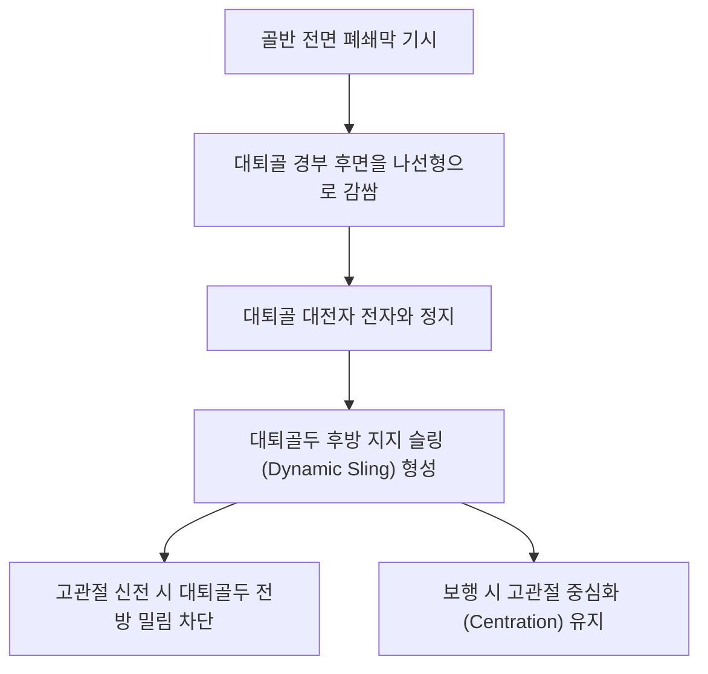

# 🫁 [[외폐쇄근]] (Obturator Externus)

> **핵심 요약 (Key Summary)**:
> [[외폐쇄근]](Obturator Externus)은 골반 외면의 폐쇄막 외측면 및 [[치골]]·[[좌골]] 외측지에서 기시하여 [[대퇴골]] 경부 후면을 나선형으로 감싸 안으며 대퇴골 대전자 [[전자와]](Trochanteric fossa)에 정지하는 심부 외회전근이다.
> 다른 모든 둔부 단외회전근들(천골신경총 지배)과 달리 **요추신경총 유래 [[폐쇄신경]](L3, L4)**의 후지 지배를 받으며, **고관절 외회전, 내전 보조 및 대퇴골두의 전방 전단력을 방어하는 동적 슬링(Dynamic Sling)**을 형성한다.
> 임상적으로는 [[외폐쇄근 증후군]], 서혜부 심부 둔통, 고관절 충돌증후군의 핵심 원인근이며, 한의 치료에서는 충문(SP12) 및 음렴(LR11) 외측 심부 침구와 서혜부-둔부 복합 이완 추나의 표적이다.

---
## 📌 목차
1. [해부학적 정밀 구조 및 지배 신경/혈관](#1-해부학적-정밀-구조-및-지배-신경혈관)
2. [생체역학·토크 분석 & 근막 사슬 (Biomechanical Synergy)](#2-생체역학토크-분석--근막-사슬-biomechanical-synergy)
3. [근막통증증후군(TP) & 연관통 패턴 (Travell & Simons)](#3-근막통증증후군tp--연관통-패턴-travell--simons)
4. [초음파 해부학(Sonoanatomy) 및 중재 시술 랜드마크](#4-초음파-해부학sonoanatomy-및-중재-시술-랜드마크)
5. [⭐ 원장님 심층 임상 고찰 및 원본 필기 (Clinical Pearls)](#5-원장님-심층-임상-고찰-및-원본-필기-clinical-pearls)
6. [관련 임상 질환 및 운동손상 증후군 총괄](#6-관련-임상-질환-및-운동손상-증후군-총괄)
7. [추나·도수치료(MET/PIR) & 침구·약침·재활 프로토콜](#7-추나도수치료metpir--침구약침재활-프로토콜)
8. [출처 및 학술 참고 문헌 (References)](#8-출처-및-학술-참고-문헌-references)

---
## 1. 해부학적 정밀 구조 및 지배 신경/혈관

| 항목 | 상세 내용 |
| :--- | :--- |
| **기시 (Origin)** | • 골반 외면의 폐쇄막(Obturator membrane) 외측면 전반부 • 폐쇄공을 둘러싼 [[치골]]하지 및 [[좌골]]지의 외측 골면 |
| **정지 (Insertion)** | • 대퇴골 경부(Femoral neck) 후면을 나선형으로 감싸며 주행 • [[대퇴골]](Femur) 대전자 내측면의 [[전자와]](Trochanteric fossa) 깊은 골면 |
| **신경 지배** | [[폐쇄신경]](Obturator nerve, **L3, L4**)의 후지(Posterior branch) — 요추신경총 유래 (유일한 둔부 외회전근) |
| **혈관 공급** | 폐쇄동맥(Obturator a.), 내측대퇴회선동맥 분지 |
| **해부학적 층위** | 전방으로는 치골근(Pectineus)과 단내전근의 심부에 위치하며, 후방으로는 대퇴방형근 심부를 주행 |

### 🔬 해부학 도해 및 단면도

외폐쇄근은 골반 앞쪽(폐쇄막 외면)에서 시작하여 대퇴골 경부의 아랫면과 뒷면을 마치 슬링처럼 나선형으로 감아 돌아 대전자 전자와에 도달한다. 기시는 골반 전면이지만 정지는 고관절 후면 전자와이므로, 수축할 때 대퇴골두를 뒤쪽에서 단단히 받쳐 올려 대퇴골두가 관절와 앞쪽으로 빠져나가는 전단력을 기계적으로 차단한다.

---
## 2. 생체역학·토크 분석 & 근막 사슬 (Biomechanical Synergy)

* **대퇴골 경부 나선형 슬링 (Spiral Sling)**: 대퇴골 경부 뒤쪽을 나선형으로 감싸고 있어, 고관절 신전 시 대퇴골두가 앞으로 미끄러지는 전방 전단력을 물리적으로 차단한다.
* **지배 신경의 독특성 (원장님 핵심 강조)**: 다른 모든 둔부 단외회전근들(천골신경총 L4-S2)과 달리, **요추신경총(L2-L4) 유래 폐쇄신경의 지배**를 받는 유일한 둔부 외회전근이다.
* **근막 사슬 연계 (Anatomy Trains)**: **심부전방선(Deep Front Line)**의 전면-후면 연결 브릿지로 내전근군 및 장요근과 인접하여 기능적 연속성을 유지한다.

---
## 3. 근막통증증후군(TP) & 연관통 패턴 (Travell & Simons)

* **발통점(TrP) 위치**: 서혜부 깊은 곳, 치골하지 외측면 및 대퇴골 경부 후하방의 근복 부위.
* **연관통 양상**:
  * 서혜부(사타구니) 깊은 곳의 묵직하고 쑤시는 통증.
  * 대퇴 내측면을 따라 무릎 안쪽까지 뻗어 나가는 깊은 연관통.
  * 고관절을 안쪽으로 돌리거나(내회전) 완전히 신전할 때 서혜부 심부에서 찝히는 통증 발생.
* **악화 인자**: 양반다리 자세, 고관절 과신전 보행, 킥 동작 등 고관절 회전이 동반되는 스포츠 활동.

---
## 4. 초음파 해부학(Sonoanatomy) 및 중재 시술 랜드마크

* **초음파 서혜부 사선 스캔**:
  * 서혜부 주름 부위에 트랜스듀서를 사선 배치하여 표층의 치골근(Pectineus)과 장내전근 심부, 폐쇄막 외측면에 밀착된 외폐쇄근 식별.
  * 폐쇄신경 전지와 후지 사이의 근막면 관찰.
* **자침 안전 마진**: 대퇴동맥과 정맥, 대퇴신경이 외측에 위치하므로 대퇴동맥의 맥동을 초음파 도플러로 확인하고 내측에서 안전하게 접근해야 한다.

---
## 5. ⭐ 원장님 심층 임상 고찰 및 원본 필기 (Clinical Pearls)

* **좌골신경 및 장요근과의 관계 (원장님 필기 100% 보존)**:
  * 외폐쇄근의 과긴장 및 부종은 인접 주행하는 [[폐쇄신경]] 및 [[좌골신경]]을 자극하여 대퇴 내측 및 둔부 후면 방사통을 유발한다.
  * 장요근 과긴장 또는 약화 시 외폐쇄근 기능 이상이 동반되므로 대퇴 삼각 부위의 협응 평가가 필수적이다.
* **요추 L2-L4 병변과 외폐쇄근 연관통**:
  * 요추 2~4번 디스크나 협착증 환자가 서혜부 안쪽과 고관절 깊은 곳의 뻐근함을 호소할 때, 폐쇄신경을 통해 외폐쇄근에 연관통이 투사되는 경우가 흔하다.
* **촉진 노하우**:
  * 서혜인대 하방에서 대퇴동맥 맥박의 내측, 치골근 아래쪽을 손가락으로 깊게 압박할 때 특유의 깊은 압통이 확인된다.

---
## 6. 관련 임상 질환 및 운동손상 증후군 총괄

| 임상 질환 / 증후군 | 병리적 연관 기전 | 주요 증상 및 이학적 검사 | 핵심 교정 타깃 |
| :--- | :--- | :--- | :--- |
| **[[외폐쇄근 증후군]]** | 외폐쇄근 건염 및 폐쇄신경 후지 자극 | 서혜부 심부 통증, 대퇴 내측 저림 | 대퇴삼각 심부 약침, 폐쇄신경 감압 |
| **고관절 전방 충돌증후군** | 대퇴골두 중심화 부전으로 전방 전단 | 고관절 신전/내회전 시 찝힘 통증 | 외폐쇄근 이완, 관절 중심화 추나 |
| **서혜부 심부 둔통** | 장요근-외폐쇄근 복합 긴장 | 보행 시 고관절 앞쪽 깊은 쑤심 | 서혜부 심부 침구 및 근막 이완 |

---
## 7. 추나·도수치료(MET/PIR) & 침구·약침·재활 프로토콜

* **한의학 경혈 매핑 및 침구 프로토콜**:
  * 충문(SP12), 음렴(LR11), 급맥(LR12).
  * 0.30×60mm 침으로 대퇴동맥 내측에서 치골하지 외측면을 향해 45도 외하방으로 35~50mm 사자 진입.
* **근에너지기법 (MET/PIR)**:
  * 앙와위 상태에서 고관절 굴곡 + 내회전 신장 도수.
  * 환자에게 외회전 방향으로 등척성 수축(20% 힘, 7초 유지) 유도 후 심부 신장.

---
## 8. 출처 및 학술 참고 문헌 (References)

1. **Standring, S.** (2020). *Gray's Anatomy* (42nd ed.). Elsevier.
   - `[연구 요약]`: 외폐쇄근의 폐쇄신경 후지 지배 및 대퇴골 경부 나선형 주행의 해부학적 특성 규명.

2. **Abouzaid, K. A., et al. (2026)**. Exploring the Significance of the Obturator Externus Groove as a Marker for Bipedalism: A Cadaveric Study. *Cureus*, 18(3), e109437. [PMID: 42333356](https://pubmed.ncbi.nlm.nih.gov/42333356/)
   - `[연구 요약]`: 외폐쇄근의 대퇴골 경부 부착부(obturator externus groove) 사체 해부를 통한 이족 보행 생체역학 마커 검증.
