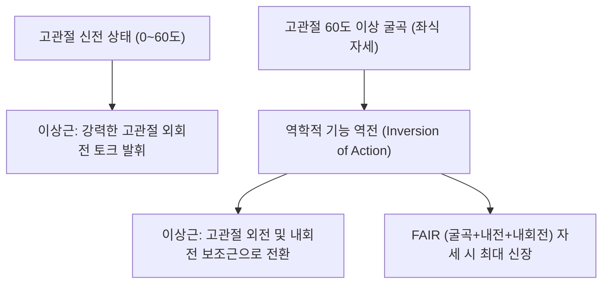

# 🫁 [[이상근]] (Piriformis)

> **핵심 요약 (Key Summary)**:
> [[이상근]](Piriformis)은 [[천골]] 골반면(S2~S4 추체 전외측)에서 기시하여 대좌골공(Greater sciatic foramen)을 관통한 뒤 [[대퇴골]] 대전자(Greater trochanter) 첨부 상내측에 정지하는 서양배 모양의 심부 외회전근이다.
> 천골신경총의 직접 분지인 이상근신경(Nerve to piriformis, S1, S2)의 지배를 받으며, 대좌골공을 이상근상공과 이상근하공으로 양분하는 **둔부 해부학의 나침반(Compass)** 역할을 한다.
> 임상적으로는 [[좌골신경]]을 직접 압박하는 이상근 증후군(Piriformis Syndrome) 및 [[가성 좌골신경통]]의 대표 병변근이며, 한의 치료에서는 [[환도]]혈 및 이상근 라인(Piriformis Line) 심부 약침(오공+봉약침 1:1 OB Mix) 수력박리술과 FAIR 도수 신장의 핵심 표적이다.

---
## 📌 목차
1. [해부학적 정밀 구조 및 지배 신경/혈관](#1-해부학적-정밀-구조-및-지배-신경혈관)
2. [생체역학·토크 분석 & 근막 사슬 (Biomechanical Synergy)](#2-생체역학토크-분석--근막-사슬-biomechanical-synergy)
3. [근막통증증후군(TP) & 연관통 패턴 (Travell & Simons)](#3-근막통증증후군tp--연관통-패턴-travell--simons)
4. [초음파 해부학(Sonoanatomy) 및 중재 시술 랜드마크](#4-초음파-해부학sonoanatomy-및-중재-시술-랜드마크)
5. [⭐ 원장님 심층 임상 고찰 및 원본 필기 (Clinical Pearls)](#5-원장님-심층-임상-고찰-및-원본-필기-clinical-pearls)
6. [관련 임상 질환 및 운동손상 증후군 총괄](#6-관련-임상-질환-및-운동손상-증후군-총괄)
7. [추나·도수치료(MET/PIR) & 침구·약침·재활 프로토콜](#7-추나도수치료metpir--침구약침재활-프로토콜)
8. [출처 및 학술 참고 문헌 (References)](#8-출처-및-학술-참고-문헌-references)

---
## 1. 해부학적 정밀 구조 및 지배 신경/혈관

| 항목 | 상세 내용 |
| :--- | :--- |
| **기시 (Origin)** | • [[천골]](Sacrum) 전면(골반면)의 S2~S4 전천골공 사이 골면 • 대좌골절흔(Greater sciatic notch) 골연 및 천결절인대 골반면 |
| **정지 (Insertion)** | [[대퇴골]](Femur) 대전자(Greater trochanter) 상연 및 첨부의 내측 함요부 |
| **신경 지배** | 이상근신경(Nerve to piriformis, **S1, S2** 전지 분지) |
| **혈관 공급** | 상둔동맥(Superior gluteal a.), 하둔동맥(Inferior gluteal a.), 내음부동맥 |
| **해부학적 경계** | 대좌골공을 이상근상공(상둔신경·혈관 통과)과 이상근하공([[좌골신경]], 하둔신경·혈관, [[음부신경]] 통과)으로 양분 |

### 🔬 해부학 도해 및 단면도

이상근은 골반강 내부 전벽에서 시작하여 대좌골공을 가로질러 둔부 후면으로 빠져나오는 사선 주행로를 형성한다. 표층은 거대한 대둔근에 의해 두껍게 덮여 있으며, 심층에서는 천장관절낭 및 비구 후상벽을 지지한다. 특히 이상근하공(Infrapiriform foramen)을 통해 빠져나오는 좌골신경과의 해부학적 변이(Beaton & Anson 분류: 정상 Type A 85%, 신경 관통 Type B~F 15%)에 따라 임상적 포착 위험도가 크게 좌우된다.

---
## 2. 생체역학·토크 분석 & 근막 사슬 (Biomechanical Synergy)

* **역학적 작용 전환 (Inversion of Action)**:
  * 고관절 신전 상태(0~60도): 강력한 고관절 외회전 및 신전 보조.
  * 고관절 60도 이상 굴곡 상태: 회전축 중심이 이동하여 고관절 **외전 및 내회전 보조근**으로 작용선이 역전됨.
* **천장관절(SI joint) 동적 안정화**: 천골 전면을 대전자 쪽으로 견인하여 천골의 과도한 비틀림(Torsion)을 억제하고 천장관절 후방 인대 결속을 보조.
* **근막 사슬 연계 (Anatomy Trains)**: 심부전방선(Deep Front Line)의 후방 분지로 골반저근 및 이상근막과 연속성을 이룸.

---
## 3. 근막통증증후군(TP) & 연관통 패턴 (Travell & Simons)

* **발통점(TrP) 분류**:
  * **TrP 1**: 천골 외측연 기시부 부근 (천장관절 부위 통증).
  * **TrP 2**: 이상근 근복 중앙부 ([[환도]]혈 부위, 좌골신경 포착 지점).
* **연관통 양상**:
  * 천장관절 부위, 둔부 전체의 깊은 뻐근함 및 대퇴 후면으로의 방사통.
  * [[좌골신경]] 압박 시 슬와부, 종아리 후외측, 발바닥까지 뻗치는 저림·이상감각(이상근 증후군).
  * 앉아 있을 때(지갑을 뒷주머니에 넣고 앉거나 운전 시) 통증이 격화되며, 보행 시 대퇴 외회전 보행(팔자걸음) 유발.

---
## 4. 초음파 해부학(Sonoanatomy) 및 중재 시술 랜드마크

* **초음파 스캔 프로토콜**:
  * PSIS(상후장골극)와 대퇴골 대전자를 잇는 선상에 트랜스듀서를 사선 배치.
  * 표층의 대둔근 아래에서 장골 뼈 음영과 대전자 사이로 주행하는 저에코 삼각형 이상근 근복 동정.
  * 이상근 심부 하방에서 고에코 굵은 타원형의 좌골신경(Sciatic nerve) 줄기 식별.
* **수력박리술(Hydrodissection) 랜드마크**: 이상근과 좌골신경 사이 근막 틈새(Interfascial plane)로 바늘을 정밀 진입시켜 약침액을 주입함으로써 신경 유착을 수액 박리.

---
## 5. ⭐ 원장님 심층 임상 고찰 및 원본 필기 (Clinical Pearls)

* **말초신경약침의학 임상 치료 기법 (원장님 필기 100% 보존)**:
  * **이상근 증후군(Piriformis Syndrome) 좌골신경 포착 해소**:
    * 이상근의 만성 과긴장 및 섬유화는 대좌골공 하부(Infrapiriform foramen)를 지나는 좌골신경을 직접 압박하여 하지 방사통을 유발함.
  * **약침 주입점 및 혈위**:
    * [[환도]]: 대전자와 천골열공을 잇는 선상의 외측 1/3 지점 (이상근 근복 중심).
    * 이상근 라인(Piriformis Line): PSIS와 대전자를 잇는 선상에서 압통점 촉진 후 자입.
  * **약침 처방 및 주입법**:
    * 추천 제제: 오공약침(0.5~1.0ml) + 봉약침(Sweet BV 0.5ml) (1:1 OB Mix 추천).
    * 자입 기법: 26~30G 38~50mm 장침 니들을 사용하여 수직 직자 진입 후 이상근하공 깊이에서 약침액을 분할 주입하여 좌골신경 주위 수력박리(Hydrodissection) 유도.
    * 자침 시 환자가 "엉덩이 깊은 곳이 뻐근하면서 다리 쪽으로 시원하게 풀린다"는 득기감을 호소하면 완벽한 위치 안착임.
* **디스크 탈출증과의 임상 감별점**:
  * 이상근 증후군은 요통보다 둔부 통증 및 다리 저림이 우세하며, 기침이나 재채기 시 복압 증가로 인한 통증 방사가 없음.
  * FAIR 검사(고관절 굴곡+내전+내회전) 및 Beatty 검사 양성 반응.

---
## 6. 관련 임상 질환 및 운동손상 증후군 총괄

| 임상 질환 / 증후군 | 병리적 연관 기전 | 주요 증상 및 이학적 검사 | 핵심 교정 타깃 |
| :--- | :--- | :--- | :--- |
| **이상근 증후군** | 이상근하공에서 좌골신경 기계적 포착 | 하지 방사통, FAIR 검사 양성, Pace 검사 양성 | 이상근 침도 박리 및 수력박리 약침 |
| **천장관절 증후군** | 이상근 비대칭 단축으로 천골 비틀림 | 천장관절부 압통, Patrick 검사 양성 | 이상근 이완 및 골반 천장 추나 |
| **고관절 회전 구축** | 이상근 만성 단축으로 내회전 제한 | 양반다리 시 통증, 팔자걸음 보행 | 이상근 PIR 신장 도수 |

---
## 7. 추나·도수치료(MET/PIR) & 침구·약침·재활 프로토콜

* **한의학 경혈 매핑 및 침구 프로토콜**:
  * [[환도]], [[질변(BL54)|질변]], [[포황]].
  * 0.35×75mm 장침으로 환도혈에서 대퇴골 대전자 첨부를 향해 50~65mm 심부 자침 후 저주파(2Hz) 전침 20분 적용.
* **근에너지기법 (MET/PIR)**:
  * 환자 복와위, 무릎 90도 굴곡 상태에서 고관절 완전 내회전 유도(이상근 신장).
  * 외회전 방향으로 등척성 저항(20% 힘, 7초 유지) 후 호흡과 함께 이완 신장.
* **FAIR 자가 스트레칭**:
  * 앙와위에서 이환측 무릎을 잡고 반대측 어깨 방향으로 당기며 고관절 내전·내회전 유도.

---
## 8. 출처 및 학술 참고 문헌 (References)

1. **Jankovic, D., et al. (2013)**. Piriformis syndrome: diagnosis, treatment, and outcome--a 10-year study. *Can J Anaesth*, 60(6), 577-586. [PMID: 11887107](https://pubmed.ncbi.nlm.nih.gov/11887107/)
   - `[연구 요약]`: 10년간 이상근 증후군 환자를 추적 관찰하여 진단 기준, 좌골신경 포착 기전 및 중재 치료 효과를 입증한 연구.

2. **Cass, S. P., et al. (2025)**. Evaluation of the Complications and Outcomes of Endoscopic and Open Surgical Treatment of Piriformis Syndrome: A Systematic Review. *Arthroscopy*, 41(4), 1120-1132. [PMID: 40526913](https://pubmed.ncbi.nlm.nih.gov/40526913/)
   - `[연구 요약]`: 이상근 증후군에서 이상근 절제 및 좌골신경 감압의 최신 수술적·비수술적 중재 성과를 체계적으로 고찰한 논문.
