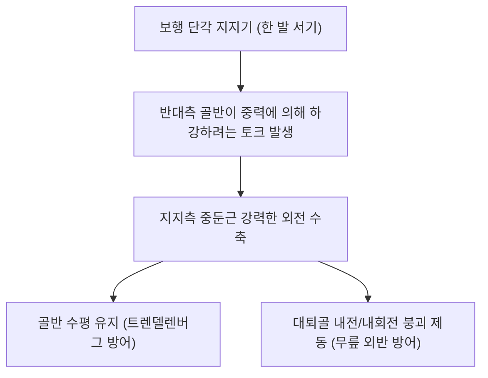

# 🫁 [[중둔근]] (Gluteus Medius)

> **핵심 요약 (Key Summary)**:
> [[중둔근]](Gluteus Medius)은 [[장골]] 외측면(전둔선과 후둔선 사이)에서 기시하여 [[대퇴골]] 대전자(Greater trochanter) 외측면에 정지하는 강력한 부채꼴 모양의 고관절 외전근이다.
> [[상둔신경]](Superior gluteal nerve, L4-S1)의 지배를 받으며, **보행 단각 지지기 골반의 관상면 수평 유지(트렌델렌버그 현상 방어)**를 주동한다.
> 임상적으로는 [[트렌델렌부르크 징후|트렌델렌버그 보행]], 대전자 통증 증후군(GTPS), 러너스 니(슬개대퇴통증 및 장경인대 마찰)의 핵심 발원근이며, 한의 치료에서는 거료(GB29)혈 및 [[환도]]혈 심부 침구, 장골능 기시부 침도 치료 및 골반 수평 추나의 핵심 표적이다.

---
## 📌 목차
1. [해부학적 정밀 구조 및 지배 신경/혈관](#1-해부학적-정밀-구조-및-지배-신경혈관)
2. [생체역학·토크 분석 & 근막 사슬 (Biomechanical Synergy)](#2-생체역학토크-분석--근막-사슬-biomechanical-synergy)
3. [근막통증증후군(TP) & 연관통 패턴 (Travell & Simons)](#3-근막통증증후군tp--연관통-패턴-travell--simons)
4. [초음파 해부학(Sonoanatomy) 및 중재 시술 랜드마크](#4-초음파-해부학sonoanatomy-및-중재-시술-랜드마크)
5. [⭐ 원장님 심층 임상 고찰 및 원본 필기 (Clinical Pearls)](#5-원장님-심층-임상-고찰-및-원본-필기-clinical-pearls)
6. [관련 임상 질환 및 운동손상 증후군 총괄](#6-관련-임상-질환-및-운동손상-증후군-총괄)
7. [추나·도수치료(MET/PIR) & 침구·약침·재활 프로토콜](#7-추나도수치료metpir--침구약침재활-프로토콜)
8. [출처 및 학술 참고 문헌 (References)](#8-출처-및-학술-참고-문헌-references)

---
## 1. 해부학적 정밀 구조 및 지배 신경/혈관

| 항목 | 상세 내용 |
| :--- | :--- |
| **기시 (Origin)** | [[장골]](Ilium) 외측 골면의 상부 3/4 (전둔선과 후둔선 사이) 및 장골능 외순 |
| **정지 (Insertion)** | [[대퇴골]](Femur) 대전자(Greater trochanter) 외측면의 후상방-전하방 사선능 |
| **신경 지배** | [[상둔신경]](Superior gluteal nerve, **L4, L5, S1**) — 중둔근과 소둔근 사이 근막면 주행 |
| **혈관 공급** | 상둔동맥 심지(Deep branch of superior gluteal a.), 외측대퇴회선동맥 |
| **기능적 분절** | 전방 섬유(굴곡 및 내회전 보조), 중간 섬유(순수 외전), 후방 섬유(신전 및 외회전 보조) |

### 🔬 해부학 도해 및 단면도

중둔근은 골반 장골익 전체를 감싸는 중간층 근육으로, 후방 1/3은 대둔근에 의해 덮여 있고 전방 2/3는 표재성으로 피하지방 바로 아래 위치한다. 넓은 기시부에서 대전자라는 좁은 부착부로 부채꼴 모양으로 모여들며, 심층에는 소둔근이 밀착되어 있다. 대전자 부착부에는 마찰을 줄이기 위한 전자간 점액낭(Trochanteric bursa)이 존재한다.

---
## 2. 생체역학·토크 분석 & 근막 사슬 (Biomechanical Synergy)

* **보행 단각 지지기 골반 관상면 안정자**: 보행 주기 중 한 발로 지탱하는 단각 지지기(Mid-stance)에서 체중의 2~3배에 달하는 외전력을 발생시켜 반대측 골반이 아래로 처지는 것을 방어한다.
* **하지 정렬 제어**: 후방 섬유가 고관절의 과도한 내전과 내회전을 억제하여 슬관절의 동적 외반(Dynamic knee valgus)을 방어한다.
* **근막 사슬 연계 (Anatomy Trains)**: **외측선(Lateral Line)**의 중심축으로 비골근군-장경인대-중둔근-복사근으로 이어지는 신체 외측 안정화 체계를 형성한다.

---
## 3. 근막통증증후군(TP) & 연관통 패턴 (Travell & Simons)

* **발통점(TrP) 분류**:
  * **TrP 1 (장골능 후부)**: 천장관절, 둔부 후면 및 대퇴 후상부로 연관통 투사.
  * **TrP 2 (장골능 중간부)**: 둔부 외측 및 대퇴 후외측, 대전자 주변으로 통증 방사.
  * **TrP 3 (장골능 전부)**: 장골능 능선 자체 및 양측 하부 요추로 방사.
* **임상적 특징**:
  * 환자가 아픈 쪽으로 누워 잘 때(측와위) 대전자 부위가 눌려 극심한 통증 발생.
  * 장시간 보행이나 서 있을 때 골반 외측이 묵직하게 결리고 쉽게 피로해짐.

---
## 4. 초음파 해부학(Sonoanatomy) 및 중재 시술 랜드마크

* **초음파 스캔 프로토콜**:
  * 장골능과 대전자 사이 외측 둔부에 트랜스듀서를 관상면 배치.
  * 표층의 피하지방 아래에서 중둔근의 두터운 근복과 저에코 중심 건막 동정.
  * 심부의 고에코 장골 뼈 음영 사이에 위치한 소둔근과의 층간 경계면 확인.
  * 원위부로 이동하여 대전자 외측면 골막에 부착하는 중둔근 건의 섬유 주행 관찰.
* **자침 안전 마진**:
  * 대전자 상방에서 접근 시 좌골신경 주행로와 안전 거리를 확보할 수 있어 안전하게 시술 가능.
  * 중둔근과 소둔근 사이를 지나는 상둔신경 및 동맥 분지를 자극하지 않도록 주의.

---
## 5. ⭐ 원장님 심층 임상 고찰 및 원본 필기 (Clinical Pearls)

* **트렌델렌버그(Trendelenburg) vs 뒤센(Duchenne) 보행 감별 (원장님 필기 100% 보존)**:
  * 환자가 걸을 때 엉덩이가 반대측으로 툭 떨어지면 '트렌델렌버그 징후(Trendelenburg sign)'이다.
  * 반면, 중둔근 근력이 너무 약해 골반을 지탱할 수 없는 환자는 체간(상체)을 아픈 쪽 다리 위로 확 기울여 고관절 외전 모멘트 암을 강제로 줄이며 걷는데, 이를 '뒤센 보행(Duchenne limp)'이라 한다.
  * 둘 다 본질은 지지측 중둔근의 심각한 부전이다.
* **러너스 니(Runner's Knee)와 무릎 내측/전방 통증의 숨은 지배자**:
  * 무릎 관절염이나 슬개대퇴통증증후군 환자에서 무릎만 치료해서는 낫지 않는다.
  * 중둔근 후부 섬유가 약화되면 보행 시 고관절이 안쪽으로 꺾이며 대퇴골이 내회전되고, 슬개골이 외측으로 끌려가며 연골이 마모된다.
  * 중둔근을 강화하여 대퇴골의 동적 회전을 안정화시켜야 무릎 통증이 근본적으로 해결된다.
* **침구 및 침도 치료 노하우**:
  * 거료(GB29)혈 상외측 장골능 아래 2~3cm 지점에서 0.35×60mm 침으로 장골익 골면을 향해 45도 후하방 사자.
  * 대전자 부착부의 만성 건염이나 석회화 병변 시 침도로 건 부착부를 종축 절개하여 감압한다.

---
## 6. 관련 임상 질환 및 운동손상 증후군 총괄

| 임상 질환 / 증후군 | 병리적 연관 기전 | 주요 증상 및 이학적 검사 | 핵심 교정 타깃 |
| :--- | :--- | :--- | :--- |
| **[[트렌델렌부르크 징후|트렌델렌버그 보행]]** | 중둔근 근력 저하로 반대측 골반 하강 | 편측 지지 시 골반 처짐, 뒤센 보행 | 중둔근 강화 및 골반 수평 추나 |
| **대전자 통증 증후군(GTPS)** | 중둔근 건병증 및 전자간 점액낭염 | 대전자 압통, 측와위 수면 통증 | 대전자 부착부 약침 및 감압 침도 |
| **슬개대퇴통증증후군(PFPS)** | 중둔근 부전으로 인한 무릎 외반 변형 | 계단 하강 시 무릎 전방통 | 중둔근 후부 섬유 강화 재활 |
| **만성 요통 및 천장관절염** | 보행 시 골반 동요로 요추 보상 과부하 | 한 발 지지 시 요천추 둔통 | 중둔근-요방형근 협응 밸런스 치료 |

---
## 7. 추나·도수치료(MET/PIR) & 침구·약침·재활 프로토콜

* **한의학 경혈 매핑 및 침구 프로토콜**:
  * 거료(GB29), [[환도]], [[풍시(GB31)|풍시]].
  * 0.35×60mm 침으로 중둔근 발통점에 자침 후 저주파(2Hz) 전침 15분 적용.
* **근에너지기법 (MET/PIR)**:
  * 환자 측와위(이환측 위), 시술자가 하지를 잡고 고관절 완전 내전 및 신전 유도.
  * 환자에게 외전 방향으로 등척성 저항(20% 힘, 7초 유지) 유도 후 호흡과 함께 이완.
* **중둔근 활성화 재활 운동**:
  * 클램쉘(Clamshell with resistance band), 사이드 라잉 힙 어브덕션, 몬스터 워크(Monster walk).

---
## 8. 출처 및 학술 참고 문헌 (References)

1. **Gottschalk, F., et al. (1989)**. The functional anatomy of tensor fasciae latae and gluteus medius and minimus. *J Anat*, 166, 179-189. [PMID: 2621137](https://pubmed.ncbi.nlm.nih.gov/2621137/)
   - `[연구 요약]`: 사체 해부 및 근전도(EMG) 분석을 통해 중둔근 3개 분절의 기능적 역할과 골반 안정화 역학 규명.

2. **Strauss, E. J., et al. (2012)**. Greater trochanteric pain syndrome: defining the clinical syndrome. *J Am Acad Orthop Surg*, 20(9), 565-573. [PMID: 22983121](https://pubmed.ncbi.nlm.nih.gov/22983121/)
   - `[연구 요약]`: 대전자 통증 증후군(GTPS)의 병리적 기전으로서 중둔근 건병증과 점액낭염의 상관관계 및 진단 지침 제시.
