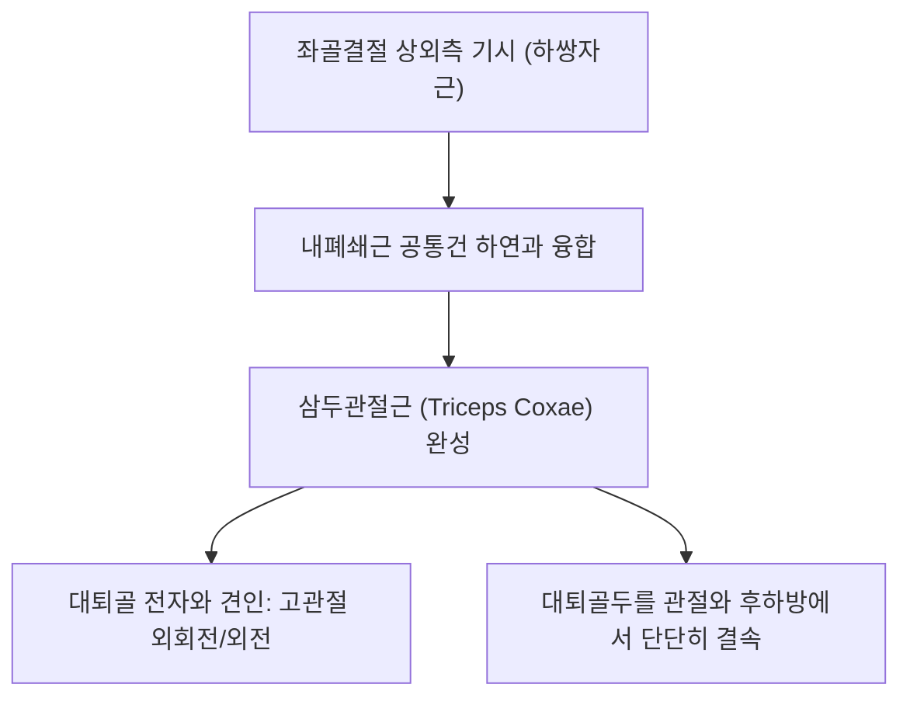

# 🫁 [[하쌍자근]] (Inferior Gemellus)

> **핵심 요약 (Key Summary)**:
> [[하쌍자근]](Inferior Gemellus)은 [[좌골]]의 [[좌골결절]](Ischial tuberosity) 상부 외측연에서 기시하여 [[내폐쇄근]] 힘줄의 하연과 융합한 뒤 [[대퇴골]] 대전자 [[전자와]](Trochanteric fossa)에 정지하는 고관절 심부 외회전근이다.
> [[대퇴방형근신경]](Nerve to quadratus femoris, L4-S1)의 지배를 받으며, 내폐쇄근 및 [[상쌍자근]]과 함께 **삼두관절근(Triceps coxae) 복합체를 형성하여 고관절 외회전, 외전(굴곡 시) 및 대퇴골두의 관절와 안착**을 주동한다.
> 임상적으로는 심부 둔부 증후군(DGS), [[가성 좌골신경통]], 좌골신경 주행로 마찰의 핵심 기여근이며, 한의 치료에서는 [[환도]]혈 하방 심부 침구 및 삼두관절근 침도 치료의 표적이다.

---
## 📌 목차
1. [해부학적 정밀 구조 및 지배 신경/혈관](#1-해부학적-정밀-구조-및-지배-신경혈관)
2. [생체역학·토크 분석 & 근막 사슬 (Biomechanical Synergy)](#2-생체역학토크-분석--근막-사슬-biomechanical-synergy)
3. [근막통증증후군(TP) & 연관통 패턴 (Travell & Simons)](#3-근막통증증후군tp--연관통-패턴-travell--simons)
4. [초음파 해부학(Sonoanatomy) 및 중재 시술 랜드마크](#4-초음파-해부학sonoanatomy-및-중재-시술-랜드마크)
5. [⭐ 원장님 심층 임상 고찰 및 원본 필기 (Clinical Pearls)](#5-원장님-심층-임상-고찰-및-원본-필기-clinical-pearls)
6. [관련 임상 질환 및 운동손상 증후군 총괄](#6-관련-임상-질환-및-운동손상-증후군-총괄)
7. [추나·도수치료(MET/PIR) & 침구·약침·재활 프로토콜](#7-추나도수치료metpir--침구약침재활-프로토콜)
8. [출처 및 학술 참고 문헌 (References)](#8-출처-및-학술-참고-문헌-references)

---
## 1. 해부학적 정밀 구조 및 지배 신경/혈관

| 항목 | 상세 내용 |
| :--- | :--- |
| **기시 (Origin)** | [[좌골]](Ischium)의 [[좌골결절]](Ischial tuberosity) 상부 외측연 및 소좌골절흔 하연 |
| **정지 (Insertion)** | [[내폐쇄근]](Obturator internus) 힘줄의 하연과 섬유성 융합 → [[대퇴골]](Femur) 대전자 전자와(Trochanteric fossa) |
| **신경 지배** | [[대퇴방형근신경]](Nerve to quadratus femoris, **L4, L5, S1**) — [[대퇴방형근]]과 공통 지배 |
| **혈관 공급** | 하둔동맥(Inferior gluteal a.), 내측대퇴회선동맥 분지 |
| **삼두관절근 구조** | 상쌍자근(위) - 내폐쇄근(중간) - 하쌍자근(아래)의 3두 샌드위치 복합체 형성 |

### 🔬 해부학 도해 및 단면도

하쌍자근은 좌골결절의 상외측 모서리에서 시작하여 소좌골절흔을 빠져나온 내폐쇄근 중심 힘줄의 아랫부분을 든든하게 받치며 대전자 전자와로 주행한다. 상쌍자근보다 약간 더 크고 두터우며, 바로 아래로는 대퇴방형근과 경계를 이루고, 표면 위로는 거대한 좌골신경 줄기가 교차 통과한다.

---
## 2. 생체역학·토크 분석 & 근막 사슬 (Biomechanical Synergy)

* **삼두관절근 하부 받침목**: 내폐쇄근이 둔부로 빠져나올 때 하방으로 가라앉으려는 힘줄의 처짐을 방어하여 일정한 견인 각도를 유지한다.
* **신경 지배의 기능적 분리**: 상쌍자근(내폐쇄근신경 L5-S2)과 달리 대퇴방형근신경(L4-S1)의 지배를 받으므로, 고관절 회전 토크 시 대퇴방형근과 긴밀한 신경학적 협응을 이룬다.
* **근막 사슬 연계 (Anatomy Trains)**: 심부전방선(Deep Front Line)의 후하방 기저부로서 골반저근 및 대내전근과 연계된다.

---
## 3. 근막통증증후군(TP) & 연관통 패턴 (Travell & Simons)

* **발통점(TrP) 위치**: 좌골결절과 대전자 사이 중간선상 약간 하방, 좌골신경 바로 심부의 하쌍자근 근복.
* **연관통 양상**:
  * 둔부 중앙 및 좌골결절 주변의 깊은 뻐근함과 지속적인 둔통.
  * [[좌골신경]]을 압박하여 대퇴 후면, 슬와부, 종아리 후외측으로 방사통 유발.
  * 고관절 수동 내회전 및 굴곡 시 삼두관절근 복합체가 신장되며 통증 급증.

---
## 4. 초음파 해부학(Sonoanatomy) 및 중재 시술 랜드마크

* **초음파 스캔 프로토콜**:
  * 좌골결절과 대전자를 잇는 선상의 횡단 스캔에서 대둔근 아래를 지나는 좌골신경 동정.
  * 좌골신경 심부에서 내폐쇄근 중심 힘줄 아래쪽에 위치한 저에코의 하쌍자근 근섬유 확인.
  * 바로 아래에 위치한 수평 방향의 대퇴방형근과의 경계면 식별.
* **자침 안전 마진**: 좌골신경의 바로 심면에 위치하므로, 자침 시 실시간 초음파 유도 하에 신경을 관통하지 않도록 안전 마진을 반드시 확보해야 한다.

---
## 5. ⭐ 원장님 심층 임상 고찰 및 원본 필기 (Clinical Pearls)

* **삼두관절근 하부 포착의 중요성 (원장님 필기 100% 보존)**:
  * 둔부 통증 환자에서 이상근만 만지는 것은 치료 실패의 주요 원인이다.
  * 좌골신경은 이상근하공을 빠져나와 상쌍자근 → 내폐쇄근 → 하쌍자근 → 대퇴방형근의 순서로 표면을 타고 내려간다.
  * 특히 하쌍자근 부위는 좌골결절과 인접해 있어 착석 시 압박을 가장 강하게 받는 지점이며, 섬유성 유착이 빈발한다.
* **촉진 및 진단 노하우**:
  * 환자를 측와위로 두고 고관절을 60도 굴곡시킨 상태에서 좌골결절 상외측 모서리를 깊게 압박할 때 압통과 함께 다리로 방사통이 재현되면 하쌍자근 병변을 진단한다.
* **침구 및 침도 치료 노하우**:
  * [[환도]]혈에서 약 1~2cm 하방 지점에서 0.35×75mm 장침으로 좌골결절 상외측연을 향해 50~65mm 직자 진입하여 골막 반응을 유도한다.

---
## 6. 관련 임상 질환 및 운동손상 증후군 총괄

| 임상 질환 / 증후군 | 병리적 연관 기전 | 주요 증상 및 이학적 검사 | 핵심 교정 타깃 |
| :--- | :--- | :--- | :--- |
| **심부 둔부 증후군(DGS)** | 하쌍자근 비후로 인한 좌골신경 포착 | 둔부 심부 둔통, 대퇴 후면 방사통 | 하쌍자근 침도 박리 및 신장 |
| **삼두관절근 건병증** | 전자와 부착부의 만성 견인 스트레스 | 대전자 후면 깊은 압통 | 전자와 부착부 약침 치료 |
| **고관절 회전 제한** | 하쌍자근 구축으로 고관절 내회전 제한 | 보행 시 보폭 감소, 양반다리 시 통증 | 하쌍자근 MET 이완 추나 |

---
## 7. 추나·도수치료(MET/PIR) & 침구·약침·재활 프로토콜

* **한의학 경혈 매핑 및 침구 프로토콜**:
  * [[환도]] 하방 반응점, [[질변(BL54)|질변]].
  * 0.35×75mm 침으로 대퇴골 전자와 방향으로 50~65mm 심부 자침 후 저주파 전침 적용.
* **근에너지기법 (MET/PIR)**:
  * 복와위 슬관절 90도 굴곡 상태에서 고관절 완전 내회전 유도.
  * 외회전 방향 등척성 저항(7초 유지) 후 호흡과 함께 이완 신장.

---
## 8. 출처 및 학술 참고 문헌 (References)

1. **Standring, S.** (2020). *Gray's Anatomy* (42nd ed.). Elsevier.
   - `[연구 요약]`: 하쌍자근의 좌골결절 기시 및 대퇴방형근신경(L4-S1) 지배 해부학 분석.

2. **Yoon, Y. H., et al. (2025)**. Beyond Nerve Entrapment: A Narrative Review of Muscle-Tendon Pathologies in Deep Gluteal Syndrome. *Diagnostics (Basel)*, 15(17), 2531. [PMID: 41095750](https://pubmed.ncbi.nlm.nih.gov/41095750/)
   - `[연구 요약]`: 심부 둔부 공간 내 삼두관절근 복합체 병변과 좌골신경 포착 기전의 종합적 고찰.
