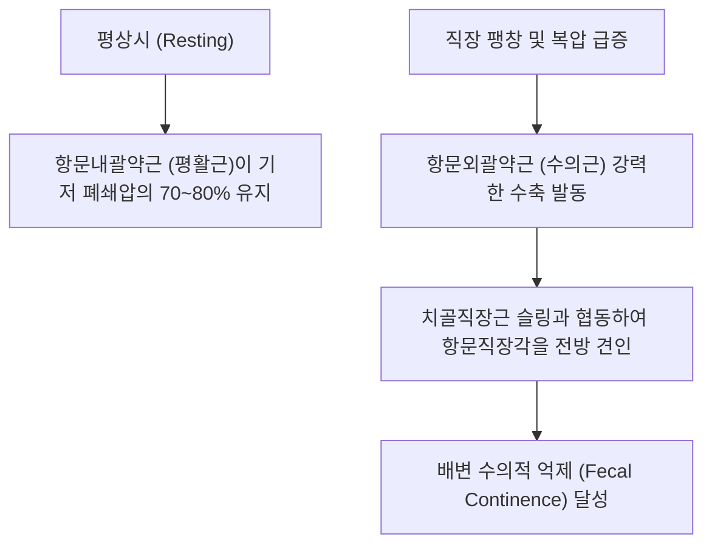

# 🫁 [[항문외괄약근]] (External Anal Sphincter)

> **핵심 요약 (Key Summary)**:
> [[항문외괄약근]](External Anal Sphincter, EAS)은 항문관(Anal canal) 전체를 타원형으로 둘러싸고 있는 수의적 골격근으로, 피하부(Subcutaneous), 천부(Superficial), 심부(Deep)의 3개 층판으로 구성된다.
> [[음부신경]](S2-S4)의 분지인 하직장신경(Inferior rectal nerve)과 S4 회음지의 지배를 받으며, **항문관을 강력히 폐쇄하여 배변을 수의적으로 조절(Fecal Continence)하고 [[골반저근]] 복합체를 지지**한다.
> 임상적으로는 배변 실금(Fecal Incontinence), 항문 거근 증후군, 치핵·치열의 만성 연축, 산후 회음부 손상의 핵심 병변근이며, 한의 치료에서는 장강(GV1) 및 회양(BL35) 외측 침구, 승산(BL57) 원위 취혈 및 [[백회(GV20)|백회]]혈 골반저 중기하함 조절의 핵심 표적이다.

---
## 📌 목차
1. [해부학적 정밀 구조 및 지배 신경/혈관](#1-해부학적-정밀-구조-및-지배-신경혈관)
2. [생체역학·토크 분석 & 근막 사슬 (Biomechanical Synergy)](#2-생체역학토크-분석--근막-사슬-biomechanical-synergy)
3. [근막통증증후군(TP) & 연관통 패턴 (Travell & Simons)](#3-근막통증증후군tp--연관통-패턴-travell--simons)
4. [초음파 해부학(Sonoanatomy) 및 중재 시술 랜드마크](#4-초음파-해부학sonoanatomy-및-중재-시술-랜드마크)
5. [⭐ 원장님 심층 임상 고찰 및 원본 필기 (Clinical Pearls)](#5-원장님-심층-임상-고찰-및-원본-필기-clinical-pearls)
6. [관련 임상 질환 및 운동손상 증후군 총괄](#6-관련-임상-질환-및-운동손상-증후군-총괄)
7. [추나·도수치료(MET/PIR) & 침구·약침·재활 프로토콜](#7-추나도수치료metpir--침구약침재활-프로토콜)
8. [출처 및 학술 참고 문헌 (References)](#8-출처-및-학술-참고-문헌-references)

---
## 1. 해부학적 정밀 구조 및 지배 신경/혈관

| 층판 구분 | 기시 및 주행 (Origin & Course) | 정지 (Insertion) | 기능적 특징 |
| :--- | :--- | :--- | :--- |
| **피하부 (Subcutaneous)** | 항문 피부 바로 아래를 평평한 고리 모양으로 주행 | 골성 부착부 없이 항문 주위 피부 및 진피에 결합 | 항문연 피부 수축 및 오므림 |
| **천부 (Superficial)** | 미골(Coccyx) 첨부 및 항미인대(Anococcygeal ligament) | 회음체(Perineal body / 회음중심원)에 전방 정지 | 타원형 괄약근으로 항문관 압착 |
| **심부 (Deep)** | 항문관 상부를 굵은 환형으로 감싸며 주행 | 치골직장근(Puborectalis)의 섬유와 융합 | 항문직장각(Anorectal angle) 유지 |

* **신경 지배**: [[음부신경]](Pudendal nerve, **S2, S3, S4**)의 분지인 하직장신경(Inferior rectal nerve) 및 S4 천골신경의 회음가지.
* **혈관 공급**: 하직장동맥(Inferior rectal artery, 내음부동맥 분지), 중직장동맥.
* **골반저 복합체**: [[항문거근]](Levator ani)의 치골직장근과 상부에서 직접 연속되어 U자형 배변 제동 슬링을 형성.

### 🔬 해부학 도해 및 단면도

항문외괄약근은 평활근인 항문내괄약근(Internal anal sphincter)의 바깥쪽을 원통형으로 둘러싸고 있다. 앞쪽으로는 질/음경 해면체와 연결되는 회음체에 단단히 결속되고, 뒤쪽으로는 미골 첨부와 항미인대로 이어져 골반저 중심부의 정중선 닻(Anchor) 역할을 수행한다.

---
## 2. 생체역학·토크 분석 & 근막 사슬 (Biomechanical Synergy)

* **배변 자제(Fecal Continence)의 수의적 제동력**: 기침, 재채기, 무거운 물건 들기 등으로 복압이 급상승할 때 반사적·수의적으로 수축하여 대변 누출을 차단한다.
* **항문직장각(Anorectal Angle) 유지**: 치골직장근과 함께 항문과 직장 사이의 80~90도 각도를 꺾어 유지함으로써 변의 하강을 물리적으로 저지한다.
* **근막 사슬 연계 (Anatomy Trains)**: **심부전방선(Deep Front Line)**의 바닥을 이루며 골반격막, 천골 인대군 및 척추 안정화 기전과 유기적으로 결합한다.

---
## 3. 근막통증증후군(TP) & 연관통 패턴 (Travell & Simons)

* **발통점(TrP) 위치**: 항문연 주변 피하 및 항미인대 외측의 천부 외괄약근 섬유.
* **연관통 양상**:
  * 항문 및 미골 부위의 지속적인 찌릿함, 타는 듯한 작열감, 뻐근한 둔통.
  * 배변 시 극심한 찢어지는 듯한 통증(치열과 유사) 및 배변 후 잔변감, 후중감(Tenesmus).
  * 딱딱한 의자에 앉을 때 회음부 중심의 압박통으로 인해 측면으로 비스듬히 앉는 자세 유발.

---
## 4. 초음파 해부학(Sonoanatomy) 및 중재 시술 랜드마크

* **초음파 스캔 프로토콜**:
  * 항문관 전후 스캔 및 회음부 접근 스캔.
  * 중심부의 항문 점막 및 저에코의 원형 띠인 항문내괄약근(IAS) 동정.
  * IAS의 외측을 둘러싸고 있는 고에코 혼합 패턴의 두터운 타원형 고리 구조인 항문외괄약근(EAS) 확인.
  * 회음체 부착부의 연속성 및 단열(Tear) 유무 평가.
* **자침 안전 마진**:
  * 괄약근 자체를 관통하기보다 항문연 외측 1.5~2cm 안전 마진을 두고 장강혈 또는 회양혈에서 사선으로 접근하여 신경 혈관 손상을 방지해야 한다.

---
## 5. ⭐ 원장님 심층 임상 고찰 및 원본 필기 (Clinical Pearls)

* **배변 실금 및 산후 회음부 통증의 진단 (원장님 필기 100% 보존)**:
  * 분만 시 회음절개술(Episiotomy)이나 자연 열상으로 인해 항문외괄약근 전방 섬유가 손상되면 기침 시 가스나 대변이 새는 요실금/변실금이 병발하기 쉽다.
  * 이때 손상된 괄약근 조직의 신경 재지배를 유도하고 회음체의 장력을 회복시키는 것이 치료의 관건이다.
* **항문 거근 증후군과 외괄약근 경직의 상관성**:
  * 만성 스트레스 환자나 좌식 직업군에서 직장 깊은 곳이 뻐근하고 쥐가 나는 통증(Proctalgia fugax)을 호소할 때, 항문외괄약근과 치골직장근의 만성 과긴장이 주원인이다.
* **침구 및 원위 취혈 노하우**:
  * 항문 주변 국소 침치료와 함께 방광경의 **승산(BL57)**혈을 반드시 배오해야 한다. 승산혈은 고대로부터 치질 및 항문 질환의 명혈로, 비복근-골반저 근막 사슬을 통해 항문 괄약근의 경직을 풀어주는 탁월한 원위 조절점이다.
  * 기운이 아래로 처지는 중기하함(中氣下陷)형 환자는 **[[백회(GV20)|백회]]**혈에 자침하여 양기를 끌어올려야 치료율이 비약적으로 상승한다.

---
## 6. 관련 임상 질환 및 운동손상 증후군 총괄

| 임상 질환 / 증후군 | 병리적 연관 기전 | 주요 증상 및 이학적 검사 | 핵심 교정 타깃 |
| :--- | :--- | :--- | :--- |
| **배변 실금(Fecal Incontinence)** | 외괄약근 파열 또는 음부신경 손상 | 가스/대변 자제 불능, 수의 수축압 감소 | 골반저 전침 자극 및 바이오피드백 |
| **항문 거근 증후군** | 외괄약근 및 항문거근의 만성 경직 | 직장 내 이물감, 앉을 때 항문 둔통 | 골반저 이완 추나, 온열 좌욕 |
| **만성 치열 및 괄약근 연축** | 괄약근 과긴장으로 항문관 혈류 저하 | 배변 시 격통, 선홍색 출혈 | 괄약근 침구 이완, 승산혈 자침 |
| **산후 회음체 결손** | 분만 시 회음절개 후 괄약근 섬유화 | 기침 시 변실금, 성교통 | 회음체 약침 재생 치료 |

---
## 7. 추나·도수치료(MET/PIR) & 침구·약침·재활 프로토콜

* **한의학 경혈 매핑 및 침구 프로토콜**:
  * 장강(GV1), 회양(BL35), 승산(BL57), [[백회(GV20)|백회]].
  * 승산혈에 0.30×40mm 침으로 심부 직자하여 비복근 긴장을 해소하고 항문 괄약근 반사 이완 유도.
  * 백회혈에 후방 사자하여 골반저 중기하함 보강.
* **골반저 케겔 운동(Kegel Exercise)**:
  * 대변을 참듯이 항문을 조였다가 천천히 풀어주는 수의적 수축(5초 유지, 10초 이완, 15회 3세트).
* **생활 티칭**:
  * 배변 시 발 받침대를 사용하여 고관절 35도 굴곡 자세(Squatting posture)를 유도함으로써 치골직장근과 외괄약근이 자연스럽게 이완되도록 지도.

---
## 8. 출처 및 학술 참고 문헌 (References)

1. **Vitton, V., et al. (2025)**. Systematic Evaluation of External Anal Sphincter Fatigability in Healthy Women and Women With Fecal Incontinence: A High-Resolution Anorectal Manometric Study. *Dis Colon Rectum*, 68(2), 245-253. [PMID: 42954015](https://pubmed.ncbi.nlm.nih.gov/42954015/)
   - `[연구 요약]`: 고해상도 항문직장 내압 검사를 통해 항문외괄약근의 피로도와 배변 실금 환자의 신경근육성 수축 부전을 정량 평가한 임상 연구.

2. **Olsen, L. H., et al. (2024)**. Episiotomy and innervation zones of the external anal Sphincter: A case series investigating the impact on neurological patterns. *Int Urogynecol J*, 35(11), 2289-2296. [PMID: 39718076](https://pubmed.ncbi.nlm.nih.gov/39718076/)
   - `[연구 요약]`: 회음절개술 시 항문외괄약근의 신경 지배 영역 손상 패턴과 배변 기능 회복에 미치는 영향을 규명한 연구.
