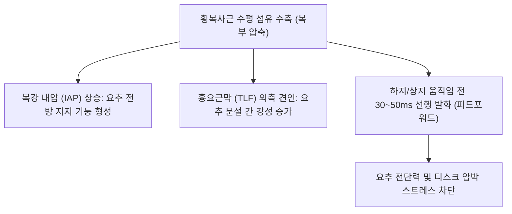

# 🫁 [[횡복사근]] (Transversus Abdominis)

> **핵심 요약 (Key Summary)**:
> [[횡복사근]](Transversus Abdominis, [[복횡근]])은 복벽의 가장 깊은 층에 위치하며, 하위 6개 늑연골, 흉요근막, [[장골]]능 및 서혜인대에서 수평으로 기시하여 복부 건막을 통해 백선(Linea alba) 및 치골에 정지하는 **'인체의 천연 코르셋(Natural Corset)'**이다.
> 하위 늑간신경(T7-T11), 늑하신경(T12), 장골하복신경 및 장골서혜신경(L1)의 지배를 받으며, **복압(Intra-abdominal pressure, IAP) 형성 및 사지 운동 전 요추-골반 분절의 선행적 안정화(Feedforward Stabilization)**를 주동한다.
> 임상적으로는 만성 요통, 요추 불안정증, 복직근 이개, 골반 부정렬의 핵심 기저 원인근이며, 한의 치료에서는 천추(ST25) 및 대횡(SP15) 심부 침구, 복부 드로잉-인(ADIM) 호흡 재활 및 요골반 코어 추나의 핵심 표적이다.

---
## 📌 목차
1. [해부학적 정밀 구조 및 지배 신경/혈관](#1-해부학적-정밀-구조-및-지배-신경혈관)
2. [생체역학·토크 분석 & 근막 사슬 (Biomechanical Synergy)](#2-생체역학토크-분석--근막-사슬-biomechanical-synergy)
3. [근막통증증후군(TP) & 연관통 패턴 (Travell & Simons)](#3-근막통증증후군tp--연관통-패턴-travell--simons)
4. [초음파 해부학(Sonoanatomy) 및 중재 시술 랜드마크](#4-초음파-해부학sonoanatomy-및-중재-시술-랜드마크)
5. [⭐ 원장님 심층 임상 고찰 및 원본 필기 (Clinical Pearls)](#5-원장님-심층-임상-고찰-및-원본-필기-clinical-pearls)
6. [관련 임상 질환 및 운동손상 증후군 총괄](#6-관련-임상-질환-및-운동손상-증후군-총괄)
7. [추나·도수치료(MET/PIR) & 침구·약침·재활 프로토콜](#7-추나도수치료metpir--침구약침재활-프로토콜)
8. [출처 및 학술 참고 문헌 (References)](#8-출처-및-학술-참고-문헌-references)

---
## 1. 해부학적 정밀 구조 및 지배 신경/혈관

| 항목 | 상세 내용 |
| :--- | :--- |
| **기시 (Origin)** | • 하위 6개(제7~12) 늑연골 내면 (횡격막과 맞물림) • 흉요근막(Thoracolumbar fascia) 중엽 및 전엽 • [[장골]]능(Iliac crest) 내순 전방 2/3 및 서혜인대 외측 1/3 |
| **정지 (Insertion)** | • 복벽 정중선의 백선(Linea alba) 및 검상돌기 • 내복사근 건막과 합류하여 결합건(Conjoint tendon) 형성 → [[치골]]릉 및 치골즐 |
| **신경 지배** | 하위 늑간신경(T7~T11), 늑하신경(T12), 장골하복신경(L1), 장골서혜신경(L1) |
| **혈관 공급** | 상복벽동맥, 하복벽동맥, 심회선장골동맥, 후늑간동맥 |
| **코어 원통 구조** | 상부의 횡격막, 하부의 [[골반저근]], 후방의 다열근과 함께 4대 코어 실린더(Core cylinder) 구성 |

### 🔬 해부학 도해 및 단면도

횡복사근은 복부 근육군 중 가장 안쪽에 위치하여 허리와 복부를 수평(가로) 방향으로 완전히 감싸 안고 있다. 뒤쪽으로는 흉요근막을 통해 요추 극돌기와 횡돌기에 단단히 고정되어 있으며, 수축할 때 복부를 안쪽으로 조여 복강 내압을 높이고 요추 전만을 안정적으로 유지시키는 복대 역할을 수행한다.

---
## 2. 생체역학·토크 분석 & 근막 사슬 (Biomechanical Synergy)

* **피드포워드 선행 제어(Feedforward Control)**: 사지가 움직이기 직전(30~50ms 전) 중추신경계의 명령에 의해 가장 먼저 발화하여 척추와 골반을 고정하는 동적 기초 플랫폼을 구축한다.
* **복강 내압(IAP)과 흉요근막 긴장도 조절**: 수축 시 흉요근막을 외측으로 팽팽하게 잡아당겨 척추 분절 간의 미세 흔들림과 전단력을 물리적으로 차단한다.
* **근막 사슬 연계 (Anatomy Trains)**: **심부전방선(Deep Front Line)**의 복부 핵심 벽체로 횡격막, 장요근, 골반저근과 기능적 일체화 단위를 이룬다.

---
## 3. 근막통증증후군(TP) & 연관통 패턴 (Travell & Simons)

* **발통점(TrP) 위치**: 늑골 하연과 장골능 사이 복벽 외측면의 심부 근육층.
* **연관통 양상**:
  * 서혜부, 하복부 및 고환/외음부로 뻗치는 뻐근하고 당기는 통증.
  * 기침, 재채기, 웃을 때 복벽이 울리며 요천추부로 깊은 통증 유발.
  * 복부 팽만감 및 소화불량, 장 운동 저하 모사.

---
## 4. 초음파 해부학(Sonoanatomy) 및 중재 시술 랜드마크

* **초음파 복벽 3층 스캔**:
  * 늑골 하연과 장골능 사이 복벽 측면에 트랜스듀서를 횡단 배치.
  * 표층부터 [[외복사근]] → [[내복사근]] → **횡복사근(TrA)** → 복막외 지방 및 복막의 3중 근육층 식별.
  * 호흡 시 복부 드로잉-인을 유도하여 횡복사근 층판이 두꺼워지는 동적 비후율(Thickening fraction) 실시간 측정.
* **자침 안전 마진**:
  * 횡복사근 바로 심부에 복막(Peritoneum)과 장관이 위치하므로, 복벽 수직 자침 시 복강 천공 위험이 있다.
  * 반드시 초음파 가이드 하에 내복사근과 횡복사근 사이 근막면(TAP plane)을 타깃으로 사선 진입해야 한다.

---
## 5. ⭐ 원장님 심층 임상 고찰 및 원본 필기 (Clinical Pearls)

* **만성 요통 환자의 피드포워드(Feedforward) 지연 (원장님 필기 100% 보존)**:
  * 건강한 사람은 팔다리를 움직이기 30~50ms 전에 횡복사근이 먼저 수축하여 척추를 잠그지만, 만성 요통 환자는 이 수축 타이밍이 늦어지거나 아예 발화하지 않는다.
  * 그 결과 사지가 움직일 때마다 요추 분절에 미세 전단력이 가해져 디스크 탈출증과 후관절염이 만성화된다.
* **복부 드로잉-인 기법(ADIM)의 핵심**:
  * 겉근육인 복직근에 힘을 주어 배를 앞으로 내밀거나 굳히는 브레이싱(Bracing)과 달리, 배꼽을 등 쪽으로 쏙 집어넣으며 골반저근을 살짝 끌어올리는 드로잉-인(Drawing-in) 훈련을 통해 횡복사근을 선택적으로 재교육해야 한다.
* **침구 치료 및 원위 배오 노하우**:
  * 천추(ST25), 대횡(SP15), 관원(CV4) 자침 시 환자에게 호흡을 내쉬게 하여 횡복사근이 수축할 때 얕은 사자(斜刺)로 자입하여 득기감을 유도한다.
  * 복횡근 활성화 후 장골의 부정렬과 천장관절 기능부전이 동반 교정되는 것을 확인해야 한다.

---
## 6. 관련 임상 질환 및 운동손상 증후군 총괄

| 임상 질환 / 증후군 | 병리적 연관 기전 | 주요 증상 및 이학적 검사 | 핵심 교정 타깃 |
| :--- | :--- | :--- | :--- |
| **요추 불안정증 및 만성 요통** | 횡복사근 피드포워드 수축 부전 | 보행 및 체위 변경 시 요통, 요추 불안정성 | 횡복사근 ADIM 재교육 및 침구 |
| **복직근 이개(Diastasis Recti)** | 복벽 심부 장력 약화로 백선 이개 | 산후 복부 돌출, 복부 코어 무력 | 횡복사근 원심성 강화 훈련 |
| **서혜부 탈장 및 스포츠 탈장** | 결합건 부위 약화 및 복압 조절 부전 | 기침/운동 시 서혜부 팽출 및 통증 | 횡복사근-내복사근 협응 강화 |

---
## 7. 추나·도수치료(MET/PIR) & 침구·약침·재활 프로토콜

* **한의학 경혈 매핑 및 침구 프로토콜**:
  * 천추(ST25), 대횡(SP15), 복결(SP14), 관원(CV4).
  * 0.30×40mm 호침으로 복벽을 따라 15~30도 사자하여 횡복사근 근막 자극.
* **복부 드로잉-인(ADIM) 3단계 재활**:
  1. **1단계 (와위 인지)**: 무릎을 세우고 누워 호기 시 배꼽을 척추 쪽으로 부드럽게 당기기(10초 유지, 골반 전방경사 방지).
  2. **2단계 (네발기기 자세)**: 네발기기 자세에서 중력에 저항하여 복벽 끌어올리기.
  3. **3단계 (기능 통합)**: 플랭크(Plank), 버드독(Bird-Dog) 등 전신 사슬 운동과 결합.

---
## 8. 출처 및 학술 참고 문헌 (References)

1. **Hodges, P. W., & Richardson, C. A. (1997)**. Contraction of the abdominal muscles associated with movement of the lower limb. *Phys Ther*, 77(2), 132-142. [PMID: 9037214](https://pubmed.ncbi.nlm.nih.gov/9037214/)
   - `[연구 요약]`: 하지 움직임 시 횡복사근(복횡근)이 척추 보호를 위해 가장 먼저 발화하는 피드포워드 선행 수축 기전을 입증한 기념비적 연구.
