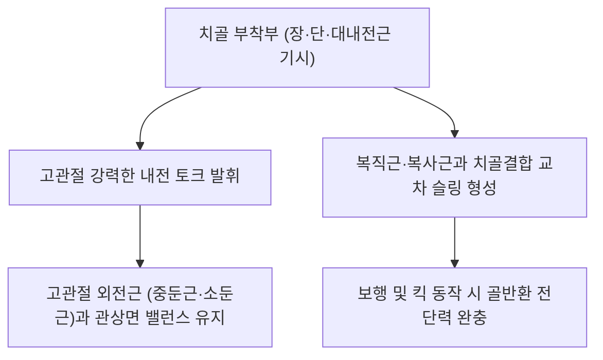

# 🫁 [[내전근]] (Adductor Muscles Complex)

> **핵심 요약 (Key Summary)**:
> [[내전근]](Adductor Muscles Complex)은 대퇴 내측을 구성하는 핵심 근육군으로, [[장내전근]](Adductor longus), [[단내전근]](Adductor brevis), [[대내전근]](Adductor magnus), [[치골근]](Pectineus), [[박근]](Gracilis)의 5개 근육으로 이루어져 있다.
> 주로 [[폐쇄신경]](L2-L4)의 지배(대내전근 후부는 좌골신경 지배)를 받으며, **고관절 내전, 굴곡·신전 보조 및 보행 시 골반과 하지 정렬의 동적 중심화**를 주동한다.
> 임상적으로는 스포츠 서혜부 통증(Athletic Pubalgia), [[치골염]](Osteitis pubis), 승마근 손상, 무릎 외반 변형의 핵심 병변 복합체이며, 한의 치료에서는 음렴(LR11), 족오리(LR10), 기충(ST30) 심부 침구 및 치골-내전근 건막 침도 치료의 표적이다.

---
## 📌 목차
1. [해부학적 정밀 구조 및 지배 신경/혈관](#1-해부학적-정밀-구조-및-지배-신경혈관)
2. [생체역학·토크 분석 & 근막 사슬 (Biomechanical Synergy)](#2-생체역학토크-분석--근막-사슬-biomechanical-synergy)
3. [근막통증증후군(TP) & 연관통 패턴 (Travell & Simons)](#3-근막통증증후군tp--연관통-패턴-travell--simons)
4. [초음파 해부학(Sonoanatomy) 및 중재 시술 랜드마크](#4-초음파-해부학sonoanatomy-및-중재-시술-랜드마크)
5. [⭐ 원장님 심층 임상 고찰 및 원본 필기 (Clinical Pearls)](#5-원장님-심층-임상-고찰-및-원본-필기-clinical-pearls)
6. [관련 임상 질환 및 운동손상 증후군 총괄](#6-관련-임상-질환-및-운동손상-증후군-총괄)
7. [추나·도수치료(MET/PIR) & 침구·약침·재활 프로토콜](#7-추나도수치료metpir--침구약침재활-프로토콜)
8. [출처 및 학술 참고 문헌 (References)](#8-출처-및-학술-참고-문헌-references)

---
## 1. 해부학적 정밀 구조 및 지배 신경/혈관

| 근육명 | 기시 (Origin) | 정지 (Insertion) | 신경 지배 | 기능적 특징 |
| :--- | :--- | :--- | :--- | :--- |
| **[[장내전근]]** | [[치골]]체 전면, 치골결절 하방 | [[대퇴골]] 조선(Linea aspera) 중간 1/3 | [[폐쇄신경]] 전지(L2-L4) | 서혜부 손상 최다 발생 부위 |
| **[[단내전근]]** | 치골체 및 치골하지 외측면 | 대퇴골 치골근선 및 조선 상부 1/3 | 폐쇄신경 전지(L2-L4) | 폐쇄신경 전·후지가 앞뒤로 관통 |
| **[[대내전근]]** | 치골하지, 좌골지, [[좌골결절]] | 대퇴골 조선 전체 및 내전근결절 | 폐쇄신경 후지 + [[좌골신경]](경골신경) | 인체 최대 내전근, 신전 보조 |
| **[[치골근]]** | 치골상지 치골근선(Pecten pubis) | 대퇴골 치골근선(Pectineal line) | 대퇴신경(L2, L3) + 폐쇄신경 | 고관절 굴곡 및 내전 복합 작용 |
| **[[박근]]** | 치골체 전면 및 치골하지 | 경골 내측 상부 (거위발건 정지부) | 폐쇄신경 전지(L2, L3) | 유일한 2관절 근육 (무릎 굴곡) |

### 🔬 해부학 도해 및 단면도

내전근 복합체는 치골에서 시작하여 대퇴골 내측 및 후면 조선을 따라 부채꼴로 펼쳐지는 거대한 근육 벽판을 형성한다. 가장 천층에는 치골근, 장내전근, 박근이 위치하고, 중간층에는 단내전근, 최심층에는 거대한 대내전근이 위치하여 층판 구조를 이룬다. 대내전근의 힘줄 부착부에는 내전근 열공(Adductor hiatus)이 형성되어 대퇴동정맥이 슬와로 빠져나가는 통로를 제공한다.

---
## 2. 생체역학·토크 분석 & 근막 사슬 (Biomechanical Synergy)

* **보행 및 달리기 시 골반 관상면 안정성**: 외전근군(중둔근)과 길항·협동하여 지지측 골반의 수평을 유지하고 유각기(Swing phase) 다리의 내측 궤적을 안내한다.
* **치골결합 교차 슬링(Cross-pelvic Sling)**: 복직근 건막과 장내전근 건막이 치골결합 전면에서 서로 엑스(X)자로 교차 결합하여 골반 전방의 인장력을 분산한다.
* **근막 사슬 연계 (Anatomy Trains)**: **심부전방선(Deep Front Line)**의 하지-골반 핵심 기둥으로 후경골근, 슬와근, 골반저근과 직접 연결된다.

---
## 3. 근막통증증후군(TP) & 연관통 패턴 (Travell & Simons)

* **발통점(TrP) 분류**:
  * **장·단내전근 TrP**: 서혜부 깊은 곳, 치골 결절 하방 및 대퇴 전내측을 따라 무릎 안쪽까지 방사.
  * **대내전근 TrP (상부/치골부)**: 서혜부 깊은 곳, 질·직장·골반 내부로 화끈거리는 통증 방사.
  * **대내전근 TrP (하부/좌골부)**: 대퇴 후내측을 따라 좌골신경통 모사 방사통.
* **임상적 특징**: 달리기, 방향 전환, 다리를 벌릴 때(외전) 사타구니 안쪽이 찢어지는 듯한 통증 유발.

---
## 4. 초음파 해부학(Sonoanatomy) 및 중재 시술 랜드마크

* **초음파 스캔 프로토콜**:
  * 치골결절 하방 서혜인대 바로 아래에 트랜스듀서를 횡단 배치.
  * 표층의 장내전근(Adductor longus)과 심층의 단내전근(Adductor brevis), 최심층의 대내전근(Adductor magnus) 3층 구조 동정.
  * 장내전근과 단내전근 사이를 지나는 폐쇄신경 전지, 단내전근과 대내전근 사이를 지나는 폐쇄신경 후지 층판 확인.
* **자침 안전 마진**:
  * 대퇴동맥과 대퇴정맥이 내전근군의 외측에 인접하므로, 대퇴맥박을 촉지한 뒤 반드시 내측 안전 구역에서 진입해야 한다.

---
## 5. ⭐ 원장님 심층 임상 고찰 및 원본 필기 (Clinical Pearls)

* **스포츠 서혜부 통증(Athletic Pubalgia / Sports Hernia)의 본질 (원장님 필기 100% 보존)**:
  * 축구, 하키, 무술 등 회전 및 킥 동작이 많은 운동선수들이 사타구니 안쪽 통증을 호소할 때 탈장으로 오진되기 쉽다.
  * 실제 원인의 80% 이상은 장내전근 기시부의 만성 미세 파열과 이에 따른 [[치골염]](Osteitis pubis)이다.
  * 복직근과 장내전근의 힘 균형이 깨지면서 치골결합에 비틀림 전단력이 집중되어 발생한다.
* **압통점 촉진 노하우**:
  * 치골결절 바로 아래 장내전근 건-골 부착부를 엄지손가락으로 뼈를 향해 강하게 압박할 때 날카로운 국소 압통과 서혜부 방사통이 재현되면 내전근 건병증으로 확진한다.
* **침구 및 침도 치료 노하우**:
  * 음렴(LR11), 족오리(LR10), 기충(ST30)혈 부위에서 0.35×60mm 침으로 치골하지 골면을 향해 35~50mm 사자 진입.
  * 만성 섬유화가 진행된 치골 부착부는 침도로 결절을 종축 박리하여 건의 장력을 낮추고 신바로약침을 주입한다.

---
## 6. 관련 임상 질환 및 운동손상 증후군 총괄

| 임상 질환 / 증후군 | 병리적 연관 기전 | 주요 증상 및 이학적 검사 | 핵심 교정 타깃 |
| :--- | :--- | :--- | :--- |
| **서혜부 긴장(Groin Strain)** | 급격한 방향 전환 시 장내전근 기시부 파열 | 사타구니 통증, 내전 저항 시 통증 | 내전근 기시부 침도 및 소염 약침 |
| **[[치골염]](Osteitis Pubis)** | 내전근-복직근 불균형으로 치골 전단력 집중 | 치골결합 압통, 보행 시 서혜부 통증 | 치골결합 안정화 추나, 내전근 이완 |
| **폐쇄신경 포착증** | 단내전근 사이 근막면 비후로 신경 압박 | 대퇴 내측 감각 저하, 내전 약화 | 폐쇄신경 수력박리 약침 |
| **무릎 외반 붕괴** | 내전근 과긴장 및 중둔근 약화 불균형 | 스쿼트 시 무릎 안쪽 모임 | 내전근 신장 + 외전근 강화 |

---
## 7. 추나·도수치료(MET/PIR) & 침구·약침·재활 프로토콜

* **한의학 경혈 매핑 및 침구 프로토콜**:
  * 음렴(LR11), 족오리(LR10), 급맥(LR12), 기충(ST30), 곡천(LR8).
  * 치골하지 내전근 기시부에 0.35×60mm 침으로 자침 후 저주파(2Hz) 전침 15분 적용.
* **근에너지기법 (MET/PIR)**:
  * 환자 앙와위, 고관절 굴곡 및 완전 외전 유도(내전근 최대 신장).
  * 환자에게 무릎을 안으로 모으는 내전 방향 등척성 저항(20% 힘, 7초 유지) 유도 후 호흡과 함께 이완 신장.
* **코펜하겐 내전근 재활 운동(Copenhagen Adduction Exercise)**:
  * 측와위 플랭크 자세에서 상측 다리로 벤치를 지탱하며 내전근의 원심성 근력 회복.

---
## 8. 출처 및 학술 참고 문헌 (References)

1. **Tyler, T. F., et al. (2010)**. Groin injuries in sports medicine. *Sports Health*, 2(3), 231-236. [PMID: 23015943](https://pubmed.ncbi.nlm.nih.gov/23015943/)
   - `[연구 요약]`: 운동선수의 서혜부 손상에서 내전근 건병증의 역학, 병태생리 및 보존적 재활 치료 원칙 규명.

2. **Serner, A., et al. (2015)**. Diagnosis of Acute Groin Injuries: A Prospective Study of 110 Athletes. *Am J Sports Med*, 43(8), 1857-1864. [PMID: 25977522](https://pubmed.ncbi.nlm.nih.gov/25977522/)
   - `[연구 요약]`: 110명의 선수를 대상으로 내전근 파열 및 서혜부 통증의 임상 평가와 MRI 소견의 상관성을 검증한 전향적 연구.
