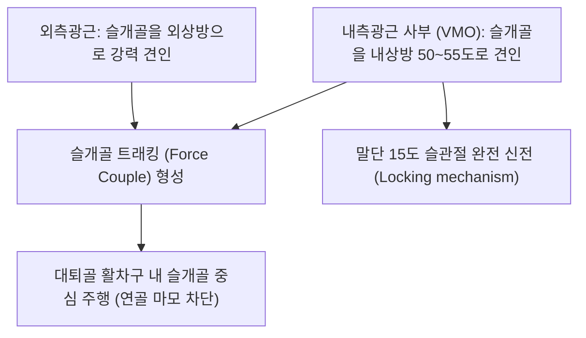

# 🫁 [[내측광근]] (Vastus Medialis)

> **핵심 요약 (Key Summary)**:
> [[내측광근]](Vastus Medialis)은 [[대퇴사두근]]을 구성하는 4개 근두 중 하나로, [[대퇴골]] 전자간선 하부 및 조선(Linea aspera) 내측순에서 기시하여 [[슬개골]] 내측연 및 슬개인대를 통해 경골조면에 정지하는 방추형 근육이다.
> [[대퇴신경]](Femoral nerve, L2-L4)의 지배를 받으며, 무릎 신전뿐만 아니라 **슬개골이 바깥쪽으로 탈구되지 않도록 내상방에서 잡아당기는 핵심 동적 내측 안정자(VMO)** 역할을 수행한다.
> 임상적으로는 보행 시 무릎이 푹 꺾이는 무릎 꺾임 현상(Buckling Knee), 슬개대퇴통증증후군(PFPS), [[슬개골 연골연화증]]의 핵심 병변근이며, 한의 치료에서는 혈해(SP10)혈 심부 침구 및 말단 슬관절 신전(TKE) 운동의 표적이다.

---
## 📌 목차
1. [해부학적 정밀 구조 및 지배 신경/혈관](#1-해부학적-정밀-구조-및-지배-신경혈관)
2. [생체역학·토크 분석 & 근막 사슬 (Biomechanical Synergy)](#2-생체역학토크-분석--근막-사슬-biomechanical-synergy)
3. [근막통증증후군(TP) & 연관통 패턴 (Travell & Simons)](#3-근막통증증후군tp--연관통-패턴-travell--simons)
4. [초음파 해부학(Sonoanatomy) 및 중재 시술 랜드마크](#4-초음파-해부학sonoanatomy-및-중재-시술-랜드마크)
5. [⭐ 원장님 심층 임상 고찰 및 원본 필기 (Clinical Pearls)](#5-원장님-심층-임상-고찰-및-원본-필기-clinical-pearls)
6. [관련 임상 질환 및 운동손상 증후군 총괄](#6-관련-임상-질환-및-운동손상-증후군-총괄)
7. [추나·도수치료(MET/PIR) & 침구·약침·재활 프로토콜](#7-추나도수치료metpir--침구약침재활-프로토콜)
8. [출처 및 학술 참고 문헌 (References)](#8-출처-및-학술-참고-문헌-references)

---
## 1. 해부학적 정밀 구조 및 지배 신경/혈관

| 항목 | 상세 내용 |
| :--- | :--- |
| **기시 (Origin)** | • [[대퇴골]](Femur) 전자간선(Intertrochanteric line) 하부 • 나선선(Spiral line) 및 대퇴골 조선(Linea aspera) 내측순 전체 • 내측 상과선(Medial supracondylar line) 및 대내전근 건 |
| **정지 (Insertion)** | • [[슬개골]](Patella) 내측연 상반부 및 내측 지대(Medial retinaculum) • 공통 대퇴사두근건을 통해 [[슬개건]](Patellar tendon)으로 이어져 경골조면에 정지 |
| **신경 지배** | [[대퇴신경]](Femoral nerve, **L2, L3, L4** 후지 분지) |
| **혈관 공급** | 대퇴동맥의 근지, 하행슬동맥(Descending genicular a.), 슬와동맥 상내측슬동맥 |
| **구조적 분절** | • **내측광근 장부(VML)**: 근위부 근섬유로 15~18도 주행 (무릎 폄 주동) • **내측광근 사부(VMO)**: 원위부 근섬유로 50~55도 사선 주행 (슬개골 내측 견인) |

### 🔬 해부학 도해 및 단면도

내측광근은 대퇴 전내측의 하반부를 볼록하게 채우고 있는 눈물방울 모양(Teardrop shape)의 근육이다. 특히 슬개골 바로 안쪽 위에 도톰하게 솟아 있는 사선 섬유 다발인 VMO(Vastus Medialis Obliquus)는 슬개골을 안쪽으로 50도 이상 강하게 당겨 외측광근의 외상방 장력과 동적 균형(Force couple)을 이룬다.

---
## 2. 생체역학·토크 분석 & 근막 사슬 (Biomechanical Synergy)

* **슬개골 외측 탈구 방어의 핵심 브레이크**: 인체 구조상 Q-각(Q-angle)으로 인해 무릎 신전 시 슬개골은 바깥쪽으로 쏠리려는 경향이 있는데, VMO가 유일하게 슬개골을 안쪽에서 제동한다.
* **말단 15도 신전(Terminal Extension)**: 무릎이 거의 다 펴지는 마지막 15도 구간에서 내측광근의 전기적 활성도가 급증하며 무릎의 나사-홈 회전(Screw-home mechanism)을 완성한다.
* **근막 사슬 연계 (Anatomy Trains)**: **표면전방선(Superficial Front Line)**의 대퇴 내측 지지대로서 전경골근 및 복직근과 협응한다.

---
## 3. 근막통증증후군(TP) & 연관통 패턴 (Travell & Simons)

* **발통점(TrP) 위치**: 슬개골 내상연 직상방 3~5cm 지점의 도톰한 VMO 근복 (혈해혈 부위).
* **연관통 양상**:
  * 슬관절 전내측 깊은 곳의 쑤시는 통증 및 슬개골 하부의 뻐근한 압통.
  * 계단을 내려갈 때 무릎 안쪽이 시큰거리며 통증 유발.
  * 보행 중 불시에 무릎이 푹 꺾이는 현상(Buckling knee)으로 인해 넘어질 뻔함.

---
## 4. 초음파 해부학(Sonoanatomy) 및 중재 시술 랜드마크

* **초음파 스캔 프로토콜**:
  * 슬개골 내상연에 트랜스듀서를 축방향으로 거치하여 대퇴사두근 내측 섬유 주행 관찰.
  * 대퇴직근 내측면과 대퇴골 피질골 사이에서 삼각형 모양으로 두터워지는 VMO 근복 동정.
  * 슬개골 내측 지대(Medial retinaculum)와 슬개대퇴관절 내측 열극(Medial joint space) 확인.
* **자침 안전 마진**:
  * 대퇴동맥이 주행하는 헌터관(Hunter's canal / Adductor canal)은 내측광근 심부 후방에 위치하므로, 슬개골 상방 5cm 이내 전내측 자침 시 혈관 손상 위험 없이 안전하게 시술 가능.

---
## 5. ⭐ 원장님 심층 임상 고찰 및 원본 필기 (Clinical Pearls)

* **무릎 꺾임 현상(Buckling Knee / Giving-Way)의 진짜 주범 (원장님 필기 100% 보존)**:
  * 환자가 "길을 걷거나 계단을 내려가다가 무릎에 갑자기 힘이 푹 빠져서 주저앉을 뻔했다"고 호소할 때, 십중팔구 십자인대나 반월상연골 파열을 의심하지만 실제는 VMO 발통점이다.
  * 내측광근의 발통점은 척수 반사적으로 대퇴신경의 원심성 신호를 차단(Inhibition)하여 보행 충격기 시 무릎 신전 텐션을 순간적으로 상실하게 만든다.
* **슬개골 연골연화증과 VMO 위축의 악순환**:
  * 무릎 관절염이나 연골연화증 환자는 외측광근만 두꺼워지고 VMO는 말라 있는 경우가 대부분이다.
  * 슬개골이 활차구 외측벽에 부딪히며 소리가 나고 갈리는 느낌(Crepitus)이 들 때, 혈해혈 침치료와 함께 VMO를 고립 강화시켜야 연골 마모가 멈춘다.
* **침구 및 운동 치료 노하우**:
  * 혈해(SP10)혈 및 VMO 발통점에 0.35×50mm 호침으로 직자하여 득기감을 유도하고 저주파(2Hz) 전침을 걸어 VMO의 선택적 수축을 자극한다.
  * 무릎 밑에 수건을 말아 넣고 무릎 뒤로 수건을 바닥으로 꾹 누르며 발끝을 당기는 **터미널 니 익스텐션(TKE)** 운동을 매일 100회씩 시행하도록 티칭한다.

---
## 6. 관련 임상 질환 및 운동손상 증후군 총괄

| 임상 질환 / 증후군 | 병리적 연관 기전 | 주요 증상 및 이학적 검사 | 핵심 교정 타깃 |
| :--- | :--- | :--- | :--- |
| **무릎 꺾임증(Buckling Knee)** | VMO 발통점으로 인한 대퇴신경 순간 억제 | 보행 시 무릎 무력감, 계단 하강 공포 | VMO 발통점 침구 및 신경 활성화 |
| **슬개대퇴통증증후군(PFPS)** | VMO 약화로 인한 슬개골 외측 쏠림 | 슬개골 주위 둔통, 극장 징후(Movie sign) | VMO 강화 + 외측광근/장경인대 이완 |
| **[[슬개골 연골연화증]]** | 슬개골 외측 활차구 지속 마찰 및 마모 | 무릎 굴곡 시 마찰음, 슬개골 압박통 | VMO 균형 회복, 슬개골 가동 추나 |
| **슬개골 재발성 탈구** | 내측 지대 및 VMO 장력 부전 | 무릎 굴곡 시 슬개골 외측 아탈구 | VMO 건-인대 재생 약침 |

---
## 7. 추나·도수치료(MET/PIR) & 침구·약침·재활 프로토콜

* **한의학 경혈 매핑 및 침구 프로토콜**:
  * 혈해(SP10), 음릉천(SP9), 양구(ST34), 내슬안(EX-LE4).
  * 혈해혈 VMO 중심부에 0.35×50mm 침으로 자침 후 2Hz 전침 20분 적용.
* **근에너지기법 (MET/PIR)**:
  * 환자 앙와위, 슬관절 최대 굴곡 유도(내측광근 신장).
  * 환자에게 무릎을 펴는 신전 방향 등척성 저항(20% 힘, 7초 유지) 후 PIR 이완.
* **VMO 고립 강화 운동**:
  * 숏 아크 쿼드(Short Arc Quad, 0~30도 무릎 폄), 볼 스퀴즈 스쿼트(Ball Squeeze Squat).

---
## 8. 출처 및 학술 참고 문헌 (References)

1. **Smith, T. O., et al. (2009)**. Vastus medialis obliquus atrophy: does it exist in patellofemoral pain syndrome? *Br J Sports Med*, 43(4), 263-267. [PMID: 21487120](https://pubmed.ncbi.nlm.nih.gov/21487120/)
   - `[연구 요약]`: 슬개대퇴통증증후군(PFPS) 환자에서 VMO의 구조적 위축과 근활성도 지연 패턴을 규명한 체계적 고찰.

2. **Powers, C. M. (2003)**. The influence of altered lower-extremity kinematics on patellofemoral joint dysfunction: a theoretical perspective. *J Orthop Sports Phys Ther*, 33(11), 639-646. [PMID: 14669959](https://pubmed.ncbi.nlm.nih.gov/14669959/)
   - `[연구 요약]`: 대퇴골 운동역학 이상과 대퇴사두근 내·외측 불균형이 슬개대퇴관절 기능부전에 미치는 생체역학적 기전 분석.
