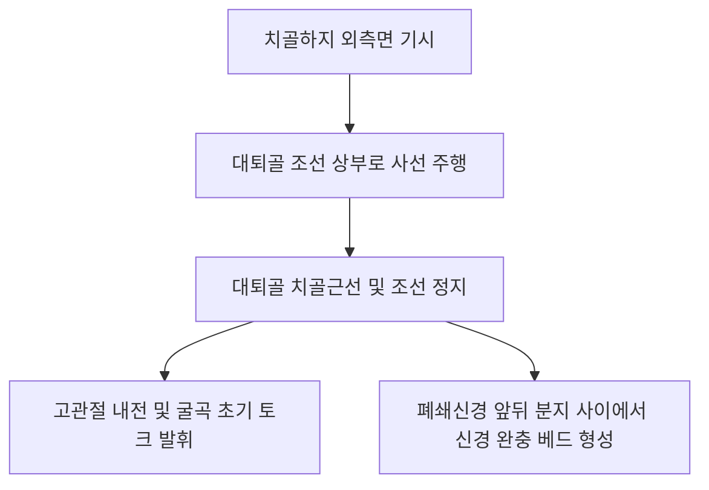

# 🫁 [[단내전근]] (Adductor Brevis)

> **핵심 요약 (Key Summary)**:
> [[단내전근]](Adductor Brevis)은 [[치골]]체 및 치골하지 외측면에서 기시하여 [[대퇴골]] 치골근선 및 조선(Linea aspera) 상부 1/3에 정지하는 삼각형의 고관절 내전근이다.
> [[폐쇄신경]](Obturator nerve, L2-L4)의 지배를 받으며, **폐쇄신경의 전지(Anterior branch)와 후지(Posterior branch)가 이 근육의 앞뒤를 샌드위치처럼 감싸며 주행하는 핵심 신경 해부학적 랜드마크**이다.
> 임상적으로는 [[폐쇄신경 포착 증후군]], 서혜부 심부 둔통, 승마근 손상의 핵심 병변근이며, 한의 치료에서는 음렴(LR11)혈 심부 침구 및 폐쇄신경 주위 수력박리 약침 치료의 표적이다.

---
## 📌 목차
1. [해부학적 정밀 구조 및 지배 신경/혈관](#1-해부학적-정밀-구조-및-지배-신경혈관)
2. [생체역학·토크 분석 & 근막 사슬 (Biomechanical Synergy)](#2-생체역학토크-분석--근막-사슬-biomechanical-synergy)
3. [근막통증증후군(TP) & 연관통 패턴 (Travell & Simons)](#3-근막통증증후군tp--연관통-패턴-travell--simons)
4. [초음파 해부학(Sonoanatomy) 및 중재 시술 랜드마크](#4-초음파-해부학sonoanatomy-및-중재-시술-랜드마크)
5. [⭐ 원장님 심층 임상 고찰 및 원본 필기 (Clinical Pearls)](#5-원장님-심층-임상-고찰-및-원본-필기-clinical-pearls)
6. [관련 임상 질환 및 운동손상 증후군 총괄](#6-관련-임상-질환-및-운동손상-증후군-총괄)
7. [추나·도수치료(MET/PIR) & 침구·약침·재활 프로토콜](#7-추나도수치료metpir--침구약침재활-프로토콜)
8. [출처 및 학술 참고 문헌 (References)](#8-출처-및-학술-참고-문헌-references)

---
## 1. 해부학적 정밀 구조 및 지배 신경/혈관

| 항목 | 상세 내용 |
| :--- | :--- |
| **기시 (Origin)** | [[치골]](Pubis)의 치골체 외측면 및 치골하지(Inferior pubic ramus) 외측 골면 |
| **정지 (Insertion)** | [[대퇴골]](Femur) 후면의 치골근선(Pectineal line) 및 대퇴골 조선(Linea aspera) 상부 1/3 |
| **신경 지배** | [[폐쇄신경]](Obturator nerve, **L2, L3, L4** 전지 분지, 일부 후지) |
| **혈관 공급** | 폐쇄동맥(Obturator a.), 심대퇴동맥의 내전근 관통지 |
| **해부학적 층위** | 표층의 치골근·장내전근과 심층의 대내전근 사이에 위치하는 중간 층판 |

### 🔬 해부학 도해 및 단면도

단내전근은 치골의 좁은 기시부에서 대퇴골 조선으로 넓게 펼쳐지는 두터운 부채꼴 형태이다. 표층은 치골근과 장내전근에 완전히 덮여 있고, 심층은 거대한 대내전근에 맞닿아 있다. 특히 폐쇄신경이 폐쇄관을 빠져나와 단내전근의 앞면(전지)과 뒷면(후지)으로 갈라져 주행하므로, 단내전근은 폐쇄신경의 주행 궤도를 결정하는 해부학적 중심축 역할을 한다.

---
## 2. 생체역학·토크 분석 & 근막 사슬 (Biomechanical Synergy)

* **고관절 내전 및 굴곡 보조**: 고관절 굴곡 각도에 따라 신전 상태에서는 굴곡과 내전을 동시에 발휘하고, 굴곡 상태에서는 안정적인 내전력을 제공한다.
* **대퇴골두 관절와 안착 보조**: 치골과 대퇴골 경부 하단을 가깝게 연결하여 외전 시 과도한 관절 팽창을 제어한다.
* **근막 사슬 연계 (Anatomy Trains)**: **심부전방선(Deep Front Line)**의 내측 고관절 앵커로서 기능한다.

---
## 3. 근막통증증후군(TP) & 연관통 패턴 (Travell & Simons)

* **발통점(TrP) 위치**: 치골하지 외측연 바로 아래, 장내전근 심부의 단내전근 근복 상부.
* **연관통 양상**:
  * 서혜부(사타구니) 깊은 곳 및 치골결합 주변의 깊고 쑤시는 통증.
  * 대퇴 전내측 상부면을 따라 무릎 안쪽 상방까지 뻗어나가는 둔통.
  * 고관절 외전 시 날카로운 당김 통증으로 인해 다리를 옆으로 벌리지 못함.

---
## 4. 초음파 해부학(Sonoanatomy) 및 중재 시술 랜드마크

* **초음파 스캔 프로토콜**:
  * 서혜부 주름 하방 대퇴 내측에 트랜스듀서를 횡단 배치.
  * 표층의 장내전근(AL) 아래에 위치한 타원형의 단내전근(AB) 동정.
  * 단내전근의 표면을 지나는 폐쇄신경 전지(Anterior division)와 심면을 지나는 폐쇄신경 후지(Posterior division)의 고에코 점상 구조물 식별.
* **자침 안전 마진**:
  * 대퇴혈관보다 내측에 위치하지만, 폐쇄신경 줄기가 단내전근의 앞뒤를 포위하고 있으므로 신경을 직접 찌르지 않도록 근막 층간 공간을 정밀 타깃해야 한다.

---
## 5. ⭐ 원장님 심층 임상 고찰 및 원본 필기 (Clinical Pearls)

* **폐쇄신경 포착(Obturator Nerve Entrapment)의 핵심 게이트 (원장님 필기 100% 보존)**:
  * 대퇴 내측의 감각 이상, 저림 및 사타구니 통증을 호소하는 환자에서 단내전근의 비후는 폐쇄신경을 옭아매는 가장 흔한 덫이다.
  * 장내전근과 단내전근 사이, 또는 단내전근과 대내전근 사이의 근막 유착을 풀어주면 대퇴 내측 신경통이 즉각 완화된다.
* **만성 서혜부 통증 감별 노하우**:
  * 앙와위에서 고관절을 외전 및 신전시켰을 때 치골하지 심부에서 손가락 끝으로 찌르는 듯한 국소 압통이 재현되면 장내전근보다 심층에 위치한 단내전근 단독 병변으로 감별한다.
* **침구 및 침도 치료 노하우**:
  * 음렴(LR11)혈 부위에서 0.35×60mm 호침으로 장내전근의 외측연을 스치듯 비스듬히 35~50mm 심부로 진입하여 단내전근 골막 부착부에 안착시킨다.
  * 폐쇄신경 유착 부위에 신바로약침 1.0cc를 수력박리 기법으로 주입하여 신경 부종을 해소한다.

---
## 6. 관련 임상 질환 및 운동손상 증후군 총괄

| 임상 질환 / 증후군 | 병리적 연관 기전 | 주요 증상 및 이학적 검사 | 핵심 교정 타깃 |
| :--- | :--- | :--- | :--- |
| **폐쇄신경 포착증** | 단내전근 앞뒤 근막 비후로 폐쇄신경 압박 | 대퇴 내측 저림, 내전 약화 | 단내전근 근막 약침 수력박리 |
| **서혜부 심부 염좌** | 과도한 외전 시 치골하지 부착부 손상 | 다리 벌릴 때 사타구니 통증 | 단내전근 기시부 침도 및 소염 |
| **고관절 외전 가동제한** | 단내전근 만성 구축으로 인한 외전 제한 | 양반다리 시 서혜부 통증 | 단내전근 PIR 신장 추나 |

---
## 7. 추나·도수치료(MET/PIR) & 침구·약침·재활 프로토콜

* **한의학 경혈 매핑 및 침구 프로토콜**:
  * 음렴(LR11), 족오리(LR10), 기충(ST30).
  * 치골하지 외측면 단내전근 부착부에 0.35×60mm 침으로 자침 후 전침(2Hz, 15분).
* **근에너지기법 (MET/PIR)**:
  * 앙와위, 고관절 굴곡 및 최대 외전 유도(단내전근 신장).
  * 내전 방향 등척성 수축(20% 힘, 7초 유지) 후 PIR 이완 신장.

---
## 8. 출처 및 학술 참고 문헌 (References)

1. **Bradshaw, C., et al. (1997)**. Obturator nerve entrapment. *J Sci Med Sport*, 1(1), 1-8. [PMID: 9262891](https://pubmed.ncbi.nlm.nih.gov/9262891/)
   - `[연구 요약]`: 운동선수의 만성 서혜부 통증에서 단내전근과 폐쇄신경 포착의 해부학적 기전 및 외과적/보존적 감압 치료 성과 분석.

2. **Tyler, T. F., et al. (2010)**. Groin injuries in sports medicine. *Sports Health*, 2(3), 231-236. [PMID: 23015943](https://pubmed.ncbi.nlm.nih.gov/23015943/)
   - `[연구 요약]`: 내전근 복합체 손상 및 서혜부 통증의 병기별 재활 프로토콜과 임상 평가 지침.
