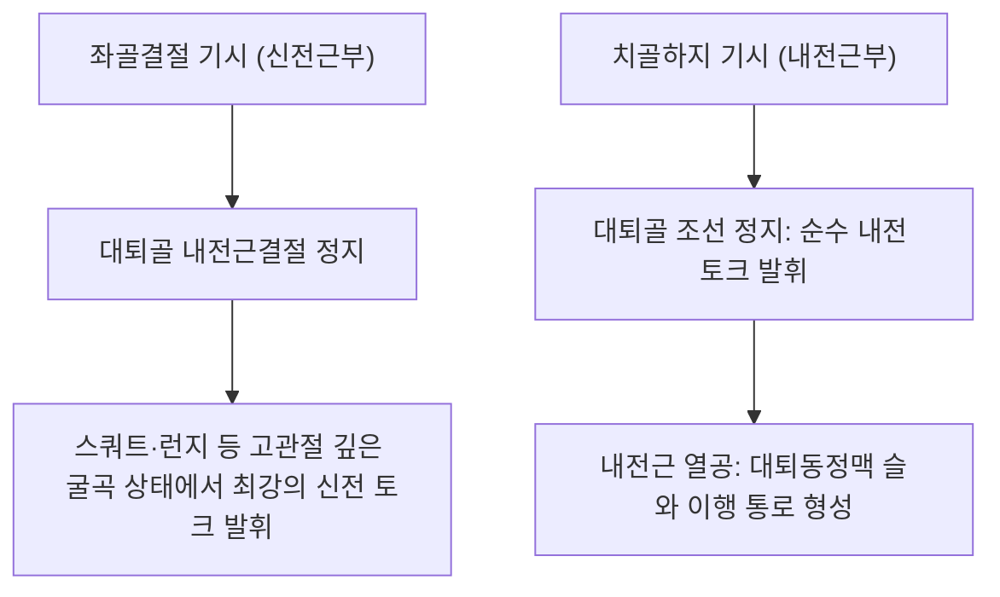

# 🫁 [[대내전근]] (Adductor Magnus)

> **핵심 요약 (Key Summary)**:
> [[대내전근]](Adductor Magnus)은 인체 내전근군 중 가장 크고 강력한 거대 복합 근육으로, [[치골]]하지·[[좌골]]지에서 기시하는 **내전근부(Pubofemoral part)**와 [[좌골결절]]에서 기시하는 **신전근부(Ischiocondylar/Hamstring part)**로 구성된다.
> 각각 **[[폐쇄신경]](후지)과 [[좌골신경]](경골신경)의 독특한 이중 신경 지배**를 받으며, 강력한 고관절 내전뿐만 아니라 **제4의 햄스트링(The 4th Hamstring)**으로서 고관절 신전과 골반 시상면 안정화를 주동한다.
> 임상적으로는 내전근 열공(Adductor hiatus) 대퇴혈관 압박에 따른 하지 순환장애, 좌골부 건병증, 스포츠 서혜부 통증의 핵심 병변근이며, 한의 치료에서는 음곡(KI10) 상방 및 족오리(LR10) 심부 침구, 내전근 열공 감압 침도 치료의 핵심 표적이다.

---
## 📌 목차
1. [해부학적 정밀 구조 및 지배 신경/혈관](#1-해부학적-정밀-구조-및-지배-신경혈관)
2. [생체역학·토크 분석 & 근막 사슬 (Biomechanical Synergy)](#2-생체역학토크-분석--근막-사슬-biomechanical-synergy)
3. [근막통증증후군(TP) & 연관통 패턴 (Travell & Simons)](#3-근막통증증후군tp--연관통-패턴-travell--simons)
4. [초음파 해부학(Sonoanatomy) 및 중재 시술 랜드마크](#4-초음파-해부학sonoanatomy-및-중재-시술-랜드마크)
5. [⭐ 원장님 심층 임상 고찰 및 원본 필기 (Clinical Pearls)](#5-원장님-심층-임상-고찰-및-원본-필기-clinical-pearls)
6. [관련 임상 질환 및 운동손상 증후군 총괄](#6-관련-임상-질환-및-운동손상-증후군-총괄)
7. [추나·도수치료(MET/PIR) & 침구·약침·재활 프로토콜](#7-추나도수치료metpir--침구약침재활-프로토콜)
8. [출처 및 학술 참고 문헌 (References)](#8-출처-및-학술-참고-문헌-references)

---
## 1. 해부학적 정밀 구조 및 지배 신경/혈관

| 분절 구분 | 기시 (Origin) | 정지 (Insertion) | 신경 지배 | 기능적 역할 |
| :--- | :--- | :--- | :--- | :--- |
| **내전근부 (Adductor part)** | 치골하지(Inferior pubic ramus) 및 좌골지 전면 | [[대퇴골]] 둔근조면, 조선(Linea aspera) 전체, 내측상과선 | [[폐쇄신경]](L2, L3, L4 후지) | 고관절 강력 내전, 굴곡 보조 |
| **신전근부 (Hamstring part)** | [[좌골결절]](Ischial tuberosity) 하외측면 | 대퇴골 내측상과 상단의 **내전근결절(Adductor tubercle)** | [[좌골신경]](경골신경 분지, L4) | 강력한 고관절 신전 (제4의 햄스트링) |

* **혈관 공급**: 폐쇄동맥, 심대퇴동맥의 4개 관통동맥(Perforating arteries), 슬와동맥.
* **내전근 열공 (Adductor Hiatus)**: 조선 부착 건막과 내전근결절 힘줄 사이에 형성된 건-골성 개구부로, **대퇴동맥과 대퇴정맥**이 이 틈을 지나 슬와(Popliteal fossa)로 진입하여 슬와혈관으로 명칭 변경.

### 🔬 해부학 도해 및 단면도

대내전근은 대퇴 내측 깊은 곳에서 거대한 삼각형 판막 구조물을 형성한다. 전방으로는 단내전근과 대퇴혈관을 마주하고, 후방으로는 반막양근, 반건양근, 대퇴이두근 등 햄스트링군과 맞닿아 있어 전·후방 구획의 경계벽 역할을 수행한다.

---
## 2. 생체역학·토크 분석 & 근막 사슬 (Biomechanical Synergy)

* **고관절 신전의 진정한 파워하우스**: 고관절이 60도 이상 깊게 굴곡된 상태(스쿼트 최하단, 달리기 스타트)에서는 대둔근보다 대내전근의 신전 모멘트 암이 훨씬 커져 강력한 추진력을 제공한다.
* **골반 안정화 슬링**: 좌골결절에서 치골결합까지의 거대한 기시부를 통해 골반환의 전후 회전력을 완충한다.
* **근막 사슬 연계 (Anatomy Trains)**: **심부전방선(Deep Front Line)**의 핵심 기둥으로 골반저근과 대퇴 내측을 직접 연결한다.

---
## 3. 근막통증증후군(TP) & 연관통 패턴 (Travell & Simons)

* **발통점(TrP) 분류**:
  * **상부 TrP (치골 부착부)**: 서혜부 깊은 곳, 치골결합 주변 및 질, 직장, 방광으로 뻗치는 화끈거리는 골반통.
  * **중간/하부 TrP (근복 및 내전근결절)**: 대퇴 전내측에서 슬관절 내측 상방(무릎 안쪽)까지 방사되는 깊은 둔통.
  * **후방 TrP (좌골결절부)**: 대퇴 후면을 따라 햄스트링이나 좌골신경통과 유사한 방사통 투사.
* **임상적 특징**: 무거운 짐을 들고 걷거나 계단을 오를 때 서혜부와 허벅지 안쪽에 쥐가 나는 듯한 통증 유발.

---
## 4. 초음파 해부학(Sonoanatomy) 및 중재 시술 랜드마크

* **초음파 스캔 프로토콜**:
  * 대퇴 내측 하부 1/3 지점에서 축방향 단축 스캔.
  * 대퇴골 내측 피질골과 내전근결절 뼈 음영 식별.
  * 대내전근 원위부 힘줄과 대퇴골 사이에서 둥근 맥동을 보이는 대퇴동정맥(내전근 열공 부위) 동정.
* **자침 안전 마진**:
  * 내전근 열공 부위는 대퇴동정맥이 관통하므로 도플러 초음파로 혈관의 위치를 확인하고 혈관 전방 또는 후방 안전 구역에서 골막을 향해 진입해야 한다.

---
## 5. ⭐ 원장님 심층 임상 고찰 및 원본 필기 (Clinical Pearls)

* **인체 제4의 햄스트링(The 4th Hamstring)의 임상적 가치 (원장님 필기 100% 보존)**:
  * 햄스트링 부상이나 요통 치료 시 허벅지 뒤쪽만 치료하고 대내전근을 놓치면 재발을 막을 수 없다.
  * 대내전근의 좌골결절 분절은 신경 지배(좌골신경)와 기능(고관절 신전) 모두 햄스트링과 완벽히 일치한다.
  * 스쿼트 시 일어나는 구간에서 허벅지 안쪽 깊은 곳이 찢어질 듯 아픈 환자는 대내전근 신전부의 만성 과부하를 치료해야 한다.
* **내전근 열공(Adductor Hiatus) 증후군과 하지 부종**:
  * 대내전근 하부 힘줄이 만성 경직되면 내전근 열공을 통과하는 대퇴정맥이 기계적으로 압박되어 다리가 무겁고 종아리에 쥐가 자주 나며 오후에 부종이 심해진다.
  * 이 부위를 침도나 약침으로 감압해주면 하지 순환이 즉각 개선된다.
* **침구 및 침도 치료 노하우**:
  * 음곡(KI10)혈 상방 3~5cm 대퇴 후내측 함요처에서 0.35×75mm 장침으로 대퇴골 내측상과 방향으로 45~60mm 자침.
  * 좌골결절 부착부 건병증 시 침도로 좌골 골막의 섬유성 유착대를 미세 절개하여 장력을 해소한다.

---
## 6. 관련 임상 질환 및 운동손상 증후군 총괄

| 임상 질환 / 증후군 | 병리적 연관 기전 | 주요 증상 및 이학적 검사 | 핵심 교정 타깃 |
| :--- | :--- | :--- | :--- |
| **내전근 열공 포착 증후군** | 대내전근 건 열공에서 대퇴혈관 압박 | 하지 무거움, 야간 종아리 경련, 하지 부종 | 내전근 열공 감압 약침 및 침도 |
| **좌골부 대내전근 건병증** | 좌골결절 부착부 만성 견인 스트레스 | 착석 시 좌골 통증, 햄스트링 스트레칭 시 통증 | 좌골결절 건 부착부 재생 약침 |
| **스포츠 서혜부-둔부 통증** | 대내전근-복직근 슬링 불균형 | 킥 동작 시 서혜부 깊은 쑤심 | 대내전근 이완 및 골반 추나 |

---
## 7. 추나·도수치료(MET/PIR) & 침구·약침·재활 프로토콜

* **한의학 경혈 매핑 및 침구 프로토콜**:
  * 음곡(KI10), 족오리(LR10), 곡천(LR8), 혈해(SP10) 내측 반응점.
  * 0.35×75mm 침으로 대내전근 심부 발통점에 자침 후 저주파(2Hz) 전침 15분 적용.
* **근에너지기법 (MET/PIR)**:
  * 환자 앙와위, 고관절 90도 굴곡 상태에서 완전 외전 유도(대내전근 신전부 신장).
  * 내전 방향 등척성 저항(20% 힘, 7초 유지) 후 PIR 이완 신장.

---
## 8. 출처 및 학술 참고 문헌 (References)

1. **Serner, A., et al. (2015)**. Diagnosis of Acute Groin Injuries: A Prospective Study of 110 Athletes. *Am J Sports Med*, 43(8), 1857-1864. [PMID: 25977522](https://pubmed.ncbi.nlm.nih.gov/25977522/)
   - `[연구 요약]`: 운동선수의 급성 서혜부 손상에서 대내전근 및 내전근군의 손상 패턴과 임상 감별 진단 지침.

2. **Tyler, T. F., et al. (2010)**. Groin injuries in sports medicine. *Sports Health*, 2(3), 231-236. [PMID: 23015943](https://pubmed.ncbi.nlm.nih.gov/23015943/)
   - `[연구 요약]`: 대내전근을 포함한 내전근 복합체의 기능 해부학과 재활 중재 전략 분석.
