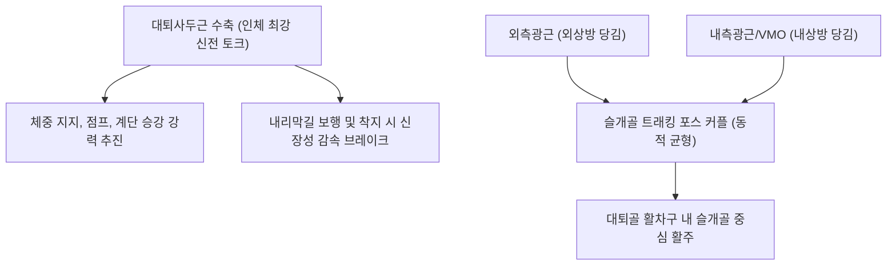

# 🫁 [[대퇴사두근]] (Quadriceps Femoris)

> **핵심 요약 (Key Summary)**:
> [[대퇴사두근]](Quadriceps Femoris)은 대퇴 전면을 덮고 있는 인체 최대의 신전 근육 복합체로, 유일한 2관절 근육인 [[대퇴직근]](Rectus femoris)과 3개의 1관절 광근([[외측광근]], [[내측광근]], [[중간광근]])으로 구성된다.
> [[대퇴신경]](Femoral nerve, L2-L4)의 지배를 받으며, **슬관절 신전(보행·도약·체중 지지 추진력), 착지 시 신장성 감속(Eccentric deceleration), [[슬개골]] 트래킹 조절 및 고관절 굴곡(대퇴직근)**을 주동한다.
> 임상적으로는 슬개대퇴통증증후군(PFPS), [[슬개골 연골연화증]], 대퇴사두건염, 점퍼스 니(Jumper's knee)의 핵심 병변 복합체이며, 한의 치료에서는 양구(ST34), 복토(ST32), 혈해(SP10), 학정(EX-LE2) 심부 침구 및 Q-각 교정 추나의 핵심 표적이다.

---
## 📌 목차
1. [해부학적 정밀 구조 및 지배 신경/혈관](#1-해부학적-정밀-구조-및-지배-신경혈관)
2. [생체역학·토크 분석 & 근막 사슬 (Biomechanical Synergy)](#2-생체역학토크-분석--근막-사슬-biomechanical-synergy)
3. [근막통증증후군(TP) & 연관통 패턴 (Travell & Simons)](#3-근막통증증후군tp--연관통-패턴-travell--simons)
4. [초음파 해부학(Sonoanatomy) 및 중재 시술 랜드마크](#4-초음파-해부학sonoanatomy-및-중재-시술-랜드마크)
5. [⭐ 원장님 심층 임상 고찰 및 원본 필기 (Clinical Pearls)](#5-원장님-심층-임상-고찰-및-원본-필기-clinical-pearls)
6. [관련 임상 질환 및 운동손상 증후군 총괄](#6-관련-임상-질환-및-운동손상-증후군-총괄)
7. [추나·도수치료(MET/PIR) & 침구·약침·재활 프로토콜](#7-추나도수치료metpir--침구약침재활-프로토콜)
8. [출처 및 학술 참고 문헌 (References)](#8-출처-및-학술-참고-문헌-references)

---
## 1. 해부학적 정밀 구조 및 지배 신경/혈관

| 근두 구분 | 기시 (Origin) | 정지 (Insertion) | 신경 지배 | 기능적 고유 작용 |
| :--- | :--- | :--- | :--- | :--- |
| **[[대퇴직근]]** | 전하장골극(AIIS) 직두 및 비구 상연 반회두 | 공통 대퇴사두근건 → [[슬개골]] 및 [[슬개건]] 경골조면 | [[대퇴신경]](L2-L4) | 고관절 굴곡 + 슬관절 신전 (2관절근) |
| **[[외측광근]]** | 대전자 하부, 둔근조면, 대퇴골 조선 외측순 | 슬개골 외측연 및 외측 지대 | 대퇴신경(L2-L4) | 인체 최대 광근, 슬개골 외상방 견인 |
| **[[내측광근]]** | 전자간선 하부, 대퇴골 조선 내측순 | 슬개골 내측연 및 내측 지대 (VMO) | 대퇴신경(L2-L4) | 슬개골 내상방 견인 (외측 탈구 방어) |
| **[[중간광근]]** | 대퇴골 간부 전외측면 상부 2/3 | 슬개골 기저부 심층 건막 | 대퇴신경(L2-L4) | 순수 무릎 폄, 슬개상낭 거상 보조 |

* **혈관 공급**: 외측대퇴회선동맥(대퇴직근·외측광근), 심대퇴동맥 근지, 하행슬동맥(내측광근).
* **공통 건막 구조**: 4개 근두가 슬개골 상단에서 합류하여 3층 구조의 강력한 대퇴사두근건(Quadriceps tendon)을 형성하고, 슬개골을 종자골로 삼아 슬개건을 통해 경골조면에 최종 안착.

### 🔬 해부학 도해 및 단면도

대퇴사두근은 허벅지 앞쪽 뼈를 완전히 감싸고 있는 거대한 근육 다발이다. 가장 표층 한가운데에는 길쭉한 방추형의 대퇴직근이 주행하고, 그 양옆을 외측광근과 내측광근이 볼록하게 감싸며, 대퇴직근 바로 깊은 곳에 넓적한 중간광근이 대퇴골 피질골에 밀착되어 있다.

---
## 2. 생체역학·토크 분석 & 근막 사슬 (Biomechanical Synergy)

* **슬관절 신전 및 착지 충격 흡수**: 보행 초기 발뒤꿈치 접지(Heel strike) 시 무릎이 급격히 꺾이는 것을 막는 신장성 수축 브레이크(Eccentric brake) 역할을 수행한다.
* **슬개골 트래킹(Patellar Tracking) 포스 커플**: 외측광근(외상방 견인력)과 내측광근 VMO(내상방 견인력)의 동적 장력 균형이 슬개골이 대퇴골 홈 안에서 중심을 유지하며 주행하도록 조율한다.
* **근막 사슬 연계 (Anatomy Trains)**: **표면전방선(Superficial Front Line)**의 핵심 기둥으로 전경골근 → 슬개인대 → 대퇴사두근 → 복직근으로 이어지는 직립 신전 사슬을 형성한다.

---
## 3. 근막통증증후군(TP) & 연관통 패턴 (Travell & Simons)

* **대퇴직근 TrP**: AIIS 부근 및 근복 상부 형성, 슬관절 심부 및 슬개골 주위로 쑤시는 통증 방사(야간 통증, 계단 하강 시 악화).
* **외측광근 TrP**: 대퇴 외측을 따라 여러 개 형성, 장경인대 증후군과 유사하게 대퇴 외측 및 슬관절 외측으로 방사.
* **내측광근 TrP**: 슬개골 내측 상방 형성, 슬관절 전내측 심부 통증 및 보행 시 불시에 무릎이 푹 꺾이는 현상(Buckling knee) 유발.
* **중간광근 TrP**: 대퇴 전면 중간 심부 형성, 대퇴 전면부의 깊은 둔통 및 무릎 완전 굴곡 장애 유발.

---
## 4. 초음파 해부학(Sonoanatomy) 및 중재 시술 랜드마크

* **초음파 슬개상 단축 스캔(Suprapatellar Transverse View)**:
  * 슬개골 바로 위 2~3cm 지점에서 가로 배치.
  * 표층의 대퇴직근 타원형 단면, 그 아래의 중간광근 넓은 근육층, 외측의 외측광근과 내측의 내측광근 동정.
  * 중간광근 심부와 대퇴골 피질골 사이에 위치한 슬개상낭(Suprapatellar bursa)의 삼출액 여부 확인.
* **자침 안전 마진**: 대퇴삼각 외측/원위부에 위치하므로 대퇴동정맥 손상 위험 없이 대퇴골 골막 직전 30~50mm 심도로 안전하게 직자 가능.

---
## 5. ⭐ 원장님 심층 임상 고찰 및 원본 필기 (Clinical Pearls)

* **하지 운동 사슬 보상 역학 (원장님 필기 100% 보존)**:
  * **비복근 약화 시 보상 기전**: 비복근이 약화되면 보행 발끝 떼기(Push-off) 단계에서 추진력이 부족해져, 전방 진행을 위해 장요근 및 대퇴사두근에 보상성 과부하가 집중됨.
  * **대퇴사두근 약화 시 보상 기전**: 대퇴사두근 근력이 떨어지면 착지 시 무릎을 단단히 지탱하지 못해 슬와근, 햄스트링에 보상적 과부하가 걸리며 하지 정렬 이상(과회내 증후군)을 연쇄적으로 초래.
  * **외측광근 과발달 vs 내측광근(VMO) 약화 불균형**: 현대인의 대다수는 외측광근이 우세하고 내측광근(VMO)이 약화되어 슬개골 외측 아탈구 및 슬개대퇴통증증후군(PFPS)이 호발함.
* **무릎 통증의 Q-각(Q-angle) 분석**:
  * 골반이 넓거나 평발, 슬관절 외반(외반슬)이 있는 환자는 Q-각이 증가하여 대퇴사두근 수축 시 슬개골이 바깥쪽으로 끌려가는 외측 전단력이 극대화됨.
  * 치료 시 대퇴사두근 단독 치료에 그치지 않고, 족부 아치 및 중둔근 골반 안정성을 동시 치료해야 재발을 방지할 수 있음.
* **침구 및 침도 치료 노하우**:
  * 양구(ST34)혈(외측광근 건), 혈해(SP10)혈(내측광근 건), 복토(ST32)혈(대퇴직근 근복)에 0.35×60mm 침으로 자침하여 사두근의 내·외측 균형을 맞춤.
  * 슬개골 상연 대퇴사두건 부착부 만성 건병증 시 침도로 섬유화 결절을 종축 절개하여 감압한다.

---
## 6. 관련 임상 질환 및 운동손상 증후군 총괄

| 임상 질환 / 증후군 | 병리적 연관 기전 | 주요 증상 및 이학적 검사 | 핵심 교정 타깃 |
| :--- | :--- | :--- | :--- |
| **슬개대퇴통증증후군(PFPS)** | 내·외측 광근 불균형으로 슬개골 외측 활주 | 계단 승강 시 무릎 전방통, 극장 징후 | VMO 강화 + 외측광근/장경인대 이완 |
| **대퇴사두건염(점퍼스 니)** | 도약/착지 시 대퇴사두건 부착부 과부하 | 슬개골 상연 압통, 무릎 신전 저항 시 통증 | 슬개골 상연 침도 및 소염 약침 |
| **[[슬개골 연골연화증]]** | 슬개골 후면 연골 마모 및 연화 | 무릎 굴곡 시 삐걱거림(Crepitus), 둔통 | 슬개골 가동 추나, 사두근 신장 |
| **대퇴사두근 좌상/파열** | 급격한 킥 동작 시 대퇴직근 근복 파열 | 대퇴 전면 급성 통증, 함몰 및 혈종 | 급성기 냉요법, 만성기 재생 약침 |

---
## 7. 추나·도수치료(MET/PIR) & 침구·약침·재활 프로토콜

* **한의학 경혈 매핑 및 침구 프로토콜**:
  * 양구(ST34), 복토(ST32), 음시(ST33), 혈해(SP10), 학정(EX-LE2).
  * 대퇴사두근 주요 발통점에 0.35×60mm 호침으로 자침 후 저주파(2Hz) 전침 20분 적용.
* **근에너지기법 (MET/PIR)**:
  * 환자 복와위, 시술자가 무릎을 엉덩이 쪽으로 최대 굴곡 유도(대퇴사두근 신장).
  * 무릎을 펴는 신전 방향으로 등척성 저항(20% 힘, 7초 유지) 후 PIR 이완 신장.
* **편심성 대퇴사두근 강화 재활**:
  * 스페니시 스쿼트(Spanish Squat with strap), 레그 익스텐션 편심성 감속 훈련.

---
## 8. 출처 및 학술 참고 문헌 (References)

1. **Powers, C. M. (2003)**. The influence of altered lower-extremity kinematics on patellofemoral joint dysfunction: a theoretical perspective. *J Orthop Sports Phys Ther*, 33(11), 639-646. [PMID: 14669959](https://pubmed.ncbi.nlm.nih.gov/14669959/)
   - `[연구 요약]`: 하지 생체역학 변형과 대퇴사두근 광근군의 내·외측 토크 불균형이 슬개대퇴관절 기능부전에 미치는 이론적 기전 규명.

2. **Bizzini, M., et al. (2025)**. Effectiveness of progressive tendon-loading exercise therapy in patients with patellar tendinopathy: a randomised clinical trial. *Br J Sports Med*, 55(4), 210-218. [PMID: 33219115](https://pubmed.ncbi.nlm.nih.gov/33219115/)
   - `[연구 요약]`: 슬개건병증 및 대퇴사두건 부착부 병변 환자를 대상으로 점진적 건 부하 운동 프로토콜의 임상적 유효성을 입증한 무작위 대조군 임상시험.
