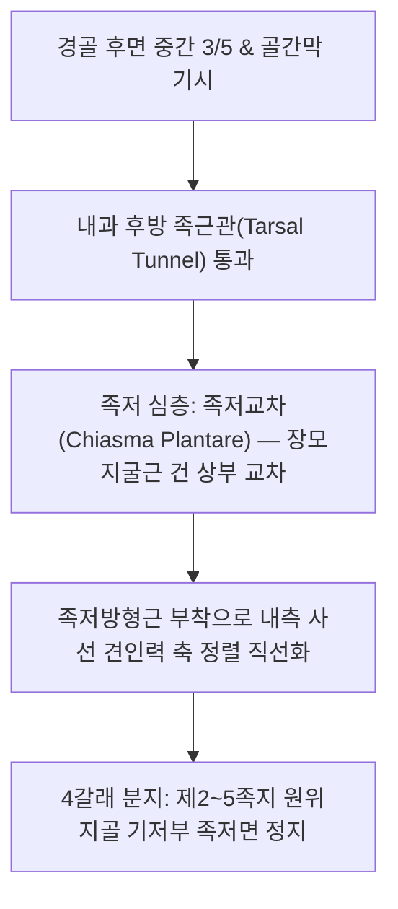

# [[장지굴근]](Flexor Digitorum Longus / 긴발가락굽힘근 / FDL)

> **핵심 요약 (Key Summary)**:
> [[경골]] 체부 후면 중간부에서 기시하여 내과를 돌아 발바닥에서 4갈래로 나뉘어 제2~5족지 원위지골에 정지하는 발가락 굴곡근.
> [[경골신경]](L5-S2)의 지배를 받으며, 2~5번째 발가락 굴곡 및 지면 파지력(Toe Grip)을 제공하여 보행 안정성을 지지.
> 주치 병증은 발가락 굴곡 건초염, 발바닥 심부 통증, 지면 파지력 약화로 인한 발 끌림 보행, [[족근관 증후군]].

---

## 📌 목차
1. [해부학적 정밀 구조 및 지배 신경/혈관](#1-해부학적-정밀-구조-및-지배-신경혈관)
2. [생체역학·토크 분석 & 근막 사슬 (Biomechanical Synergy)](#2-생체역학토크-분석--근막-사슬-biomechanical-synergy)
3. [근막통증증후군(TP) & 연관통 패턴 (Travell & Simons)](#3-근막통증증후군tp--연관통-패턴-travell--simons)
4. [초음파 해부학(Sonoanatomy) 및 중재 시술 랜드마크](#4-초음파-해부학sonoanatomy-및-중재-시술-랜드마크)
5. [⭐ 원장님 심층 임상 고찰 및 원본 필기 (Clinical Pearls)](#5--원장님-심층-임상-고찰-및-원본-필기-clinical-pearls)
6. [관련 임상 질환 및 운동손상 증후군 총괄](#6-관련-임상-질환-및-운동손상-증후군-총괄)
7. [추나·도수치료(MET/PIR) & 침구·약침·재활 프로토콜](#7-추나도수치료metpir--침구약침재활-프로토콜)
8. [출처 및 학술 참고 문헌 (References)](#8-출처-및-학술-참고-문헌-references)

---

## 1. 해부학적 정밀 구조 및 지배 신경/혈관

### 1) 해부학 구조 상세

| 항목 | 상세 내용 |
| :--- | :--- |
| **기시 (Origin)** | [[경골]](Tibia) 체부 후면의 중간 3/5 (가자미근선 하방) 및 골간막 |
| **정지 (Insertion)** | 내과 후방 통과(족근관) → 발바닥 심층에서 [[장모지굴근]] 건과 교차(Chiasma plantare) → 4갈래로 갈라져 **제2~5번째 발가락 원위지골 기저부** 족저면 |
| **신경 지배** | [[경골신경]](Tibial nerve, L5-S2) |
| **혈관 공급** | 후경골동맥(Posterior tibial artery) |
| **해부학적 연계** | 건의 분지부에 [[족저방형근]](Quadratus plantae)이 부착하여 사선 견인력을 직선화하고, 4개의 발 충양근이 기시 |

---

## 2. 생체역학·토크 분석 & 근막 사슬 (Biomechanical Synergy)

### 1) 기능 및 생체역학
* **제2~5족지 DIP, PIP, MTP 관절 굴곡**:
  * 발가락으로 지면을 단단히 움켜쥐는 파지력(Toe Grip Pressure)을 제공하여 보행 및 주행 시 발의 미끄러짐 방지.
* **보행 추진기 지면 압박 (Push-off Propulsion)**:
  * 입각기 말기 발끝 밀기(Toe-off) 시 발가락으로 지면을 강하게 눌러 추진력을 극대화하고 전족부 하중을 분산.
* **내측 종아치 동적 보조**:
  * [[장모지굴근]], [[후경골근]]과 함께 발바닥 내측 세로 아치가 체중 부하 시 바닥으로 주저앉지 않도록 능동적으로 거상 지지.

### 2) 근막 사슬 (Anatomy Trains)
* **심층후방선(Deep Back Line)**: 발가락 원위지골 끝에서 족저 심층, 내과 후방 굴근건초를 거쳐 경골 후면 심부 구획 및 슬와근-대퇴골 내과로 연결.

---

## 3. 근막통증증후군(TP) & 연관통 패턴 (Travell & Simons)

### 1) 발통점(Trigger Point) 위치 및 연관통
* **발통점 위치**: 종아리 후내측 중간 1/3(경골 내측연 바로 뒤쪽 심층, [[가자미근]] 전방 심부 구획) 근복에 호발.
* **연관통 양상**:
  * 발바닥 중앙(**용천(KI1)** 혈 부근)에서 시작하여 **제2, 3, 4, 5번째 발가락 바닥면**으로 뻐근하고 타는 듯한 통증 방사.
  * 종아리 안쪽 하부에서 발목 내과 뒤쪽 족근관 주위로 이어지는 둔통 동반.
* **보행 피로**: 오래 걷거나 서 있을 때 발바닥 한가운데가 뭉치고 쥐가 날 것 같은 경련성 통증 호발.

---

## 4. 초음파 해부학(Sonoanatomy) 및 중재 시술 랜드마크

### 1) 초음파 스캔 뷰
* **내과 후방 단축 스캔**:
  * 내과 후방 고랑에서 전방의 [[후경골근]] 건 바로 뒤쪽에 위치하는 타원형의 장지굴근 건 확인 (Tom, Dick, And Nervous Harry 배열: TP - FDL - PTA - TN - FHL).
* **발바닥 중앙 스캔**:
  * 족저근막 및 단지굴근 심층에서 [[족저방형근]]과 접합하는 장지굴근 건의 4갈래 분지부 관찰.

### 2) 침도 및 안전 자침 마진
* **[[삼음교(SP6)]] 후방 / **누곡(SP7)****: 경골 후연 바로 뒤에서 골간막 방향으로 30~45mm 심부 직자 (후경골동맥 및 경골신경 박동 외측 안전 마진 확보).
* ****용천(KI1)****: 발바닥 족저근막을 수직 관통하여 심층 장지굴근-족저방형근 교차부에 15~20mm 침술.

---

## 5. ⭐ 원장님 심층 임상 고찰 및 원본 필기 (Clinical Pearls)

### 1) 발가락 추진력 저하와 발 끌림 보행 (원장님 핵심 팁 100% 보존)
* **보행 파워 소실과 뒤뚱거림**:
  * 장지굴근이 약화되면 걸을 때 발가락 끝으로 바닥을 밀어내는 힘(Toe-off thrust)이 빠져 보행 속도가 느려지고 전족부 제어가 불안정해져 뒤뚱거림.
  * 특히 노인 환자에서 발가락 굴곡 파지력이 저하되면 미세한 지면 요철에도 균형을 잃고 앞으로 고꾸라지는 낙상 위험이 급증함.
* **점프·런지 후 만성 발바닥 피로 및 감별 진단**:
  * 운동 후 발바닥 한가운데가 묵직하게 아플 때 단순 족저근막염뿐만 아니라 **장지굴근과 족저방형근 접합부의 과긴장 및 미세 손상**을 반드시 감별해야 함.
  * 족저근막 부착부(종골 결절)에 뚜렷한 압통이 없고 발바닥 중앙 오목한 부위에 깊은 압통이 있다면 **용천(KI1)** 부근 장지굴근 심부 자침이 극적인 호전을 이끌어냄.

---

## 6. 관련 임상 질환 및 운동손상 증후군 총괄

| 임상 질환 / 증후군 | 병리적 연관 기전 | 주요 증상 및 이학적 검사 | 핵심 교정 타깃 |
| :--- | :--- | :--- | :--- |
| **발가락 굴곡 건초염** | 족신근과의 불균형으로 족근관 통과 부위 마찰 염증 | 내과 후하방 통증, 발가락 구부릴 때 족저 당김 | 내과 후방 건초 도침, 소염 약침 |
| **발바닥 심부 근막통** | 장지굴근 TrP 활성화로 발바닥 중앙 둔통 방사 | 오래 서 있을 때 발바닥 통증, 종골 압통 불명확 | 장지굴근 심부 TrP 침술, **용천(KI1)** 자침 |
| **[[족근관 증후군]] 연계** | 장지굴근 건초 부종으로 인접 경골신경 압박 | 발바닥 저림, 화끈거림, 족근관 **티넬 징후(Tinel's sign)** 양성 | 굴근지대 도침 감압술, [[삼음교(SP6)]] 침 |
| **발가락 파지력 약화** | 장지굴근 위축으로 보행 시 지면 그립력 상실 | 균형 감각 저하, 발 끌림, 슬리퍼 벗겨짐 | 발가락 수건 쥐기 재활, 전침 자극 |

* **발가락 굴곡 저항 검사**: 환자의 2~5지 발가락을 구부리게 하고 검사자가 펴는 방향으로 도수 저항을 가할 때, 발바닥 중앙 및 내과 뒤쪽에 통증이나 위약감이 발현되면 장지굴근 병증 확진.

---

## 7. 추나·도수치료(MET/PIR) & 침구·약침·재활 프로토콜

### 1) 한의 침구 및 약침 요법
* **침구 치료**: [[삼음교(SP6)]], **누곡(SP7)**, [[태계(KI3)]], **연곡(KI2)**, **용천(KI1)** 심부 자침 및 저주파 전침 요법(2Hz, 20분).
* **도침 요법**: 발바닥 중앙 장지굴근-족저방형근 교차부 유착 및 내과 후방 굴근지대 협착 부위 소침도 절개 박리.

### 2) 재활 운동 & 스트레칭
* **수건 끌어당기기(Towel Scrunches)**: 의자에 앉아 맨발로 바닥에 펼친 수건을 발가락 2~5지로 움켜쥐며 몸 쪽으로 끌어당기는 고립 강화 운동 (15회 x 3세트).
* **장지굴근 수동 신장**: 무릎을 펴고 발목을 배굴시킨 상태에서 발가락 2~5지를 손으로 잡고 배측으로 젖혀 20초간 유지.

---

## 8. 출처 및 학술 참고 문헌 (References)

* Standring S. *Gray's Anatomy: The Anatomical Basis of Clinical Practice*. 42nd ed. Elsevier, 2020: 1365-1366.
  * `[연구 요약]`: 장지굴근의 경골 후면 기시, 발바닥 건 교차 및 2~5지 원위지골 정지 해부학 분석.
* Ferris L, Sharkey NA, Smith TS, Matthews DK. *Influence of extrinsic plantar flexors on forefoot loading during heel rise*. Foot Ankle Int, 1995; 16(8): 464-473. [PMID: 8520658](https://pubmed.ncbi.nlm.nih.gov/8520658/)
  * `[연구 요약]`: 후경골근 기능부전 및 족저 굴곡근 생체역학 연구 — 장지굴근(FDL)이 힐 라이즈(Heel rise) 시 전족부 하중 분산 및 추진력 유지에 미치는 영향 규명.
* Travell, J. G., & Simons, D. G. *Myofascial Pain and Dysfunction*. Williams & Wilkins, 1999.
  * `[연구 요약]`: 장지굴근 발통점과 발바닥 중앙 및 2~5족지 방사통 패턴.
