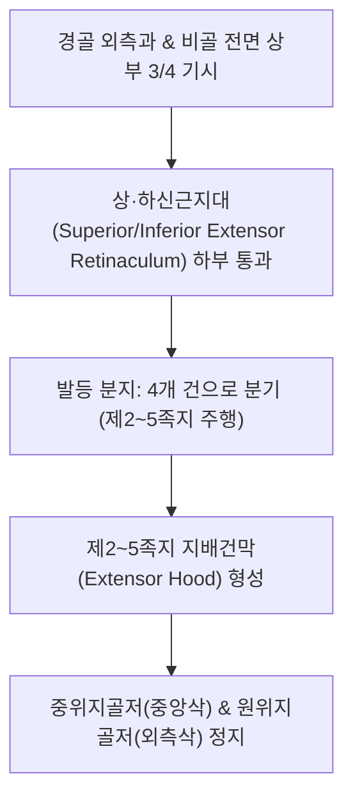

# [[장지신근]](Extensor Digitorum Longus / 긴발가락폄근 / EDL)

> **핵심 요약 (Key Summary)**:
> [[경골]] 외측과 및 [[비골]] 전면 상부 3/4에서 기시하여 4갈래로 나뉘어 제2~5족지 배측건막에 정지하는 발가락 신전근.
> [[심비골신경]](L4-S1)의 지배를 받으며, 2~5번째 발가락 신전 및 발목 족배굴곡·외번을 보조.
> 주치 병증은 [[망치족]](Hammer toe), [[족저근막염]], 중족골통(Metatarsalgia), 발등 통증 및 [[전경골근]] 약화의 보상성 과긴장.

---

## 📌 목차
1. [해부학적 정밀 구조 및 지배 신경/혈관](#1-해부학적-정밀-구조-및-지배-신경혈관)
2. [생체역학·토크 분석 & 근막 사슬 (Biomechanical Synergy)](#2-생체역학토크-분석--근막-사슬-biomechanical-synergy)
3. [근막통증증후군(TP) & 연관통 패턴 (Travell & Simons)](#3-근막통증증후군tp--연관통-패턴-travell--simons)
4. [초음파 해부학(Sonoanatomy) 및 중재 시술 랜드마크](#4-초음파-해부학sonoanatomy-및-중재-시술-랜드마크)
5. [⭐ 원장님 심층 임상 고찰 및 원본 필기 (Clinical Pearls)](#5--원장님-심층-임상-고찰-및-원본-필기-clinical-pearls)
6. [관련 임상 질환 및 운동손상 증후군 총괄](#6-관련-임상-질환-및-운동손상-증후군-총괄)
7. [추나·도수치료(MET/PIR) & 침구·약침·재활 프로토콜](#7-추나도수치료metpir--침구약침재활-프로토콜)
8. [출처 및 학술 참고 문헌 (References)](#8-출처-및-학술-참고-문헌-references)

---

## 1. 해부학적 정밀 구조 및 지배 신경/혈관

### 1) 해부학 구조 상세

| 항목 | 상세 내용 |
| :--- | :--- |
| **기시 (Origin)** | [[경골]](Tibia) 외측과, [[비골]](Fibula) 전면 상부 3/4, 골간막 및 전방 근간중격 |
| **정지 (Insertion)** | 4갈래 건으로 갈라져 상·하 신근지대 통과 → **제2~5번째 발가락의 지배건막(Extensor expansion)**, 중위지골 및 원위지골 기저부 |
| **신경 지배** | [[심비골신경]](Deep fibular nerve, L4-S1) |
| **혈관 공급** | 전경골동맥(Anterior tibial artery) |

---

## 2. 생체역학·토크 분석 & 근막 사슬 (Biomechanical Synergy)

### 1) 기능 및 생체역학
* **제2~5족지 MTP, PIP, DIP 관절 신전**:
  * 보행 유각기(Swing phase) 동안 발가락이 바닥에 걸리지 않도록 들어 올려 안전한 지면 클리어런스(Clearance) 확보.
* **발목 족배굴곡 및 외번 보조**:
  * [[전경골근]]이 피로하거나 약화되었을 때 발목을 들어 올리는 2차 보상 주동근으로 작동.
* **발가락 파워 그립 균형**:
  * [[장지굴근]](Flexor digitorum longus)의 강력한 굴곡력에 대항하여 발가락의 시상면 중립 정렬을 유지.

### 2) 근막 사슬 (Anatomy Trains)
* **표면전방선(Superficial Front Line)**: 발가락 끝 지배건막 → 발등 신근지대 → 장지신근/전경골근 → 대퇴사두근/슬개골 → AIIS → 복직근으로 연결되는 전방 신전/굴곡 조절 사슬.

---

## 3. 근막통증증후군(TP) & 연관통 패턴 (Travell & Simons)

### 1) 발통점(Trigger Point) 위치 및 연관통
* **발통점 위치**: 종아리 전외측 상부 1/3([[전경골근]] 외측, 비골두 하방 약 6~8cm, **풍륭(ST40)** 부근) 근복에 호발.
* **연관통 양상**:
  * 발목 전면 중앙에서 시작하여 **발등 전체와 제2, 3, 4번째 발가락 등쪽 끝**으로 쑤시고 조이는 통증 방사.
  * 보행 시 발가락을 들어 올릴 때 발등이 끊어질 듯이 아프고 발가락에 쥐가 나는 양상 호발.

---

## 4. 초음파 해부학(Sonoanatomy) 및 중재 시술 랜드마크

### 1) 초음파 스캔 뷰
* **종아리 전외측 횡단 스캔**:
  * 내측의 [[전경골근]]과 외측의 비골근군 사이에 위치하는 장지신근 근복 및 심비골신경 주행 경로 확인.
* **발등 횡단 스캔**:
  * 하신근지대 Y자 분지부(Frondiform ligament) 아래를 통과하는 4개의 평행한 장지신근 건 및 족배동맥(Dorsalis pedis artery) 맥동 식별.

### 2) 침도 및 안전 자침 마진
* **[[족삼리(ST36)]] 외측 / **풍륭(ST40)** 상방**: 경골 전능 외측 1~1.5촌에서 비골 방향으로 직자 25~35mm.
* ****해계(ST41)** 외측 / **함곡(ST43)****: 발등 자침 시 족배동맥 맥동을 촉지하여 내측으로 피하고 건 사이 함요처로 10~15mm 사자.

---

## 5. ⭐ 원장님 심층 임상 고찰 및 원본 필기 (Clinical Pearls)

### 1) 전경골근 약화와 망치족(Hammer Toe) 변형 사슬 (원장님 핵심 팁 100% 보존)
* **보상적 과사용과 생체역학적 파탄**:
  * 족배굴곡의 주동근인 [[전경골근]]이 약화되거나 억제되면, 보행 유각기에 발끝이 끌리지 않도록 **장지신근이 보상적으로 과도하게 수축**하여 발등을 억지로 들어 올림.
  * 장지신근의 지속적 과수축은 제2~5 MTP 관절의 과신전(Hyperextension)을 초래하고, 이에 대항하는 내재근과의 불균형으로 IP 관절 굴곡이 고착되는 **[[망치족]](Hammer toe)** 변형을 유발함.
  * **핵심 연쇄 사슬**:
    $$\text{슬괵근 단축} \longrightarrow \text{전경골근 억제/약화} \longrightarrow \text{장지신근 보상 과긴장} \longrightarrow \text{망치족 및 발등 통증}$$
  * 따라서 다리를 질질 끄는 환자는 장지신근만 풀어서는 재발하며, 반드시 **[[슬괵근]] 이완과 전경골근 활성화**를 병행해야 함.

### 2) 족저근막염 및 중족골통(Metatarsalgia) 연쇄
* 장지신근이 과사용되어 MTP 관절을 강하게 위로 젖히면, 기저부에 부착된 족저근막의 윈들러스 기전(Windlass mechanism)이 비정상적으로 항시 긴장됨.
* 결과적으로 **[[족저근막염]] 및 제2~3 중족골두의 과도한 바닥 압박(Metatarsalgia)**이 연쇄적으로 발생.

### 3) 중족골 돔 패드(Metatarsal Dome Pad) 임상 활용
* 장지신근 과긴장으로 횡아치가 붕괴되고 중족골두 통증이 심한 환자에게 **Metatarsal dome pad**를 처방하여 중족골두를 배측으로 지지하고 건 견인력을 감압.

---

## 6. 관련 임상 질환 및 운동손상 증후군 총괄

| 임상 질환 / 증후군 | 병리적 연관 기전 | 주요 증상 및 이학적 검사 | 핵심 교정 타깃 |
| :--- | :--- | :--- | :--- |
| **[[망치족]](Hammer Toe)** | 전경골근 부전 시 장지신근 과수축으로 MTP 과신전 고착 | 발가락 중간 마디 돌출 및 티눈, 신발 마찰통 | 장지신근 PIR, 내재근 강화, 신근지대 도침 |
| **중족골통(Metatarsalgia)** | 장지신근 단축으로 중족골두가 바닥을 강하게 압박 | 발바닥 앞쪽 화끈거림, 굳은살, 횡아치 붕괴 | Metatarsal pad 처방, **함곡(ST43)** 자침 |
| **발등 신근 건초염** | 꽉 조이는 신발 착용 시 신근지대 하부 건 마찰 염증 | 발등 부종 및 마찰음(Crepitus), 발가락 신전통 | 발등 신근지대 도침 박리, 소염 약침 |
| **[[족저근막염]]** | 장지신근의 MTP 과신전으로 족저건막 항시 견인 | 아침 첫 발 뒤꿈치/아치 통증, 족저건막 긴장 | [[전경골근]] 활성화, 장지신근 이완 |

* **발가락 신전 저항 검사**: 환자에게 2~5지 발가락을 위로 힘껏 젖히게 하고 검사자가 아래로 저항할 때 발등 중앙 또는 종아리 전외측에 극심한 통증이 발생하면 장지신근 건초염 및 TrP 확진.

---

## 7. 추나·도수치료(MET/PIR) & 침구·약침·재활 프로토콜

### 1) 한의 침구 및 약침 요법
* **침구 치료**: [[족삼리(ST36)]] 외측 1촌, **풍륭(ST40)**, **해계(ST41)**, **함곡(ST43)** 심부 자침 및 전침 요법.
* **도침 요법**: 하하신근지대(Frondiform ligament) 하부의 건초 비후 및 유착 부위에 종축 도침 절개 감압.

### 2) 재활 운동 & 스트레칭
* **발가락 수건 쥐기(Towel Curls)**: 발가락 내재근(충양근)을 활성화하여 보상적 장지신근 과긴장을 억제.
* **장지신근 수동 스트레칭**: 발목을 완전 저측굴곡시키고 발가락 2~5지를 족저 방향으로 구부려 20초간 유지.

---

## 8. 출처 및 학술 참고 문헌 (References)

* Standring S. *Gray's Anatomy: The Anatomical Basis of Clinical Practice*. 42nd ed. Elsevier, 2020: 1363.
  * `[연구 요약]`: 장지신근의 비골/경골 기시 및 2~5지 배측건막 정지 해부학과 심비골신경 지배 분석.
* Zember J, et al. *The frondiform ligament and pseudotenosynovitis of the extensor digitorum longus tendon: MRI evaluation with cadaveric correlation*. Skeletal Radiol, 2016; 45(8): 1121-1127. [PMID: 27107999](https://pubmed.ncbi.nlm.nih.gov/27107999/)
  * `[연구 요약]`: 하하신근지대(Frondiform ligament)와 장지신근(EDL) 건의 해부학적 마찰 및 가성 건초염(Pseudotenosynovitis) 병태생리를 MRI와 사체 해부로 규명.
* Travell, J. G., & Simons, D. G. *Myofascial Pain and Dysfunction*. Williams & Wilkins, 1999.
  * `[연구 요약]`: 장지신근 발통점과 발등 및 발가락 방사통 패턴.
