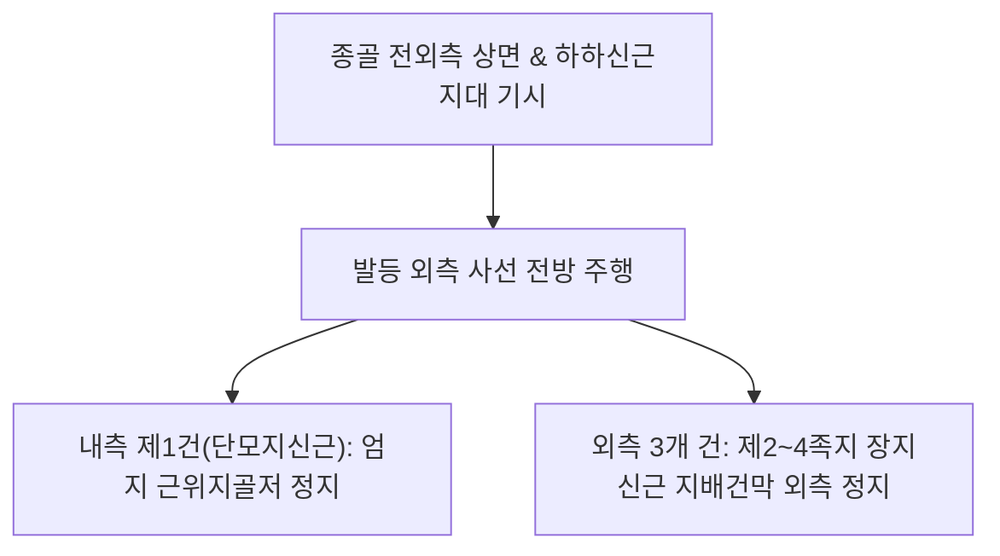

# [[족지신근]](Extensor Digitorum Brevis / 단지신근 / 짧은발가락폄근 / EDB)

> **핵심 요약 (Key Summary)**:
> [[종골]] 전외측 상면에서 기시하여 4갈래로 나뉘어 제1족지(단모지신근) 및 제2~4족지 지배건막에 정지하는 발등의 고유 내재 신전근으로 [[장지신근]], [[장모지신근]]과 협응.
> [[심비골신경]](L5-S1)의 외측 말초 분지 지배를 받으며, 발가락 MTP 및 IP 관절의 신전을 미세 조정.
> 주치 병증은 발등 외측 통증, 발가락 신전 장애, L5/S1 신경근병증 마비성 위축, 신발 마찰성 건막염.

---

## 📌 목차
1. [해부학적 정밀 구조 및 지배 신경/혈관](#1-해부학적-정밀-구조-및-지배-신경혈관)
2. [생체역학·토크 분석 & 근막 사슬 (Biomechanical Synergy)](#2-생체역학토크-분석--근막-사슬-biomechanical-synergy)
3. [근막통증증후군(TP) & 연관통 패턴 (Travell & Simons)](#3-근막통증증후군tp--연관통-패턴-travell--simons)
4. [초음파 해부학(Sonoanatomy) 및 중재 시술 랜드마크](#4-초음파-해부학sonoanatomy-및-중재-시술-랜드마크)
5. [⭐ 원장님 심층 임상 고찰 및 원본 필기 (Clinical Pearls)](#5--원장님-심층-임상-고찰-및-원본-필기-clinical-pearls)
6. [관련 임상 질환 및 운동손상 증후군 총괄](#6-관련-임상-질환-및-운동손상-증후군-총괄)
7. [추나·도수치료(MET/PIR) & 침구·약침·재활 프로토콜](#7-추나도수치료metpir--침구약침재활-프로토콜)
8. [출처 및 학술 참고 문헌 (References)](#8-출처-및-학술-참고-문헌-references)

---

## 1. 해부학적 정밀 구조 및 지배 신경/혈관

### 1) 해부학 구조 상세

| 항목 | 상세 내용 |
| :--- | :--- |
| **기시 (Origin)** | [[종골]](Calcaneus) 전외측 상면, 골간거종인대(Interosseous talocalcaneal ligament), 하하신근지대 줄기 |
| **정지 (Insertion)** | 4개의 건 분지: • 가장 내측 건(단모지신근): 엄지 근위지골저 배측면 • 외측 3개 건: **제2, 3, 4번째 발가락의 [[장지신근]] 건 외측면(지배건막)** |
| **신경 지배** | [[심비골신경]](Deep fibular nerve, L5-S1) 외측 말초 분지 |
| **혈관 공급** | 외측족근동맥(Lateral tarsal artery) 및 궁상동맥(Arcuate artery) |

---

## 2. 생체역학·토크 분석 & 근막 사슬 (Biomechanical Synergy)

### 1) 기능 및 생체역학
* **제1~4족지 관절 신전 보조**:
  * [[장지신근]]이 발목 족배굴곡과 함께 발가락을 들어 올릴 때, 족지신근은 발등에서 직접 사선 견인력을 발휘하여 발가락의 외측 편향을 조율.
* **불균형 지면 적응**:
  * 울퉁불퉁한 자갈길이나 경사지를 보행할 때 발가락을 미세하게 개별 신전시켜 지면 접촉 면적과 안정성을 극대화.

### 2) 근막 사슬 (Anatomy Trains)
* **표면전방선(Superficial Front Line)**: 발가락 배측건막에서 발등 표층을 거쳐 전방 신근지대를 거쳐 [[대퇴사두근]]과 [[슬개골]]로 연결.

---

## 3. 근막통증증후군(TP) & 연관통 패턴 (Travell & Simons)

### 1) 발통점(Trigger Point) 위치 및 연관통
* **발통점 위치**: 외과 앞쪽 함요처 바로 앞, 종골 전외측 상면의 도톰한 근복에 호발.
* **연관통 양상**:
  * 발등 외측(제3~5 중족골 사이)과 복사뼈 앞쪽으로 뻐근한 통증 집중.
  * 제2~4 발가락 등쪽으로 쑤시는 방사통 발현.
* **보행 시 통증**: 꽉 조이는 신발이나 구두를 신고 걸을 때 발등 외측이 짓눌리듯이 아픔.

---

## 4. 초음파 해부학(Sonoanatomy) 및 중재 시술 랜드마크

### 1) 초음파 스캔 뷰
* **발등 외측 사선 스캔**:
  * [[종골]] 및 [[거골]] 전외측 피질골 바로 위에서 관찰되는 저에코성 족지신근 근복 식별.
  * [[심비골신경]](L5-S1, 상위의 [[비골신경]] 및 [[좌골신경]] 분지) 외측 분지 및 외측족근동맥과의 해부학적 인접 관계 확인.

### 2) 침도 및 안전 자침 마진
* ****구허(GB40)** 전하방 / **임읍(GB41)** 외측**: 종골 전외측 융기부에서 골면을 향해 10~15mm 직자.

---

## 5. ⭐ 원장님 심층 임상 고찰 및 원본 필기 (Clinical Pearls)

### 1) 장지신근 vs 단지신근(족지신근) 연계 및 발등 통증 감별 (원장님 핵심 팁 100% 보존)
* **근복 위치의 감별**:
  * 장지신근은 종아리에 근복이 있고 발등에는 건만 지나가지만, **족지신근은 발등 자체에 도톰한 근복이 존재**함.
  * 따라서 발등 외과 앞쪽 몽우리가 부어오르거나 뻐근하다면 장지신근 건초염보다 **족지신근 근복 자체의 TrP 및 긴장**일 가능성이 대단히 높음.
* **신발 끈 압박과 심비골신경 포착**:
  * 등산화나 조이는 운동화 끈을 꽉 묶었을 때 발등을 지나가는 심비골신경 말초지가 족지신근 근막에 압박되어 발가락 저림과 감각 이상 유발.

### 2) L5/S1 신경근병증의 결정적 전기생리학적 지표근
* 족지신근(EDB)은 심비골신경의 최원위 종말 분지가 지배하므로, **L5 신경근병증 또는 비골신경 마비 시 가장 먼저 탈신경 전위(Denervation potential)와 근위축이 관찰되는 핵심 표적근**임.
* 환자의 발등 외측 근육 볼륨이 반대측에 비해 푹 꺼져 있다면 척추성 신경병증의 만성화를 즉각 의심해야 함.

---

## 6. 관련 임상 질환 및 운동손상 증후군 총괄

| 임상 질환 / 증후군 | 병리적 연관 기전 | 주요 증상 및 이학적 검사 | 핵심 교정 타깃 |
| :--- | :--- | :--- | :--- |
| **발등 외측 건근막염** | 신발 마찰 및 족지 과신전 스트레스로 인한 근막염 | 외과 전방 압통, 신발 착용 시 통증 악화 | 족지신근 TrP 침술, 헐렁한 신발 |
| **L5 신경근병증 위축** | L5 디스크 탈출증으로 인한 EDB 탈신경성 위축 | 발등 외측 함몰, 발가락 신전력 약화 | 요추 추나·약침, [[가자미근]] 및 [[비복근]] 긴장 완화, EDB 전침 자극 |
| **전족근관 증후군** | 하하신근지대 아래 심비골신경 포착 | 제1~2 발가락 사이 감각 저하, 발등 작열통 | 신근지대 도침 박리, **함곡(ST43)** 침 |

* **발가락 개별 신전 검사**: 발목을 중립으로 고정한 상태에서 2~4지 발가락만 능동 신전시킬 때 발등 외측에 통증이나 위약감이 있는지 확인.

---

## 7. 추나·도수치료(MET/PIR) & 침구·약침·재활 프로토콜

### 1) 한의 침구 및 약침 요법
* **침구 치료**: **구허(GB40)** 전하방, **임읍(GB41)**, **함곡(ST43)**, **내정(ST44)** 자침.
* **도침 요법**: 족지신근 기시부 종골 전외측 골막 유착 부위 소침도 감압술.

### 2) 도수 치료 및 재활
* **발등 근막 롤링**: 골프공을 발등 외측에 대고 부드럽게 굴려 근막 이완.
* **발가락 능동 신전-벌리기 운동(Toe Spreading)**: 발가락을 부채꼴로 쫙 펴는 훈련으로 족지신근 협응력 강화.

---

## 8. 출처 및 학술 참고 문헌 (References)

* Standring S. *Gray's Anatomy: The Anatomical Basis of Clinical Practice*. 42nd ed. Elsevier, 2020: 1367.
  * `[연구 요약]`: 족지신근(EDB)의 종골 기시, 발등 건 분지 및 [[심비골신경]](L5-S1, 상위의 [[비골신경]] 및 [[좌골신경]] 분지) 외측 분지 해부학 분석.
* Sinanovic O, Zukic S, Vidovic M, Imamovic K. *Musculus extensor digitorum brevis is clinical and electrophysiological marker for L5/S1 radicular lesions*. Med Arh, 2010; 64(5): 271-273. [PMID: 21246920](https://pubmed.ncbi.nlm.nih.gov/21246920/)
  * `[연구 요약]`: 단지신근(EDB)의 임상적 위축 및 근전도 검사가 L5/S1 신경근 병변을 조기 진단하는 결정적 전기생리학적 표지자임을 입증.
* Travell, J. G., & Simons, D. G. *Myofascial Pain and Dysfunction*. Williams & Wilkins, 1999.
  * `[연구 요약]`: 족지신근 발통점과 발등 외측 및 발가락 방사통 패턴.
