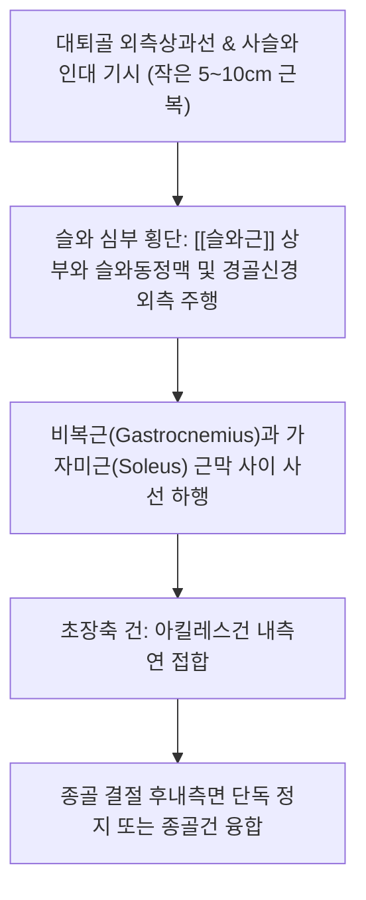

# [[족척근]](Plantaris / 발바닥근)

> **핵심 요약 (Key Summary)**:
> [[대퇴골]] 외측상과 하부 외측상과선에서 기시하여 매우 짧은 근복을 형성한 후 가느다란 장건이 비복근과 가자미근 사이를 주행하여 종골 후내측에 정지하는 인체의 대표적 퇴화 근육.
> [[경골신경]](S1-S2)의 지배를 받으며, 미약한 슬관절 굴곡 및 족관절 저측굴곡 보조 외에 무릎-발목 고유수용성 감각 수용체(Proprioceptor)로 기능.
> 주치 병증은 **테니스 레그(Tennis leg)** 감별 진단, 슬와부 심부 통증, 아킬레스건 내측 견인성 건병증.

---

## 📌 목차
1. [해부학적 정밀 구조 및 지배 신경/혈관](#1-해부학적-정밀-구조-및-지배-신경혈관)
2. [생체역학·토크 분석 & 근막 사슬 (Biomechanical Synergy)](#2-생체역학토크-분석--근막-사슬-biomechanical-synergy)
3. [근막통증증후군(TP) & 연관통 패턴 (Travell & Simons)](#3-근막통증증후군tp--연관통-패턴-travell--simons)
4. [초음파 해부학(Sonoanatomy) 및 중재 시술 랜드마크](#4-초음파-해부학sonoanatomy-및-중재-시술-랜드마크)
5. [⭐ 원장님 심층 임상 고찰 및 원본 필기 (Clinical Pearls)](#5--원장님-심층-임상-고찰-및-원본-필기-clinical-pearls)
6. [관련 임상 질환 및 운동손상 증후군 총괄](#6-관련-임상-질환-및-운동손상-증후군-총괄)
7. [추나·도수치료(MET/PIR) & 침구·약침·재활 프로토콜](#7-추나도수치료metpir--침구약침재활-프로토콜)
8. [출처 및 학술 참고 문헌 (References)](#8-출처-및-학술-참고-문헌-references)

---

## 1. 해부학적 정밀 구조 및 지배 신경/혈관

### 1) 해부학 구조 상세

| 항목 | 상세 내용 |
| :--- | :--- |
| **기시 (Origin)** | [[대퇴골]](Femur) 외측상과 상부의 외측상과선(Lateral supracondylar line) 및 사슬와인대(Oblique popliteal ligament) |
| **정지 (Insertion)** | 비복근과 가자미근 사이를 비스듬히 하행 → 아킬레스건 내측연을 따라 **종골 결절 후내측면**에 정지 |
| **신경 지배** | [[경골신경]](Tibial nerve, S1-S2) |
| **혈관 공급** | 슬와동맥(Popliteal artery)의 외측 상슬동맥 및 비복동맥 가지 |
| **해부학적 특징** | 인체에서 가장 긴 건(Tendon)을 가진 근육 중 하나이며, 인구의 약 7~10%에서 선천적으로 결손 |

---

## 2. 생체역학·토크 분석 & 근막 사슬 (Biomechanical Synergy)

### 1) 기능 및 생체역학
* **미약한 운동 주동력**:
  * 단면적이 극히 작아 슬관절 굴곡 및 발목 저측굴곡 토크에 기여하는 역학적 힘은 1~2% 미만.
* **고유수용성 감각 수용체 (Kinesthetic Sensor)**:
  * 근방추(Muscle spindle) 밀도가 인체 근육 중 가장 높아, [[대퇴골]]-무릎 관절과 발목 관절([[경골]], [[거골]]) 간의 위치 변화 및 아킬레스건의 장력 상태를 중추신경계로 실시간 피드백하는 정밀 센서로 기능.

### 2) 근막 사슬 (Anatomy Trains)
* **표면후방선(Superficial Back Line)**: 대퇴골 후면에서 종아리 심층을 관통하여 [[종골]]로 연결되며 상부로는 [[대퇴이두근]] 및 [[슬괵근]]으로 이어지는 수직 장력 감지 사슬.

---

## 3. 근막통증증후군(TP) & 연관통 패턴 (Travell & Simons)

### 1) 발통점(Trigger Point) 위치 및 연관통
* **발통점 위치**: 오금(슬와부) 약간 외측 상방, [[비복근]] 외측두 심층의 작은 근복에 호발.
* **연관통 양상**:
  * 오금 주름 바로 뒤쪽에서 종아리 한가운데를 거쳐 **아킬레스건 심부([[비복근]], [[가자미근]] 건 복합체) 및 발뒤꿈치 후면**으로 찌르는 듯한 날카로운 통증 방사.
* **증상 특징**: 무릎을 완전히 펴면서 발목을 위로 젖힐 때(배굴) 오금 뒤쪽이 당기며 통증 악화.

---

## 4. 초음파 해부학(Sonoanatomy) 및 중재 시술 랜드마크

### 1) 초음파 스캔 뷰
* **종아리 근위 후방 횡단 스캔**:
  * 표층의 비복근 내측두와 심층의 [[가자미근]] 사이에 위치하는 작은 타원형 족척근 건(저에코/등에코) 확인.
  * 건 파열 시 근간막 사이에 고인 혈종(Hematoma) 및 액체 저류 감별.

### 2) 침도 및 안전 자침 마진
* **[[위중(BL40)]] 외상방 / **합양(BL55)****: 슬와 횡문선 외측 1촌에서 대퇴골 외측상과 방향으로 20~30mm 사자 (경골신경 및 슬와혈관 주행로 내측 안전 확인).

---

## 5. ⭐ 원장님 심층 임상 고찰 및 원본 필기 (Clinical Pearls)

### 1) 테니스 레그(Tennis Leg) 감별 진단의 핵심 (원장님 팁 100% 보존)
* **비복근 파열 vs 족척근 건 파열**:
  * 배드민턴, 테니스, 축구 등 순간적인 전방 대쉬 중 "뒤에서 누가 종아리를 돌로 때린 것 같다"며 쓰러지는 급성 **테니스 레그(Tennis leg)** 발생 시, 비복근 내측두 파열과 족척근 단독 파열을 반드시 초음파로 감별해야 함.
  * 족척근 단독 파열은 비복근 근복 파열에 비해 예후가 훨씬 양호하여 조기 체중 부하 및 스트레칭이 가능함.
* **"신입생의 신경(Freshman's Nerve)" 오인 주의**:
  * 해부학 실습 시 족척근의 길고 가느다란 건을 초보자가 경골신경 가지로 오인하여 "신입생의 신경"이라는 별칭이 붙었을 정도로 신경과 외형이 유사함.
  * 침도 시술 시 신경과 족척근 건을 초음파 횡단면에서 동적 활주로 정확히 구별해야 함.

---

## 6. 관련 임상 질환 및 운동손상 증후군 총괄

| 임상 질환 / 증후군 | 병리적 연관 기전 | 주요 증상 및 이학적 검사 | 핵심 교정 타깃 |
| :--- | :--- | :--- | :--- |
| **테니스 레그(Tennis Leg)** | 순간적 발목 배굴-무릎 신전 시 족척근 건 급격 파열 | 종아리 상중부 뚝 소리, 보행 곤란, 근간 혈종 | 급성기 PRICE, 혈종 흡인, 소염 약침 |
| **슬와부 심부 건염** | 반복된 달리기 시 비복-가자미근 사이 마찰 염증 | 오금 뒤쪽 쑤심, 완전 신전 시 뻣뻣함 | 슬와부 근간막 도침 박리, **합양(BL55)** 침 |
| **비전형적 아킬레스건통** | 족척근 건 부착부의 종골 내측 만성 견인 건병증 | 종골 내측 후방 국소 압통, 뒤꿈치 착지통 | 종골 후내측 도침, 힐패드 처방 |

* **Thompson 검사와의 감별**: 족척근이 파열되어도 아킬레스건이 온전하면 종아리를 쥐어짤 때 발목이 정상적으로 저측굴곡되므로, 완전 파열인 아킬레스건 손상과 감별 가능.

---

## 7. 추나·도수치료(MET/PIR) & 침구·약침·재활 프로토콜

### 1) 한의 침구 및 약침 요법
* **침구 치료**: [[위중(BL40)]] 외상방, **합양(BL55)**, [[승산(BL57)]], [[곤륜(BL60)]] 심부 자침.
* **도침 요법**: 비복근과 가자미근 사이 근간막 유착 및 종골 결절 후내측 부착부 소침도 박리.
* **약침 치료**: 급성 건 파열 및 혈종 흡수 후 신바로약침 또는 중성어혈약침 주입.

### 2) 재활 운동 & 스트레칭
* **종아리 편심성 신장**: 계단 끝에 발 앞꿈치를 대고 뒤꿈치를 아래로 천천히 내리는 원심성 운동.
* **힐 패드(Heel Lift) 적용**: 급성기 족척근 건에 가해지는 장력을 줄이기 위해 신발 뒤꿈치에 1~1.5cm 힐패드 2주간 착용.

---

## 8. 출처 및 학술 참고 문헌 (References)

* Standring S. *Gray's Anatomy: The Anatomical Basis of Clinical Practice*. 42nd ed. Elsevier, 2020: 1364.
  * `[연구 요약]`: 족척근의 대퇴골 외측상과 기시, 종아리 주행 및 종골 정지 해부학과 경골신경 지배 분석.
* Delgado GJ, et al. *Tennis leg: clinical US study of 141 patients and anatomic investigation of four cadavers with MR imaging and US*. Radiology, 2002; 224(1): 112-119. [PMID: 12091669](https://pubmed.ncbi.nlm.nih.gov/12091669/)
  * `[연구 요약]`: 테니스 레그(Tennis leg) 환자 141례의 초음파 임상 연구 — 족척근 파열과 비복근 내측두 파열의 감별 진단 및 영상의학적 기준 확립.
* Travell, J. G., & Simons, D. G. *Myofascial Pain and Dysfunction*. Williams & Wilkins, 1999.
  * `[연구 요약]`: 족척근 발통점과 슬와부 및 아킬레스건 방사통 패턴.
