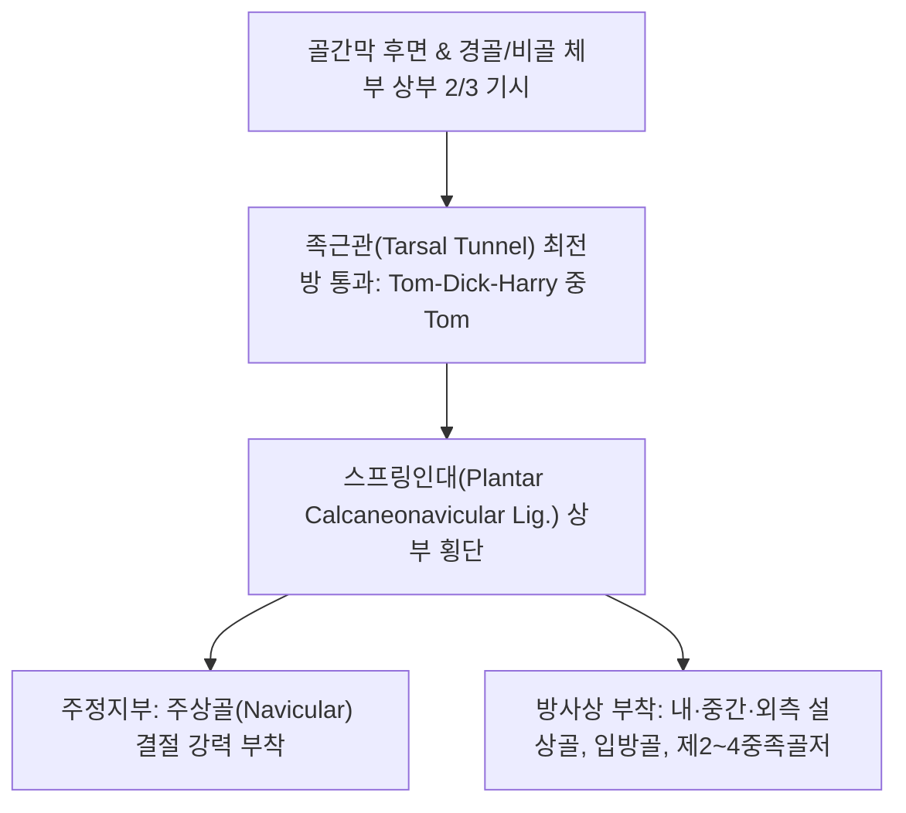

# [[후경골근]](Tibialis Posterior / 뒤정강근 / TP)

> **핵심 요약 (Key Summary)**:
> [[경골]]·[[비골]] 체부 후면 및 골간막 후면 전체에서 기시하여 내과 후방 족근관을 지나 **주상골(Navicular)** 결절을 주축으로 족근골과 중족골 전반에 정지하는 종아리 심층 최강의 근육.
> [[경골신경]](L4-L5)의 지배를 받으며, 발목 저측굴곡 및 내번을 수행하고 인체 발의 내측 종아치(Medial Longitudinal Arch)를 지지하는 절대적 핵심 기둥.
> 주치 병증은 [[후경골근건 기능부전증]](PTTD), 성인 획득성 [[평발]], [[족근관 증후군]], 신스프린트(MTSS).

---

## 📌 목차
1. [해부학적 정밀 구조 및 지배 신경/혈관](#1-해부학적-정밀-구조-및-지배-신경혈관)
2. [생체역학·토크 분석 & 근막 사슬 (Biomechanical Synergy)](#2-생체역학토크-분석--근막-사슬-biomechanical-synergy)
3. [근막통증증후군(TP) & 연관통 패턴 (Travell & Simons)](#3-근막통증증후군tp--연관통-패턴-travell--simons)
4. [초음파 해부학(Sonoanatomy) 및 중재 시술 랜드마크](#4-초음파-해부학sonoanatomy-및-중재-시술-랜드마크)
5. [⭐ 원장님 심층 임상 고찰 및 원본 필기 (Clinical Pearls)](#5--원장님-심층-임상-고찰-및-원본-필기-clinical-pearls)
6. [관련 임상 질환 및 운동손상 증후군 총괄](#6-관련-임상-질환-및-운동손상-증후군-총괄)
7. [추나·도수치료(MET/PIR) & 침구·약침·재활 프로토콜](#7-추나도수치료metpir--침구약침재활-프로토콜)
8. [출처 및 학술 참고 문헌 (References)](#8-출처-및-학술-참고-문헌-references)

---

## 1. 해부학적 정밀 구조 및 지배 신경/혈관

### 1) 해부학 구조 상세

| 항목 | 상세 내용 |
| :--- | :--- |
| **기시 (Origin)** | [[경골]](Tibia) 후면 상외측 2/3, [[비골]](Fibula) 내측면 상부 2/3, 골간막(Interosseous membrane) 후면 전체 |
| **정지 (Insertion)** | 내과 후방 고랑(족근관 최전방) 통과 → **주상골(Navicular) 결절** (주 부착부), 설상골 3개, 입방골 및 제2~4 중족골 기저부 (광범위 방사상 정지) |
| **신경 지배** | [[경골신경]](Tibial nerve, L4-L5) |
| **혈관 공급** | 후경골동맥 및 비골동맥 가지 |
| **주행 관계** | 족근관(Tarsal tunnel)에서 가장 앞쪽을 지나며, [[장지굴근]] 및 [[장모지굴근]] 건과 함께 내과를 감싸고 주행 |

---

## 2. 생체역학·토크 분석 & 근막 사슬 (Biomechanical Synergy)

### 1) 기능 및 생체역학
* **발목 관절 저측굴곡 및 내번 (Plantarflexion & Inversion)**:
  * 거골하관절(Subtalar joint)을 내번시켜 발을 견고한 지렛대(Rigid lever)로 잠그고 강력한 보행 추진력 제공.
* **내측 종아치 동적 거상의 절대적 주동근**:
  * 체중 부하 시 거골두(Talus head)가 아래로 떨어지는 것을 스프링 인대와 함께 아래에서 받쳐 올려 평발화를 방어.
* **보행 주기 회내 제동 (Pronation Control)**:
  * 입각기 초기(Heel strike ~ Foot flat)에 강력한 편심성 수축으로 발의 과도한 회내(Overpronation)를 제어하여 충격 완충.

### 2) 근막 사슬 (Anatomy Trains)
* **심층후방선(Deep Back Line)**: 발바닥 내측 족궁 건막에서 후경골근을 거쳐 오금 슬와근막 및 골반저근으로 직결되는 심부 코어 지지축.

---

## 3. 근막통증증후군(TP) & 연관통 패턴 (Travell & Simons)

### 1) 발통점(Trigger Point) 위치 및 연관통
* **발통점 위치**: 종아리 후면 상부 1/3, [[비복근]]과 [[가자미근]] 심층 경골 후면 정중선 부근 근복.
* **연관통 양상**:
  * **아킬레스건 심부 및 종골 부착부**, 그리고 **내과(복사뼈 안쪽) 바로 뒤쪽**으로 통증 집중.
  * 종아리 뒤쪽 전체와 발바닥 안쪽 족궁 전체로 쑤시는 둔통 방사.
* **보행 악화**: 보행이나 달리기 시 발바닥 안쪽 아치와 종아리 깊은 곳이 뻐근하게 조여오며 쥐가 남.

---

## 4. 초음파 해부학(Sonoanatomy) 및 중재 시술 랜드마크

### 1) 초음파 스캔 뷰
* **내과 후방 단축 스캔**:
  * 뼈 고랑 바로 위에 위치하는 둥근 후경골근 건(가장 전방)과 그 뒤의 [[장지굴근]] 건, 후경골동맥, 경골신경 확인.
  * 건초 삼출액, 건 내 섬유 파열(Split tear) 및 주상골 부착부 골극 유무 감별.

### 2) 침도 및 안전 자침 마진
* **[[삼음교(SP6)]]**: 내과 첨부 상방 3촌, 경골 후연에서 골간막을 향해 30~50mm 심부 직자.
* **[[태계(KI3)]] 전상방 / 내과 후연**: 내과 바로 뒤 굴근지대에서 후경골동맥 맥동 전방으로 사자 15~20mm.

---

## 5. ⭐ 원장님 심층 임상 고찰 및 원본 필기 (Clinical Pearls)

### 1) 과회내 증후군과 후경골근건 기능부전증(PTTD) (원장님 핵심 팁 100% 보존)
* **성인 획득성 평발(Adult Acquired Flatfoot)의 주범**:
  * 평발 및 **과회내 증후군(Overpronation)** 환자는 보행 시마다 내측 족궁이 주저앉으면서 후경골근 건에 과도한 장축 인장력이 지속적으로 가해짐.
  * 결국 건이 비후·변성되고 미세 파열로 진행하는 **[[후경골근건 기능부전증]](PTTD)** 호발.
* **싱글 힐 레이즈 검사(Single Heel Raise Test)**:
  * 환자가 한 발로 서서 까치발을 들 때, 정상이라면 종골이 안쪽으로 젖혀지며(내번) 족궁이 상승해야 함.
  * 종골이 내반되지 못하고 발꿈치를 전혀 들지 못하거나 심한 통증을 호소하면 **후경골근 건의 파열 또는 중증 기능 상실** 확진.

### 2) 족근관 증후군(Tarsal Tunnel Syndrome)과의 연계
* 후경골근 건초에 만성 염증과 삼출액이 생기면 좁은 족근관 내 압력이 급상승하여 인접한 경골신경을 압박.
* 발바닥 저림, 화끈거림, **티넬 징후(Tinel's sign)** 양성이 나타나므로 굴근지대 도침 감압술이 필수적임.

---

## 6. 관련 임상 질환 및 운동손상 증후군 총괄

| 임상 질환 / 증후군 | 병리적 연관 기전 | 주요 증상 및 이학적 검사 | 핵심 교정 타깃 |
| :--- | :--- | :--- | :--- |
| **[[후경골근건 기능부전증]](PTTD)** | 만성 인장 부하로 건 변성, 족궁 지지 상실 및 성인 평발화 | 내측 족궁 붕괴, 싱글 힐 레이즈 불능, "Too many toes" 징후 | 후경골근 도침 박리, 족궁 인솔 교정 |
| **[[족근관 증후군]]** | 후경골근 건초염 비후로 족근관 내 경골신경 압박 | 발바닥 저림, 야간 작열통, 내과 뒤 **티넬 징후** 양성 | 굴근지대 도침 감압술, [[삼음교(SP6)]] 침 |
| **내측 경골 스트레스(MTSS)** | 후경골근 기시부 경골 후내측 골막 견인 염증 | 경골 후내측 하부 1/3 골막 압통, 주행 후 쑤심 | 경골 골막 약침, 심부 근막 이완 |
| **발바닥 안쪽 아치 통증** | 주상골 결절 부착부 만성 건병증 및 족저 방사통 | 아침 기상 시 족궁 통증, 주상골 결절 국소 압통 | 주상골 부착부 소염 약침, 거골하 추나 |

* **Too-many-toes sign**: 환자를 뒤에서 보았을 때, 종골이 외번되고 전족부가 외전되어 정상(1~1.5개)보다 외측 발가락이 2~3개 이상 더 많이 보이면 PTTD로 인한 족궁 붕괴 확진.

---

## 7. 추나·도수치료(MET/PIR) & 침구·약침·재활 프로토콜

### 1) 한의 침구 및 약침 요법
* **침구 치료**: [[삼음교(SP6)]], **조해(KI6)**, **부류(KI7)**, [[태계(KI3)]] 심부 자침 및 전침 요법(2Hz, 20분).
* **도침 요법**: 내과 후방 굴근지대 협착 부위 및 주상골 결절 부착부 건초 비후 부위 소침도 절개 감압.

### 2) 재활 운동 & 스트레칭
* **단족 운동(Short Foot Exercise)**: 발가락을 구부리지 않고 중족골두를 뒤꿈치 쪽으로 끌어당겨 족궁을 높이는 후경골근 고립 강화 훈련.
* **내번 밴드 저항 운동**: 탄성 밴드를 발 안쪽에 걸고 발목을 안쪽 위로 당기는 훈련 (15회 x 3세트).

---

## 8. 출처 및 학술 참고 문헌 (References)

* Standring S. *Gray's Anatomy: The Anatomical Basis of Clinical Practice*. 42nd ed. Elsevier, 2020: 1365.
  * `[연구 요약]`: 후경골근의 골간막 기시 및 주상골/족근골 정지 해부학과 족근관 주행 구조 분석.
* Kohls-Gatzoulis J, Angel JC, Singh D, Haddad F, Livingstone J, Berry G. *Tibialis posterior dysfunction: a common and treatable cause of adult acquired flatfoot*. BMJ, 2004; 329(7478): 1328-1333. [PMID: 15576744](https://pubmed.ncbi.nlm.nih.gov/15576744/)
  * `[연구 요약]`: 성인 획득성 평발(Adult acquired flatfoot)의 주요 원인인 후경골근건 기능부전증(PTTD)의 병태생리, 진단적 징후(Single heel raise, Too-many-toes) 및 조기 보존적 치료의 임상적 중요성 규명.
* Travell, J. G., & Simons, D. G. *Myofascial Pain and Dysfunction*. Williams & Wilkins, 1999.
  * `[연구 요약]`: 후경골근 발통점과 아킬레스건 심부 및 발바닥 방사통 패턴.
