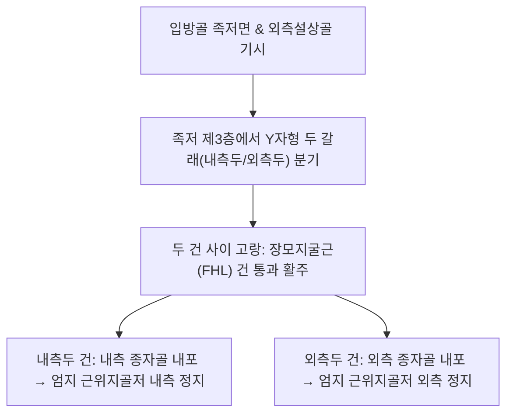

# [[단무지굴근(발)]](Flexor Hallucis Brevis / 짧은엄지굽힘근 / FHB)

> **핵심 요약 (Key Summary)**:
> **입방골(Cuboid)** 및 외측설상골 족저면과 장척인대에서 기시하여 두 갈래로 나뉘어 엄지발가락 근위지골저 내외측(내외측 종자골)에 정지하는 족저 제3층 근육.
> 내측두는 [[내측족저신경]](S1-S2), 외측두는 [[외측족저신경]](S1-S2)의 이중 신경 지배를 받으며, 엄지 MTP 관절의 강력한 굴곡을 담당.
> 주치 병증은 [[종자골염]](Sesamoiditis), 제1중족골두 족저면 통증, 가성 통풍, 보행 발끝 밀기(Push-off) 결손 및 [[무지외반증]] 악화.

---

## 📌 목차
1. [해부학적 정밀 구조 및 지배 신경/혈관](#1-해부학적-정밀-구조-및-지배-신경혈관)
2. [생체역학·토크 분석 & 근막 사슬 (Biomechanical Synergy)](#2-생체역학토크-분석--근막-사슬-biomechanical-synergy)
3. [근막통증증후군(TP) & 연관통 패턴 (Travell & Simons)](#3-근막통증증후군tp--연관통-패턴-travell--simons)
4. [초음파 해부학(Sonoanatomy) 및 중재 시술 랜드마크](#4-초음파-해부학sonoanatomy-및-중재-시술-랜드마크)
5. [⭐ 원장님 심층 임상 고찰 및 원본 필기 (Clinical Pearls)](#5--원장님-심층-임상-고찰-및-원본-필기-clinical-pearls)
6. [관련 임상 질환 및 운동손상 증후군 총괄](#6-관련-임상-질환-및-운동손상-증후군-총괄)
7. [추나·도수치료(MET/PIR) & 침구·약침·재활 프로토콜](#7-추나도수치료metpir--침구약침재활-프로토콜)
8. [출처 및 학술 참고 문헌 (References)](#8-출처-및-학술-참고-문헌-references)

---

## 1. 해부학적 정밀 구조 및 지배 신경/혈관

### 1) 해부학 구조 상세

| 항목 | 상세 내용 |
| :--- | :--- |
| **기시 (Origin)** | **입방골(Cuboid)** 족저면, 외측설상골(Lateral cuneiform), 장척인대(Long plantar ligament) |
| **정지 (Insertion)** | 2개의 건으로 나뉨: • **내측두**: 내측 종자골(Medial sesamoid)을 포함하여 엄지 근위지골저 내측 • **외측두**: 외측 종자골(Lateral sesamoid)을 포함하여 엄지 근위지골저 외측 |
| **신경 지배** | • **내측두**: [[내측족저신경]](Medial plantar nerve, S1-S2) • **외측두**: [[외측족저신경]](Lateral plantar nerve 심분지, S1-S2) |
| **혈관 공급** | 내측족저동맥의 분지 및 족저동맥궁(Plantar arch) |
| **건 통과 관계** | 두 갈래 건 사이 고랑(Groove)으로 **[[장모지굴근]](FHL) 건**이 통과하여 말절골로 주행 |

---

## 2. 생체역학·토크 분석 & 근막 사슬 (Biomechanical Synergy)

### 1) 기능 및 생체역학
* **엄지발가락 MTP 관절 굴곡 (1st MTP Flexion)**:
  * 보행 주기 말기 및 달리기, 점프 착지 시 체중의 2~3배에 달하는 하중을 지면에 전달하며 발끝 밀기(Push-off) 최종 지렛대 역할.
* **종자골 도르래 기전 (Sesamoid Pulley Mechanism)**:
  * 2개의 종자골이 건 내에 매립되어 지레팔(Moment arm)을 증가시키고 지면 충격을 완충하며, [[장모지굴근]] 및 [[장모지신근]] 건의 마찰을 방어.
* **횡중족아치(Transverse Metatarsal Arch) 안정화**:
  * 입방골에서 전방으로 주행하며 발의 가로 아치 전방부를 단단히 결속 지지.

### 2) 근막 사슬 (Anatomy Trains)
* **심층후방선(Deep Back Line)**: 엄지발가락 족저에서 종자골을 거쳐 [[종골]] 및 발바닥 심부 아치를 거쳐 [[후경골근]], [[장지굴근]], [[슬와근]]으로 연결.

---

## 3. 근막통증증후군(TP) & 연관통 패턴 (Travell & Simons)

### 1) 발통점(Trigger Point) 위치 및 연관통
* **발통점 위치**: 제1중족골 간부(Shaft) 하방의 근복 내측두 및 외측두.
* **연관통 양상**:
  * **제1중족골두 족저면(엄지 발바닥 밑 뼈 부위)**으로 극심한 통증 집중: "디딜 때마다 유리 조각을 밟는 것 같다"고 호소.
  * 엄지발가락 바닥 전체로 뻐근하고 타는 듯한 둔통 방사.
* **임상적 특징**: 하이힐 착용자, 육상 선수, 발레 무용수에서 호발하며 맨발로 딱딱한 바닥을 디딜 때 통증 극대화.

---

## 4. 초음파 해부학(Sonoanatomy) 및 중재 시술 랜드마크

### 1) 초음파 스캔 뷰
* **제1중족골두 족저면 단축 스캔**:
  * 고에코성의 내측 및 외측 종자골 음영과 그 사이에 위치하는 장모지굴근 건 관찰.
  * 종자골을 감싸고 있는 저에코성 단무지굴근 내·외측두 건막 및 종자골 주위 활액낭 삼출액 감별.

### 2) 침도 및 안전 자침 마진
* ****태백(SP3)** / **대도(SP2)** 사이 족저면**: 제1중족골두 후방 족저 함요처에서 종자골을 향해 10~15mm 사자 (족저신경혈관속 손상 방지).

---

## 5. ⭐ 원장님 심층 임상 고찰 및 원본 필기 (Clinical Pearls)

### 1) 종자골염(Sesamoiditis)과 단무지굴근의 연쇄 (원장님 핵심 팁 100% 보존)
* **종자골 골절 vs 건염 감별**:
  * 엄지 발바닥 밑 통증 환자에서 X-ray 상 이분 종자골(Bipartite sesamoid)이 흔히 관찰되나, 이는 선천적 변이인 경우가 많음.
  * 실제 통증의 원인은 **단무지굴근 건의 반복 견인으로 인한 종자골염 및 건골막염**이 대부분임.
* **가성 통풍과의 감별**:
  * 제1 MTP 관절에 극심한 통증과 발적이 있을 때 요산 수치가 정상이고 야간 돌발통이 없다면, 통풍이 아니라 **단무지굴근 TrP 및 급성 종자골 활액낭염**으로 진단하고 침도 치료를 시행해야 함.

### 2) 하이힐과 MTP 과신전 스트레스
* 하이힐 착용 시 체중의 80% 이상이 제1중족골두와 종자골로 집중되어 단무지굴근이 항시 단축 연축되므로, 힐 착용 중단과 족저 패드 처방이 치료의 전제 조건임.

---

## 6. 관련 임상 질환 및 운동손상 증후군 총괄

| 임상 질환 / 증후군 | 병리적 연관 기전 | 주요 증상 및 이학적 검사 | 핵심 교정 타깃 |
| :--- | :--- | :--- | :--- |
| **[[종자골염]](Sesamoiditis)** | 단무지굴근 건의 반복 충격 및 종자골 골막 마찰 염증 | 제1중족골두 족저 압통, 발끝 보행 불능 | 종자골 주위 도침술, 댄서 패드 처방 |
| **무지외반증 동반 통증** | 엄지 외반 변형으로 외측두 단축 및 내측두 신장 파열 | MTP 내측 돌출통, 신발 마찰 굳은살 | 외측두 도침 이완, 내측두 강화 |
| **잔디발(Turf Toe)** | 단무지굴근 건 복합체 및 족저판(Plantar plate) 과신전 염증 | 엄지 수동 신전통, 관절 부종 및 불안정 | 급성기 고정 테이핑, 인대 약침 |

* **종자골 압박 검사**: 제1중족골두 족저면의 내외측 종자골을 직접 엄지로 강하게 압박하며 엄지발가락을 수동 배굴시킬 때 극심한 통증이 재현되면 양성.

---

## 7. 추나·도수치료(MET/PIR) & 침구·약침·재활 프로토콜

### 1) 한의 침구 및 약침 요법
* **침구 치료**: **태백(SP3)**, **대도(SP2)**, **공손(SP4)**, **연곡(KI2)** 자침.
* **도침 요법**: 종자골 주위 만성 유착 및 단무지굴근 기시부 건막 비후 부위 소침도 미세 절개 박리.
* **약침 치료**: 종자골염 부위에 신바로약침 또는 중성어혈약침 0.3~0.5cc 국소 주입.

### 2) 재활 운동 & 보조기
* **댄서 패드(Dancer's Pad / Sesamoid Relief Pad)**: 제1중족골두 부위를 도려낸 U자형 패드를 신발 안에 깔아 종자골이 바닥에 닿지 않도록 감압.
* **단무지굴근 등척성 강화**: 엄지발가락으로 바닥을 부드럽게 누르는 등척성 훈련 (5초 유지 x 10회).

---

## 8. 출처 및 학술 참고 문헌 (References)

* Standring S. *Gray's Anatomy: The Anatomical Basis of Clinical Practice*. 42nd ed. Elsevier, 2020: 1367.
  * `[연구 요약]`: 단무지굴근의 입방골 기시, 종자골 내포 정지 해부학 및 내·외측 족저신경 이중 지배 분석.
* Cohen BE. *Hallux sesamoid disorders*. Foot Ankle Clin, 2009; 14(1): 91-104. [PMID: 19232995](https://pubmed.ncbi.nlm.nih.gov/19232995/)
  * `[연구 요약]`: 엄지 종자골 장애(Sesamoid disorders)의 진단과 치료 — 단무지굴근 건-종자골 복합체의 생체역학, 종자골염의 병태생리 및 보존적 치료 지침.
* Travell, J. G., & Simons, D. G. *Myofascial Pain and Dysfunction*. Williams & Wilkins, 1999.
  * `[연구 요약]`: 단무지굴근 발통점과 제1중족골두 방사통 패턴.
