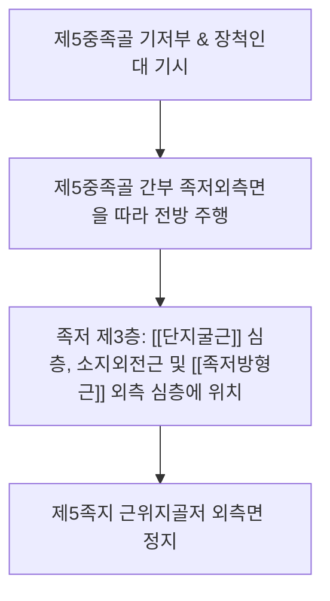

# [[단소지굴근(발)]](Flexor Digiti Minimi Brevis / 짧은새끼굽힘근 / FDMB)

> **핵심 요약 (Key Summary)**:
> **제5중족골(5th metatarsal)** 기저부 족저면 및 장척인대 건초에서 기시하여 새끼발가락(제5족지) 근위지골저 외측면에 정지하는 족저 제3층 근육.
> [[외측족저신경]](S1-S2) 천분지의 지배를 받으며, 새끼발가락 MTP 관절 굴곡 및 외측 세로 아치를 동적 지지하여 [[후경골근]]의 내측 종아치와 상호 균형을 이루며 [[장비골근]], [[단비골근]], [[단지굴근]]과 협응.
> 주치 병증은 소건막류(Bunionette), [[무지외반증]] 보상성 외측 통증, 제5중족골두 족저 외측 통증, 외측 족궁 피로 증후군.

---

## 📌 목차
1. [해부학적 정밀 구조 및 지배 신경/혈관](#1-해부학적-정밀-구조-및-지배-신경혈관)
2. [생체역학·토크 분석 & 근막 사슬 (Biomechanical Synergy)](#2-생체역학토크-분석--근막-사슬-biomechanical-synergy)
3. [근막통증증후군(TP) & 연관통 패턴 (Travell & Simons)](#3-근막통증증후군tp--연관통-패턴-travell--simons)
4. [초음파 해부학(Sonoanatomy) 및 중재 시술 랜드마크](#4-초음파-해부학sonoanatomy-및-중재-시술-랜드마크)
5. [⭐ 원장님 심층 임상 고찰 및 원본 필기 (Clinical Pearls)](#5--원장님-심층-임상-고찰-및-원본-필기-clinical-pearls)
6. [관련 임상 질환 및 운동손상 증후군 총괄](#6-관련-임상-질환-및-운동손상-증후군-총괄)
7. [추나·도수치료(MET/PIR) & 침구·약침·재활 프로토콜](#7-추나도수치료metpir--침구약침재활-프로토콜)
8. [출처 및 학술 참고 문헌 (References)](#8-출처-및-학술-참고-문헌-references)

---

## 1. 해부학적 정밀 구조 및 지배 신경/혈관

### 1) 해부학 구조 상세

| 항목 | 상세 내용 |
| :--- | :--- |
| **기시 (Origin)** | **제5중족골(5th metatarsal)** 기저부 족저면, 장척인대(Long plantar ligament) 및 장비골근 건초 |
| **정지 (Insertion)** | **제5족지(새끼발가락) 근위지골저** 외측면 (소지외전근 건과 일부 융합) |
| **신경 지배** | [[외측족저신경]](Lateral plantar nerve, S1-S2) 천분지 |
| **혈관 공급** | 외측족저동맥(Lateral plantar artery)의 족저지동맥 가지 |
| **형태적 변이** | 심층 섬유 일부가 제5중족골 외측면에 정지하는 경우 '소지대립근(Opponens digiti minimi)'으로 분류되기도 함 |

---

## 2. 생체역학·토크 분석 & 근막 사슬 (Biomechanical Synergy)

### 1) 기능 및 생체역학
* **새끼발가락 MTP 관절 굴곡 (5th MTP Flexion)**:
  * 보행 시 발의 외측 모서리가 지면에 닿을 때 새끼발가락으로 바닥을 눌러 외측 지면 지지면(Base of support)을 확보.
* **외측 세로 아치(Lateral Longitudinal Arch) 동적 지지**:
  * 제5중족골을 족저 방향으로 안정화시켜 체중 부하 시 외측 아치가 바깥쪽으로 주저앉는 것을 방지.

### 2) 근막 사슬 (Anatomy Trains)
* **외측선(Lateral Line)**: [[종골]] 외측 및 발 외측 모서리에서 비골근군과 장경인대로 이어지는 외측 신체 안정화 사슬([[장비골근]], [[단비골근]], [[대퇴근막장근]])의 족저 종말부.

---

## 3. 근막통증증후군(TP) & 연관통 패턴 (Travell & Simons)

### 1) 발통점(Trigger Point) 위치 및 연관통
* **발통점 위치**: 제5중족골 간부 중간 족저외측 근복.
* **연관통 양상**:
  * **제5중족골두 외측 및 족저면**으로 통증 집중.
  * 새끼발가락 바닥면 전체로 쑤시는 둔통 방사.
* **임상적 특징**: 발 볼이 좁은 구두나 등산화를 신었을 때 제5중족골두 외측이 신발에 닿아 찢어질 듯이 아픔.

---

## 4. 초음파 해부학(Sonoanatomy) 및 중재 시술 랜드마크

### 1) 초음파 스캔 뷰
* **제5중족골 족저외측 단축 스캔**:
  * [[종골]] 전방과 제5중족골 피질골 바로 아래 위치하는 소지외전근과 단소지굴근의 경계면 식별.
  * 중족골두 외측의 활액낭 비후(소건막류) 및 건염 유무 감별.

### 2) 침도 및 안전 자침 마진
* ****속골(BL65)** 전하방 / **통곡(BL66)****: 제5중족골두 후외측 함요처에서 골면을 향해 10~15mm 직자.

---

## 5. ⭐ 원장님 심층 임상 고찰 및 원본 필기 (Clinical Pearls)

### 1) 소건막류(Bunionette / 건막류 변형)와의 연계 (원장님 핵심 팁 100% 보존)
* **외측 족궁 압박과 마찰 염증**:
  * 제5중족골두 외측이 돌출되어 신발과 마찰하는 **소건막류(Bunionette, 건막류 변형)** 환자는 뼈 자체의 돌출뿐만 아니라 **단소지굴근 및 소지외전근의 만성 긴장과 활액낭 비후**가 통증의 주원인임.
  * 돌출 부위의 점액낭염만 치료하지 말고 제5중족골 기저부 부착부를 도침으로 이완시켜야 외측 인장력이 해소됨.
* **보행 시 외측 체중 쏠림과 피로**:
  * [[무지외반증]] 환자가 엄지 통증 때문에 체중을 발 외측으로 회피 보행(Antalgic gait)할 때 단소지굴근에 심각한 과부하가 걸려 2차성 외측 족저통 빈발.

---

## 6. 관련 임상 질환 및 운동손상 증후군 총괄

| 임상 질환 / 증후군 | 병리적 연관 기전 | 주요 증상 및 이학적 검사 | 핵심 교정 타깃 |
| :--- | :--- | :--- | :--- |
| **소건막류(Bunionette)** | 제5중족골두 외측 돌출 및 신발 마찰 활액낭염 | 외측 골 돌출통, 굳은살, 보행 시 마찰 압통 | 활액낭 도침 감압, 넓은 신발 처방 |
| **제5중족골 건골막염** | 단소지굴근 기시부 장척인대 견인성 염증 | 제5중족골 기저부 압통, 외측 아치 보행통 | 기저부 도침술, 소염 약침 |
| **외측 족궁 피로 증후군** | 장시간 기립 및 외측 쏠림으로 단소지굴근 탈진 | 발바닥 바깥쪽 경련성 조임통 및 피로감 | 족저 내재근 강화, 아치 서포트 |

* **새끼발가락 굴곡 저항 검사**: 새끼발가락을 아래로 구부리게 하고 위로 저항할 때 제5중족골두 부근에 국소 통증이 나타나면 단소지굴근 병증 확진.

---

## 7. 추나·도수치료(MET/PIR) & 침구·약침·재활 프로토콜

### 1) 한의 침구 및 약침 요법
* **침구 치료**: **통곡(BL66)**, **속골(BL65)**, **경골(BL64)**, **지음(BL67)** 자침.
* **도침 요법**: 제5중족골두 외측 만성 비후 활액낭 및 기저부 건 부착부 소침도 절개 박리.
* **약침 치료**: 소건막류 마찰 부위에 중성어혈약침 또는 신바로약침 0.3cc 주입.

### 2) 재활 운동 & 생활 지도
* **발 볼 확장(Wide Toe Box)**: 앞볼이 좁은 신발을 즉시 배제하고 토 스프레더(Toe spacer) 착용.
* **외측 족저 볼 마사지**: 작은 마사지볼을 발바닥 외측 가장자리에 대고 체중을 실어 굴려 근막 이완.

---

## 8. 출처 및 학술 참고 문헌 (References)

* Standring S. *Gray's Anatomy: The Anatomical Basis of Clinical Practice*. 42nd ed. Elsevier, 2020: 1367.
  * `[연구 요약]`: 단소지굴근의 제5중족골 기시, 새끼발가락 정지 해부학 및 외측족저신경 지배 분석.
* McKeon PO, Hertel J, Bramble D, Davis I. *The foot core system: a new paradigm for understanding intrinsic foot muscle function*. Br J Sports Med, 2015; 49(5): 290. [PMID: 24659509](https://pubmed.ncbi.nlm.nih.gov/24659509/)
  * `[연구 요약]`: 발 코어 시스템(The foot core system) 패러다임 — 단소지굴근을 포함한 족저 내재근이 족궁 동적 안정화 및 지면 반발력 제어에 미치는 핵심 역학 규명.
* Travell, J. G., & Simons, D. G. *Myofascial Pain and Dysfunction*. Williams & Wilkins, 1999.
  * `[연구 요약]`: 단소지굴근 발통점과 제5중족골두 방사통 패턴.
