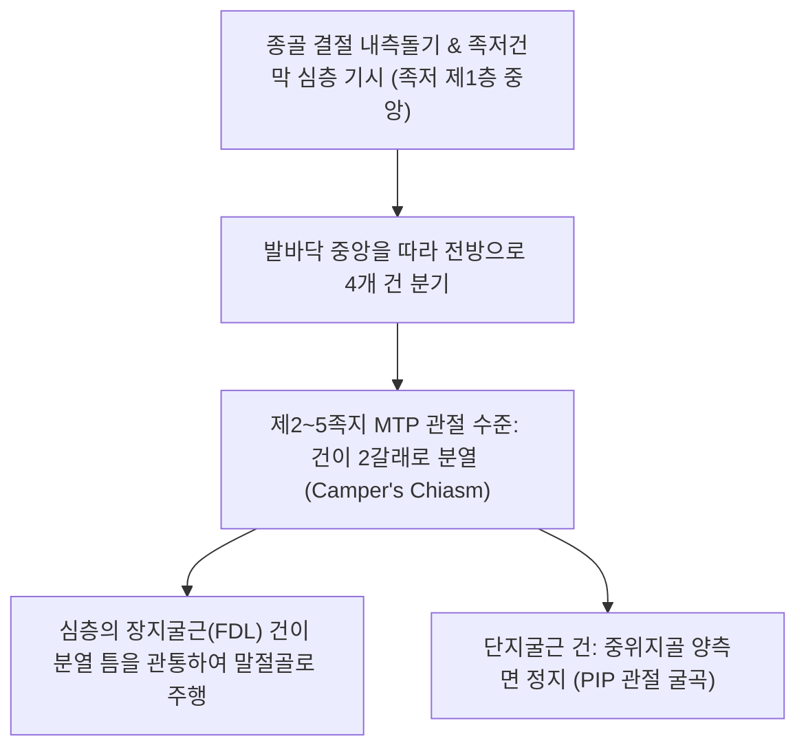

# [[단지굴근]](Flexor Digitorum Brevis / 짧은발가락굽힘근 / FDB)

> **핵심 요약 (Key Summary)**:
> [[종골]] 결절 내측돌기 및 족저건막에서 기시하여 4갈래로 나뉘어 제2~5족지 중위지골 양측에 정지(천공건 형태)하는 족저 제1층의 가장 큰 근육.
> [[내측족저신경]](S1-S2)의 지배를 받으며, 제2~5 발가락 PIP 관절을 굴곡시키고 발의 내측 종아치를 능동적으로 지지하여 [[평발]] 및 [[후경골근건 기능부전증]]을 방어.
> 주치 병증은 심부성 [[족저근막염]], 발바닥 중앙 둔통, 발가락 굴곡 연축, **갈퀴족지(Claw toe)** 및 [[망치족지]].

---

## 📌 목차
1. [해부학적 정밀 구조 및 지배 신경/혈관](#1-해부학적-정밀-구조-및-지배-신경혈관)
2. [생체역학·토크 분석 & 근막 사슬 (Biomechanical Synergy)](#2-생체역학토크-분석--근막-사슬-biomechanical-synergy)
3. [근막통증증후군(TP) & 연관통 패턴 (Travell & Simons)](#3-근막통증증후군tp--연관통-패턴-travell--simons)
4. [초음파 해부학(Sonoanatomy) 및 중재 시술 랜드마크](#4-초음파-해부학sonoanatomy-및-중재-시술-랜드마크)
5. [⭐ 원장님 심층 임상 고찰 및 원본 필기 (Clinical Pearls)](#5--원장님-심층-임상-고찰-및-원본-필기-clinical-pearls)
6. [관련 임상 질환 및 운동손상 증후군 총괄](#6-관련-임상-질환-및-운동손상-증후군-총괄)
7. [추나·도수치료(MET/PIR) & 침구·약침·재활 프로토콜](#7-추나도수치료metpir--침구약침재활-프로토콜)
8. [출처 및 학술 참고 문헌 (References)](#8-출처-및-학술-참고-문헌-references)

---

## 1. 해부학적 정밀 구조 및 지배 신경/혈관

### 1) 해부학 구조 상세

| 항목 | 상세 내용 |
| :--- | :--- |
| **기시 (Origin)** | [[종골]](Calcaneus) 결절의 내측돌기(Medial process), 족저건막 중앙부 및 근간중격 |
| **정지 (Insertion)** | 4갈래 건으로 갈라져 전방 주행 → 근위지골저에서 각 건이 두 갈래로 갈라져 **제2~5족지 중위지골(Middle phalanx) 양측면**에 정지 |
| **신경 지배** | [[내측족저신경]](Medial plantar nerve, S1-S2) |
| **혈관 공급** | 내측 및 외측 족저동맥의 분지 |
| **건 관통 관계** | 상지의 천지굴근과 동일하게 건이 갈라지는 틈(천공건) 사이로 **심층의 [[장지굴근]](FDL) 건이 관통**하여 말절골로 주행 |

---

## 2. 생체역학·토크 분석 & 근막 사슬 (Biomechanical Synergy)

### 1) 기능 및 생체역학
* **제2~5족지 근위지간관절(PIP joint) 굴곡**:
  * 보행 중 입각기 말기에 발가락이 바닥을 안정적으로 누르도록 조율.
* **내측 세로 아치의 동적 충격 흡수 (Dynamic Arch Suspension)**:
  * 족저건막 바로 아래에서 종골과 지골 사이를 연결하여 체중 부하 시 아치가 과도하게 무너지는 것을 능동적으로 억제하는 '인장 타이(Tie-rod)' 역할 수행.
* **윈들러스 메커니즘(Windlass Mechanism) 보조**:
  * 보행 시 발가락이 위로 젖혀질 때 족저건막과 함께 수축하여 종아치를 단단하게 잠그는 추진 지렛대 형성.

### 2) 근막 사슬 (Anatomy Trains)
* **표면후방선(Superficial Back Line)**: 발가락 끝에서 단지굴근 → 족저근막 → 종골 → 아킬레스건 → 비복근으로 직결되는 후방 전신 장력선.

---

## 3. 근막통증증후군(TP) & 연관통 패턴 (Travell & Simons)

### 1) 발통점(Trigger Point) 위치 및 연관통
* **발통점 위치**: 종골 결절 전방 2~4cm 지점, 발바닥 정중앙 오목한 부위의 두터운 근복.
* **연관통 양상**:
  * **발바닥 중앙 및 뒤꿈치 전방 통증**: "발바닥 한가운데 멍이 든 것처럼 딛기 힘들다"고 호소.
  * 종골 결절 부착부로 통증이 투사되어 단순 족저근막염과 거의 동일한 뒤꿈치 착지통 발현.
* **임상적 특징**: 오래 서 있거나 딱딱한 신발을 신고 걸었을 때 발바닥 중앙부가 뻐근하고 타는 듯한 열감 발생.

---

## 4. 초음파 해부학(Sonoanatomy) 및 중재 시술 랜드마크

### 1) 초음파 스캔 뷰
* **종골 결절 전방 종단 스캔**:
  * 표층의 고에코 족저건막 바로 아래 두껍게 자리 잡은 저에코성 단지굴근 근복 식별.
  * 더 깊은 층의 [[족저방형근]] 및 장지굴근 건과의 경계면 확인.
  * 종골 부착부 골극(Heel spur) 및 건골막염 두께 측정.

### 2) 침도 및 안전 자침 마진
* ****용천(KI1)** 하방 1~2촌**: 발바닥 중심선에서 수직으로 15~25mm 직자.
* 족저건막 관통 시 강한 저항과 뻐근함이 유발되므로 환자 호흡에 맞추어 침도 진입.

---

## 5. ⭐ 원장님 심층 임상 고찰 및 원본 필기 (Clinical Pearls)

### 1) 족저근막염 치료 실패의 주원인: 단지굴근 건골막염 (원장님 핵심 팁 100% 보존)
* **근막과 근육 기시부의 해부학적 유착 (원장님 팁 100% 보존)**:
  * 많은 임상의들이 발뒤꿈치 통증을 단순 족저근막의 표층 염증으로만 보고 체외충격파나 표층 치료에 집중하지만, 실제 만성 난치성 환자의 상당수는 **단지굴근의 종골 기시부 건골막 유착 및 TrP**가 통증의 핵심 원인임.
  * 표층 족저건막을 뚫고 들어가 종골 결절 전방의 단지굴근 근복 및 골막 부착부를 도침으로 감압·박리해야 비로소 지긋지긋한 발뒤꿈치 통증이 완치됨.

### 2) 하이힐 착용과 단지굴근 구축
* 하이힐을 오래 신으면 발가락이 상시 과신전된 상태로 유지되어 단지굴근이 단축 연축되고, 앞발바닥 굳은살과 중족골두 통증이 연쇄적으로 발생.

---

## 6. 관련 임상 질환 및 운동손상 증후군 총괄

| 임상 질환 / 증후군 | 병리적 연관 기전 | 주요 증상 및 이학적 검사 | 핵심 교정 타깃 |
| :--- | :--- | :--- | :--- |
| **[[족저근막염]](심부성)** | 단지굴근 종골 기시부 견인성 미세 파열 및 유착 | 아침 첫 발 뒤꿈치 착지통, 종골 전내측 심부 압통 | 단지굴근 심부 도침술, 아킬레스건 및 [[비복근]], [[가자미근]] 이완 |
| **발바닥 아치 피로 증후군** | 장시간 기립 및 보행으로 단지굴근 내재근 탈진 | 보행 후 발바닥 중앙 뻐근한 경련감 및 열감 | 족저 내재근 강화, 인솔 교정 |
| **갈퀴족지(Claw Toe) / [[망치족지]]** | 단지굴근 과긴장으로 PIP 관절 굴곡 변형 고착 | 2~4지 발가락 중간 마디 굴곡, 발가락 등쪽 굳은살 | 단지굴근 건막 스트레칭, 수기 이완 |

* **단지굴근 고립 굴곡 검사**: 환자의 MTP 관절을 중립으로 고정한 상태에서 PIP 관절만 능동 굴곡시킬 때 발바닥 중앙에 통증이나 경련이 발생하는지 확인.

---

## 7. 추나·도수치료(MET/PIR) & 침구·약침·재활 프로토콜

### 1) 한의 침구 및 약침 요법
* **침구 치료**: **용천(KI1)**, **연곡(KI2)**, **수천(KI5)** 심부 직자 20~30mm.
* **도침 요법**: 종골 결절 전방 단지굴근 기시부의 만성 비후 부위를 종축으로 2~3회 절개 감압.
* **약침 치료**: 종골 부착부 건골막염에 신바로약침 또는 중성어혈약침 0.5cc 국소 주입.

### 2) 도수 치료 및 자가 관리
* **골프공/마사지볼 롤링**: 서서 체중을 실어 발바닥 중앙으로 골프공을 2~3분간 강하게 굴려 족저 심층 근막 이완.
* **발가락 집기(Towel Scrunches)**: 발가락 끝으로 수건을 끌어당겨 내재근 굴곡력 재교육.

---

## 8. 출처 및 학술 참고 문헌 (References)

* Standring S. *Gray's Anatomy: The Anatomical Basis of Clinical Practice*. 42nd ed. Elsevier, 2020: 1365.
  * `[연구 요약]`: 단지굴근의 종골 기시, 천공건 정지 구조 및 내측족저신경 지배 분석.
* Wearing SC, Smeathers JE, Urry SR, Hennig EM, Hills AP. *Plantar fasciitis: are pain and fascial thickness associated with arch shape and loading?* Phys Ther, 2007; 87(8): 1002-1008. [PMID: 17553919](https://pubmed.ncbi.nlm.nih.gov/17553919/)
  * `[연구 요약]`: 족저근막염 환자에서 통증 및 근막 두께와 족궁 형태/하중의 상관관계 — 단지굴근을 포함한 족저 심부 조직의 생체역학적 과부하 분석.
* Travell, J. G., & Simons, D. G. *Myofascial Pain and Dysfunction*. Williams & Wilkins, 1999.
  * `[연구 요약]`: 단지굴근 발통점과 발바닥 중앙부 방사통 패턴.
