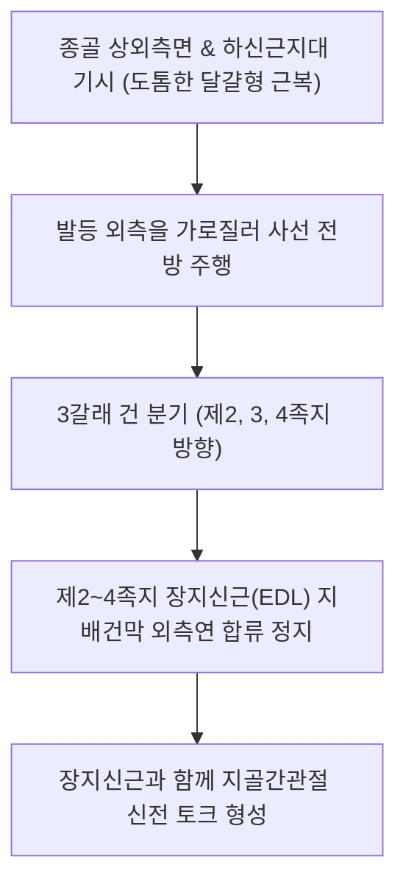

# [[단지신근]](Extensor Digitorum Brevis / 짧은발가락폄근 / EDB)

> **핵심 요약 (Key Summary)**:
> [[종골]] 상외측면(족근동 전외측) 및 하신근지대 줄기에서 기시하여 3갈래 건으로 나뉘어 2~4번째 발가락의 [[장지신근]] 배측건막에 합류하는 발등 외측의 고유 신전근.
> [[심비골신경]](L5-S1) 외측 종말 분지의 지배를 받으며, 2~4지 발가락 관절의 독립적 신전 및 보행 유각기 발가락 클리어런스를 보조.
> 주치 병증은 발등 외측 통증, 등산화 압박 신경통, 전족근관 증후군 및 L5/S1 신경근병증 마비성 위축.

---

## 📌 목차
1. [해부학적 정밀 구조 및 지배 신경/혈관](#1-해부학적-정밀-구조-및-지배-신경혈관)
2. [생체역학·토크 분석 & 근막 사슬 (Biomechanical Synergy)](#2-생체역학토크-분석--근막-사슬-biomechanical-synergy)
3. [근막통증증후군(TP) & 연관통 패턴 (Travell & Simons)](#3-근막통증증후군tp--연관통-패턴-travell--simons)
4. [초음파 해부학(Sonoanatomy) 및 중재 시술 랜드마크](#4-초음파-해부학sonoanatomy-및-중재-시술-랜드마크)
5. [⭐ 원장님 심층 임상 고찰 및 원본 필기 (Clinical Pearls)](#5--원장님-심층-임상-고찰-및-원본-필기-clinical-pearls)
6. [관련 임상 질환 및 운동손상 증후군 총괄](#6-관련-임상-질환-및-운동손상-증후군-총괄)
7. [추나·도수치료(MET/PIR) & 침구·약침·재활 프로토콜](#7-추나도수치료metpir--침구약침재활-프로토콜)
8. [출처 및 학술 참고 문헌 (References)](#8-출처-및-학술-참고-문헌-references)

---

## 1. 해부학적 정밀 구조 및 지배 신경/혈관

### 1) 해부학 구조 상세

| 항목 | 상세 내용 |
| :--- | :--- |
| **기시 (Origin)** | [[종골]](Calcaneus) 상외측면 (족근동 Sinus tarsi 전외측), 골간거종인대 및 하신근지대 줄기 |
| **정지 (Insertion)** | 3개의 건으로 갈라져 **제2, 3, 4번째 발가락의 [[장지신근]](EDL) 배측건막(Extensor expansion)** 외측연에 합류 정지 (제5지에는 건이 없음) |
| **신경 지배** | [[심비골신경]](Deep fibular nerve, L5-S1, 상위의 [[비골신경]] 및 [[좌골신경]] 분지) 외측 종말 분지 |
| **혈관 공급** | 외측족근동맥(Lateral tarsal artery) 및 족배동맥 분지 |
| **해부학적 특징** | 외과(외측 복사뼈) 전하방에서 도톰한 달걀 모양의 근복을 형성하며, 엄지 쪽으로 가는 단모지신근과 기시부를 공유 |

---

## 2. 생체역학·토크 분석 & 근막 사슬 (Biomechanical Synergy)

### 1) 기능 및 생체역학
* **제2~4번째 발가락 독립적 신전**:
  * [[장지신근]]이 발목 족배굴곡과 발가락 신전을 동시에 일으킬 때, 단지신근은 발목 위치에 구애받지 않고 발가락 관절(MTP 및 IP)만을 독립적으로 신전 조율.
* **보행 유각기 지면 여유 공간 확보 (Clearance)**:
  * 유각기(Swing phase) 동안 발가락 끝이 바닥에 걸려 전도되는 것을 [[전경골근]], [[장지신근]]과 함께 방어.
* **족관절 전외측 동적 안정화**:
  * [[종골]]과 [[거골]] 사이 족근동 전방에서 관절낭을 덮고 있어 발목 내번 염좌 시 외측 인대 손상을 능동적으로 완충.

### 2) 근막 사슬 (Anatomy Trains)
* **표면전방선(Superficial Front Line)**: 발가락 배측건막에서 단지신근을 거쳐 하하신근지대, [[전경골근]], [[대퇴사두근]], [[슬개골]]로 이어지는 전면 굴곡-신전 조절축.

---

## 3. 근막통증증후군(TP) & 연관통 패턴 (Travell & Simons)

### 1) 발통점(Trigger Point) 위치 및 연관통
* **발통점 위치**: 외과(외측 복사뼈) 전하방 2~3cm 지점의 도톰한 근복 중앙부.
* **연관통 양상**:
  * **발등 외측면 통증**: 발등 바깥쪽이 멍든 것처럼 쑤시고 뻐근하며, 신발에 닿을 때 극심한 불쾌감 호발.
  * 제2, 3, 4번째 발가락 등쪽으로 뻗치는 둔통 방사.
* **임상적 특징**: 딱딱한 안전화, 등산화, 스키 부츠 등 발등을 강하게 압박하는 신발을 착용했을 때 증상 급격히 악화.

---

## 4. 초음파 해부학(Sonoanatomy) 및 중재 시술 랜드마크

### 1) 초음파 스캔 뷰
* **외과 전하방 족근동 부위 단축 스캔**:
  * 피하지방 아래 뚜렷하게 관찰되는 저에코성 난원형 단지신근 근복 식별.
  * 근복 심층에서 주행하는 심비골신경 외측 분지 및 족근동 인대 구조물 확인.

### 2) 침도 및 안전 자침 마진
* **구허(GB40) 전하방 / 임읍(GB41) 외측**: 종골 전외측 융기부에서 골면을 향해 10~15mm 직자.

---

## 5. ⭐ 원장님 심층 임상 고찰 및 원본 필기 (Clinical Pearls)

### 1) 장지신근 vs 단지신근(족지신근) 연계 및 발등 통증 감별 (원장님 핵심 팁 100% 보존)
* **근복 위치의 결정적 차이**:
  * 장지신근은 종아리에 근복이 있고 발등에는 건만 지나가지만, **단지신근은 발등 외측 자체에 도톰한 근복이 존재**함.
  * 발등 외과 앞쪽 몽우리가 부어오르거나 뻐근하다면 장지신근 건초염보다 **단지신근 근복 자체의 TrP 및 긴장 연축**일 가능성이 대단히 높음.
* **신발 끈 압박과 심비골신경 포착**:
  * 끈을 꽉 조이는 신발 착용 시 심비골신경 말초지가 단지신근 근막 아래에서 압박되어 발가락 저림과 감각 이상 유발.

### 2) L5/S1 신경근병증의 결정적 전기생리학적 지표근
* 단지신근(EDB)은 심비골신경의 최원위 종말 분지가 지배하므로, **L5 신경근병증 또는 비골신경 마비 시 가장 먼저 탈신경 전위와 근위축이 관찰되는 핵심 표적근**임.
* 요통 환자에서 발등 외측 근육 볼륨이 반대측에 비해 푹 꺼져 있다면 척추성 신경근병증의 만성화를 즉각 의심해야 함.

---

## 6. 관련 임상 질환 및 운동손상 증후군 총괄

| 임상 질환 / 증후군 | 병리적 연관 기전 | 주요 증상 및 이학적 검사 | 핵심 교정 타깃 |
| :--- | :--- | :--- | :--- |
| **발등 외측 건근막염** | 신발 마찰 및 발가락 과신전 스트레스로 인한 근막염 | 외과 전방 압통, 신발 착용 시 통증 악화 | 단지신근 TrP 침술, 헐렁한 신발 |
| **L5 신경근병증 위축** | L5 디스크 탈출증으로 인한 EDB 탈신경성 위축 | 발등 외측 함몰, 발가락 신전력 약화 | 요추 추나·약침, [[가자미근]]·[[비복근]] 이완 |
| **전족근관 증후군** | 하하신근지대 아래 심비골신경 포착 | 제1~2 발가락 사이 감각 저하, 발등 작열통 | 신근지대 도침 박리, 전침 자극 |

* **발가락 개별 신전 검사**: 발목을 중립으로 고정한 상태에서 2~4지 발가락만 능동 신전시킬 때 발등 외측에 통증이나 위약감이 있는지 확인.

---

## 7. 추나·도수치료(MET/PIR) & 침구·약침·재활 프로토콜

### 1) 한의 침구 및 약침 요법
* **침구 치료**: 구허(GB40) 전하방, 임읍(GB41), 함곡(ST43), 내정(ST44) 자침.
* **도침 요법**: 단지신근 기시부 종골 전외측 골막 유착 부위 및 하하신근지대 외측 섬유 소침도 절개 감압.

### 2) 도수 치료 및 재활
* **발등 근막 롤링**: 골프공이나 마사지볼을 발등 외측에 대고 부드럽게 굴려 근막 이완.
* **발가락 능동 신전-벌리기 운동(Toe Spreading)**: 발가락을 부채꼴로 쫙 펴는 훈련으로 내재근 협응력 강화.

---

## 8. 출처 및 학술 참고 문헌 (References)

* Standring S. *Gray's Anatomy: The Anatomical Basis of Clinical Practice*. 42nd ed. Elsevier, 2020: 1367.
  * `[연구 요약]`: 단지신근(EDB)의 종골 기시, 발등 건 분지 및 심비골신경 외측 분지 해부학 분석.
* Sinanovic O, et al. *Musculus extensor digitorum brevis is clinical and electrophysiological marker for L5/S1 radicular lesions*. Med Arh, 2010; 64(5): 271-273. [PMID: 21246920](https://pubmed.ncbi.nlm.nih.gov/21246920/)
  * `[연구 요약]`: 단지신근(EDB)의 임상적 위축 및 근전도 검사가 L5/S1 신경근 병변을 조기 진단하는 결정적 전기생리학적 표지자임을 입증.
* Travell, J. G., & Simons, D. G. *Myofascial Pain and Dysfunction*. Williams & Wilkins, 1999.
  * `[연구 요약]`: 단지신근 발통점과 발등 외측 및 발가락 방사통 패턴.
