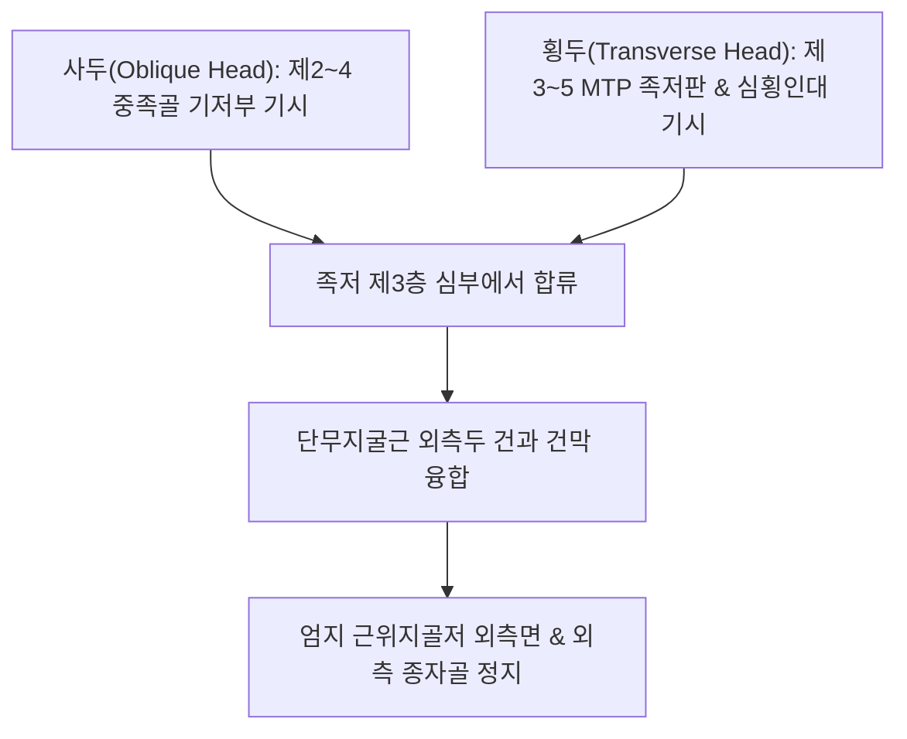

# [[무지내전근(발)]](Adductor Hallucis / 엄지모음근(발))

> **핵심 요약 (Key Summary)**:
> 족저 심층(제3층)에서 사두(Oblique head)와 횡두(Transverse head)의 두 갈래로 기시하여 엄지발가락 근위지골저 외측면 및 외측 종자골에 정지하는 엄지 모음근.
> [[외측족저신경]](S2-S3, 상위의 [[경골신경]] 및 [[좌골신경]] 분지) 심분지의 지배를 받으며, 엄지발가락 내전 및 전족부 횡아치(Transverse arch)를 결속.
> 주치 병증은 [[무지외반증]](Hallux Valgus), 제1~2 중족골 사이 통증, 횡아치 붕괴 개장족 및 [[종자골염]].

---

## 📌 목차
1. [해부학적 정밀 구조 및 지배 신경/혈관](#1-해부학적-정밀-구조-및-지배-신경혈관)
2. [생체역학·토크 분석 & 근막 사슬 (Biomechanical Synergy)](#2-생체역학토크-분석--근막-사슬-biomechanical-synergy)
3. [근막통증증후군(TP) & 연관통 패턴 (Travell & Simons)](#3-근막통증증후군tp--연관통-패턴-travell--simons)
4. [초음파 해부학(Sonoanatomy) 및 중재 시술 랜드마크](#4-초음파-해부학sonoanatomy-및-중재-시술-랜드마크)
5. [⭐ 원장님 심층 임상 고찰 및 원본 필기 (Clinical Pearls)](#5--원장님-심층-임상-고찰-및-원본-필기-clinical-pearls)
6. [관련 임상 질환 및 운동손상 증후군 총괄](#6-관련-임상-질환-및-운동손상-증후군-총괄)
7. [추나·도수치료(MET/PIR) & 침구·약침·재활 프로토콜](#7-추나도수치료metpir--침구약침재활-프로토콜)
8. [출처 및 학술 참고 문헌 (References)](#8-출처-및-학술-참고-문헌-references)

---

## 1. 해부학적 정밀 구조 및 지배 신경/혈관

### 1) 해부학 구조 상세

| 항목 | 상세 내용 |
| :--- | :--- |
| **기시 (Origin)** | 2개의 두(Heads)로 기시: • **사두(Oblique head)**: 제2~4 중족골 기저부 족저면 및 장비골근 건초 • **횡두(Transverse head)**: 제3~5 중족족지관절(MTP joint)의 족저판(Plantar plate) 및 심횡중족인대 |
| **정지 (Insertion)** | 두 갈래가 합쳐져 **엄지발가락 근위지골저 외측면** 및 **외측 종자골(Lateral sesamoid)**에 정지 ([[단무지굴근(발)]] 외측두 건과 융합) |
| **신경 지배** | [[외측족저신경]](Lateral plantar nerve, S2-S3) 심분지 |
| **혈관 공급** | 족저동맥궁(Plantar arch)의 족저중족동맥 분지 |
| **해부학적 층 (Layer)** | 족저 제3층(Third layer of sole)에 위치하며, [[단지굴근]] 및 [[장지굴근]] 건의 심층에 자리 잡음 |

---

## 2. 생체역학·토크 분석 & 근막 사슬 (Biomechanical Synergy)

### 1) 기능 및 생체역학
* **엄지발가락 내전 (1st Toe Adduction)**:
  * 엄지발가락을 제2발가락 쪽(외측)으로 강하게 당기는 모음 토크 발휘.
* **전족부 횡아치(Transverse Metatarsal Arch) 능동 결속**:
  * 횡두가 중족골두 사이를 가로질러 수평 인장 밴드 역할을 수행하여 체중 부하 시 전족부가 부채꼴로 퍼지는 것을 방지.
* **보행 추진기 지면 반발력 조율**:
  * 보행 주기 말기 발끝 밀기(Push-off) 시 제1열(First ray)을 안정화하여 추진력 손실을 차단.

### 2) 근막 사슬 (Anatomy Trains)
* **나선선(Spiral Line) 및 심층후방선**: 발바닥 횡아치에서 비골근건 및 [[후경골근]] 건막과 교차하며 족부 입체 돔을 지지.

---

## 3. 근막통증증후군(TP) & 연관통 패턴 (Travell & Simons)

### 1) 발통점(Trigger Point) 위치 및 연관통
* **발통점 위치**: 제1~2 중족골 사이 공간 족저 심층(사두 근복) 및 중족골두 하방(횡두).
* **연관통 양상**:
  * **제1~2중족골두 족저면 통증**: 발바닥 앞쪽 엄지와 검지 발가락 뿌리 사이가 욱신거리고 뻐근함.
  * 엄지발가락 외측면과 제1 MTP 관절 심부로 쑤시는 통증 집중.
* **임상적 특징**: 발볼이 좁은 신발을 신거나 오래 서 있을 때 전족부 중앙이 타는 듯이 아픔.

---

## 4. 초음파 해부학(Sonoanatomy) 및 중재 시술 랜드마크

### 1) 초음파 스캔 뷰
* **전족부 족저 횡단 스캔**:
  * 굴근건 심층에서 중족골두 사이를 수평으로 가로지르는 횡두 근섬유 식별.
  * 제1중족골두 외측 종자골 부착부에서 무지내전근 건의 비후 및 골극 확인.

### 2) 침도 및 안전 자침 마진
* **태충(LR3) 투 용천(KI1) 방향 / 행간(LR2) 상방**: 제1~2 중족골 사이 발등 함요처에서 발바닥 방향으로 20~30mm 사자 (배측동맥 손상 방지).

---

## 5. ⭐ 원장님 심층 임상 고찰 및 원본 필기 (Clinical Pearls)

### 1) 무지외반증(Hallux Valgus)의 핵심 병리 주동근 (원장님 핵심 팁 100% 보존)
* **외측 견인력과 종자골 아탈구의 주범**:
  * [[무지외반증]] 환자에서 엄지발가락이 외측으로 꺾이는 핵심 원인은 **무지내전근의 과도한 단축 견인력과 [[무지외전근]]의 신장성 약화 불균형**임.
  * 무지내전근이 단축되면 외측 종자골을 바깥쪽으로 잡아당겨 종자골 탈구를 가속화하고, 제1중족골두 내측 돌출(건막류)을 악화시킴.
  * 따라서 무지외반증 보존 치료 시 제1~2 중족간극의 **무지내전근 부착부를 도침으로 절개·이완**시켜야 외측 인장력이 비로소 해소됨.

### 2) 횡아치 붕괴와 개장족 연쇄
* 무지내전근 횡두가 약화되거나 파열되면 전족부 횡아치가 무너지면서 제2~3 중족골두에 과도한 압력이 집중되어 굳은살과 중족골통이 발생.

---

## 6. 관련 임상 질환 및 운동손상 증후군 총괄

| 임상 질환 / 증후군 | 병리적 연관 기전 | 주요 증상 및 이학적 검사 | 핵심 교정 타깃 |
| :--- | :--- | :--- | :--- |
| **[[무지외반증]](Hallux Valgus)** | 무지내전근 과긴장으로 엄지 MTP 관절 외측 편위 고착 | 엄지 관절 외측 편위, 신발 마찰 건막류통 | 무지내전근 도침 이완, [[무지외전근]] 강화 |
| **[[종자골염]](Sesamoiditis)** | 외측 종자골 부착부 무지내전근 건의 반복 견인 염증 | 제1중족골두 족저 압통, 발끝 보행 곤란 | 종자골 부착부 도침술, 소염 약침 |
| **전족부 횡아치 붕괴** | 무지내전근 횡두 결속력 상실로 발볼 확장 | 발볼 넓어짐, 제2~3 중족골두 굳은살 | 횡아치 패드, 내재근 강화 운동 |

* **무지 수동 외전 검사**: 엄지발가락을 안쪽(내전 반대 방향)으로 벌릴 때 제1~2 중족간극 족저 심층에 강한 저항이나 통증이 유발되면 무지내전근 단축 구축 확진.

---

## 7. 추나·도수치료(MET/PIR) & 침구·약침·재활 프로토콜

### 1) 한의 침구 및 약침 요법
* **침구 치료**: 태충(LR3), 행간(LR2), 함곡(ST43), 내정(ST44) 자침.
* **도침 요법**: 제1~2 중족골 간극 외측 종자골 부착부 무지내전근 건막 소침도 박리술.
* **약침 치료**: MTP 관절 외측 건막 부착부에 신바로약침 또는 중성어혈약침 0.3~0.5cc 주입.

### 2) 재활 운동 & 보조기
* **토 스프레더(Toe Spacer) 착용**: 엄지와 검지 발가락 사이에 실리콘 스페이서를 끼워 무지내전근의 지속적 단축을 방지.
* **엄지 능동 외전 훈련**: 발가락을 바닥에 붙인 채 엄지발가락만 안쪽으로 벌리는 운동으로 길항근인 무지외전근을 강화하고 무지내전근을 억제.

---

## 8. 출처 및 학술 참고 문헌 (References)

* Standring S. *Gray's Anatomy: The Anatomical Basis of Clinical Practice*. 42nd ed. Elsevier, 2020: 1367.
  * `[연구 요약]`: 무지내전근의 사두/횡두 기시, 외측 종자골 정지 해부학 및 외측족저신경 지배 분석.
* Tharmviboonsri T, et al. *How Adductor Hallucis Reattachment Affects Outcomes Following Scarf Osteotomy in Hallux Valgus Correction: A 4- to 8-Year Follow-Up Retrospective Comparative Study*. Foot Ankle Int, 2023; 44(8): 734-742. [PMID: 37220865](https://pubmed.ncbi.nlm.nih.gov/37220865/)
  * `[연구 요약]`: 무지외반증 교정 시 무지내전근 건의 해부학적 견인력 해제 및 재부착이 전족부 횡아치 재건과 변형 재발 방지에 미치는 장기 추적 연구.
* Travell, J. G., & Simons, D. G. *Myofascial Pain and Dysfunction*. Williams & Wilkins, 1999.
  * `[연구 요약]`: 무지내전근 발통점과 제1~2중족골두 방사통 패턴.
