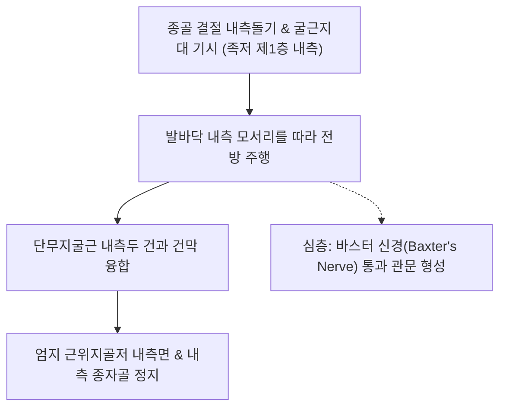

# [[무지외전근]](Abductor Hallucis / 엄지벌림근)

> **핵심 요약 (Key Summary)**:
> [[종골]] 결절 내측돌기 및 굴근지대에서 기시하여 엄지발가락 근위지골저 내측면과 내측 종자골에 정지하는 족저 제1층 내측의 가장 큰 근육.
> [[내측족저신경]](S1-S2, 상위의 [[경골신경]] 및 [[좌골신경]] 분지)의 지배를 받으며, 엄지발가락 외전 및 내측 종아치(Medial Longitudinal Arch)를 능동적으로 거상.
> 주치 병증은 [[무지외반증]](Hallux Valgus), 바스터 신경염(Baxter's neuropathy), [[족근관 증후군]], 아침 첫 발 뒤꿈치 통증([[족저근막염]] 오진).

---

## 📌 목차
1. [해부학적 정밀 구조 및 지배 신경/혈관](#1-해부학적-정밀-구조-및-지배-신경혈관)
2. [생체역학·토크 분석 & 근막 사슬 (Biomechanical Synergy)](#2-생체역학토크-분석--근막-사슬-biomechanical-synergy)
3. [근막통증증후군(TP) & 연관통 패턴 (Travell & Simons)](#3-근막통증증후군tp--연관통-패턴-travell--simons)
4. [초음파 해부학(Sonoanatomy) 및 중재 시술 랜드마크](#4-초음파-해부학sonoanatomy-및-중재-시술-랜드마크)
5. [⭐ 원장님 심층 임상 고찰 및 원본 필기 (Clinical Pearls)](#5--원장님-심층-임상-고찰-및-원본-필기-clinical-pearls)
6. [관련 임상 질환 및 운동손상 증후군 총괄](#6-관련-임상-질환-및-운동손상-증후군-총괄)
7. [추나·도수치료(MET/PIR) & 침구·약침·재활 프로토콜](#7-추나도수치료metpir--침구약침재활-프로토콜)
8. [출처 및 학술 참고 문헌 (References)](#8-출처-및-학술-참고-문헌-references)

---

## 1. 해부학적 정밀 구조 및 지배 신경/혈관

### 1) 해부학 구조 상세

| 항목 | 상세 내용 |
| :--- | :--- |
| **기시 (Origin)** | [[종골]](Calcaneus) 결절의 **내측돌기(Medial process)**, 굴근지대(Flexor retinaculum) 및 족저건막 내측부 |
| **정지 (Insertion)** | **엄지발가락 근위지골저 내측면** 및 내측 종자골 ([[단무지굴근(발)]] 내측두 건과 융합) |
| **신경 지배** | [[내측족저신경]](Medial plantar nerve, S1-S2) |
| **혈관 공급** | 내측족저동맥(Medial plantar artery) |
| **신경 터널 관계** | 근육의 심층 근막 아래로 [[내측족저신경]], [[외측족저신경]], 그리고 **바스터 신경(Baxter's nerve)**이 통과하는 중요한 신경학적 관문 형성 |

---

## 2. 생체역학·토크 분석 & 근막 사슬 (Biomechanical Synergy)

### 1) 기능 및 생체역학
* **엄지발가락 외전 및 굴곡 보조**:
  * 엄지발가락을 안쪽(신체 중심선 쪽, 제2발가락 반대편)으로 벌리고 바닥으로 누름.
* **내측 종아치 동적 거상 (Dynamic Arch Support)**:
  * 체중 부하 시 발바닥 안쪽 아치가 바닥으로 주저앉는 것을 막아주는 능동적 활시위(Bowstring) 역할.
* **무지외반증 방어의 제1방어선**:
  * [[무지내전근(발)]]의 외측 굴곡력에 대항하여 엄지 MTP 관절의 시상면 중립 축을 유지.

### 2) 근막 사슬 (Anatomy Trains)
* **심층후방선(Deep Back Line)**: 엄지발가락에서 족저 아치를 거쳐 [[후경골근]], [[장지굴근]], [[슬와근]]으로 이어지는 코어 지지선.

---

## 3. 근막통증증후군(TP) & 연관통 패턴 (Travell & Simons)

### 1) 발통점(Trigger Point) 위치 및 연관통
* **발통점 위치**: 종골 내측돌기 전방 3~4cm 부위, 발바닥 내측 세로 아치 정점의 두터운 근복.
* **연관통 양상**:
  * **발뒤꿈치 내측 및 족궁 통증**: "아침에 첫 발을 디딜 때 발뒤꿈치 안쪽이 찢어지듯이 아프다"고 호소 (족저근막염과 증상 유사).
  * 엄지발가락 바닥 안쪽으로 뻗치는 둔통 방사.
* **임상적 특징**: 평발([[평발]]) 또는 과회내 족부를 가진 환자에서 만성적인 긴장과 TrP 빈발.

---

## 4. 초음파 해부학(Sonoanatomy) 및 중재 시술 랜드마크

### 1) 초음파 스캔 뷰
* **발바닥 내측 종단 스캔**:
  * 종골 결절 내측돌기에서 기시하는 두꺼운 저에코성 무지외전근 근복 식별.
  * 근복 심층에서 분지되어 나가는 내측·외측 족저신경 및 바스터 신경(First branch of lateral plantar nerve)의 음영 확인.

### 2) 침도 및 안전 자침 마진
* **연곡(KI2) 후방 / 태계(KI3) 전하방**: 발바닥 내측 모서리에서 종골 결절 방향으로 15~25mm 사자.

---

## 5. ⭐ 원장님 심층 임상 고찰 및 원본 필기 (Clinical Pearls)

### 1) 무지외반증(Hallux Valgus) 발생의 역학적 원인 (원장님 핵심 팁 100% 보존)
* **내측 지지대 붕괴와 외반 변형**:
  * 무지외전근이 약화되어 엄지를 안쪽으로 벌려주지 못하면, 보행 추진 시 체중이 엄지 내측으로 쏠리며 [[무지내전근(발)]]의 외측 견인력이 우세해져 **엄지가 바깥쪽으로 꺾이는 [[무지외반증]]**이 발생함.
  * 따라서 무지외반증 초기 치료 시 무지외전근의 근력을 재교육하는 훈련이 필수적임.

### 2) 바스터 신경염(Baxter's Neuropathy) 포착의 관문
* 종골 전방에서 무지외전근 심부 근막과 족저방형근 사이로 외측족저신경의 첫 번째 분지인 **바스터 신경**이 통과함.
* 무지외전근이 과긴장되거나 비후되면 바스터 신경이 포착되어 발뒤꿈치 앞내측에 심한 작열통과 저림을 유발하므로, 난치성 뒤꿈치 통증 시 무지외전근 기시부 도침 박리가 결정적 치료법임.

### 3) 족궁 지지 인솔 의존의 양날의 검
* 과도한 아치 서포트는 무지외전근의 자가 수축 기회를 박탈하여 고유수용성 감각과 내재근 근력을 장기적으로 위축시킴. 점진적인 맨발 보행 및 내재근 재활 병행 필수.

---

## 6. 관련 임상 질환 및 운동손상 증후군 총괄

| 임상 질환 / 증후군 | 병리적 연관 기전 | 주요 증상 및 이학적 검사 | 핵심 교정 타깃 |
| :--- | :--- | :--- | :--- |
| **[[무지외반증]](Hallux Valgus)** | 무지외전근 위축 및 무지내전근 과긴장 불균형 | 엄지 MTP 관절 외측 편위, 건막류 염증통 | 무지외전근 강화, 무지내전근 이완 |
| **[[족근관 증후군]]** | 무지외전근 근막 통과부 족저신경 압박 | 발바닥 내측 작열통, **티넬 징후(Tinel's sign)** 양성 | 굴근지대 감압, 무지외전근 기시부 도침 |
| **바스터 신경염(Baxter's Neuropathy)** | 종골 결절 전방 무지외전근 심부 건막에 신경 포착 | 발뒤꿈치 내측 만성 통증, 소지외전근 위축 | 무지외전근 심부 도침 박리, 소염 약침 |
| **[[족저근막염]] 오진 케이스** | 무지외전근 TrP 활성화로 인한 종골 내측 방사통 | 아침 첫 발 통증, 종골 내측 결절 국소 압통 | 무지외전근 TrP 침술 및 근막 이완 |

* **티넬 징후(Tinel's Sign)**: 내과 하후방 족근관 및 무지외전근 기시부를 가볍게 타진했을 때 발바닥 안쪽으로 찌릿한 방사통이 재현되면 양성.
* **윈들러스 검사(Windlass Test)**: 체중 부하 상태에서 엄지발가락을 수동 배굴시킬 때 내측 아치가 정상적으로 상승하는지 평가.

---

## 7. 추나·도수치료(MET/PIR) & 침구·약침·재활 프로토콜

### 1) 한의 침구 및 약침 요법
* **침구 치료**: 연곡(KI2), [[태계(KI3)]], 공손(SP4) 심부 직자 및 저주파 전침 2Hz 15분.
* **도침 요법**: 종골 결절 내측돌기 기시부의 비후된 근막 및 신경 통과 부위를 종축으로 1~2회 미세 절개 감압.
* **약침 요법**: 족저신경 포착 부위에 신바로약침 또는 중성어혈약침 0.5cc 주입.

### 2) 스트레칭 및 자가 재활 운동 (숏풋 운동의 정렬·역학 근거)
* **발가락 벌리기(Toe Spread Out)**: 발뒤꿈치를 바닥에 붙인 채 엄지발가락을 안쪽으로 벌려 5초 유지(무지외전근 선택적 활성화).
* **숏풋 운동(Short Foot Exercise)**:
  * 발가락을 굽히지 않은 채 제1중족골두를 종골 쪽으로 당겨 내측 종아치를 거상하고, 한 발 서기 10초 유지 후 5초 하강 (최대 5세트 반복).
  * 무지외전근 등 제1층 내재근의 능동 아치 지지를 훈련하며, 후족각 및 발 자세 지수(FPI) 교정 이득을 확립.
  * 발가락 굴곡 대체(외재근 굴근 우세) 보상 패턴이 나타나지 않도록 거울로 매 세트 확인.

---

## 8. 출처 및 학술 참고 문헌 (References)

* Standring S. *Gray's Anatomy: The Anatomical Basis of Clinical Practice*. 42nd ed. Elsevier, 2020: 1364.
  * `[연구 요약]`: 무지외전근의 종골 내측돌기 기시 및 족저 제1층 해부학과 내측족저신경 주행 분석.
* Baxter DE, et al. *Treatment of chronic heel pain by surgical release of the first branch of the lateral plantar nerve*. Clin Orthop Relat Res, 1992; (279): 229-236. [PMID: 1600660](https://pubmed.ncbi.nlm.nih.gov/1600660/)
  * `[연구 요약]`: 만성 발뒤꿈치 통증 환자에서 무지외전근 심부 바스터 신경(Baxter's nerve) 포착의 임상적 중요성 및 외과적/보존적 감압 효과 규명.
* Travell, J. G., & Simons, D. G. *Myofascial Pain and Dysfunction*. Williams & Wilkins, 1999.
  * `[연구 요약]`: 무지외전근 발통점과 발뒤꿈치 내측 통증 방사 패턴.
