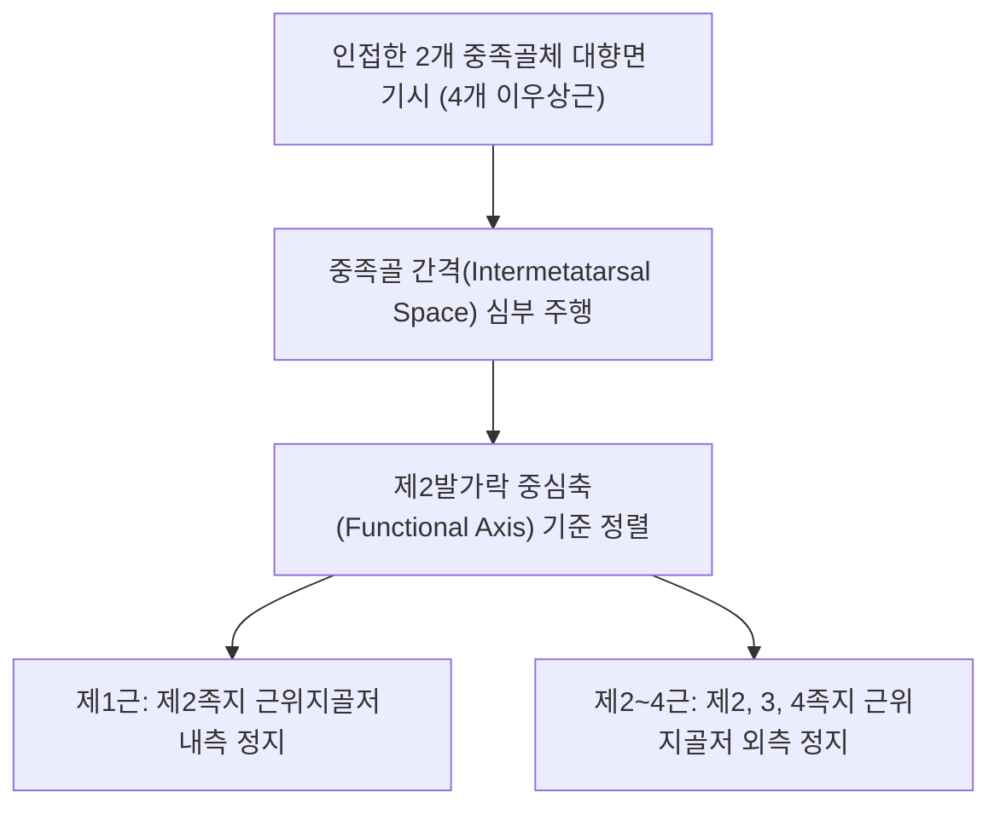

# [[배측골간근(발)]](Dorsal Interossei of Foot / 등쪽뼈사이근(발))

> **핵심 요약 (Key Summary)**:
> 5개 중족골체 사이 대향면에서 2개의 두(Bipennate)로 기시하여 2~4번째 발가락 근위지골저 및 배측건막에 정지하는 발등/발바닥 심부 4개의 이우상근.
> [[외측족저신경]](S2-S3, 상위의 [[경골신경]] 및 [[좌골신경]] 분지) 심분지 및 천분지의 지배를 받으며, **제2발가락을 기준축(Axis)으로 2~4지 발가락 외전(DAB)** 및 MTP 관절 굴곡을 보조.
> 주치 병증은 중족골통(Metatarsalgia), [[몰톤 증후군|지간신경종(Morton neuroma)]](Morton's neuroma), 발등 통증 및 보행 시 전족부 타는 듯한 작열통.

---

## 📌 목차
1. [해부학적 정밀 구조 및 지배 신경/혈관](#1-해부학적-정밀-구조-및-지배-신경혈관)
2. [생체역학·토크 분석 & 근막 사슬 (Biomechanical Synergy)](#2-생체역학토크-분석--근막-사슬-biomechanical-synergy)
3. [근막통증증후군(TP) & 연관통 패턴 (Travell & Simons)](#3-근막통증증후군tp--연관통-패턴-travell--simons)
4. [초음파 해부학(Sonoanatomy) 및 중재 시술 랜드마크](#4-초음파-해부학sonoanatomy-및-중재-시술-랜드마크)
5. [⭐ 원장님 심층 임상 고찰 및 원본 필기 (Clinical Pearls)](#5--원장님-심층-임상-고찰-및-원본-필기-clinical-pearls)
6. [관련 임상 질환 및 운동손상 증후군 총괄](#6-관련-임상-질환-및-운동손상-증후군-총괄)
7. [추나·도수치료(MET/PIR) & 침구·약침·재활 프로토콜](#7-추나도수치료metpir--침구약침재활-프로토콜)
8. [출처 및 학술 참고 문헌 (References)](#8-출처-및-학술-참고-문헌-references)

---

## 1. 해부학적 정밀 구조 및 지배 신경/혈관

### 1) 해부학 구조 상세

| 항목 | 상세 내용 |
| :--- | :--- |
| **기시 (Origin)** | 4개의 근육 모두 **인접한 2개 중족골체(Adjacent sides of metatarsals)** 대향면에서 2개의 두로 기시 |
| **정지 (Insertion)** | • **제1배측골간근**: 제2지 근위지골저 내측면 • **제2배측골간근**: 제2지 근위지골저 외측면 • **제3배측골간근**: 제3지 근위지골저 외측면 • **제4배측골간근**: 제4지 근위지골저 외측면 및 [[장지신근]] 배측건막 |
| **정렬 기준축 (Axis)** | 손(제3지 중심)과 달리, **발은 제2발가락(2nd toe)이 외전·내전의 중심 기준축**임 |
| **신경 지배** | [[외측족저신경]](Lateral plantar nerve, S2-S3) 심분지 (제4근은 천분지가 지배) |
| **혈관 공급** | 족배동맥의 배측중족동맥 및 족저동맥궁 분지 |

---

## 2. 생체역학·토크 분석 & 근막 사슬 (Biomechanical Synergy)

### 1) 기능 및 생체역학
* **발가락 외전 (Dorsal Abduction: DAB)**:
  * 제2발가락을 기준으로 2~4지 발가락을 부채꼴로 펼쳐 보행 중 전족부 지면 접촉 면적을 극대화하고 [[평발]] 및 [[후경골근건 기능부전증]]의 족궁 붕괴를 보조 방어.
* **MTP 관절 굴곡 보조 및 전족부 횡아치 결속**:
  * 중족골 사이를 가로지르는 수평 장력을 제공하여 체중 부하 시 중족골두들이 바깥으로 과도하게 벌어지는 것을 방지.
* **[[장측골간근(발)]]과의 길항-협동 밸런스**:
  * 배측골간근(외전)과 장측골간근(내전)이 전족부에서 정교한 횡적 장력 균형을 형성.

### 2) 근막 사슬 (Anatomy Trains)
* **표면전방선 및 나선선**: 발등 지간건막에서 [[단지신근]], [[장지신근]]을 거쳐 하지 전외측 구획의 [[장비골근]], [[단비골근]]으로 연결.

---

## 3. 근막통증증후군(TP) & 연관통 패턴 (Travell & Simons)

### 1) 발통점(Trigger Point) 위치 및 연관통
* **발통점 위치**: 제1~4 중족골 사이 공간(Intermetatarsal space)의 근복 중앙부.
* **연관통 양상**:
  * **발등 및 발가락 통증**: 중족골 사이가 멍든 것처럼 욱신거리며 발가락 끝쪽으로 뻗치는 통증 방사.
  * 발바닥 앞쪽 중족골두 하방으로도 뻐근하고 타는 듯한 통증 투사.
* **임상적 특징**: 발볼이 좁은 신발을 착용했을 때 중족골이 서로 맞부딪히며 증상 극대화.

---

## 4. 초음파 해부학(Sonoanatomy) 및 중재 시술 랜드마크

### 1) 초음파 스캔 뷰
* **발등 횡단 스캔**:
  * 인접한 두 중족골 피질골 음영 사이에 위치한 쐐기 모양의 배측골간근 근복 식별.
  * [[지간신경]](Interdigital nerve)의 비후 및 신경종 형성 유무 감별.

### 2) 침도 및 안전 자침 마진
* **태충(LR3), 함곡(ST43), 족임읍(GB41) 지간부위**: 발등 함요처에서 발바닥 방향으로 15~20mm 직자.

---

## 5. ⭐ 원장님 심층 임상 고찰 및 원본 필기 (Clinical Pearls)

### 1) 몰톤 지간신경종(Morton's Neuroma)과의 오진 및 감별 (원장님 핵심 팁 100% 보존)
* **신경종 vs 배측골간근 TrP 감별**:
  * 제3~4 중족골 사이 통증 환자가 내원했을 때 무조건 **[[몰톤 증후군|지간신경종(Morton neuroma)]](Morton's neuroma)**으로 단정하기 쉬우나, 실제로는 **제3배측골간근의 만성 TrP 연축**인 경우가 매우 흔함.
  * 발볼을 좌우로 압박할 때 클릭음(Mulder's sign)이 없고 중족골 사이 근복을 집었을 때 극심한 압통이 나타나며, [[종골]] 및 [[거골]]의 정렬 상태와 극심한 압통과 방사통이 재현된다면 골간근 침구 치료만으로 수술 없이 완치됨.

### 2) 손과 발의 결정적 기준축 차이
* 손은 제3수지(중지)가 내·외전의 기준축이지만, **발은 제2족지가 기준축**임.
* 제1배측골간근이 제2족지 내측에 붙어 제2지를 엄지 쪽으로 당기고, 제2배측골간근이 외측에 붙어 제2지를 바깥쪽으로 당김.

---

## 6. 관련 임상 질환 및 운동손상 증후군 총괄

| 임상 질환 / 증후군 | 병리적 연관 기전 | 주요 증상 및 이학적 검사 | 핵심 교정 타깃 |
| :--- | :--- | :--- | :--- |
| **[[몰톤 증후군|지간신경종(Morton neuroma)]] 오진 케이스** | 배측골간근 단축으로 지간신경 기계적 압박 자극 | 3-4 발가락 저림, 발바닥 화끈거림, 딛기 힘듦 | 배측골간근 침도 감압, 넓은 신발 |
| **중족골통(Metatarsalgia)** | 골간근 피로로 중족골두 하중 분산 실패 | 보행 시 발바닥 앞쪽 굳은살 및 찌르는 통증 | 골간근 강화, 중족골 패드 처방 |
| **발가락 외전 장애** | 배측골간근 약화로 발가락 부채꼴 벌림 불능 | 보행 시 접지력 저하, 발가락 쥐남 | 발가락 벌리기 운동, 전침 자극 |

* **물더 징후(Mulder's Click Sign)**: 제1중족골과 제5중족골을 손으로 쥐어짜며 중족간극을 압박할 때 '딸깍'하는 탄발음과 날카로운 통증이 있으면 지간신경종, 둔한 근육 압통만 있으면 골간근 TrP로 감별.

---

## 7. 추나·도수치료(MET/PIR) & 침구·약침·재활 프로토콜

### 1) 한의 침구 및 약침 요법
* **침구 치료**: 태충(LR3), 함곡(ST43), 족임읍(GB41), 내정(ST44), 팔풍(EX-LE10) 자침.
* **도침 요법**: 중족골 사이 심부 횡중족인대 및 골간근막 비후 부위 소침도 종축 절개 박리.
* **약침 치료**: 지간간극에 신바로약침 또는 중성어혈약침 0.3cc 주입.

### 2) 도수 치료 및 재활
* **발가락 벌리기(Toe Spreading) 운동**: 발가락을 부채꼴로 쫙 펴는 능동 외전 운동 (5초 유지 x 15회).
* **골프공 지간 롤링**: 중족골 사이를 마사지볼로 부드럽게 압박하여 근막 이완.

---

## 8. 출처 및 학술 참고 문헌 (References)

* Standring S. *Gray's Anatomy: The Anatomical Basis of Clinical Practice*. 42nd ed. Elsevier, 2020: 1368.
  * `[연구 요약]`: 배측골간근의 인접 중족골 기시, 제2지 기준축 외전 구조 및 외측족저신경 지배 분석.
* Jaklin N, et al. *Rethinking Morton's neuroma: a sonographic study of bilateral prevalence and symmetry*. Skeletal Radiol, 2024. [PMID: 42337790](https://pubmed.ncbi.nlm.nih.gov/42337790/)
  * `[연구 요약]`: 몰톤 신경종의 초음파 영상 연구 — 중족골 간격 압박과 배측골간근의 기계적 마찰 및 양측성 유병률 분석.
* Travell, J. G., & Simons, D. G. *Myofascial Pain and Dysfunction*. Williams & Wilkins, 1999.
  * `[연구 요약]`: 배측골간근 발통점과 발등 및 발가락 방사통 패턴.
